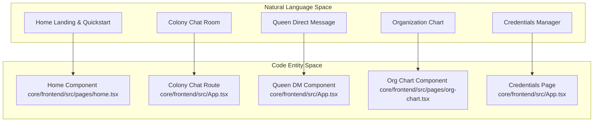
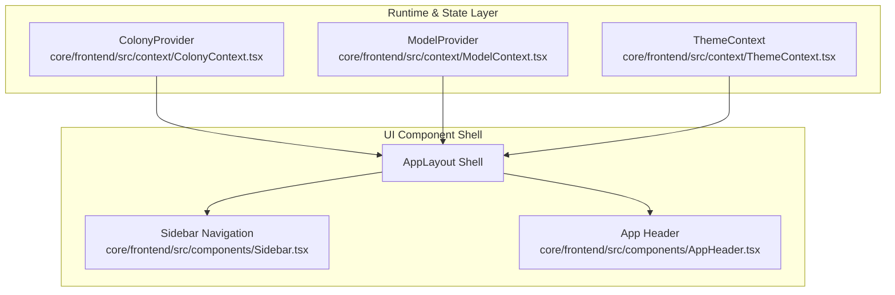

<!-- source: DeepWiki mcp.deepwiki.com · repo aden-hive/hive · page 4.3 Frontend Application Structure · fetched 2026-10-26 -->

# Frontend Application Structure

Relevant source files

The following files were used as context for generating this wiki page:

- [core/frontend/package-lock.json](core/frontend/package-lock.json)
- [core/frontend/package.json](core/frontend/package.json)
- [core/frontend/src/App.tsx](core/frontend/src/App.tsx)
- [core/frontend/src/components/AppHeader.tsx](core/frontend/src/components/AppHeader.tsx)
- [core/frontend/src/components/MessageAttachments.tsx](core/frontend/src/components/MessageAttachments.tsx)
- [core/frontend/src/components/ModelErrorCard.test.tsx](core/frontend/src/components/ModelErrorCard.test.tsx)
- [core/frontend/src/components/ModelErrorCard.tsx](core/frontend/src/components/ModelErrorCard.tsx)
- [core/frontend/src/components/NoModelNotice.test.tsx](core/frontend/src/components/NoModelNotice.test.tsx)
- [core/frontend/src/components/NoModelNotice.tsx](core/frontend/src/components/NoModelNotice.tsx)
- [core/frontend/src/components/QueenProfilePanel.tsx](core/frontend/src/components/QueenProfilePanel.tsx)
- [core/frontend/src/components/Sidebar.tsx](core/frontend/src/components/Sidebar.tsx)
- [core/frontend/src/components/SidebarColonyItem.tsx](core/frontend/src/components/SidebarColonyItem.tsx)
- [core/frontend/src/components/SidebarQueenItem.tsx](core/frontend/src/components/SidebarQueenItem.tsx)
- [core/frontend/src/components/SkillTextEditor.tsx](core/frontend/src/components/SkillTextEditor.tsx)
- [core/frontend/src/components/TaskListPanel.tsx](core/frontend/src/components/TaskListPanel.tsx)
- [core/frontend/src/components/charts/ChartToolDetail.tsx](core/frontend/src/components/charts/ChartToolDetail.tsx)
- [core/frontend/src/components/charts/EChartsBlock.tsx](core/frontend/src/components/charts/EChartsBlock.tsx)
- [core/frontend/src/components/charts/MermaidBlock.tsx](core/frontend/src/components/charts/MermaidBlock.tsx)
- [core/frontend/src/components/charts/openhiveTheme.ts](core/frontend/src/components/charts/openhiveTheme.ts)
- [core/frontend/src/context/ColonyContext.tsx](core/frontend/src/context/ColonyContext.tsx)
- [core/frontend/src/context/ConfigurationGate.tsx](core/frontend/src/context/ConfigurationGate.tsx)
- [core/frontend/src/context/ModelContext.tsx](core/frontend/src/context/ModelContext.tsx)
- [core/frontend/src/context/ThemeContext.tsx](core/frontend/src/context/ThemeContext.tsx)
- [core/frontend/src/index.css](core/frontend/src/index.css)
- [core/frontend/src/lib/colony-registry.ts](core/frontend/src/lib/colony-registry.ts)
- [core/frontend/src/pages/credentials.tsx](core/frontend/src/pages/credentials.tsx)
- [core/frontend/src/pages/home.tsx](core/frontend/src/pages/home.tsx)
- [core/frontend/src/pages/not-found.tsx](core/frontend/src/pages/not-found.tsx)
- [core/frontend/src/pages/org-chart.tsx](core/frontend/src/pages/org-chart.tsx)
- [core/frontend/src/types/colony.ts](core/frontend/src/types/colony.ts)

The frontend application is a modern single-page React and Vite application located in `core/frontend/` [core/frontend/package-lock.json:2-24](). It serves as the primary web dashboard for monitoring and interacting with Hive colonies, worker subagents, and queen profiles. The application relies on React Router v7 [core/frontend/package-lock.json:19-20]() for route management, Tailwind CSS for styling [core/frontend/package-lock.json:26-36](), and a collection of custom React contexts to manage global states such as colonies, models, themes, and user preferences.

This parent page provides a high-level overview of the frontend architecture, routing patterns, core providers, and API modules. For deeper technical details, see the child pages:
- [Settings, Models and Credentials UI](#4.3.1)
- [Colony, Worker and Library Views](#4.3.2)

---

## 1. Routing and Application Layout (`App.tsx`, `AppLayout`)

The entry point of the React app is defined in `core/frontend/src/App.tsx` [core/frontend/src/App.tsx:32-58](). It uses route-level code splitting with React's `lazy` mechanism to ensure that heavy views (such as libraries and visualization canvases) are loaded on-demand while the application shell (`AppLayout`) and landing page (`Home`) render immediately [core/frontend/src/App.tsx:1-19]().

Colony chats are keyed explicitly to their route parameters using `ColonyChatRoute` [core/frontend/src/App.tsx:27-30](), ensuring that navigating between colonies unmounts previous component instances and prevents state contamination.

### Routing to Code Entity Architecture

Sources: `core/frontend/src/App.tsx:1-60`, `core/frontend/src/pages/home.tsx:81-156`, `core/frontend/src/pages/org-chart.tsx:41-60`

---

## 2. Core React Contexts

Global state is orchestrated via specialized React Context providers that wrap the component tree. These contexts bridge the gap between REST endpoints, Server-Sent Events (SSE) telemetry, and UI components.

- **`ColonyProvider`**: Implemented in `core/frontend/src/context/ColonyContext.tsx` [core/frontend/src/context/ColonyContext.tsx:77-118](), managing list states for colonies, active queen bees, profile summaries, user profile details, and avatar cache-busting versions.
- **`ModelProvider`**: Implemented in `core/frontend/src/context/ModelContext.tsx` [core/frontend/src/context/ModelContext.tsx:70-109](), managing active provider selections, model options, API keys, and subscription status via configuration endpoints.
- **`ThemeContext`**: Handles dark/light mode toggles and spacing density states defined in `core/frontend/src/index.css` [core/frontend/src/index.css:43-69]().

### Context Dependency Architecture

Sources: `core/frontend/src/context/ColonyContext.tsx:77-118`, `core/frontend/src/context/ModelContext.tsx:70-109`, `core/frontend/src/index.css:43-69`

---

## 3. Page Architecture Overview

The frontend includes several distinct pages and panels tailored for agent orchestration:

1. **Home (`home.tsx`)**: The primary dashboard surface featuring quick prompt starters, placeholder completion pills, and live colony status summaries [core/frontend/src/pages/home.tsx:81-156]().
2. **Colony Chat & Queen DM**: Interactive chat interfaces with tool status pills, execution traces, and sliding profile drawers (`QueenProfilePanel`) [core/frontend/src/components/QueenProfilePanel.tsx:44-106]().
3. **Org Chart (`org-chart.tsx`)**: A canvas-based hierarchical visualizer mapping the CEO and Queen personas to active colonies with honeycomb node avatars and live status indicators [core/frontend/src/pages/org-chart.tsx:41-60]().

For detailed breakdowns of these views, see [Colony, Worker and Library Views](#4.3.2) and [Settings, Models and Credentials UI](#4.3.1).

Sources: `core/frontend/src/pages/home.tsx:81-156`, `core/frontend/src/pages/org-chart.tsx:41-60`, `core/frontend/src/components/QueenProfilePanel.tsx:44-106`

---

## 4. API Client Modules and Chart Components

Communication with the backend aiohttp server is structured into discrete modules under `core/frontend/src/api/`. These handle typed requests for agents, sessions, colonies, queen profiles, configuration settings, and prompt libraries.

Additionally, the UI integrates specialized rendering components:
- **`MermaidBlock`**: Renders diagrams dynamically within markdown streams.
- **`EChartsBlock` & `ChartToolDetail`**: Renders structured data visualizations generated by execution tools.

Sources: `core/frontend/package-lock.json:10-24`, `core/frontend/src/pages/home.tsx:145-155`

---

