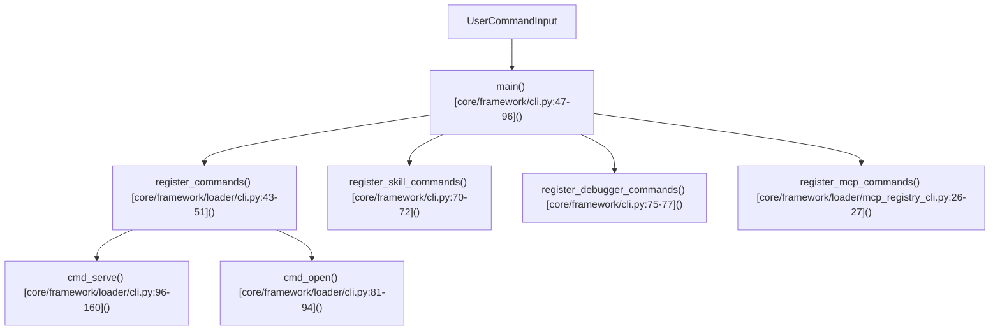
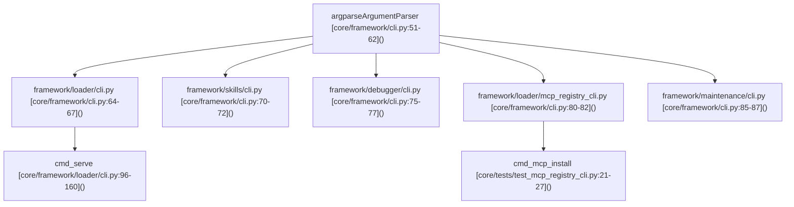

<!-- source: DeepWiki mcp.deepwiki.com · repo aden-hive/hive · page 5 CLI · fetched 2026-10-26 -->

# CLI

Relevant source files

The following files were used as context for generating this wiki page:

- [.github/workflows/ci.yml](.github/workflows/ci.yml)
- [.python-version](.python-version)
- [AGENTS.md](AGENTS.md)
- [CLAUDE.md](CLAUDE.md)
- [core/README.md](core/README.md)
- [core/framework/cli.py](core/framework/cli.py)
- [core/framework/loader/cli.py](core/framework/loader/cli.py)
- [core/framework/server/tests/test_session_shutdown.py](core/framework/server/tests/test_session_shutdown.py)
- [core/framework/testing/__init__.py](core/framework/testing/__init__.py)
- [core/frontend/vite.config.ts](core/frontend/vite.config.ts)
- [core/hatch_build.py](core/hatch_build.py)
- [core/tests/test_mcp_connection_manager.py](core/tests/test_mcp_connection_manager.py)
- [core/tests/test_mcp_registry_cli.py](core/tests/test_mcp_registry_cli.py)
- [core/tests/test_runner_cli_frontend.py](core/tests/test_runner_cli_frontend.py)
- [docs/releases/v1.0.2.md](docs/releases/v1.0.2.md)
- [docs/releases/v1.0.3.md](docs/releases/v1.0.3.md)
- [tools/README.md](tools/README.md)

## Purpose and Scope

This page provides a high-level overview of the Hive command-line interface (`hive`), covering entrypoints such as `serve`, `open`, `queen`, `colony`, `session`, `chat`, along with companion executables like `hive-cred` and `hive-browser`. 

Hive commands are registered and dispatched through an `argparse` routing framework defined in `core/framework/cli.py` and modularized across various subpackages.

For deep technical details on server execution, startup signals, and agent tool registry pipelines, refer to the child pages:
- Server and Colony Commands: see [Server and Colony Commands](#5.1)
- Agent Loading and Tool Registry: see [Agent Loading and Tool Registry](#5.2)

---

## Overview of Hive CLI Entrypoints

The main entrypoint for the CLI is defined in `core/framework/cli.py`, which configures runtime paths and delegates subcommands to specialized modules [core/framework/cli.py:28-96](). 

The primary command groups include:
- `serve` / `open`: Launches the `aiohttp` HTTP API server and optionally initializes the web dashboard interface [core/framework/loader/cli.py:58-94]().
- `queen`: Manages Queen agent personas, displays details, and lists associated sessions [core/framework/loader/cli.py:1-13]().
- `colony`: Inspects, lists, or deletes colony directories and persistent tracker state [core/framework/loader/cli.py:1-13]().
- `session` / `chat`: Controls live or cold agent execution sessions and dispatches direct messages to running Queen agents [core/framework/loader/cli.py:1-13]().
- Additional subsystem registries handle skills, debugging views, Model Context Protocol (MCP) servers, and data retention janitor tasks [core/framework/cli.py:69-88]().

Sources: [core/framework/cli.py:28-96](), [core/framework/loader/cli.py:43-51]()

---

## CLI Subsystem Routing Architecture

The CLI acts as a unified facade for managing system components. Below is the mapping between command namespaces and their corresponding code implementations across the workspace.

Sources: [core/framework/cli.py:47-96](), [core/tests/test_mcp_registry_cli.py:12-27]()

---

## 5.1 Server and Colony Commands

For details on `cmd_serve` startup routines, port advertisement via `HIVE_RUNTIME_PORT`, signal handling, graceful shutdown sequences, and state management commands for queens, colonies, sessions, and chat interactions, see [Server and Colony Commands](#5.1).

Sources: [core/framework/loader/cli.py:1-160]()

---

## 5.2 Agent Loading and Tool Registry

For details on agent loading subsystems (`agent_loader`, `agent_host`, `execution_manager`), the `ToolRegistry`, MCP client connection pooling, and pipeline stage execution (`mcp_registry`, `llm_provider`, `credential_resolver`, `skill_registry`), see [Agent Loading and Tool Registry](#5.2).

Sources: [core/framework/loader/cli.py:1-1042](), [core/tests/test_mcp_connection_manager.py:1-187]()

---

