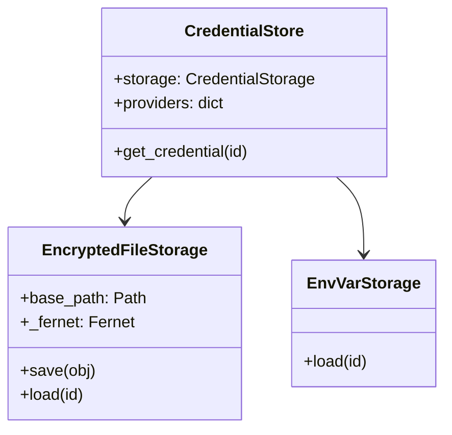
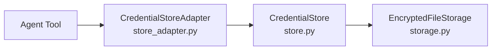

<!-- source: DeepWiki mcp.deepwiki.com · repo aden-hive/hive · page 6 Credential Management · fetched 2026-10-26 -->

# Credential Management

Relevant source files

The following files were used as context for generating this wiki page:

- [core/framework/credentials/__init__.py](core/framework/credentials/__init__.py)
- [core/framework/credentials/models.py](core/framework/credentials/models.py)
- [core/framework/credentials/oauth2/base_provider.py](core/framework/credentials/oauth2/base_provider.py)
- [core/framework/credentials/oauth2/lifecycle.py](core/framework/credentials/oauth2/lifecycle.py)
- [core/framework/credentials/oauth2/provider.py](core/framework/credentials/oauth2/provider.py)
- [core/framework/credentials/provider.py](core/framework/credentials/provider.py)
- [core/framework/credentials/setup.py](core/framework/credentials/setup.py)
- [core/framework/credentials/storage.py](core/framework/credentials/storage.py)
- [core/framework/credentials/store.py](core/framework/credentials/store.py)
- [core/framework/credentials/template.py](core/framework/credentials/template.py)
- [core/framework/credentials/tests/test_credential_store.py](core/framework/credentials/tests/test_credential_store.py)
- [core/framework/credentials/validation.py](core/framework/credentials/validation.py)
- [tools/src/aden_tools/credentials/store_adapter.py](tools/src/aden_tools/credentials/store_adapter.py)

Purpose and Scope: Overview of credential handling in Hive, covering secure key storage, Fernet encryption, environment-variable fallbacks, the tool-facing `CredentialStoreAdapter`, and integration with OAuth2 providers and the Aden platform synchronization layer.

This page serves as a high-level overview of credential management. For deep technical specifications and implementation details, refer to the child pages:
- [Credential Specs, Validation and Health Checks](#6.1)
- [OAuth2 and Aden Platform Sync](#6.2)

---

## Core Storage Architecture and Encryption

Hive manages sensitive API keys and authentication tokens through `CredentialStore` [core/framework/credentials/store.py:35-67]() and pluggable storage backends [core/framework/credentials/storage.py:28-94](). In production, credentials are encrypted at rest using Fernet symmetric encryption (AES-128-CBC + HMAC) implemented in `EncryptedFileStorage` [core/framework/credentials/storage.py:96-165](), keyed off the `HIVE_CREDENTIAL_KEY` environment variable.

When `HIVE_CREDENTIAL_KEY` is not set or when running in constrained environments, the system falls back to environment variables via `EnvVarStorage`, ensuring robust backward compatibility.

Sources: [core/framework/credentials/store.py:35-95](), [core/framework/credentials/storage.py:28-165]()

---

## Tool Integration via `CredentialStoreAdapter`

Tools and MCP servers do not interact with `CredentialStore` directly. Instead, they receive a `CredentialStoreAdapter` instance from `aden_tools` [tools/src/aden_tools/credentials/store_adapter.py:120-137](). The adapter bridges logical credential names (defined in `CREDENTIAL_SPECS`) to underlying storage records, enabling template interpolation (`{{cred.key}}`) and named account routing.

For detailed documentation on tool credential requirements, see [Credential Specs, Validation and Health Checks](#6.1).

Sources: [tools/src/aden_tools/credentials/store_adapter.py:120-158]()

---

## Child Pages

For comprehensive technical specifications and subsystem deep dives, explore the child pages:

- **[Credential Specs, Validation and Health Checks](#6.1)**: Detailed coverage of `CREDENTIAL_SPECS`, two-phase validation (`validate_for_tools`, `validate_startup`), `CredentialError`, and live HTTP health-checking mechanisms.
- **[OAuth2 and Aden Platform Sync](#6.2)**: Deep dive into OAuth2 provider lifecycle management, browser auth helpers, `AdenCredentialClient`, `AdenSyncProvider`, and cached offline fallback storage.

Sources: [core/framework/credentials/__init__.py:1-41](), [core/framework/credentials/validation.py:1-177]()

---

