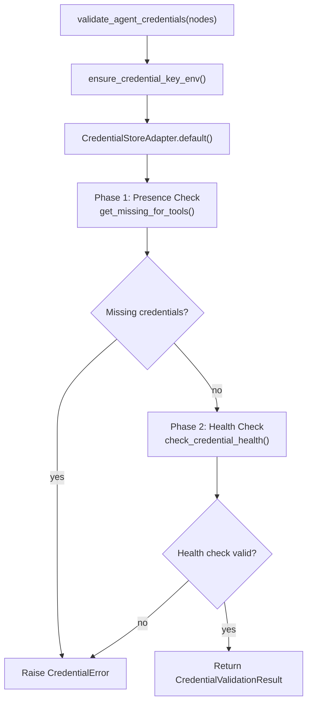
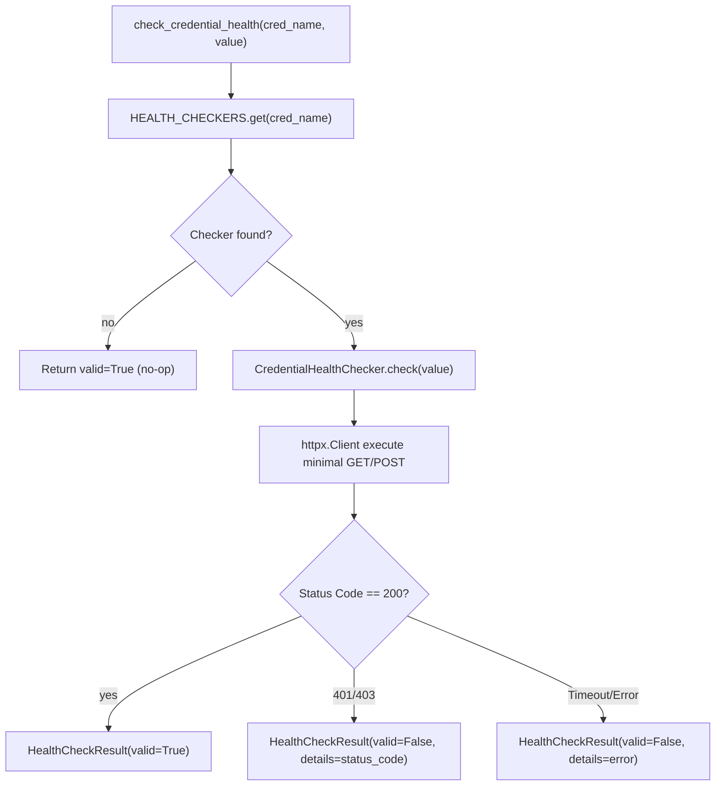

<!-- source: DeepWiki mcp.deepwiki.com · repo aden-hive/hive · page 6.1 Credential Specs, Validation and Health Checks · fetched 2026-10-26 -->

# Credential Specs, Validation and Health Checks

Relevant source files

The following files were used as context for generating this wiki page:

- [core/framework/credentials/__init__.py](core/framework/credentials/__init__.py)
- [core/framework/credentials/models.py](core/framework/credentials/models.py)
- [core/framework/credentials/oauth2/provider.py](core/framework/credentials/oauth2/provider.py)
- [core/framework/credentials/setup.py](core/framework/credentials/setup.py)
- [core/framework/credentials/store.py](core/framework/credentials/store.py)
- [core/framework/credentials/validation.py](core/framework/credentials/validation.py)
- [core/tests/test_janitor_worker_deepclean.py](core/tests/test_janitor_worker_deepclean.py)
- [core/tests/test_run_worker_tool.py](core/tests/test_run_worker_tool.py)
- [core/tests/test_worker_definition.py](core/tests/test_worker_definition.py)
- [tools/src/aden_tools/credentials/__init__.py](tools/src/aden_tools/credentials/__init__.py)
- [tools/src/aden_tools/credentials/health_check.py](tools/src/aden_tools/credentials/health_check.py)
- [tools/src/aden_tools/credentials/store_adapter.py](tools/src/aden_tools/credentials/store_adapter.py)
- [tools/src/aden_tools/tools/__init__.py](tools/src/aden_tools/tools/__init__.py)
- [tools/src/terminal_tools/common/limits.py](tools/src/terminal_tools/common/limits.py)
- [tools/tests/integrations/__init__.py](tools/tests/integrations/__init__.py)
- [tools/tests/integrations/conftest.py](tools/tests/integrations/conftest.py)
- [tools/tests/integrations/test_input_validation.py](tools/tests/integrations/test_input_validation.py)
- [tools/tests/integrations/test_registration.py](tools/tests/integrations/test_registration.py)
- [tools/tests/integrations/test_spec_conformance.py](tools/tests/integrations/test_spec_conformance.py)
- [tools/tests/test_command_guard.py](tools/tests/test_command_guard.py)
- [tools/tests/test_credential_registry.py](tools/tests/test_credential_registry.py)
- [tools/tests/test_credentials.py](tools/tests/test_credentials.py)
- [tools/tests/test_health_checks.py](tools/tests/test_health_checks.py)
- [tools/tests/test_live_health_checks.py](tools/tests/test_live_health_checks.py)
- [tools/tests/tools/test_google_sheets_tool.py](tools/tests/tools/test_google_sheets_tool.py)

This page documents the credential specification architecture, validation routines (`validate_for_tools`, startup checks, and node-type filtering), `CredentialError`, per-integration credential modules, and the HTTP health-check framework used across the Hive framework and `aden-tools`.

---

## 1. Credential Specs and Per-Integration Modules

Credential specifications are organized modularly under `tools/src/aden_tools/credentials/`, where each integration file defines its own `CredentialSpec` instances. These are merged into a unified registry dictionary, `CREDENTIAL_SPECS`, in `tools/src/aden_tools/credentials/__init__.py`.

A `CredentialSpec` defines metadata, environment variables, associated tools, node types, help URLs, and optional health-check endpoints.

Sources: [tools/src/aden_tools/credentials/__init__.py:1-181](), [tools/src/aden_tools/credentials/base.py:1-67]()

### Credential Specification Structure

| Field | Type | Role |
|---|---|---|
| `env_var` | `str` | Primary environment variable name (e.g. `BRAVE_SEARCH_API_KEY`) |
| `tools` | `list[str]` | MCP tool names that require this credential |
| `node_types` | `list[str]` | Core node types requiring this credential |
| `help_url` | `str` | Documentation link for obtaining the credential |
| `description` | `str` | Human-readable explanation of the integration |
| `credential_id` | `str` | Unique logical identifier in the credential store |
| `credential_key` | `str` | Key name inside the credential vault object (e.g. `api_key`, `access_token`) |
| `health_check_endpoint` | `str \| None` | Optional API URL for lightweight verification checks |

Sources: [tools/src/aden_tools/credentials/__init__.py:151-181]()

---

## 2. Validation Subsystem: `validate_for_tools`, Node Types, and Startup

The validation engine ensures that agents fail fast before execution if required credentials are absent or invalid. Validation is handled by `CredentialStoreAdapter.validate_for_tools()` for tool lists and `validate_agent_credentials()` for node specs.

Sources: [tools/src/aden_tools/credentials/store_adapter.py:1-182](), [core/framework/credentials/validation.py:1-177]()

### Validation Flow and Architecture

Sources: [core/framework/credentials/validation.py:16-177](), [tools/src/aden_tools/credentials/store_adapter.py:120-182]()

### Key Validation Functions and Classes

* `ensure_credential_key_env()`: Loads bootstrap credentials into `os.environ` following a strict priority chain (`os.environ`, dedicated file storage under `~/.hive/secrets/`, and shell config fallbacks like `~/.zshrc`). `HIVE_CREDENTIAL_KEY` is loaded before `ADEN_API_KEY`.
* `CredentialStoreAdapter.validate_for_tools(tools)`: Inspects a list of tool names, queries reverse mappings (`_tool_to_cred`), and raises `CredentialError` if any required credentials are missing.
* `CredentialError`: Custom exception raised when validation fails, exposing `.failed_cred_names` for setup session builders.

Sources: [core/framework/credentials/validation.py:16-67](), [tools/src/aden_tools/credentials/store_adapter.py:120-182]()

---

## 3. HTTP Health-Check Framework

The health-check framework executes lightweight, non-destructive API queries against integration endpoints to verify that stored credentials are active and have sufficient permissions.

Sources: [tools/src/aden_tools/credentials/health_check.py:1-190](), [tools/tests/test_health_checks.py:1-186]()

### Health Check Architecture

Sources: [tools/src/aden_tools/credentials/health_check.py:18-190]()

### Protocols and Return Types

* `CredentialHealthChecker`: Python `Protocol` defining the single method `check(self, credential_value: str) -> HealthCheckResult`.
* `HealthCheckResult`: Dataclass containing `valid: bool`, `message: str`, and `details: dict[str, Any]`.
* `HEALTH_CHECKERS`: Global dictionary mapping credential identifiers to their concrete checker implementations (e.g., `GitHubHealthChecker`, `HubSpotHealthChecker`, `ResendHealthChecker`, `BraveSearchHealthChecker`).

Sources: [tools/src/aden_tools/credentials/health_check.py:18-47](), [tools/tests/test_health_checks.py:20-105]()

---

## 4. Spec Conformance and Registry Testing

To prevent misconfigurations, CI test suites enforce strict consistency between `CREDENTIAL_SPECS`, registered FastMCP tools, and health check implementations.

Sources: [tools/tests/integrations/test_spec_conformance.py:1-167](), [tools/tests/test_credential_registry.py:1-104]()

### Conformance Validation Rules

* Every tool module must export `register_tools` from its `__init__.py`.
* Tools requiring credentials must accept a `credentials` parameter defaulting to `None`.
* Every `CredentialSpec` with a `health_check_endpoint` must have a corresponding entry in `HEALTH_CHECKERS` (unless explicitly listed in `KNOWN_EXCEPTIONS`).
* No duplicate environment variables can exist across unrelated credential specs.

Sources: [tools/tests/integrations/test_spec_conformance.py:48-157](), [tools/tests/test_credential_registry.py:20-104]()

---

