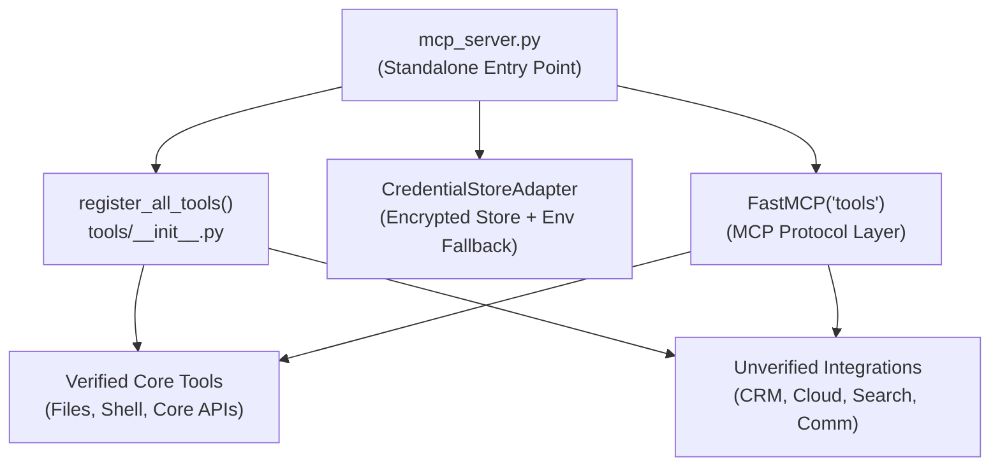

<!-- source: DeepWiki mcp.deepwiki.com · repo aden-hive/hive · page 7 Tools Ecosystem · fetched 2026-10-26 -->

# Tools Ecosystem

Relevant source files

The following files were used as context for generating this wiki page:

- [tools/BUILDING_TOOLS.md](tools/BUILDING_TOOLS.md)
- [tools/mcp_server.py](tools/mcp_server.py)
- [tools/src/aden_tools/__init__.py](tools/src/aden_tools/__init__.py)
- [tools/src/aden_tools/credentials/__init__.py](tools/src/aden_tools/credentials/__init__.py)
- [tools/src/aden_tools/credentials/health_check.py](tools/src/aden_tools/credentials/health_check.py)
- [tools/src/aden_tools/credentials/hubspot.py](tools/src/aden_tools/credentials/hubspot.py)
- [tools/src/aden_tools/tools/__init__.py](tools/src/aden_tools/tools/__init__.py)
- [tools/src/aden_tools/tools/hubspot_tool/hubspot_tool.py](tools/src/aden_tools/tools/hubspot_tool/hubspot_tool.py)
- [tools/src/aden_tools/tools/hubspot_tool/tests/test_hubspot_tool.py](tools/src/aden_tools/tools/hubspot_tool/tests/test_hubspot_tool.py)
- [tools/src/aden_tools/tools/web_search_tool/web_search_tool.py](tools/src/aden_tools/tools/web_search_tool/web_search_tool.py)
- [tools/tests/conftest.py](tools/tests/conftest.py)
- [tools/tests/test_credentials.py](tools/tests/test_credentials.py)
- [tools/tests/test_env_helpers.py](tools/tests/test_env_helpers.py)
- [tools/tests/test_health_checks.py](tools/tests/test_health_checks.py)
- [tools/tests/test_live_health_checks.py](tools/tests/test_live_health_checks.py)
- [tools/tests/tools/test_google_sheets_tool.py](tools/tests/tools/test_google_sheets_tool.py)
- [tools/tests/tools/test_web_search_tool.py](tools/tests/tools/test_web_search_tool.py)

The **Tools Ecosystem** centers around the `aden-tools` package (`tools/src/aden_tools/`), which provides external capabilities, data processors, integrations, and browser automation primitives for AI agents in Hive via the Model Context Protocol (MCP) [tools/src/aden_tools/__init__.py:1-15](). 

This page provides a high-level parent overview of the package architecture, tool registration passes, verification gates, directory conventions, and links out to detailed child pages for specific tool families.

---

## Overview of `aden-tools` and FastMCP

`aden-tools` exposes its capabilities as standardized tool servers built on top of `fastmcp` [tools/src/aden_tools/__init__.py:1-15](). The standalone MCP server entry point (`tools/mcp_server.py`) initializes a composite credential store, validates startup requirements, registers all available tools, and runs either over HTTP (for Docker and remote runtime environments) or over STDIO (for local IDE integrations like Claude Code) [tools/mcp_server.py:1-126]().

**Tools Ecosystem Architecture**

Sources: [tools/mcp_server.py:1-126](), [tools/src/aden_tools/__init__.py:1-37]()

---

## Tool Registration, Verified vs Unverified Passes, and Manifest Sentinel

Tool registration is managed by `register_all_tools()` located in `tools/src/aden_tools/tools/__init__.py` [tools/src/aden_tools/__init__.py:1-15](). Tools are divided into two distinct passes:

1. **Verified Pass (Stable, Main):** Core integrations, file operations, shell utilities, and credential-less tools (such as server-proxied image generation and email sender pools) that are vetted and shipped on main.
2. **Unverified Pass (Community & New Integrations):** Third-party integrations and newer tool modules that require explicit opt-in via the `INCLUDE_UNVERIFIED_TOOLS` environment variable (`true`, `1`, or `yes`) or the `include_unverified=True` parameter [tools/mcp_server.py:84-85]().

### Verified Manifest Sentinel
Certain credential-less tools (such as proxy-billed image generation or pooled cloud senders) rely on the runtime's server proxies rather than a per-tool credential store [tools/src/aden_tools/tools/__init__.py:78-82](). To prevent security bypasses, the queen MCP admission gate enforces that these credential-less tools must be present in the verified manifest sentinel; otherwise, they are automatically dropped at agent load time [tools/src/aden_tools/tools/__init__.py:78-82]().

Sources: [tools/src/aden_tools/tools/__init__.py:1-129](), [tools/mcp_server.py:84-89]()

---

## Tool Directory Conventions and `BUILDING_TOOLS` Guidance

Each tool integration resides in its own dedicated subdirectory under `tools/src/aden_tools/tools/<tool_name>/` [tools/src/aden_tools/tools/__init__.py:1-129](). Conforming to standard conventions:

- Each tool module exports a `register_tools(mcp: FastMCP, credentials: CredentialStoreAdapter | None = None) -> None` function [tools/src/aden_tools/credentials/__init__.py:51-53]().
- Tools requiring secrets declare corresponding `CredentialSpec` definitions in `tools/src/aden_tools/credentials/` which are merged into `CREDENTIAL_SPECS` [tools/src/aden_tools/credentials/__init__.py:35-58]().
- Tools that operate entirely without credentials omit the `credentials` parameter entirely, a convention strictly enforced by test suites [tools/src/aden_tools/credentials/__init__.py:51-53]().

Detailed instructions on authoring new tools, setting up credential specs, wiring health checkers, and writing conformance tests are documented in `tools/BUILDING_TOOLS.md`.

Sources: [tools/src/aden_tools/tools/__init__.py:1-35](), [tools/src/aden_tools/credentials/__init__.py:35-58]()

---

## Tool Families and Child Pages

The `aden-tools` ecosystem spans numerous specialized functional domains. For detailed documentation on each tool family, refer to the following child pages:

- **[Browser Automation (GCU)](#7.1)** — Document the GCU browser subsystem: BeelineBridge WebSocket/CDP bridge, the Chrome extension, contexts and tabs, viewport-fraction interactions, snapshots/screenshots, shadow-piercing queries, and the `hive-browser` CLI.
- **[Terminal, File and Data Tools](#7.2)** — Document `terminal_tools` (exec, jobs, search, security guards, truncation limits), `file_ops` and the file system sandbox, CSV/Excel/PDF tools, and `chart_tools` rendering.
- **[Communication and Productivity Integrations](#7.3)** — Document email/Gmail, Slack, Telegram, Discord, Pushover, Brevo, calendar/Calendly, Google Docs/Sheets, Notion and Trello/Asana/Linear/Jira tools and their credentials.
- **[Search, Research and Web Tools](#7.4)** — Document `web_search`, `exa_search`, `web_scrape`, Wikipedia, news, Apify, image generation and PDF reading tools, including provider auto-detection and proxy billing.
- **[Business, CRM and Infrastructure Integrations](#7.5)** — Document CRM/sales tools (HubSpot, Salesforce, Attio, Apollo, Lusha, Pipedrive), finance (Stripe, QuickBooks, Plaid), infra/dev (GitHub, Cloudflare, Docker Hub, AWS S3, Postgres/MongoDB/Azure SQL/Snowflake, PagerDuty), and security scanners.
- **[Writing a New Tool](#7.6)** — Step-by-step guide to adding a tool: directory layout, `register_*` function, credential spec + health checker wiring, README, tests, spec conformance and registration test suites, and verified/unverified gating.

Sources: [tools/src/aden_tools/tools/__init__.py:1-129](), [tools/src/aden_tools/credentials/__init__.py:35-58]()

---

