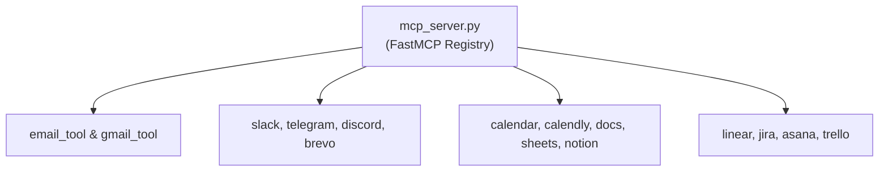
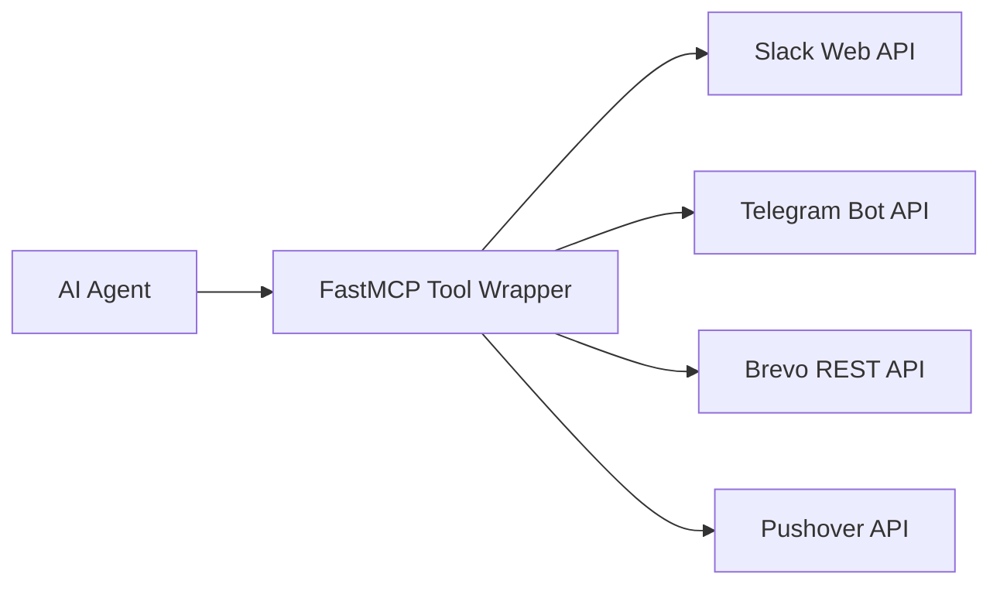
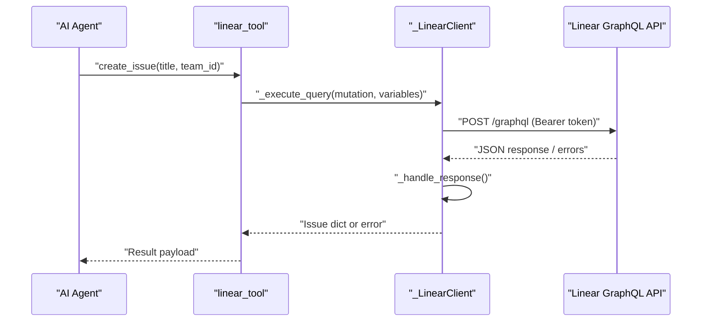

<!-- source: DeepWiki mcp.deepwiki.com · repo aden-hive/hive · page 7.3 Communication and Productivity Integrations · fetched 2026-10-26 -->

# Communication and Productivity Integrations

<details>
<summary>Relevant source files</summary>

The following files were used as context for generating this wiki page:

- [tools/src/aden_tools/credentials/asana.py](tools/src/aden_tools/credentials/asana.py)
- [tools/src/aden_tools/credentials/calendly.py](tools/src/aden_tools/credentials/calendly.py)
- [tools/src/aden_tools/credentials/email.py](tools/src/aden_tools/credentials/email.py)
- [tools/src/aden_tools/credentials/integrations.py](tools/src/aden_tools/credentials/integrations.py)
- [tools/src/aden_tools/credentials/linear.py](tools/src/aden_tools/credentials/linear.py)
- [tools/src/aden_tools/credentials/telegram.py](tools/src/aden_tools/credentials/telegram.py)
- [tools/src/aden_tools/credentials/trello.py](tools/src/aden_tools/credentials/trello.py)
- [tools/src/aden_tools/tools/asana_tool/README.md](tools/src/aden_tools/tools/asana_tool/README.md)
- [tools/src/aden_tools/tools/asana_tool/__init__.py](tools/src/aden_tools/tools/asana_tool/__init__.py)
- [tools/src/aden_tools/tools/asana_tool/asana_tool.py](tools/src/aden_tools/tools/asana_tool/asana_tool.py)
- [tools/src/aden_tools/tools/aws_s3_tool/__init__.py](tools/src/aden_tools/tools/aws_s3_tool/__init__.py)
- [tools/src/aden_tools/tools/aws_s3_tool/aws_s3_tool.py](tools/src/aden_tools/tools/aws_s3_tool/aws_s3_tool.py)
- [tools/src/aden_tools/tools/calendar_tool/README.md](tools/src/aden_tools/tools/calendar_tool/README.md)
- [tools/src/aden_tools/tools/calendar_tool/__init__.py](tools/src/aden_tools/tools/calendar_tool/__init__.py)
- [tools/src/aden_tools/tools/calendar_tool/calendar_tool.py](tools/src/aden_tools/tools/calendar_tool/calendar_tool.py)
- [tools/src/aden_tools/tools/calendly_tool/README.md](tools/src/aden_tools/tools/calendly_tool/README.md)
- [tools/src/aden_tools/tools/calendly_tool/__init__.py](tools/src/aden_tools/tools/calendly_tool/__init__.py)
- [tools/src/aden_tools/tools/calendly_tool/calendly_tool.py](tools/src/aden_tools/tools/calendly_tool/calendly_tool.py)
- [tools/src/aden_tools/tools/docker_hub_tool/__init__.py](tools/src/aden_tools/tools/docker_hub_tool/__init__.py)
- [tools/src/aden_tools/tools/docker_hub_tool/docker_hub_tool.py](tools/src/aden_tools/tools/docker_hub_tool/docker_hub_tool.py)
- [tools/src/aden_tools/tools/email_tool/README.md](tools/src/aden_tools/tools/email_tool/README.md)
- [tools/src/aden_tools/tools/email_tool/__init__.py](tools/src/aden_tools/tools/email_tool/__init__.py)
- [tools/src/aden_tools/tools/email_tool/email_tool.py](tools/src/aden_tools/tools/email_tool/email_tool.py)
- [tools/src/aden_tools/tools/exa_search_tool/README.md](tools/src/aden_tools/tools/exa_search_tool/README.md)
- [tools/src/aden_tools/tools/exa_search_tool/__init__.py](tools/src/aden_tools/tools/exa_search_tool/__init__.py)
- [tools/src/aden_tools/tools/exa_search_tool/exa_search_tool.py](tools/src/aden_tools/tools/exa_search_tool/exa_search_tool.py)
- [tools/src/aden_tools/tools/gmail_tool/gmail_tool.py](tools/src/aden_tools/tools/gmail_tool/gmail_tool.py)
- [tools/src/aden_tools/tools/google_docs_tool/README.md](tools/src/aden_tools/tools/google_docs_tool/README.md)
- [tools/src/aden_tools/tools/google_docs_tool/__init__.py](tools/src/aden_tools/tools/google_docs_tool/__init__.py)
- [tools/src/aden_tools/tools/google_docs_tool/google_docs_tool.py](tools/src/aden_tools/tools/google_docs_tool/google_docs_tool.py)
- [tools/src/aden_tools/tools/google_docs_tool/tests/__init__.py](tools/src/aden_tools/tools/google_docs_tool/tests/__init__.py)
- [tools/src/aden_tools/tools/google_docs_tool/tests/test_google_docs_tool.py](tools/src/aden_tools/tools/google_docs_tool/tests/test_google_docs_tool.py)
- [tools/src/aden_tools/tools/google_sheets_tool/README.md](tools/src/aden_tools/tools/google_sheets_tool/README.md)
- [tools/src/aden_tools/tools/google_sheets_tool/__init__.py](tools/src/aden_tools/tools/google_sheets_tool/__init__.py)
- [tools/src/aden_tools/tools/google_sheets_tool/google_sheets_tool.py](tools/src/aden_tools/tools/google_sheets_tool/google_sheets_tool.py)
- [tools/src/aden_tools/tools/google_sheets_tool/tests/__init__.py](tools/src/aden_tools/tools/google_sheets_tool/tests/__init__.py)
- [tools/src/aden_tools/tools/google_sheets_tool/tests/test_google_sheets_integration.py](tools/src/aden_tools/tools/google_sheets_tool/tests/test_google_sheets_integration.py)
- [tools/src/aden_tools/tools/google_sheets_tool/tests/test_google_sheets_tool.py](tools/src/aden_tools/tools/google_sheets_tool/tests/test_google_sheets_tool.py)
- [tools/src/aden_tools/tools/jira_tool/__init__.py](tools/src/aden_tools/tools/jira_tool/__init__.py)
- [tools/src/aden_tools/tools/jira_tool/jira_tool.py](tools/src/aden_tools/tools/jira_tool/jira_tool.py)
- [tools/src/aden_tools/tools/linear_tool/__init__.py](tools/src/aden_tools/tools/linear_tool/__init__.py)
- [tools/src/aden_tools/tools/linear_tool/linear_tool.py](tools/src/aden_tools/tools/linear_tool/linear_tool.py)
- [tools/src/aden_tools/tools/notion_tool/__init__.py](tools/src/aden_tools/tools/notion_tool/__init__.py)
- [tools/src/aden_tools/tools/notion_tool/notion_tool.py](tools/src/aden_tools/tools/notion_tool/notion_tool.py)
- [tools/src/aden_tools/tools/slack_tool/README.md](tools/src/aden_tools/tools/slack_tool/README.md)
- [tools/src/aden_tools/tools/slack_tool/__init__.py](tools/src/aden_tools/tools/slack_tool/__init__.py)
- [tools/src/aden_tools/tools/slack_tool/slack_tool.py](tools/src/aden_tools/tools/slack_tool/slack_tool.py)
- [tools/src/aden_tools/tools/telegram_tool/README.md](tools/src/aden_tools/tools/telegram_tool/README.md)
- [tools/src/aden_tools/tools/telegram_tool/__init__.py](tools/src/aden_tools/tools/telegram_tool/__init__.py)
- [tools/src/aden_tools/tools/telegram_tool/telegram_tool.py](tools/src/aden_tools/tools/telegram_tool/telegram_tool.py)
- [tools/src/aden_tools/tools/trello_tool/README.md](tools/src/aden_tools/tools/trello_tool/README.md)
- [tools/src/aden_tools/tools/trello_tool/__init__.py](tools/src/aden_tools/tools/trello_tool/__init__.py)
- [tools/src/aden_tools/tools/trello_tool/trello_client.py](tools/src/aden_tools/tools/trello_tool/trello_client.py)
- [tools/src/aden_tools/tools/trello_tool/trello_tool.py](tools/src/aden_tools/tools/trello_tool/trello_tool.py)
- [tools/tests/tools/test_asana_tool.py](tools/tests/tools/test_asana_tool.py)
- [tools/tests/tools/test_calendar_tool.py](tools/tests/tools/test_calendar_tool.py)
- [tools/tests/tools/test_calendly_tool.py](tools/tests/tools/test_calendly_tool.py)
- [tools/tests/tools/test_email_tool.py](tools/tests/tools/test_email_tool.py)
- [tools/tests/tools/test_exa_search_tool.py](tools/tests/tools/test_exa_search_tool.py)
- [tools/tests/tools/test_gmail_tool.py](tools/tests/tools/test_gmail_tool.py)
- [tools/tests/tools/test_google_docs_tool.py](tools/tests/tools/test_google_docs_tool.py)
- [tools/tests/tools/test_hubspot_tool.py](tools/tests/tools/test_hubspot_tool.py)
- [tools/tests/tools/test_intercom_tool.py](tools/tests/tools/test_intercom_tool.py)
- [tools/tests/tools/test_slack_tool.py](tools/tests/tools/test_slack_tool.py)
- [tools/tests/tools/test_telegram_tool.py](tools/tests/tools/test_telegram_tool.py)
- [tools/tests/tools/test_trello_tool.py](tools/tests/tools/test_trello_tool.py)
- [tools/tests/tools/test_trello_tool_integration.py](tools/tests/tools/test_trello_tool_integration.py)

</details>


This page documents the communication, messaging, document management, calendar, and productivity integration tools within the `aden_tools` package. These tools enable AI agents to send and receive messages across platforms (Slack, Telegram, Discord, Pushover, Brevo), manage calendars and scheduling (Google Calendar, Calendly), manipulate documents and spreadsheets (Google Docs, Google Sheets, Notion), and track issues and projects across tracking platforms (Trello, Asana, Linear, Jira).

---

## 1. Overview and Scope

The Aden tools ecosystem provides a set of FastMCP-compliant tool modules designed to bridge AI agents with external communication channels and productivity suites. 

| Tool Family | Primary Modules | Key Services / APIs | Authentication / Credentials |
|---|---|---|---|
| **Email & Gmail** | `email_tool`, `gmail_tool` | Gmail API v1, Resend API | `GOOGLE_ACCESS_TOKEN`, `RESEND_API_KEY` |
| **Messaging** | `slack_tool`, `telegram_tool`, etc. | Slack Web API, Telegram Bot API, Discord, Pushover, Brevo | Bot tokens, Webhooks, API keys |
| **Calendar & Scheduling** | `calendar_tool`, `calendly_tool` | Google Calendar API v3, Calendly API v2 | `GOOGLE_ACCESS_TOKEN`, `CALENDLY_PAT` |
| **Docs & Sheets** | `google_docs_tool`, `google_sheets_tool`, `notion_tool` | Google Docs API v1, Sheets API v4, Notion API | `GOOGLE_ACCESS_TOKEN`, `NOTION_API_KEY` |
| **Project Management** | `linear_tool`, `jira_tool`, `asana_tool`, `trello_tool` | Linear GraphQL, Jira REST, Asana REST, Trello REST | API keys, OAuth tokens |

**Tool Ecosystem Registration Architecture:**



Sources: `[tools/src/aden_tools/tools/email_tool/email_tool.py:22-26]`, `[tools/src/aden_tools/tools/gmail_tool/gmail_tool.py:49-53]`

---

## 2. Email and Gmail Tools

The email subsystem is split into outbound delivery (`email_tool`) and rich inbox management (`gmail_tool`).

### Implementation Details
- **Outbound Mail (`email_tool`)**: Supports both Resend API (`RESEND_API_KEY`) and Google Gmail API (`GOOGLE_ACCESS_TOKEN`) `[tools/src/aden_tools/tools/email_tool/email_tool.py:28-119]`. It handles address normalization `_normalize_recipients` and testing overrides (`EMAIL_OVERRIDE_TO`) `[tools/src/aden_tools/tools/email_tool/email_tool.py:142-186]`.
- **Inbox Management (`gmail_tool`)**: Implements thread searching, message retrieval (`gmail_get_message`), labeling, drafting, and batch modifications via `https://gmail.googleapis.com/gmail/v1/users/me` `[tools/src/aden_tools/tools/gmail_tool/gmail_tool.py:27-111]`. Path parameter sanitization is enforced via `_sanitize_path_param` to prevent traversal attacks `[tools/src/aden_tools/tools/gmail_tool/gmail_tool.py:30-34]`.

**Email Sending Flow:**

```mermaid
flowchart TD
    call["send_email tool call"]
    validate["_send_email_impl validation"]
    override{"EMAIL_OVERRIDE_TO\nset?"}
    redirect["Redirect recipient to test address"]
    provider{"Provider selection"}
    resend["_send_via_resend"]
    gmail["_send_via_gmail"]

    call --> validate
    validate --> override
    override -- "Yes" --> redirect --> provider
    override -- "No" --> provider
    provider -- "resend" --> resend
    provider -- "gmail" --> gmail
```

Sources: `[tools/src/aden_tools/tools/email_tool/email_tool.py:153-213]`, `[tools/src/aden_tools/credentials/email.py:9-100]`

---

## 3. Messaging Integrations (Slack, Telegram, Discord, Pushover, Brevo)

Messaging integrations allow agents to broadcast alerts, manage channels, and interact in real time.

### Slack Tool (`slack_tool.py`)
- **Client**: Wraps the Slack Web API (`https://slack.com/api`) via `_SlackClient` `[tools/src/aden_tools/tools/slack_tool/slack_tool.py:25-72]`.
- **Features**: Post messages (`chat.postMessage`), manage threaded discussions (`thread_ts`), fetch channel history (`conversations.history`), add reactions (`reactions.add`), and look up user info `[tools/src/aden_tools/tools/slack_tool/slack_tool.py:73-184]`.
- **Authentication**: Bot tokens (`SLACK_BOT_TOKEN`) or OAuth2 access tokens via the credential store.

### Telegram, Discord, Pushover & Brevo
- **Telegram Tool**: Interacts with the Telegram Bot API for sending notifications and managing chats.
- **Pushover Tool**: Provides lightweight push notifications to mobile/desktop devices.
- **Brevo Tool**: Handles transactional emails and SMS campaigns via Brevo's REST API.

**Messaging Architecture:**



Sources: `[tools/src/aden_tools/tools/slack_tool/slack_tool.py:22-96]`

---

## 4. Calendar and Scheduling Tools

### Google Calendar (`calendar_tool.py`)
- Built on top of the Google Calendar API v3 using `GOOGLE_ACCESS_TOKEN`.
- **Capabilities**: List events (`calendar_list_events`), create events (`calendar_create_event`), check availability (`calendar_check_availability`), and manage calendars `[tools/src/aden_tools/credentials/email.py:54-61]`.

### Calendly (`calendly_tool.py`)
- Integrates with the Calendly REST API v2 (`https://api.calendly.com`) `[tools/src/aden_tools/tools/calendly_tool/calendly_tool.py:15]`.
- **Key Functions**:
  - `calendly_get_current_user`: Retrieves user URI, organization, and scheduling links `[tools/src/aden_tools/tools/calendly_tool/calendly_tool.py:51-76]`.
  - `calendly_list_event_types`: Lists active meeting templates (`/event_types`) `[tools/src/aden_tools/tools/calendly_tool/calendly_tool.py:79-127]`.
  - `calendly_list_scheduled_events`: Queries booked meetings within a date range (`/scheduled_events`) `[tools/src/aden_tools/tools/calendly_tool/calendly_tool.py:130-186]`.
- **Credential**: Requires `CALENDLY_PAT` (Personal Access Token) `[tools/src/aden_tools/tools/calendly_tool/calendly_tool.py:4]`.

Sources: `[tools/src/aden_tools/tools/calendly_tool/calendly_tool.py:1-47]`, `[tools/src/aden_tools/credentials/email.py:36-61]`

---

## 5. Document and Spreadsheet Tools (Google Docs, Sheets, Notion)

### Google Docs (`google_docs_tool.py`)
- Interacts with Google Docs API v1 and Google Drive API v3 `[tools/src/aden_tools/tools/google_docs_tool/google_docs_tool.py:30-31]`.
- **Key Features**: Document creation, 1-based index text insertion (`insert_text`), global template population (`replace_all_text`), text formatting (`google_docs_format_text`), and PDF/DOCX export (`google_docs_export_content`) `[tools/src/aden_tools/tools/google_docs_tool/README.md:7-15]`.

### Google Sheets (`google_sheets_tool.py`)
- Wrapped by `_GoogleSheetsClient` interacting with Google Sheets API v4 (`https://sheets.googleapis.com/v4/spreadsheets`) `[tools/src/aden_tools/tools/google_sheets_tool/google_sheets_tool.py:22]`.
- **Operations**: `get_spreadsheet`, `create_spreadsheet`, `get_values`, `update_values`, `append_values`, and batch updates `[tools/src/aden_tools/tools/google_sheets_tool/google_sheets_tool.py:57-198]`.

### Notion
- Integrates with the Notion API for page creation, database querying, and block updates.

Sources: `[tools/src/aden_tools/tools/google_docs_tool/google_docs_tool.py:1-31]`, `[tools/src/aden_tools/tools/google_sheets_tool/google_sheets_tool.py:25-93]`

---

## 6. Project Management and Ticketing (Trello, Asana, Linear, Jira)

### Linear (`linear_tool.py`)
- Communicates via the Linear GraphQL API (`https://api.linear.app/graphql`) wrapped in `_LinearClient` `[tools/src/aden_tools/tools/linear_tool/linear_tool.py:22-26]`.
- **Operations**: Issue creation (`create_issue`), retrieval (`get_issue`), updates, project tracking, and team queries `[tools/src/aden_tools/tools/linear_tool/linear_tool.py:80-202]`.
- **Credential**: Personal API key (`LINEAR_API_KEY`, starting with `lin_api_`) or OAuth2 token via the credential store `[tools/src/aden_tools/credentials/integrations.py:94-148]`.

### Jira, Asana & Trello
- **Jira Tool**: Interfaces with Jira REST APIs for issue tracking, epics, and sprint boards.
- **Asana Tool**: Manages workspaces, tasks, projects, and comments.
- **Trello Tool**: Handles boards, lists, cards, and checklists via `trello_client.py`.

**Linear GraphQL Execution Flow:**



Sources: `[tools/src/aden_tools/tools/linear_tool/linear_tool.py:25-76]`, `[tools/src/aden_tools/credentials/integrations.py:94-148]`

---

## 7. Credential Management and Health Checks

All communication and productivity integrations declare their requirements through `CredentialSpec` definitions located in `tools/src/aden_tools/credentials/` (`email.py`, `integrations.py`, etc.).

| Integration | Credential ID | Env Var | Health Check Endpoint |
|---|---|---|---|
| Google (Gmail/Docs/Sheets/Calendar) | `google` | `GOOGLE_ACCESS_TOKEN` | `https://gmail.googleapis.com/gmail/v1/users/me/profile` `[tools/src/aden_tools/credentials/email.py:95]` |
| Resend | `resend` | `RESEND_API_KEY` | `https://api.resend.com/domains` `[tools/src/aden_tools/credentials/email.py:31]` |
| Linear | `linear` | `LINEAR_API_KEY` | `https://api.linear.app/graphql` `[tools/src/aden_tools/credentials/integrations.py:143]` |
| HubSpot | `hubspot` | `HUBSPOT_ACCESS_TOKEN` | `https://api.hubapi.com/crm/v3/objects/contacts?limit=1` `[tools/src/aden_tools/credentials/integrations.py:88]` |
| GitHub | `github` | `GITHUB_TOKEN` | `https://api.github.com/user` `[tools/src/aden_tools/credentials/integrations.py:45]` |

Sources: `[tools/src/aden_tools/credentials/email.py:9-100]`, `[tools/src/aden_tools/credentials/integrations.py:9-149]`

---

