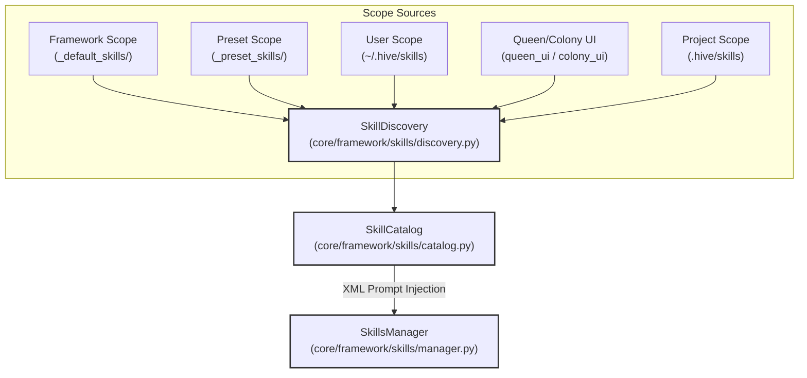
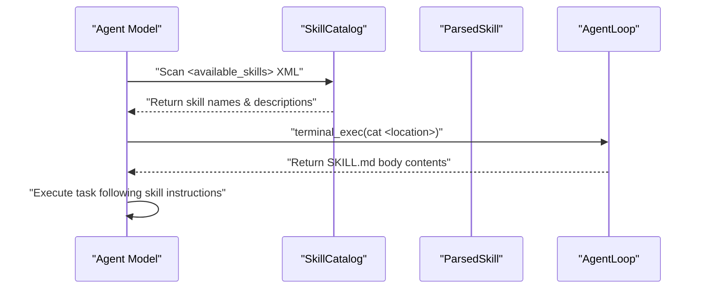

<!-- source: DeepWiki mcp.deepwiki.com · repo aden-hive/hive · page 8 Skills System · fetched 2026-10-26 -->

# Skills System

<details>
<summary>Relevant source files</summary>

The following files were used as context for generating this wiki page:

- [core/framework/server/routes_skills.py](core/framework/server/routes_skills.py)
- [core/framework/skills/__init__.py](core/framework/skills/__init__.py)
- [core/framework/skills/_default_skills/context-preservation/SKILL.md](core/framework/skills/_default_skills/context-preservation/SKILL.md)
- [core/framework/skills/_default_skills/error-recovery/SKILL.md](core/framework/skills/_default_skills/error-recovery/SKILL.md)
- [core/framework/skills/_default_skills/note-taking/SKILL.md](core/framework/skills/_default_skills/note-taking/SKILL.md)
- [core/framework/skills/_default_skills/quality-monitor/SKILL.md](core/framework/skills/_default_skills/quality-monitor/SKILL.md)
- [core/framework/skills/catalog.py](core/framework/skills/catalog.py)
- [core/framework/skills/config.py](core/framework/skills/config.py)
- [core/framework/skills/defaults.py](core/framework/skills/defaults.py)
- [core/framework/skills/discovery.py](core/framework/skills/discovery.py)
- [core/framework/skills/manager.py](core/framework/skills/manager.py)
- [core/framework/skills/parser.py](core/framework/skills/parser.py)
- [core/tests/test_default_skills.py](core/tests/test_default_skills.py)
- [core/tests/test_routes_skills.py](core/tests/test_routes_skills.py)
- [core/tests/test_skill_catalog.py](core/tests/test_skill_catalog.py)
- [core/tests/test_skill_discovery.py](core/tests/test_skill_discovery.py)
- [core/tests/test_skill_integration.py](core/tests/test_skill_integration.py)
- [core/tests/test_skill_overrides.py](core/tests/test_skill_overrides.py)
- [core/tests/test_skill_parser.py](core/tests/test_skill_parser.py)
- [core/tests/test_skill_resources.py](core/tests/test_skill_resources.py)
- [core/tests/test_skill_trust.py](core/tests/test_skill_trust.py)
- [docs/releases/v0.10.0.md](docs/releases/v0.10.0.md)

</details>


The Skills System provides portable capabilities to Hive agents using the open Agent Skills standard (`agentskills.io/specification`). Skills encapsulate specialized instructions, workflows, and resource references inside structured `SKILL.md` packages. The runtime discovers, validates, trusts, and injects these packages into agent prompts via a progressive-disclosure catalog and tool-gating mechanisms.

As a parent page, this document provides a high-level overview of the skills subsystem. For deep technical details, configuration files, and API implementations, refer to the child pages:
- [Skill Catalog, Discovery and Overrides](#8.1)
- [Skill CLI, Installation, Trust and Validation](#8.2)

---

## 1. SKILL.md Package Format

Every skill is defined by a directory containing a `SKILL.md` file [core/framework/skills/parser.py:69](). The file consists of YAML frontmatter enclosed by `---` delimiters, followed by a Markdown instruction body [core/framework/skills/parser.py:104](). The frontmatter requires a `name` and a `description`, and supports optional fields such as `compatibility`, `allowed_tools`, and `visibility` [core/framework/skills/parser.py:25]().

```yaml
---
name: hive.browser-automation
description: "Instructions and decision trees for headless browser navigation and interaction."
compatibility: ["hive>=0.10.0"]
allowed_tools: ["browser_navigate", "browser_snapshot", "browser_click"]
visibility: ["planning", "building"]
---

## Browser Navigation Protocol
When performing web automation tasks...
```

The `parse_skill_md` function parses frontmatter and markdown contents, applying auto-fixups for common YAML formatting discrepancies (such as unquoted colons in descriptions) before storing records as `ParsedSkill` objects [core/framework/skills/parser.py:46]().

Sources:
- `core/framework/skills/parser.py` [core/framework/skills/parser.py:1-45]()

---

## 2. Discovery, Catalog, and Scopes

The `SkillDiscovery` engine scans standard paths across multiple scopes to locate `SKILL.md` files [core/framework/skills/discovery.py:82](). Scopes are prioritized from lowest to highest precedence, ensuring that project-specific or user-specific overrides take precedence over framework defaults [core/framework/skills/discovery.py:110]:

1. `framework`: Built-in skills bundled with the runtime.
2. `preset`: Optional capability packs bundled with the framework but disabled by default.
3. `user`: Cross-client (`~/.agents/skills`) and Hive-specific (`~/.hive/skills`) locations [core/framework/skills/discovery.py:134]().
4. `queen_ui` / `colony_ui`: Dynamic scopes managed via the API and web dashboard [core/framework/skills/discovery.py:171]().
5. `project`: Repository-local skills (`<project>/.agents/skills` or `<project>/.hive/skills`) [core/framework/skills/discovery.py:105]().

Discovered skills are indexed by `SkillCatalog`, which generates an XML-formatted system prompt block (`<available_skills>`) accompanied by mandatory pre-reply decision rules [core/framework/skills/catalog.py:1](). If the catalog body exceeds character limits, it automatically falls back to a compact representation that preserves skill awareness while omitting verbose descriptions [core/framework/skills/catalog.py:16]().


Sources:
- `core/framework/skills/discovery.py` [core/framework/skills/discovery.py:32-110]()
- `core/framework/skills/catalog.py` [core/framework/skills/catalog.py:1-122]()

---

## 3. Default and Preset Skills

The framework ships with essential reference and operational skills managed by `DefaultSkillManager` [core/framework/skills/defaults.py:68](). While earlier iterations included micro-protocols for scratchpads, current default skills focus on core references and tool-gated capabilities:
- `hive.writing-hive-skills`: A comprehensive authoring guide for creating new Hive skills [core/framework/skills/defaults.py:49]().
- `hive.browser-automation`: Complex browser interaction and decision trees, automatically pre-activated for agents equipped with browser tools [core/framework/skills/defaults.py:54]().
- `hive.pdf`: PDF document reading and data extraction reference [core/framework/skills/defaults.py:57]().

Preset skills reside in `_preset_skills/` and remain globally disabled until enabled per-queen or per-colony via configuration overrides or the Skills Library UI [core/framework/skills/discovery.py:124]().

Sources:
- `core/framework/skills/defaults.py` [core/framework/skills/defaults.py:1-66]()

---

## 4. Tool Gating and Progressive Disclosure

Skills participate in agent execution via progressive disclosure. Models examine the `<available_skills>` catalog in their system prompts, evaluating skill descriptions against the current user request [core/framework/skills/catalog.py:1](). When a skill is selected, the model executes a pre-flight read of its `SKILL.md` file using terminal execution (`terminal_exec("cat <location>")`) before planning or calling operational tools [core/framework/skills/catalog.py:27]().

Tool gating dynamically adjusts skill visibility and prompt augmentation based on the specific tool set allocated to an agent runtime [core/tests/test_default_skills.py:33](). For example, browser-capability tool grants automatically surface browser automation guidelines without requiring manual user intervention.


Sources:
- `core/framework/skills/catalog.py` [core/framework/skills/catalog.py:27-44]()
- `core/tests/test_default_skills.py` [core/tests/test_default_skills.py:33-58]()

---

## 5. Trust, Installation, and Subsystem Links

Project-scope and externally downloaded skills are subjected to trust validation before execution. The `TrustGate` and `TrustedRepoStore` verify skill sources and signatures against security policies to prevent malicious code execution [core/framework/skills/__init__.py:1]().

Skills can be installed from remote Git repositories, registry endpoints, or bundled archives using the skills installer modules and CLI commands [core/framework/skills/__init__.py:12]().

For deeper implementation details, consult the child pages:
- **[Skill Catalog, Discovery and Overrides](#8.1)**: Detailed coverage of `SkillsManager`, catalog building, discovery config, override JSON persistence, and `routes_skills` API endpoints [core/framework/server/routes_skills.py:1]().
- **[Skill CLI, Installation, Trust and Validation](#8.2)**: Comprehensive documentation of CLI commands, registry synchronization, validation strictness, and default skill implementations [core/framework/skills/__init__.py:1]().

Sources:
- `core/framework/skills/__init__.py` [core/framework/skills/__init__.py:1-25]()
- `core/framework/server/routes_skills.py` [core/framework/server/routes_skills.py:1-32]()

---

