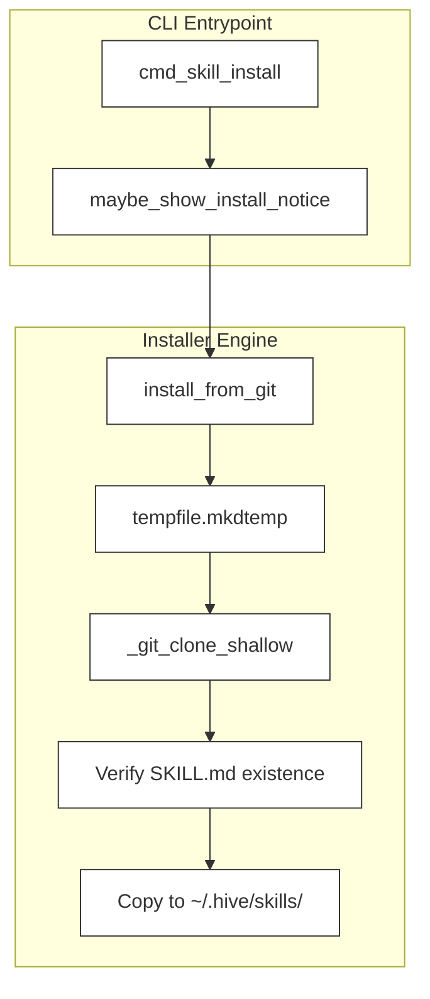
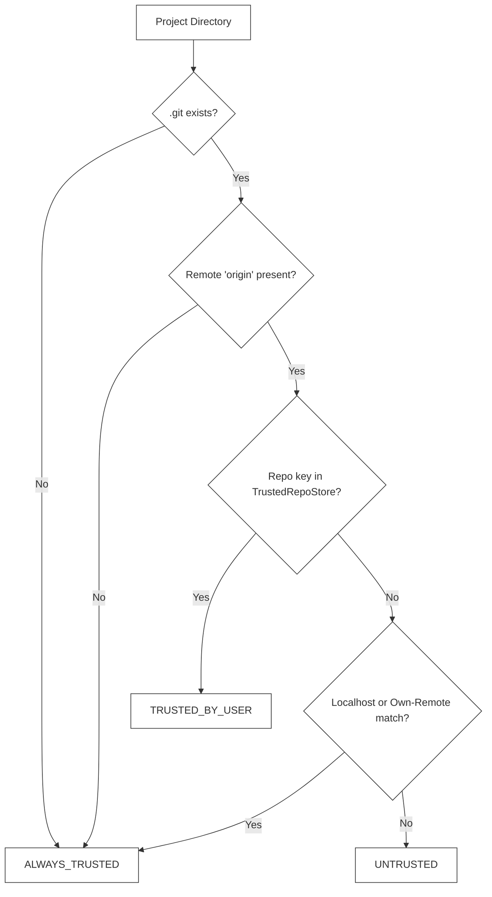
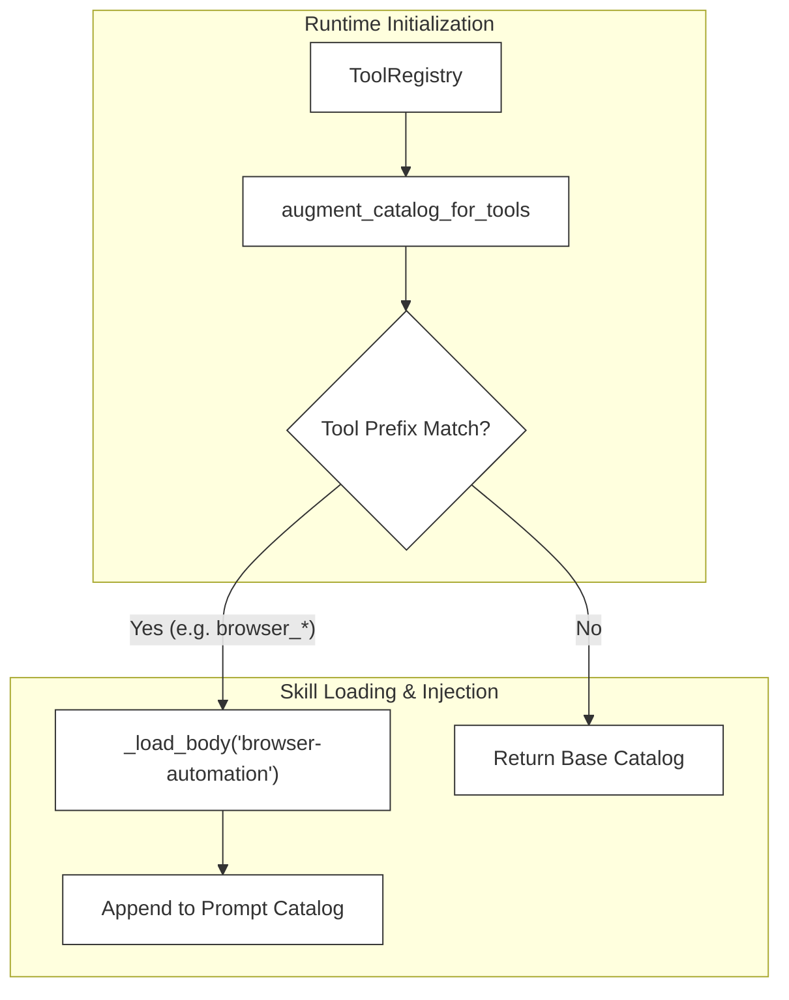

<!-- source: DeepWiki mcp.deepwiki.com · repo aden-hive/hive · page 8.2 Skill CLI, Installation, Trust and Validation · fetched 2026-10-26 -->

# Skill CLI, Installation, Trust and Validation

Relevant source files

The following files were used as context for generating this wiki page:

- [core/framework/agents/queen/mcp_registry.json](core/framework/agents/queen/mcp_registry.json)
- [core/framework/skills/_default_skills/context-preservation/SKILL.md](core/framework/skills/_default_skills/context-preservation/SKILL.md)
- [core/framework/skills/_default_skills/error-recovery/SKILL.md](core/framework/skills/_default_skills/error-recovery/SKILL.md)
- [core/framework/skills/_default_skills/note-taking/SKILL.md](core/framework/skills/_default_skills/note-taking/SKILL.md)
- [core/framework/skills/_default_skills/quality-monitor/SKILL.md](core/framework/skills/_default_skills/quality-monitor/SKILL.md)
- [core/framework/skills/_preset_skills/chart-creation-foundations/SKILL.md](core/framework/skills/_preset_skills/chart-creation-foundations/SKILL.md)
- [core/framework/skills/cli.py](core/framework/skills/cli.py)
- [core/framework/skills/defaults.py](core/framework/skills/defaults.py)
- [core/framework/skills/installer.py](core/framework/skills/installer.py)
- [core/framework/skills/registry.py](core/framework/skills/registry.py)
- [core/framework/skills/tool_gating.py](core/framework/skills/tool_gating.py)
- [core/framework/skills/trust.py](core/framework/skills/trust.py)
- [core/framework/skills/validator.py](core/framework/skills/validator.py)
- [core/tests/test_colony_fork_live.py](core/tests/test_colony_fork_live.py)
- [core/tests/test_default_skills.py](core/tests/test_default_skills.py)
- [core/tests/test_skill_cli_commands.py](core/tests/test_skill_cli_commands.py)
- [core/tests/test_skill_installer.py](core/tests/test_skill_installer.py)
- [core/tests/test_skill_registry.py](core/tests/test_skill_registry.py)
- [core/tests/test_skill_validator.py](core/tests/test_skill_validator.py)
- [core/tests/test_sse_worker_filter.py](core/tests/test_sse_worker_filter.py)
- [tools/chart_tools_server.py](tools/chart_tools_server.py)
- [tools/src/chart_tools/server.py](tools/src/chart_tools/server.py)
- [tools/src/chart_tools/static/echarts.min.js](tools/src/chart_tools/static/echarts.min.js)
- [tools/src/chart_tools/static/mermaid.min.js](tools/src/chart_tools/static/mermaid.min.js)

## Purpose and Scope
This document specifies the technical architecture and operation of the Hive skill framework subsystem. It covers the command-line interface (`hive skill`), the git-backed skill installer (`installer.py`), the registry resolver (`registry.py`), the project repository trust gating model (`trust.py`), the strict SKILL.md validation engine (`validator.py`), and the built-in default/preset skill catalogs managed by `DefaultSkillManager` and `tool_gating.py`.

---

## 1. Skill CLI Commands

The Hive skill command-line interface exposes a robust subcommand group under `hive skill` registered via `register_skill_commands` [core/framework/skills/cli.py:65-69](). These commands allow developers and agents to discover, install, validate, test, and manage skill packages across framework, user, and project scopes.

### Subcommand Overview

| Command | Handler Function | Description |
| :--- | :--- | :--- |
| `hive skill list` | `cmd_skill_list` [core/framework/skills/cli.py:79]() | Lists discovered skills across framework, user, and project scopes. Supports `--json` [core/framework/skills/cli.py:78](). |
| `hive skill install` | `cmd_skill_install` [core/framework/skills/cli.py:118]() | Installs a skill from the registry index, git URL (`--from`), or starter pack (`--pack`) [core/framework/skills/cli.py:87-108](). |
| `hive skill remove` | `cmd_skill_remove` [core/framework/skills/cli.py:124]() | Uninstalls an installed skill from the user directory [core/framework/skills/cli.py:121](). |
| `hive skill info` | `cmd_skill_info` [core/framework/skills/cli.py:136]() | Displays metadata, parsed frontmatter, and instructions for a specific skill [core/framework/skills/cli.py:127](). |
| `hive skill init` | `cmd_skill_init` [core/framework/skills/cli.py:148]() | Scaffolds a new skill directory containing a template `SKILL.md` [core/framework/skills/cli.py:29-62,139](). |
| `hive skill validate` | `cmd_skill_validate` [core/framework/skills/cli.py:154]() | Runs strict checks against a `SKILL.md` file or directory [core/framework/skills/cli.py:151](). |
| `hive skill doctor` | `cmd_skill_doctor` [core/framework/skills/cli.py:175]() | Audits skill health (parsing validity, script executability, tool availability) [core/framework/skills/cli.py:157](). |
| `hive skill update` | `cmd_skill_update` [core/framework/skills/cli.py:189]() | Refreshes the registry cache or re-installs a specific skill package [core/framework/skills/cli.py:178](). |
| `hive skill search` | `cmd_skill_search` [core/framework/skills/cli.py:195]() | Searches the remote/local skill registry by name, tag, or description [core/framework/skills/cli.py:192](). |

Sources: `[core/framework/skills/cli.py:65-196]()`

---

## 2. Installation and Registry Management

The installation subsystem manages filesystem layout, git cloning, and security notices for third-party skill packages.

### Installation Pipeline
1. **Security Notice Check**: On the first installation across the user environment, `maybe_show_install_notice()` checks for the existence of `.install_notice_shown` inside `HIVE_HOME` [core/framework/skills/installer.py:37-68](). If absent, it prints a security banner warning about third-party prompt injection risks and touches the sentinel file [core/framework/skills/installer.py:60-74]().
2. **Git Shallow Clone**: `install_from_git` verifies the availability of the `git` executable on `PATH` [core/framework/skills/installer.py:105-111](). It creates a temporary directory using `tempfile.mkdtemp` and executes a shallow clone (`git clone --depth=1`) [core/framework/skills/installer.py:122-124]().
3. **Verification and Copy**: The installer verifies that `SKILL.md` exists within the target subdirectory or repository root [core/framework/skills/installer.py:127-135](). It copies the skill directory into `~/.hive/skills/<skill_name>/` (`USER_SKILLS_DIR`) [core/framework/skills/installer.py:34,113,138]().

Sources: `[core/framework/skills/installer.py:28-152]()`

---

## 3. Trust Model and Gating

Project-level skills from untrusted repositories present security risks by injecting arbitrary instructions into agent system prompts. The trust subsystem (`trust.py`) governs project skill activation.

### Trust Classification Algorithm
The `ProjectTrustDetector.classify()` method evaluates a project directory using the following sequence [core/framework/skills/trust.py:170-198]():
1. **No project directory** or non-existent path $\rightarrow$ `ALWAYS_TRUSTED` [core/framework/skills/trust.py:175-176]()
2. **No `.git` directory** $\rightarrow$ `ALWAYS_TRUSTED` (local workspace) [core/framework/skills/trust.py:178-179]()
3. **No remote `origin`** $\rightarrow$ `ALWAYS_TRUSTED` [core/framework/skills/trust.py:181-183]()
4. **Normalized Remote URL** matching an entry in `TrustedRepoStore` (`~/.hive/trusted_repos.json`) $\rightarrow$ `TRUSTED_BY_USER` [core/framework/skills/trust.py:58-69,185-189]()
5. **Localhost remote** $\rightarrow$ `ALWAYS_TRUSTED` [core/framework/skills/trust.py:191-193]()
6. **User-configured own-remotes** matching `HIVE_OWN_REMOTES` or `~/.hive/own_remotes` $\rightarrow$ `ALWAYS_TRUSTED` [core/framework/skills/trust.py:162-163,195-198]()
7. **Default** $\rightarrow$ `UNTRUSTED` [core/framework/skills/trust.py:164]()

Sources: `[core/framework/skills/trust.py:58-69, 153-198]()`

---

## 4. Strict Validator Engine

While runtime parsing is lenient, `hive skill validate` executes strict checks via `validate_strict(path)` to ensure compliance with the Agent Skills specification [core/framework/skills/validator.py:1-42]().

### Validation Checks
1. **File Readability**: Ensures the file exists and is readable [core/framework/skills/validator.py:46-54]().
2. **Non-Empty Content**: Rejects empty files [core/framework/skills/validator.py:56-58]().
3. **Frontmatter Fences**: Requires `---` YAML delimiters [core/framework/skills/validator.py:60-66]().
4. **Strict YAML Parsing**: Parses YAML without fallback fixes; unquoted colons raise hard parse errors [core/framework/skills/validator.py:77-85]().
5. **Description Field**: Requires a non-empty `description` string [core/framework/skills/validator.py:93-96]().
6. **Name Field & Length**: Requires `name` $\le 64$ characters [core/framework/skills/validator.py:98-108]().
7. **Directory Matching**: Requires `name` to match the parent directory name or be dot-namespaced (`hive.name`) [core/framework/skills/validator.py:110-114]().
8. **Script Executability**: Verifies that any files in `scripts/` have POSIX executable permissions (`chmod +x`) on non-Windows platforms [core/framework/skills/validator.py:124-132]().
9. **Field Type Checking**: Validates that `allowed-tools`, `compatibility`, and `metadata` conform to expected YAML types [core/framework/skills/validator.py:134-158]().

Sources: `[core/framework/skills/validator.py:27-163]()`

---

## 5. Default Skills, Presets and Tool Gating

The framework ships with built-in default skills and preset capability packs located in `_default_skills/` and `_preset_skills/` [core/framework/skills/defaults.py:26](), [core/framework/skills/tool_gating.py:28-31]().

### Default Skill Registry
* `hive.writing-hive-skills`: Reference documentation for authoring valid `SKILL.md` packages [core/framework/skills/defaults.py:49]().
* `hive.browser-automation`: Tool-gated decision tree and instructions for web navigation (`browser_*` tools) [core/framework/skills/defaults.py:54]().
* `hive.pdf`: Reference skill for PDF document reading [core/framework/skills/defaults.py:57]().

### Tool-Gated Pre-Activation
To prevent agents from failing on complex tool families before discovering documentation reactively, `tool_gating.py` implements `augment_catalog_for_tools()` [core/framework/skills/tool_gating.py:79-109](). When an agent is provisioned with tools matching specific prefixes, the corresponding skill body is pre-activated and appended to the system prompt catalog:

| Tool Prefix | Skill Directory Name | Display Name |
| :--- | :--- | :--- |
| `browser_` | `browser-automation` | `hive.browser-automation` [core/framework/skills/tool_gating.py:35]() |
| `terminal_` | `terminal-tools-foundations` | `hive.terminal-tools-foundations` [core/framework/skills/tool_gating.py:36]() |
| `chart_` | `chart-creation-foundations` | `hive.chart-creation-foundations` [core/framework/skills/tool_gating.py:37]() |

Sources: `[core/framework/skills/tool_gating.py:28-109](), [core/framework/skills/defaults.py:48-58]()`

---

