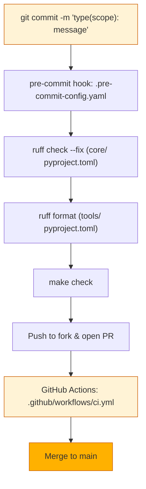
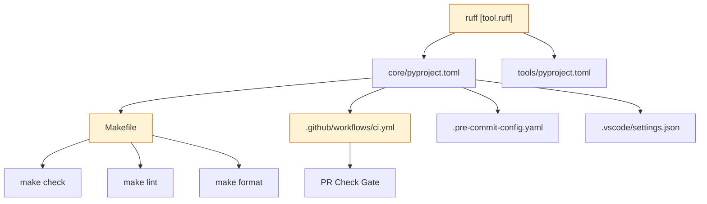

<!-- source: DeepWiki mcp.deepwiki.com · repo aden-hive/hive · page 9 Development and Contributing · fetched 2026-10-26 -->

# Development and Contributing

<details>
<summary>Relevant source files</summary>

The following files were used as context for generating this wiki page:

- [.editorconfig](.editorconfig)
- [.gitattributes](.gitattributes)
- [CONTRIBUTING.md](CONTRIBUTING.md)
- [Makefile](Makefile)
- [README.md](README.md)
- [SECURITY.md](SECURITY.md)
- [docs/bounty-program/README.md](docs/bounty-program/README.md)
- [docs/configuration.md](docs/configuration.md)
- [docs/contributing-lint-setup.md](docs/contributing-lint-setup.md)
- [docs/developer-guide.md](docs/developer-guide.md)
- [docs/environment-setup.md](docs/environment-setup.md)
- [docs/getting-started.md](docs/getting-started.md)

</details>


This page provides a high-level overview of the contribution guidelines, developer tooling, code style enforcement, and workflow policies for the Hive repository. For detailed deep-dives into test suites, CI automation, debugging utilities, and documentation structures, see the child pages:
- For unit, integration, and semantic tests, see [Testing Strategy](#9.1).
- For GitHub Actions workflows and PR validation, see [CI/CD and GitHub Automation](#9.2).
- For diagnostic scripts, timeline viewers, and tracing, see [Debugging and Diagnostics](#9.3).
- For repository documentation and i18n localization, see [Documentation and Localization](#9.4).

---

## 1. Contribution Workflow and Policies

Hive welcomes contributions from the developer community. To maintain high code quality and prevent duplicate effort, contributions follow strict assignment and pull request standards defined in `CONTRIBUTING.md`.

### Issue Assignment Policy
All code contributions require a pre-assigned issue via `CONTRIBUTING.md` before a pull request can be merged:
1. Find or create an issue in the repository [CONTRIBUTING.md:64-70]().
2. Comment on the issue to claim it [CONTRIBUTING.md:71]().
3. Wait for a maintainer to assign you (typically within 24 hours) [CONTRIBUTING.md:72]().

**Exceptions (No Assignment Needed):**
- **Documentation fixes:** Include `doc` or `docs` in your PR title or apply the `documentation` label [CONTRIBUTING.md:77-80]().
- **Micro-fixes:** Must change fewer than 20 lines, be limited to typos/lint/docs, and contain no logic, API, or database changes [CONTRIBUTING.md:81-88]().

### Pull Request Requirements
Every pull request must:
- Reference an assigned issue in its description.
- Pass all linting and formatting checks (`make check`).
- Pass the core test suite (`make test`).
- Include appropriate unit tests or documentation updates for new features.

### Bounty Program Status
The Hive bounty program has officially ended. No new bounties are being posted, and issue templates or payout automation have been removed from the repository. Ongoing contributions remain welcome via standard pull requests [docs/bounty-program/README.md:1-5]().

Sources: [CONTRIBUTING.md:64-89](), [docs/bounty-program/README.md:1-5]()

---

## 2. Linting, Formatting, and Local Development Setup

Hive standardizes on **Ruff** for all Python linting and formatting across packages (`core/`, `tools/`, and user `exports/`) [docs/contributing-lint-setup.md:3]().

### Ruff Standards and Makefile Commands
The project uses `Makefile` targets to execute local checks identical to the CI pipeline [docs/contributing-lint-setup.md:39-52]:

```bash
make lint           # Auto-fix Ruff lint issues across core/ and tools/
make format         # Apply Ruff code formatting
make check          # Dry-run check (exact CI verification gate)
make test           # Run core framework test suite
make install-hooks  # Install pre-commit hooks
```

### Local Development Flow

*Sources: [Makefile:14-29](), [docs/contributing-lint-setup.md:107-123]()*

---

## 3. Tooling and Configuration Entity Map

Configuration rules are centralized in package metadata files and enforced via editor hooks, pre-commit scripts, and Makefile targets.


*Sources: [Makefile:1-56](), [docs/contributing-lint-setup.md:126-139]()*

---

## 4. Related Child Pages

For more in-depth exploration of development workflows and testing infrastructure, consult the dedicated child pages:
- **Testing Strategy:** Detailed coverage of `core/tests`, unit tests, server tests, E2E suites (`longmemeval`), `MockLLMProvider`, and semantic evaluation via `LLMJudge`. For details, see [Testing Strategy](#9.1).
- **CI/CD and GitHub Automation:** Overview of GitHub Actions workflows (`ci.yml`), PR requirement enforcement, automated duplicate closers, and wheel packaging hooks. For details, see [CI/CD and GitHub Automation](#9.2).
- **Debugging and Diagnostics:** Documentation for debugging aids including `debug_queen_prompt.py`, `llm_timeline_viewer`, runtime logs drawers, and browser remote tooling. For details, see [Debugging and Diagnostics](#9.3).
- **Documentation and Localization:** Guide to the `docs/` tree structure, changelogs, and i18n translated README files. For details, see [Documentation and Localization](#9.4).

Sources: [CONTRIBUTING.md:1-183](), [docs/contributing-lint-setup.md:1-160]()

---

