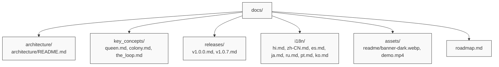
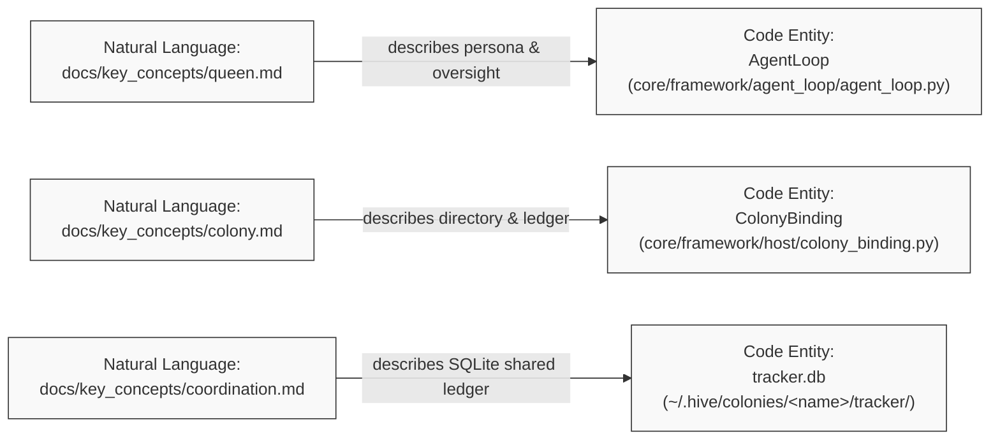
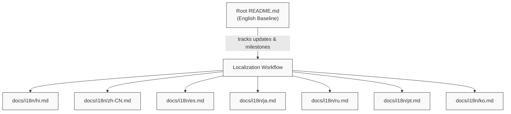

<!-- source: DeepWiki mcp.deepwiki.com · repo aden-hive/hive · page 9.4 Documentation and Localization · fetched 2026-10-26 -->

# Documentation and Localization

Relevant source files

The following files were used as context for generating this wiki page:

- [docs/agent_runtime.md](docs/agent_runtime.md)
- [docs/architecture/README.md](docs/architecture/README.md)
- [docs/assets/readme/demo.mp4](docs/assets/readme/demo.mp4)
- [docs/assets/readme/demo.webp](docs/assets/readme/demo.webp)
- [docs/assets/readme/home.webp](docs/assets/readme/home.webp)
- [docs/assets/readme/result.webp](docs/assets/readme/result.webp)
- [docs/assets/readme/tracker.webp](docs/assets/readme/tracker.webp)
- [docs/assets/readme/workers.webp](docs/assets/readme/workers.webp)
- [docs/i18n/es.md](docs/i18n/es.md)
- [docs/i18n/hi.md](docs/i18n/hi.md)
- [docs/i18n/ja.md](docs/i18n/ja.md)
- [docs/i18n/ko.md](docs/i18n/ko.md)
- [docs/i18n/pt.md](docs/i18n/pt.md)
- [docs/i18n/ru.md](docs/i18n/ru.md)
- [docs/i18n/zh-CN.md](docs/i18n/zh-CN.md)
- [docs/key_concepts/colony.md](docs/key_concepts/colony.md)
- [docs/key_concepts/coordination.md](docs/key_concepts/coordination.md)
- [docs/key_concepts/goals_outcome.md](docs/key_concepts/goals_outcome.md)
- [docs/key_concepts/improvement.md](docs/key_concepts/improvement.md)
- [docs/key_concepts/queen.md](docs/key_concepts/queen.md)
- [docs/key_concepts/the_loop.md](docs/key_concepts/the_loop.md)
- [docs/key_concepts/worker_agent.md](docs/key_concepts/worker_agent.md)
- [docs/releases/v1.0.0.md](docs/releases/v1.0.0.md)
- [docs/releases/v1.0.7.md](docs/releases/v1.0.7.md)
- [docs/roadmap-developer-success.md](docs/roadmap-developer-success.md)
- [docs/roadmap.md](docs/roadmap.md)

## Purpose and Scope
This page documents the organization, structure, and maintenance strategy for the Hive project's documentation tree (`docs/`) and localization (i18n) ecosystem. It details how conceptual documentation maps to core Python and TypeScript code entities, how the multi-language README variants in `docs/i18n/` are structured, and the workflows required to keep localized content synchronized with the English baseline.

Sources: [docs/architecture/README.md:1-10](), [docs/key_concepts/queen.md:1-5](), [docs/i18n/hi.md:1-17]()

---

## 1. Documentation Directory Layout (`docs/`)

The repository documentation is centralized under the `docs/` directory, spanning architectural guides, core domain concepts, roadmap milestones, internal benchmarks, and localized README translations.

| Directory / File | Description |
| --- | --- |
| `docs/architecture/` | Deep dives into runtime topologies, the `AgentLoop`, and data flows. |
| `docs/key_concepts/` | Core domain definitions (`Queen`, `Colony`, `Tracker`, `The Loop`, `Worker`). |
| `docs/releases/` | Version-specific changelogs and release notes (e.g., `v1.0.0.md`). |
| `docs/i18n/` | Localized markdown translations of the main README. |
| `docs/assets/` | Static media assets, UI screenshots, banner webps, and demo video files. |
| `docs/roadmap.md` | Project milestones, shipped features, and open roadmap items. |

*Figure 1: High-level structure of the Hive documentation tree.*

Sources: [docs/architecture/README.md:1-12](), [docs/roadmap.md:1-15]()

---

## 2. Bridging Natural Language Concepts to Code Entities

To maintain accuracy across documentation updates, conceptual descriptions in `docs/key_concepts/` map directly to implementation classes and execution primitives within the codebase. 

*Figure 2: Conceptual mapping from natural language docs to internal codebase symbols.*

### Key Concept Mappings
- **The Queen (`docs/key_concepts/queen.md`)**: Maps to the long-running `AgentLoop` configuration inside `core/framework/agent_loop/agent_loop.py` and persona injection vectors (`agents/queen/worker_definition.py`).
- **The Colony (`docs/key_concepts/colony.md`)**: Maps to `ColonyBinding` (`core/framework/host/colony_binding.py`), managing directory layouts under `~/.hive/colonies/`.
- **The Tracker (`docs/key_concepts/coordination.md`)**: Maps to SQLite ledger operations driven by `tracker_sql`, `tracker_register_writable`, and `tracker_upsert` tools.

Sources: [docs/key_concepts/queen.md:1-48](), [docs/architecture/README.md:13-68]()

---

## 3. Localization and i18n (`docs/i18n/`)

Hive supports multilingual documentation to broaden community adoption. The primary localized artifacts are translated versions of the project README maintained under `docs/i18n/`.

### Supported Languages
The repository maintains parity for major developer languages:
- **Hindi (`docs/i18n/hi.md`)** [docs/i18n/hi.md:1-17]()
- **Simplified Chinese (`docs/i18n/zh-CN.md`)** [docs/i18n/zh-CN.md:1-17]()
- **Spanish (`docs/i18n/es.md`)** [docs/i18n/es.md:1-17]()
- **Japanese (`docs/i18n/ja.md`)** [docs/i18n/ja.md:1-17]()
- **Russian (`docs/i18n/ru.md`)** [docs/i18n/ru.md:1-17]()
- **Portuguese (`docs/i18n/pt.md`)** [docs/i18n/pt.md:1-17]()
- **Korean (`docs/i18n/ko.md`)** [docs/i18n/ko.md:1-17]()

*Figure 3: Localization synchronization layout across supported translation targets.*

### Keeping Translations in Sync
To prevent documentation drift between the English baseline (`README.md`) and localized mirrors (`docs/i18n/*.md`), contributors must adhere to these synchronization standards:
1. **Header Anchor Parity**: Ensure cross-links, anchor tags, and navigation headers (e.g., links pointing back to `../../README.md` or relative sibling files) use correct relative path depths (`../assets/`, `zh-CN.md`, etc.) [docs/i18n/hi.md:1-17]().
2. **Structural Alignment**: Mermaid diagrams, code block execution examples (e.g., `./quickstart.sh` vs `.\quickstart.ps1`), and feature lists must match the sections presented in the primary README.
3. **Badge Integrity**: Badge URLs pointing to licenses, Y Combinator backing, Discord invites, and X/LinkedIn handles must remain uniform across all translation files [docs/i18n/hi.md:19-25]().

Sources: [docs/i18n/hi.md:1-101](), [docs/i18n/zh-CN.md:1-50]()

---

## 4. Release Engineering and Changelogs

Release documentation under `docs/releases/` records version progression, deprecations, and new features introduced in runtime packages.

### Changelog Structure
Each release document (such as `docs/releases/v1.0.0.md` or `docs/releases/v1.0.7.md`) adheres to a standard format:
- **Core Additions**: New tools, agent loop optimizations, and orchestration updates.
- **Breaking Changes**: Retirals (e.g., removal of the legacy graph executor or terminal UI as noted in [docs/roadmap.md:61-67]()).
- **Upgrade Path**: Instructions for migrating existing colonies, configurations, or credential stores.

Sources: [docs/releases/v1.0.0.md:1-10](), [docs/roadmap.md:61-67]()

---

