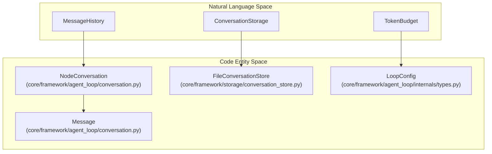
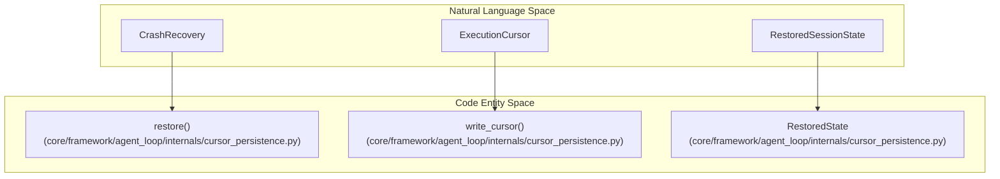

<!-- source: DeepWiki mcp.deepwiki.com · repo aden-hive/hive · extra page Conversation, Compaction and Persistence · fetched 2026-10-26 -->

# Conversation, Compaction and Persistence

<details>
<summary>Relevant source files</summary>

The following files were used as context for generating this wiki page:

- [core/framework/agent_loop/agent_loop.py](core/framework/agent_loop/agent_loop.py)
- [core/framework/agent_loop/conversation.py](core/framework/agent_loop/conversation.py)
- [core/framework/agent_loop/internals/compaction.py](core/framework/agent_loop/internals/compaction.py)
- [core/framework/agent_loop/internals/cursor_persistence.py](core/framework/agent_loop/internals/cursor_persistence.py)
- [core/framework/agent_loop/internals/types.py](core/framework/agent_loop/internals/types.py)
- [core/framework/agent_loop/internals/vision_fallback.py](core/framework/agent_loop/internals/vision_fallback.py)
- [core/framework/agent_loop/past_conversations_reminder.py](core/framework/agent_loop/past_conversations_reminder.py)
- [core/framework/agent_loop/reminders.py](core/framework/agent_loop/reminders.py)
- [core/framework/agents/queen/queen_profiles.py](core/framework/agents/queen/queen_profiles.py)
- [core/framework/agents/queen/tests/test_deferred_handle_redeemers.py](core/framework/agents/queen/tests/test_deferred_handle_redeemers.py)
- [core/framework/orchestrator/orchestrator.py](core/framework/orchestrator/orchestrator.py)
- [core/framework/server/routes_colony_workers.py](core/framework/server/routes_colony_workers.py)
- [core/framework/storage/conversation_store.py](core/framework/storage/conversation_store.py)
- [core/framework/tools/harness_tools.py](core/framework/tools/harness_tools.py)
- [core/frontend/src/api/colonyWorkers.ts](core/frontend/src/api/colonyWorkers.ts)
- [core/frontend/src/components/ParallelSubagentBubble.tsx](core/frontend/src/components/ParallelSubagentBubble.tsx)
- [core/frontend/src/components/WorkerRunBubble.tsx](core/frontend/src/components/WorkerRunBubble.tsx)
- [core/frontend/src/context/ColonyWorkersContext.tsx](core/frontend/src/context/ColonyWorkersContext.tsx)
- [core/frontend/src/context/QueenProfileContext.tsx](core/frontend/src/context/QueenProfileContext.tsx)
- [core/frontend/src/layouts/AppLayout.tsx](core/frontend/src/layouts/AppLayout.tsx)
- [core/frontend/src/lib/graphUtils.ts](core/frontend/src/lib/graphUtils.ts)
- [core/tests/test_event_loop_node.py](core/tests/test_event_loop_node.py)
- [core/tests/test_memory_timeline_recall.py](core/tests/test_memory_timeline_recall.py)
- [core/tests/test_node_conversation.py](core/tests/test_node_conversation.py)
- [tools/src/memory_tools/recall.py](tools/src/memory_tools/recall.py)
- [tools/tests/test_memory_recall_timeline.py](tools/tests/test_memory_recall_timeline.py)

</details>


## Purpose and Scope

This page documents message management, token estimation, multi-level compaction (microcompaction, phase-aware, and tool-result pruning), cursor persistence/crash recovery, the `ConversationStore` protocol with its `FileConversationStore` implementation, and reminders/past-conversation injection within Hive's `AgentLoop` and graph execution framework.

---

## 1. Overview and Component Architecture

Each agent execution within Hive maintains an isolated or shared conversation stream managed by `NodeConversation` [core/framework/agent_loop/conversation.py:1](). It coordinates message sequencing, token budget enforcement, proactive compaction, orphan tool-call recovery, and write-through persistence via `ConversationStore` [core/framework/agent_loop/conversation.py:102]().

The following diagram maps high-level conversation management concepts to their concrete code entities in the codebase:



Sources: [core/framework/agent_loop/conversation.py:1-121](), [core/framework/storage/conversation_store.py:1-40]()

---

## 2. The `Message` Dataclass

Every turn, tool invocation, and system injection in a conversation is represented by a `Message` instance [core/framework/agent_loop/conversation.py:74]().

```python
@dataclass
class Message:
    seq: int
    role: Literal["user", "assistant", "tool"]
    content: str
    tool_use_id: str | None = None
    tool_calls: list[dict[str, Any]] | None = None
    is_error: bool = False
    phase_id: str | None = None
    is_transition_marker: bool = False
    is_client_input: bool = False
    image_content: list[dict[str, Any]] | None = None
    is_skill_content: bool = False
    run_id: str | None = None
    is_system_reminder: bool = False
    truncated: bool = False
    inherited_from: str | None = None
    is_trigger: bool = False
    thinking_blocks: list[dict[str, Any]] | None = None
    reasoning_content: str | None = None
    images: list[dict[str, Any]] | None = None
```

Key attributes supporting advanced features include:
- **`thinking_blocks`**: Stores reasoning blocks (such as Anthropic extended thinking signatures or DeepSeek/GLM signatures) verbatim so they can be echoed back on follow-up requests, avoiding API `400` errors [core/tests/test_node_conversation.py:134-148]().
- **`reasoning_content`**: OpenAI-compatible reasoning string used by models like Qwen and DeepSeek [core/tests/test_node_conversation.py:159-168]().
- **`is_system_reminder`**: Flags framework-injected guidance (idle nudges, stream-stall hints) rendered as compact system notices rather than user speech [core/framework/agent_loop/conversation.py:103-107]().
- **`is_trigger`**: Identifies user messages synthesized from timer ticks or webhook triggers [core/framework/agent_loop/conversation.py:119-122]().

Sources: [core/framework/agent_loop/conversation.py:73-143](), [core/tests/test_node_conversation.py:134-168]()

---

## 3. `NodeConversation` Message Management

`NodeConversation` maintains the ordered list of `Message` objects, assigns monotonic sequence numbers (`seq`), handles orphan repair, and executes write-through updates [core/framework/agent_loop/conversation.py:1-30]().

### Orphaned Tool Call Repair
When an agent loop is interrupted or cancelled mid-execution, an `assistant` message containing `tool_calls` may lack a corresponding `tool`-role response. Before passing messages to the LLM via `to_llm_messages()`, the conversation inspects and repairs these sequences by injecting a synthetic error message [core/framework/agent_loop/conversation.py:312-353]():
```json
{"role": "tool", "tool_call_id": "<id>", "content": "ERROR: Tool execution was interrupted."}
```

Sources: [core/framework/agent_loop/conversation.py:312-353]()

---

## 4. Token Estimation and Compaction Pipeline

To prevent context window overflow, Hive implements a multi-level compaction strategy handled by `framework/agent_loop/internals/compaction.py` [core/framework/agent_loop/internals/compaction.py:1-10]().

### Compaction Tiers
1. **Microcompaction (Count-based tool result clearing)**: Clears older, compactable tool results (e.g., `pdf_read`, `terminal_exec`, `web_scrape`) while keeping the most recent `MICROCOMPACT_KEEP_RECENT` (default `6`) intact [core/framework/agent_loop/internals/compaction.py:70-110]().
2. **Prune Old Tool Results**: Token-budget based reduction of verbose tool outputs that reference spillover files on disk [core/framework/agent_loop/internals/compaction.py:1-10]().
3. **Structure-Preserving Compaction / Spillover**: Large payloads are spilled to disk with a placeholder reference [core/framework/agent_loop/internals/compaction.py:1-10]().
4. **LLM Summary Compaction**: Summarizes older conversation blocks via an auxiliary LLM call when context usage crosses the threshold defined in `LoopConfig` [core/framework/agent_loop/internals/compaction.py:1-10](), [core/framework/agent_loop/internals/types.py:49-110]().
5. **Phase-Graduated Compaction**: In continuous conversation mode, protects the current phase and immediately preceding phase while summarizing older phases [core/framework/agent_loop/conversation.py:515-618]().

Sources: [core/framework/agent_loop/internals/compaction.py:1-110](), [core/framework/agent_loop/internals/types.py:49-110]()

---

## 5. Reminders and Past-Conversation Injection

Hive injects contextual reminders and past-conversation summaries into the active agent loop via `ReminderHub` and `past_conversations_reminder.py` [core/framework/agent_loop/agent_loop.py:95-104](). These mechanisms allow workers and queens to recall past interaction history or receive periodic housekeeping nudges without cluttering the core instruction prompt.

Sources: [core/framework/agent_loop/agent_loop.py:95-104](), [core/framework/agent_loop/reminders.py:1-104]()

---

## 6. Cursor Persistence and Crash Recovery

To support crash recovery and process restarts, execution checkpoints are persisted via cursor records [core/framework/agent_loop/internals/cursor_persistence.py:1-6](). 

The following diagram maps the crash recovery subsystem concepts to their underlying code components:



`restore()` recovers conversation parts, loop iteration counters, accumulators, and stall detection metrics from storage [core/framework/agent_loop/internals/cursor_persistence.py:49-138](). `write_cursor()` records progress after each iteration [core/framework/agent_loop/internals/cursor_persistence.py:140-174]().

Sources: [core/framework/agent_loop/internals/cursor_persistence.py:1-174]()

---

## 7. Storage Protocols and `FileConversationStore`

Conversations persist to disk through the `ConversationStore` protocol implemented by `FileConversationStore` [core/framework/storage/conversation_store.py:1-115]().

**Directory Layout:**
```
{base_path}/
    meta.json          ← system_prompt, config metadata
    cursor.json        ← {"next_seq": <int>, "iteration": <int>}
    parts/
        0000000000.json
        0000000001.json
        ...
```

The `ConversationStore` protocol defines asynchronous methods for part writes, bulk reads, metadata handling, cursor management, and pruning [core/framework/storage/conversation_store.py:1-115]().

Sources: [core/framework/storage/conversation_store.py:1-115]()

---

