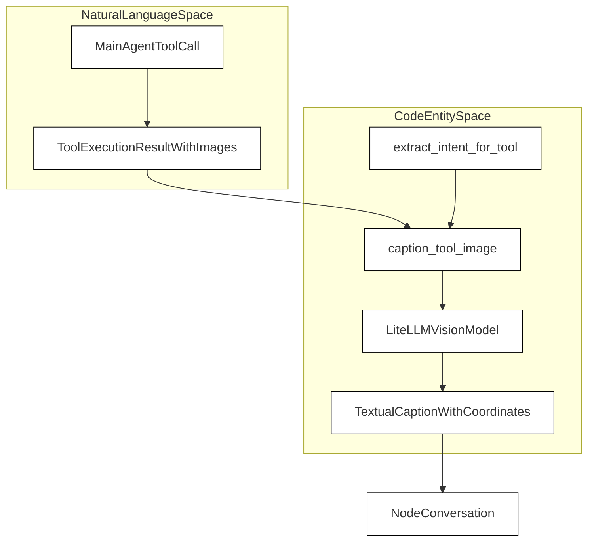
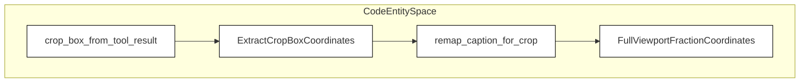

<!-- source: DeepWiki mcp.deepwiki.com · repo aden-hive/hive · extra page Vision Fallback and Tool Results · fetched 2026-10-26 -->

# Vision Fallback and Tool Results

Relevant source files

The following files were used as context for generating this wiki page:

- [core/framework/agent_loop/agent_loop.py](core/framework/agent_loop/agent_loop.py)
- [core/framework/agent_loop/conversation.py](core/framework/agent_loop/conversation.py)
- [core/framework/agent_loop/internals/cursor_persistence.py](core/framework/agent_loop/internals/cursor_persistence.py)
- [core/framework/agent_loop/internals/tool_result_handler.py](core/framework/agent_loop/internals/tool_result_handler.py)
- [core/framework/agent_loop/internals/types.py](core/framework/agent_loop/internals/types.py)
- [core/framework/agent_loop/internals/vision_fallback.py](core/framework/agent_loop/internals/vision_fallback.py)
- [core/framework/agents/queen/queen_profiles.py](core/framework/agents/queen/queen_profiles.py)
- [core/framework/agents/queen/tests/test_deferred_handle_redeemers.py](core/framework/agents/queen/tests/test_deferred_handle_redeemers.py)
- [core/framework/llm/model_catalog.json](core/framework/llm/model_catalog.json)
- [core/framework/llm/model_catalog.py](core/framework/llm/model_catalog.py)
- [core/framework/storage/conversation_store.py](core/framework/storage/conversation_store.py)
- [core/tests/test_event_loop_node.py](core/tests/test_event_loop_node.py)
- [core/tests/test_model_catalog.py](core/tests/test_model_catalog.py)
- [core/tests/test_node_conversation.py](core/tests/test_node_conversation.py)
- [docs/releases/v0.10.2.md](docs/releases/v0.10.2.md)

## Purpose and Scope
This document covers the technical architecture and implementation details of Hive's vision fallback pipeline and tool result management systems, located within the event loop internals (`core/framework/agent_loop/internals/`). 

Specifically, this page details how text-only LLMs interact with graphical tools via the `vision_fallback` subagent, how fractional viewport coordinates and crop boxes are remapped, how tool executions are isolated via `tool_result_handler`, and how large tool results are safely truncated, previewed, and spilled over to disk.

---

## 1. Vision Fallback for Text-Only Models
When an agent model does not support native image processing (i.e., its entry in `core/framework/llm/model_catalog.json` specifies `supports_vision: false`), tool results containing images (such as browser screenshots or element clips) cannot be sent directly to the model's context window. Without intervention, the main agent would only see a bare metadata envelope.

The `vision_fallback` module intercepts these tool results and delegates image interpretation to a configured vision model (defined in `~/.hive/configuration.json` under the `vision_fallback` block) [core/framework/agent_loop/internals/vision_fallback.py:1-24]().

*Diagram 1: Data flow bridging natural language agent intent and tool execution results to the `caption_tool_image` pipeline.*

Sources: `core/framework/agent_loop/internals/vision_fallback.py:1-46`, `core/framework/llm/model_catalog.json:100-140`

---

## 2. Fractional Coordinates and Crop Remapping
Because text-only models cannot "see" click targets, the vision subagent prompt forces the fallback vision model to output exact viewport fraction coordinates `(fx, fy)` in the range `[0..1]` where `(0,0)` is the top-left and `(1,1)` is the bottom-right [core/framework/agent_loop/internals/vision_fallback.py:65-101]().

When dealing with cropped images (such as element clips or zoom actions), the subagent's coordinates are relative to the crop rather than the full viewport. The framework handles this via:
1. `crop_box_from_tool_result()`: Extracts the `[vx0, vy0, vx1, vy1]` boundary box from the tool result JSON envelope [core/framework/agent_loop/internals/vision_fallback.py:110-140]().
2. `remap_caption_for_crop()`: Rewrites the subagent's `(fx, fy)` coordinate labels from crop-relative fractions into full-viewport fractions so that subsequent mouse actions target the correct screen coordinates [core/framework/agent_loop/internals/vision_fallback.py:143-154]().

*Diagram 2: Coordinate remapping pipeline for subagent visual outputs.*

Sources: `core/framework/agent_loop/internals/vision_fallback.py:110-154`

---

## 3. Tool Execution and `tool_result_handler`
Tool execution is managed by `core/framework/agent_loop/internals/tool_result_handler.py`. To prevent synchronous or hanging tools (such as blocking MCP STDIO calls) from starving the main event loop or HTTP API threads, Hive implements a dedicated bounded thread pool executor (`_tool_executor`) [core/framework/agent_loop/internals/tool_result_handler.py:27-51]().

### Error Classification
Exceptions encountered during tool execution or LLM streaming are classified via helper functions:
* `is_transient_error()`: Identifies retryable errors such as `RateLimitError`, `APIConnectionError`, `InternalServerError`, `TimeoutError`, and related HTTP/stream status exceptions [core/framework/agent_loop/internals/tool_result_handler.py:72-123]().
* `is_context_too_large_error()`: Detects whether an exception indicates that the LLM input payload exceeded the model's maximum token window [core/framework/agent_loop/internals/tool_result_handler.py:54-70]().

Sources: `core/framework/agent_loop/internals/tool_result_handler.py:27-123`

---

## 4. Large Tool-Result Spillover and Previews
To protect the LLM context window from being flooded by large tool outputs (e.g., massive database dumps or log files), `tool_result_handler` applies automated truncation and disk spillover policies [core/framework/agent_loop/internals/tool_result_handler.py:1-6].

* **Disk Spillover**: Results exceeding the character threshold are written to disk under `spillover_dir`, leaving a lightweight reference preview in the conversation context [core/framework/agent_loop/internals/types.py:133-145](). The agent can re-read full payloads via terminal or file tools on demand.
* **JSON Previews & Metadata**: For structured data, `build_json_preview()` generates a smart preview highlighting array lengths (showing the first 3 and last 1 items of large arrays), while `extract_json_metadata()` returns key names, value types, and array dimensions so the model understands the broader schema [core/framework/agent_loop/internals/tool_result_handler.py:125-189]().

Sources: `core/framework/agent_loop/internals/tool_result_handler.py:125-189`, `core/framework/agent_loop/internals/types.py:133-145`

---

