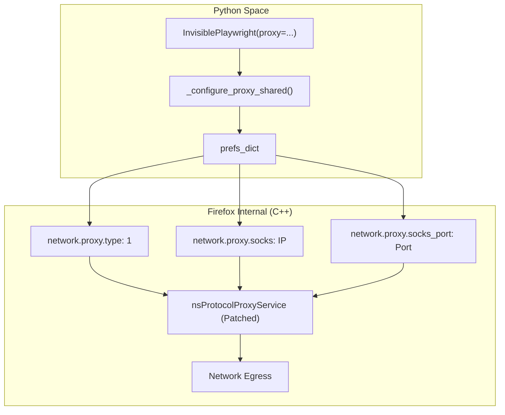
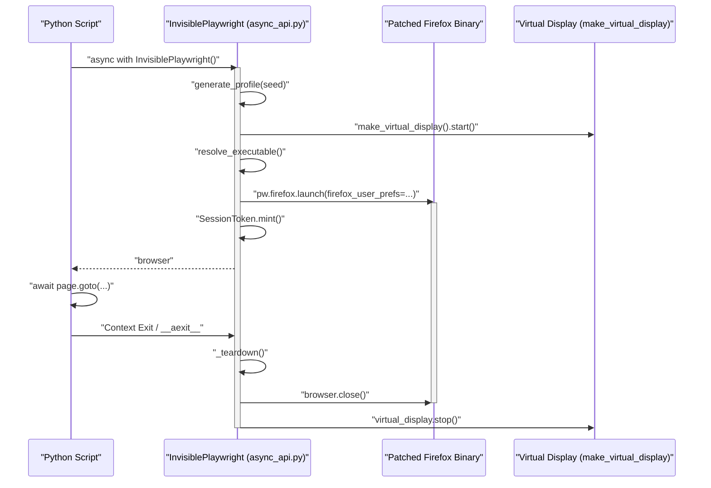

<!-- source: DeepWiki mcp.deepwiki.com · repo feder-cr/invisible_playwright · page 1.2 Usage Examples · fetched 2026-10-26 -->

# Usage Examples

<details>
<summary>Relevant source files</summary>

The following files were used as context for generating this wiki page:

- [README.md](README.md)
- [docs/README.md](docs/README.md)
- [docs/badges/telegram.svg](docs/badges/telegram.svg)
- [docs/banner-dark.png](docs/banner-dark.png)
- [docs/banner-light.png](docs/banner-light.png)
- [docs/configuration.md](docs/configuration.md)
- [docs/integrations/README.md](docs/integrations/README.md)
- [docs/pinning.md](docs/pinning.md)
- [docs/quickstart.md](docs/quickstart.md)
- [docs/recaptcha-v3-score.md](docs/recaptcha-v3-score.md)
- [docs/sannysoft-explained.md](docs/sannysoft-explained.md)
- [docs/screen-size-headless-tells.md](docs/screen-size-headless-tells.md)
- [src/invisible_playwright/_recaptcha_seed.py](src/invisible_playwright/_recaptcha_seed.py)
- [src/invisible_playwright/async_api.py](src/invisible_playwright/async_api.py)
- [src/invisible_playwright/launcher.py](src/invisible_playwright/launcher.py)
- [tests/test_async_api.py](tests/test_async_api.py)
- [tests/test_launcher_helpers.py](tests/test_launcher_helpers.py)
- [tests/test_readme_claims.py](tests/test_readme_claims.py)
- [tests/test_recaptcha_seed.py](tests/test_recaptcha_seed.py)

</details>


The `invisible_playwright` library provides a drop-in replacement for the standard Playwright Firefox launcher. It abstracts the complexity of fingerprint generation, preference translation, and virtual display management into a single entry point: the `InvisiblePlaywright` class [src/invisible_playwright/launcher.py:78-108]().

## Basic Browser Launch

The most common usage pattern is the synchronous context manager. This pattern handles the initialization of the Playwright engine, the generation of a random coherent profile, and the automated cleanup of the browser process.

```python
from invisible_playwright import InvisiblePlaywright

# Every session gets a unique, coherent fingerprint drawn from real-world telemetry
with InvisiblePlaywright() as browser:
    page = browser.new_page()
    page.goto("https://example.com")
    print("Title:", page.title())
    # Browser and Playwright resources are automatically cleaned up here
```

### Implementation Flow
When `InvisiblePlaywright` is instantiated, it immediately generates a `Profile` via `generate_profile` [src/invisible_playwright/launcher.py:175-177](). Upon entering the context (`__enter__`), it:
1.  Resolves the session geography and timezone [src/invisible_playwright/launcher.py:196-197]().
2.  Starts a virtual display if `headless=True` (default) [src/invisible_playwright/launcher.py:214-215]().
3.  Translates the `Profile` into a dictionary of Firefox preferences [src/invisible_playwright/launcher.py:209-210]().
4.  Launches the patched Firefox binary using custom `firefox_user_prefs` [src/invisible_playwright/launcher.py:234-243]().
5.  Applies a `_NEWTAB_SETTLE` sleep (0.4s) to prevent navigation race conditions [src/invisible_playwright/launcher.py:30-49]().

**Sources:** [README.md:57-78](), [src/invisible_playwright/launcher.py:30-243]()

---

## Proxy Configuration

`invisible_playwright` supports `socks5`, `socks4`, `http`, and `https` proxies [README.md:120-120](). Unlike standard Playwright, which may leak the host IP via WebRTC or fail on SOCKS5 authentication, this library uses a patched `nsProtocolProxyService` to ensure credentials and routing are handled at the C++ level [docs/configuration.md:29-32]().

```python
from invisible_playwright import InvisiblePlaywright

proxy_config = {
    "server": "socks5://gate.example.com:1080",
    "username": "user",
    "password": "pass"
}

with InvisiblePlaywright(proxy=proxy_config) as browser:
    page = browser.new_page()
    page.goto("https://httpbin.org/ip")
```

### Proxy Data Flow
The following diagram illustrates how proxy settings are propagated from the Python API to the Firefox internal networking layer.

**System Proxy Integration**


**Sources:** [README.md:108-120](), [src/invisible_playwright/launcher.py:211-211](), [docs/configuration.md:17-37]()

---

## Seed-based Deterministic Sessions

To recreate the exact same browser fingerprint (GPU, Screen, Audio, etc.) across different runs, you can provide a `seed`. This is useful for maintaining a consistent "identity".

```python
from invisible_playwright import InvisiblePlaywright

# Session 1: Use seed 42
with InvisiblePlaywright(seed=42) as browser:
    # This session will have a specific GPU and screen resolution
    page = browser.new_page()

# Session 2: Use seed 42 again
with InvisiblePlaywright(seed=42) as browser:
    # This session is guaranteed to have the EXACT same fingerprint
    page = browser.new_page()
```

### Seed Validation and Eager Materialization
The `InvisiblePlaywright` constructor ensures that if a seed is provided, it is clamped to `int32_t` and used to materialize the `Profile` immediately [src/invisible_playwright/launcher.py:157-177](). If no seed is provided, a random 31-bit integer is chosen via `secrets.randbits(31)` [src/invisible_playwright/launcher.py:158-158]().

**Sources:** [README.md:101-107](), [src/invisible_playwright/launcher.py:157-177]()

---

## Humanized Cursor Motion

By default, `invisible_playwright` humanizes mouse movements. Standard Playwright calls like `page.click()` or `page.hover()` are intercepted to move the cursor along a Bezier-curve trajectory [README.md:77-77]().

```python
with InvisiblePlaywright(humanize=True) as browser:
    page = browser.new_page()
    page.goto("https://example.com")
    # The pointer travels on a curved path, it does not teleport
    page.click("#submit") 
```

### Cursor Engine Resolution
The engine used (Python-side vs. Binary-side) is resolved via `resolve_cursor_engine(humanize)` [src/invisible_playwright/launcher.py:166-166](). The maximum movement time is capped (default 1.5s) using `_cursor_max_seconds` [tests/test_launcher_helpers.py:95-97]().

**Sources:** [README.md:31-35](), [src/invisible_playwright/launcher.py:94-99](), [tests/test_launcher_helpers.py:95-129]()

---

## Async API Usage

For high-concurrency applications, the `invisible_playwright.async_api` module provides an asynchronous interface [src/invisible_playwright/async_api.py:1-48]().

```python
import asyncio
from invisible_playwright.async_api import InvisiblePlaywright

async def run_task():
    async with InvisiblePlaywright() as browser:
        page = await browser.new_page()
        await page.goto("https://example.com")
        print(await page.title())

asyncio.run(run_task())
```

### Lifecycle Comparison
The `InvisiblePlaywright` class manages the transition between the high-level API and the underlying Playwright lifecycle, including the `SessionToken` and `LifetimeGuard` for process management [src/invisible_playwright/async_api.py:100-101]().

**Lifecycle Mapping: Code to System**


**Sources:** [src/invisible_playwright/async_api.py:47-152](), [src/invisible_playwright/launcher.py:78-108]()

---

