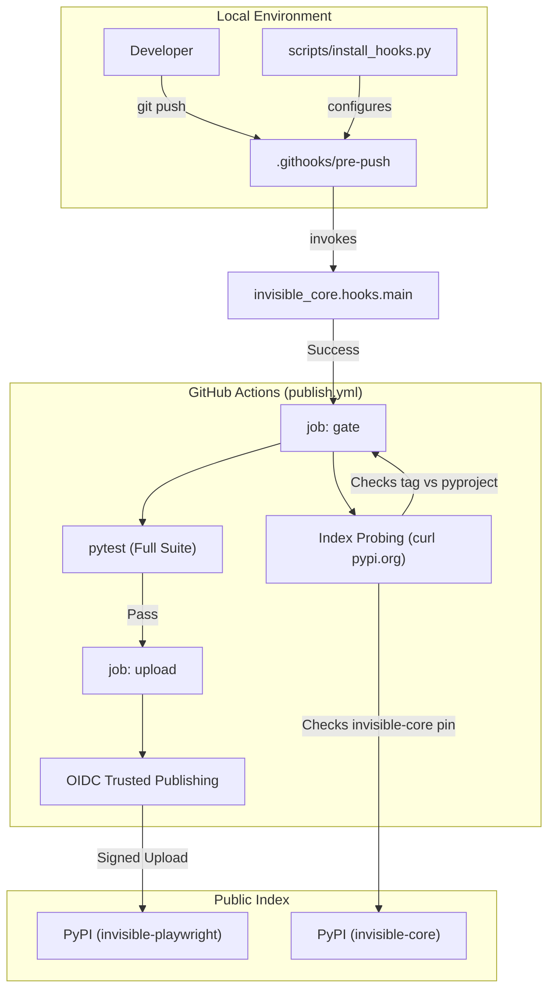

<!-- source: DeepWiki mcp.deepwiki.com · repo feder-cr/invisible_playwright · page 10.1 Publication Gate and Release Ledger · fetched 2026-10-26 -->

# Publication Gate and Release Ledger

Relevant source files

The following files were used as context for generating this wiki page:

- [.gitattributes](.gitattributes)
- [.githooks/pre-push](.githooks/pre-push)
- [.github/workflows/firefox-launch-matrix.yml](.github/workflows/firefox-launch-matrix.yml)
- [.github/workflows/publish.yml](.github/workflows/publish.yml)
- [.github/workflows/tests.yml](.github/workflows/tests.yml)
- [.github/workflows/user-install.yml](.github/workflows/user-install.yml)
- [.github/workflows/webrtc-e2e.yml](.github/workflows/webrtc-e2e.yml)
- [PUBLISHED.json](PUBLISHED.json)
- [scripts/install_hooks.py](scripts/install_hooks.py)
- [src/invisible_playwright/cli.py](src/invisible_playwright/cli.py)
- [tests/test_cli.py](tests/test_cli.py)
- [tests/test_mouse.py](tests/test_mouse.py)
- [tests/test_publish_gate_wiring.py](tests/test_publish_gate_wiring.py)
- [tests/test_release_e2e.py](tests/test_release_e2e.py)
- [tests/test_upgrade_e2e.py](tests/test_upgrade_e2e.py)
- [tests/test_version.py](tests/test_version.py)
- [tests/test_webrtc_realness.py](tests/test_webrtc_realness.py)

The `invisible_playwright` publication system is a multi-layered integrity framework designed to prevent "broken releases"—situations where a package is published to PyPI but cannot be installed or executed by users due to missing dependencies, mismatched binary seals, or out-of-sync core libraries. The system replaces manual `twine` uploads with OIDC-trusted publishing and enforces a strict release ledger (`PUBLISHED.json`) to track the provenance of every artifact.

## Release Integrity Architecture

The release process is governed by a "Gate" pattern. Before any code reaches the public index (PyPI), it must pass through local pre-push hooks, CI unit tests, and a specialized publication workflow that probes the index for dependency availability.

### Release Flow and Data Gateways

The following diagram illustrates the flow from a developer's commit to a successful PyPI publication, highlighting the technical entities involved in the validation.

**Release Pipeline and Gate Entities**

**Sources:** [.github/workflows/publish.yml:1-140](), [.githooks/pre-push:1-55](), [scripts/install_hooks.py:1-20]()

## The Release Ledger (`PUBLISHED.json`)

The `PUBLISHED.json` file serves as a definitive record of every version that has reached the PyPI index. It prevents "ghost releases" where a version tag exists in Git but the corresponding artifact on PyPI was built from a different, uncommitted tree state.

### Ledger Structure and Validation
The ledger records:
1.  **Release Metadata**: Timestamp and `requires_dist` pins at the time of publication [.PUBLISHED.json:4-16]().
2.  **File Digests**: SHA256 hashes for the `sdist` and every individual file contained within the package [.PUBLISHED.json:17-42]().
3.  **Provenance**: The origin of the release (e.g., GitHub Actions workflow) [.PUBLISHED.json:108]().

This ledger is never shipped inside the package itself, as the act of including the ledger would change the package's own digest, creating a recursive invalidation [.PUBLISHED.json:2]().

**Sources:** [PUBLISHED.json:1-108]()

## Publication Gates (`publish.yml`)

The `publish.yml` workflow implements several critical gates that must be cleared before the `upload` job (which holds the PyPI OIDC token) can execute.

### 1. Dependency Synchronization Gate
The most frequent cause of release failure is a "split-brain" dependency state. `invisible_playwright` depends on an exact version of `invisible-core`. If the wrapper is published before the new core version is available on PyPI, all user installs will fail with `No matching distribution found`.

The workflow explicitly probes the PyPI JSON API to ensure the pinned `invisible-core` version is live before proceeding [.github/workflows/publish.yml:87-117]().

### 2. Index Probing and Idempotency
The `already-published` job checks if the current version in `pyproject.toml` already exists on PyPI. If it does, the workflow exits gracefully with a `::notice::` rather than failing with a Red CI status, which happens when trying to re-upload an existing filename to PyPI [.github/workflows/publish.yml:39-60]().

### 3. OIDC Trusted Publishing
The system uses GitHub's OIDC (OpenID Connect) trust relationship with PyPI. This eliminates the need for long-lived secrets or tokens. The `id-token: write` permission is granted only to the `upload` job, which is protected by the `pypi` environment [.github/workflows/publish.yml:138-146]().

**Sources:** [.github/workflows/publish.yml:1-160]()

## Local Integrity: Pre-Push Hooks

To catch issues before they reach CI, the repository uses a Git hook system managed by `scripts/install_hooks.py`.

### Hook Mechanism
*   **Installation**: `scripts/install_hooks.py` sets `git config core.hooksPath .githooks` [scripts/install_hooks.py:1-20]().
*   **Execution**: The `.githooks/pre-push` script is a shell stub that locates a Python interpreter and hands over control to the `invisible_core.hooks` module [.githooks/pre-push:23-55]().
*   **Policy**: The actual validation logic (e.g., checking for uncommitted changes in sensitive files, validating `pyproject.toml` versions) is defined in the `invisible_core` package to ensure consistency across the entire ecosystem [.githooks/pre-push:45-55]().

**Sources:** [.githooks/pre-push:1-55](), [scripts/install_hooks.py:1-20]()

## Release Validation Tests

The system includes specific end-to-end tests that simulate a "stranger's" installation path to verify the integrity of the published artifacts.

### `test_release_e2e.py`
This suite performs a "clean room" install:
1.  Creates a fresh temporary virtual environment [tests/test_release_e2e.py:75-82]().
2.  Installs `invisible-playwright` from the PyPI index (or a specified git revision for pre-release checks) [tests/test_release_e2e.py:1-31]().
3.  Verifies that the correct `FIREFOX_UPSTREAM_VERSION` is readable from the installed package [tests/test_release_e2e.py:100-109]().
4.  Launches a real browser instance against a `data:` URL to ensure the patched binary and Juggler protocol are functional [tests/test_release_e2e.py:22-31]().

### `test_upgrade_e2e.py`
Ensures that existing users can upgrade safely. It installs the *previous* version from PyPI, then runs `pip install -U`, and verifies that the `invisible-core` pin moves in lockstep with the wrapper [tests/test_upgrade_e2e.py:1-25](), [tests/test_upgrade_e2e.py:139-173]().

**Sources:** [tests/test_release_e2e.py:1-109](), [tests/test_upgrade_e2e.py:1-173]()

## CLI Version and Diagnostic Reporting

The `invisible-playwright version` command provides the diagnostic data required to verify release integrity on a user's machine.

| Field | Source | Purpose |
| :--- | :--- | :--- |
| `invisible_playwright` | `__version__` | The wrapper version [.src/invisible_playwright/cli.py:103]() |
| `invisible_core` | `importlib.metadata` | The core version actually in the venv [.src/invisible_playwright/cli.py:100]() |
| `engine` | `active_seal()` | The specific Firefox tag/build ID [.src/invisible_playwright/cli.py:107]() |
| `seal` | `s.digest` | The SHA256 fragment of the binary seal [.src/invisible_playwright/cli.py:108]() |

**Sources:** [src/invisible_playwright/cli.py:90-112]()

---

