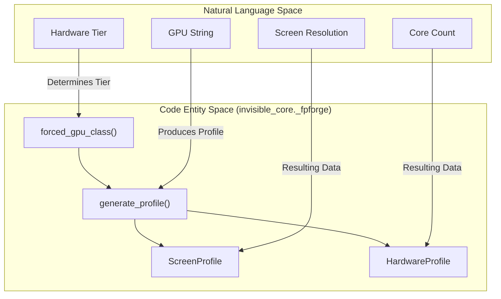
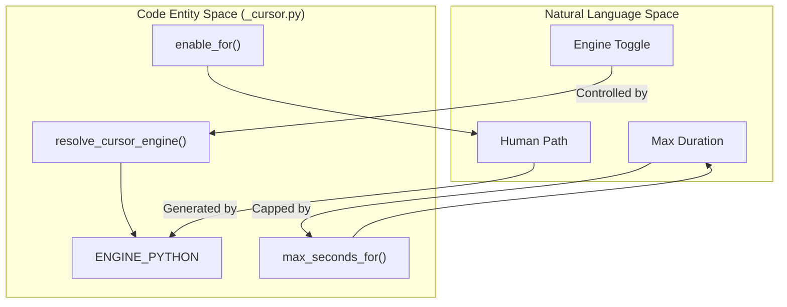

<!-- source: DeepWiki mcp.deepwiki.com · repo feder-cr/invisible_playwright · page 11 Glossary · fetched 2026-10-26 -->

# Glossary

Relevant source files

The following files were used as context for generating this wiki page:

- [.gitattributes](.gitattributes)
- [.githooks/pre-push](.githooks/pre-push)
- [.github/workflows/firefox-launch-matrix.yml](.github/workflows/firefox-launch-matrix.yml)
- [.github/workflows/publish.yml](.github/workflows/publish.yml)
- [.github/workflows/tests.yml](.github/workflows/tests.yml)
- [.github/workflows/webrtc-e2e.yml](.github/workflows/webrtc-e2e.yml)
- [CHANGELOG.md](CHANGELOG.md)
- [PUBLISHED.json](PUBLISHED.json)
- [README.md](README.md)
- [docs/README.md](docs/README.md)
- [docs/badges/telegram.svg](docs/badges/telegram.svg)
- [docs/banner-dark.png](docs/banner-dark.png)
- [docs/banner-light.png](docs/banner-light.png)
- [docs/creepjs-explained.md](docs/creepjs-explained.md)
- [docs/headless-fonts-differ.md](docs/headless-fonts-differ.md)
- [docs/integrations/README.md](docs/integrations/README.md)
- [docs/navigator-webdriver-explained.md](docs/navigator-webdriver-explained.md)
- [docs/playwright-detected-as-bot.md](docs/playwright-detected-as-bot.md)
- [docs/playwright-stealth-levels.md](docs/playwright-stealth-levels.md)
- [docs/webgl-renderer-strings.md](docs/webgl-renderer-strings.md)
- [pyproject.toml](pyproject.toml)
- [scripts/install_hooks.py](scripts/install_hooks.py)
- [src/invisible_playwright/_geo.py](src/invisible_playwright/_geo.py)
- [src/invisible_playwright/_recaptcha_seed.py](src/invisible_playwright/_recaptcha_seed.py)
- [src/invisible_playwright/async_api.py](src/invisible_playwright/async_api.py)
- [src/invisible_playwright/constants.py](src/invisible_playwright/constants.py)
- [src/invisible_playwright/download.py](src/invisible_playwright/download.py)
- [src/invisible_playwright/launcher.py](src/invisible_playwright/launcher.py)
- [tests/test_async_api.py](tests/test_async_api.py)
- [tests/test_launcher_helpers.py](tests/test_launcher_helpers.py)
- [tests/test_mouse.py](tests/test_mouse.py)
- [tests/test_publish_gate_wiring.py](tests/test_publish_gate_wiring.py)
- [tests/test_readme_claims.py](tests/test_readme_claims.py)
- [tests/test_recaptcha_seed.py](tests/test_recaptcha_seed.py)
- [tests/test_webrtc_realness.py](tests/test_webrtc_realness.py)

This page provides a comprehensive reference for the internal terminology, implementation details, and domain concepts used throughout the `invisible_playwright` codebase. It serves as a technical bridge for engineers to map high-level anti-detection strategies to specific code entities.

## 1. Core Concepts

### Stealth Patches (C++ Level)
Unlike traditional anti-detect browsers that rely on JavaScript shims (which are themselves detectable), `invisible_playwright` utilizes a patched Firefox binary. These patches are applied at the C++ level within the Gecko engine. This ensures that when a page queries `navigator.userAgent` or `WebGLRenderingContext.getParameter`, the values returned follow the native code path, making them indistinguishable from "the truth" [README.md:26-30]().

### Coherent Fingerprinting
A "coherent" fingerprint is one where all hardware and software signals (GPU, Screen, CPU cores, Audio, Fonts) are internally consistent. For example, a high-end RTX 4090 GPU should logically be paired with a high-resolution screen (1440p+) and high core count (16+). The `fpforge` engine (housed in `invisible_core`) uses a Bayesian network to ensure these relationships are maintained [src/invisible_playwright/launcher.py:18-18]().

### Headed-on-Virtual-Display
Standard "Headless" mode (`headless=True` in Playwright) flips Firefox onto a software-rendering path that is easily detected by anti-bots [docs/playwright-stealth-levels.md:65-69](). `invisible_playwright` achieves invisibility by running a **headed** browser instance inside a virtual display (Xvfb on Linux or a hidden Desktop on Windows) via the `make_virtual_display` factory [src/invisible_playwright/launcher.py:21-21](), [src/invisible_playwright/launcher.py:131-134]().

## 2. Fingerprint Engine (fpforge)

The Fingerprint Forge (`fpforge`) is the internal package responsible for generating the browser profiles. It was moved to the `invisible_core` repository to share logic across different drivers [pyproject.toml:27-30]().

### Bayesian Sampler
The sampler utilizes a Directed Acyclic Graph (DAG) to generate values. It starts with a root node and samples child nodes based on Conditional Probability Tables (CPTs).

**Natural Language to Code Entity Space: Sampler Architecture**

Sources: [src/invisible_playwright/launcher.py:18-20](), [src/invisible_playwright/launcher.py:157-159]()

### Key Data Structures

| Term | Code Entity | Description |
|:---|:---|:---|
| **Profile** | `Profile` (dataclass) | The top-level container for a generated fingerprint, including `GPUProfile`, `ScreenProfile`, and `HardwareProfile` [src/invisible_playwright/launcher.py:18-18](). |
| **Pinning** | `pin` (parameter) | A mechanism to force specific values (e.g., a specific GPU renderer) while allowing the rest of the Bayesian network to sample around it [README.md:137-153](). |
| **Seed** | `seed` | A 31-bit integer that drives the deterministic generation of the entire profile and humanized motion [src/invisible_playwright/launcher.py:128-129](). |

## 3. Browser Launch & Display

### Humanized Cursor Motion
Instead of "teleporting" the mouse to coordinates, `invisible_playwright` intercepts Playwright pointer calls and moves the cursor along a Bezier curve.

**Natural Language to Code Entity Space: Motion System**

Sources: [src/invisible_playwright/launcher.py:12-17](), [src/invisible_playwright/launcher.py:161-163]()

### Preference Translation
The `_build_prefs` method (and `compose_session_prefs` in the core) converts the sampled `Profile` into a dictionary of Firefox preferences.

*   **`zoom.stealth.*`**: The namespace used by the C++ patches to read spoofed values [CHANGELOG.md:66-67]().
*   **`_BASELINE`**: A set of global stealth policies applied to every session [CHANGELOG.md:59-60]().
*   **`_NEWTAB_SETTLE`**: A 0.4s sleep after tab creation to prevent races with internal `about:newtab` navigations [src/invisible_playwright/launcher.py:30-30]().

## 4. Network & Proxy

### Dual-Path Proxy Strategy
The `configure_proxy` function (now in `invisible_core`) bifurcates proxy handling based on the protocol [src/invisible_playwright/launcher.py:23-23]():

1.  **SOCKS4/5**: Handled by the **patched Firefox binary**. Credentials are written to Firefox preferences, and the patched `nsProtocolProxyService` handles the authentication [README.md:120-121]().
2.  **HTTP/HTTPS**: Handled by **Playwright's native implementation**. The configuration is passed back to the Playwright launcher [src/invisible_playwright/launcher.py:177-178]().

## 5. Process Lifecycle

### Reaper and Guards
To prevent browser leaks, the `_reaper.py` module (aliased from `invisible_core`) ensures that browser processes are killed if the parent Python process dies.

*   **`SessionToken`**: A unique identifier minted for each browser session to track its process tree [src/invisible_playwright/launcher.py:24-24]().
*   **`guard_for()`**: Returns a `LifetimeGuard` (or `JobObjectGuard` on Windows) that monitors the session [src/invisible_playwright/launcher.py:179-179]().
*   **`psutil`**: A hard dependency used to identify the browser tree by reading process environment blocks [pyproject.toml:60-70]().

## 6. Jargon & Abbreviations

| Abbreviation | Full Term | Context |
|:---|:---|:---|
| **RFP** | Resist Fingerprinting | Native Firefox feature. `invisible_playwright` disables it in favor of its own C++ patches [CHANGELOG.md:59-60](). |
| **CPT** | Conditional Probability Table | The data files defining the Bayesian network's logic [pyproject.toml:28-30](). |
| **HWC** | Hardware Concurrency | Refers to `navigator.hardwareConcurrency` [README.md:149-149](). |
| **DPR** | Device Pixel Ratio | Refers to `window.devicePixelRatio` [CHANGELOG.md:53-53](). |
| **ANGLE** | Almost Native Graphics Layer Engine | Graphics abstraction layer on Windows. The binary is patched to report canonical ANGLE strings [README.md:145-146](). |
| **OIDC** | OpenID Connect | Used for "Trusted Publishing" to PyPI without long-lived tokens [CHANGELOG.md:64-64](). |