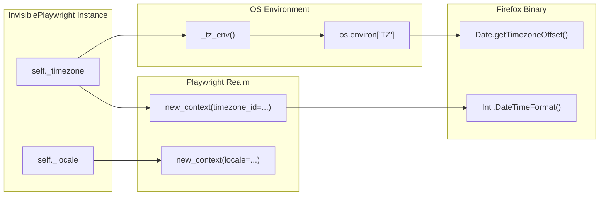

<!-- source: DeepWiki mcp.deepwiki.com · repo feder-cr/invisible_playwright · page 2.1 Sync and Async APIs · fetched 2026-10-26 -->

# Sync and Async APIs

Relevant source files

The following files were used as context for generating this wiki page:

- [src/invisible_playwright/_engine.py](src/invisible_playwright/_engine.py)
- [src/invisible_playwright/_recaptcha_seed.py](src/invisible_playwright/_recaptcha_seed.py)
- [src/invisible_playwright/async_api.py](src/invisible_playwright/async_api.py)
- [src/invisible_playwright/launcher.py](src/invisible_playwright/launcher.py)
- [tests/test_async_api.py](tests/test_async_api.py)
- [tests/test_launcher_config.py](tests/test_launcher_config.py)
- [tests/test_launcher_helpers.py](tests/test_launcher_helpers.py)
- [tests/test_new_page_defaults.py](tests/test_new_page_defaults.py)
- [tests/test_recaptcha_seed.py](tests/test_recaptcha_seed.py)
- [tests/test_seal_wire_version.py](tests/test_seal_wire_version.py)
- [tests/test_suite_boundaries.py](tests/test_suite_boundaries.py)

The `invisible_playwright` package provides a high-level wrapper around a patched Firefox binary, offering both synchronous and asynchronous APIs. These APIs manage the browser lifecycle, fingerprint generation, and virtual display orchestration to ensure a stealthy, "invisible" automation environment.

## The InvisiblePlaywright Class

The core of the library is the `InvisiblePlaywright` class, available in `invisible_playwright.launcher` [[src/invisible_playwright/launcher.py:78-78]]() (sync) and `invisible_playwright.async_api` [[src/invisible_playwright/async_api.py:47-47]]() (async). Both variants maintain strict API parity, ensuring that the fingerprinting logic, preference translation, and proxy handling remain identical regardless of the concurrency model [[tests/test_async_api.py:112-154]]().

### Constructor and Eager Initialization

The constructor performs "eager" profile generation. This ensures that the fingerprint is materialized immediately upon instantiation, allowing users to inspect the chosen identity (via `self.seed` and `self._profile`) before the browser is even launched.

**Key Constructor Parameters:**
*   `seed`: An optional integer. If `None`, a random 31-bit integer is chosen using `secrets.randbits(31)` [[src/invisible_playwright/launcher.py:147-147]]().
*   `pin`: A dictionary to force specific fingerprint fields. Invalid keys raise a `ValueError` immediately during construction [[src/invisible_playwright/async_api.py:53-53]](), [[tests/test_async_api.py:53-56]]().
*   `headless`: A boolean that, when `True`, triggers the library's custom virtual display logic instead of the standard Playwright `headless=True` flag [[src/invisible_playwright/launcher.py:149-149]]().
*   `humanize`: Controls the patched Juggler's Bezier mouse trajectory logic [[src/invisible_playwright/launcher.py:118-118]]().
*   `prep_recaptcha`: If `True`, pre-seeds the browser context with realistic cookies [[src/invisible_playwright/launcher.py:124-124]]().

**Sources:** [[src/invisible_playwright/launcher.py:110-160]](), [[src/invisible_playwright/async_api.py:50-103]](), [[tests/test_async_api.py:23-83]]()

### Data Flow: From Constructor to Browser Launch

The following diagram illustrates how the `InvisiblePlaywright` instance prepares the environment during the lifecycle.

**Launcher Initialization Flow**

```mermaid
graph TD
    subgraph "Constructor (Eager)"
        Init["InvisiblePlaywright.__init__"] --> Seed["Clamp Seed (int31)"]
        Seed --> GenProf["_fpforge.generate_profile(seed, pin)"]
        GenProf --> ProfileObj["self._profile (Materialized)"]
    end

    subgraph "Lifecycle Start (__enter__ / __aenter__)"
        Enter["__enter__ / __aenter__"] --> Geo["prepare_session_geo() (Off-loop)"]
        Geo --> Bin["resolve_executable()"]
        Bin --> Prefs["_build_prefs()"]
        Prefs --> Proxy["_configure_proxy_shared()"]
        Proxy --> Headless["_resolve_headless() (Virtual Display)"]
        Headless --> Launch["playwright.firefox.launch()"]
        Launch --> Patch["_patch_new_context_defaults()"]
    end
```

**Sources:** [[src/invisible_playwright/launcher.py:147-210]](), [[src/invisible_playwright/async_api.py:66-132]]()

---

## Lifecycle Management

`InvisiblePlaywright` is designed to be used as a context manager. This ensures that the Playwright driver, the browser process, and any virtual displays (Xvfb/Win32 Desktop) are cleaned up reliably.

### Context Manager Implementation
*   **Sync:** Implements `__enter__` and `__exit__` [[src/invisible_playwright/launcher.py:162-230]]().
*   **Async:** Implements `__aenter__` and `__aexit__` [[src/invisible_playwright/async_api.py:105-180]]().

Upon entering the context, the class monkey-patches the returned `Browser` object's `new_context` and `new_page` methods. This ensures that every context created from the browser automatically inherits the correct viewport, screen resolution, and device scale factor derived from the generated `Profile` [[src/invisible_playwright/launcher.py:221-228]]().

### Teardown Sequence
The `_teardown` method (or its async equivalent) follows a strict order to avoid resource leaks:
1.  Close the `Browser` object.
2.  Stop the `Playwright` driver.
3.  Stop the `_virtual_display` (if one was created) [[src/invisible_playwright/launcher.py:248-266]]().

**Sources:** [[src/invisible_playwright/launcher.py:162-266]](), [[src/invisible_playwright/async_api.py:105-180]]()

---

## Viewport and Screen Geometry

One of the primary responsibilities of the launcher is to calculate a valid viewport that fits within the spoofed screen dimensions without triggering "out of bounds" detection or Playwright errors.

### Geometry Calculation Logic
The library uses offsets to account for "Window Chrome" (title bars, scrollbars) and the OS taskbar. These are now sourced from the `Profile` itself or shared core constants to prevent internal disagreements [[src/invisible_playwright/launcher.py:51-69]]().

| Constant | Source | Description |
| :--- | :--- | :--- |
| `_CHROME_W` | `invisible_core.constants.CHROME_W` | Horizontal window padding (measured as 0 in real FF151) [[src/invisible_playwright/launcher.py:60-60]]() |
| `_CHROME_H` | `invisible_core.constants.CHROME_H` | Vertical chrome (measured as 85 in real FF151) [[src/invisible_playwright/launcher.py:59-59]]() |
| `_TASKBAR_H` | `ScreenProfile.taskbar_px` | OS Taskbar height (defaults to 48 in core) [[src/invisible_playwright/launcher.py:69-69]]() |

**Logic:**
*   `viewport_width = profile.screen.width - _CHROME_W` [[tests/test_launcher_helpers.py:143-143]]()
*   `viewport_height = profile.screen.height - profile.screen.taskbar_px - _CHROME_H` [[tests/test_launcher_helpers.py:144-145]]()

**Sources:** [[src/invisible_playwright/launcher.py:51-70]](), [[tests/test_launcher_helpers.py:136-152]](), [[tests/test_launcher_config.py:45-68]]()

---

## Timezone and Locale Handling

`InvisiblePlaywright` handles timezones at two levels: the OS environment and the Playwright realm.

### TZ Environment Mapping
Windows and Linux handle the `TZ` environment variable differently. Linux glibc accepts IANA names (e.g., `America/New_York`), but Windows MSVCRT requires POSIX format (e.g., `EST5EDT`). The `_tz_env` helper uses the `_IANA_TO_POSIX_TZ` table to translate common residential proxy zones [[src/invisible_playwright/launcher.py:71-76]]().

### Realm Overrides
Because Windows ICU can sometimes drop no-DST zones (like `America/Phoenix`) when set via global preferences, the library explicitly passes the `timezone_id` and `locale` into Playwright's `new_context` kwargs [[src/invisible_playwright/async_api.py:127-130]]().

**Entity Relationship: Preference and Context Propagation**

**Sources:** [[src/invisible_playwright/launcher.py:71-76]](), [[src/invisible_playwright/async_api.py:106-122]](), [[tests/test_launcher_helpers.py:27-80]]()

---

## API Parity and Patching

The library implements a specific patch to mitigate races in Firefox 150 with Fission.

### The `new_page` Settle Race-Condition Fix
Both sync and async variants wrap the `BrowserContext.new_page` method. When a new tab is created, Firefox emits an internal `about:newtab` navigation roughly 100ms later. If a script calls `page.goto()` immediately, it often fails with "Navigation interrupted". The launcher injects a `0.4s` sleep (constant `_NEWTAB_SETTLE`) to allow the internal navigation to settle [[src/invisible_playwright/launcher.py:27-48]](), [[src/invisible_playwright/async_api.py:11-44]]().

### Cookie Pre-seeding
If `prep_recaptcha` is enabled, the launcher uses `_recaptcha_seed.py` to populate the context with cookies derived from the persona's `browsing_history`. This includes a mandatory batch for `.google.com` (NID, CONSENT, SOCS, _GRECAPTCHA, ENID) while excluding deprecated cookies like `1P_JAR` [[src/invisible_playwright/_recaptcha_seed.py:1-21]]().

### Implementation Parity
The two APIs are strictly compared in tests to ensure features like the process-leak reaper and environment variable support land on both sides simultaneously [[tests/test_async_api.py:88-174]]().

| Feature | Sync API (`launcher.py`) | Async API (`async_api.py`) |
| :--- | :--- | :--- |
| **Driver** | `sync_playwright()` | `async_playwright()` |
| **Settle** | `time.sleep(0.4)` | `await asyncio.sleep(0.4)` |
| **Context** | `__enter__` / `__exit__` | `__aenter__` / `__aexit__` |
| **Geo Resolution** | `prepare_session_geo` | `await asyncio.to_thread(prepare_session_geo)` |

**Sources:** [[src/invisible_playwright/launcher.py:27-48]](), [[src/invisible_playwright/async_api.py:11-44]](), [[src/invisible_playwright/_recaptcha_seed.py:86-126]](), [[tests/test_new_page_defaults.py:143-153]]()

---

