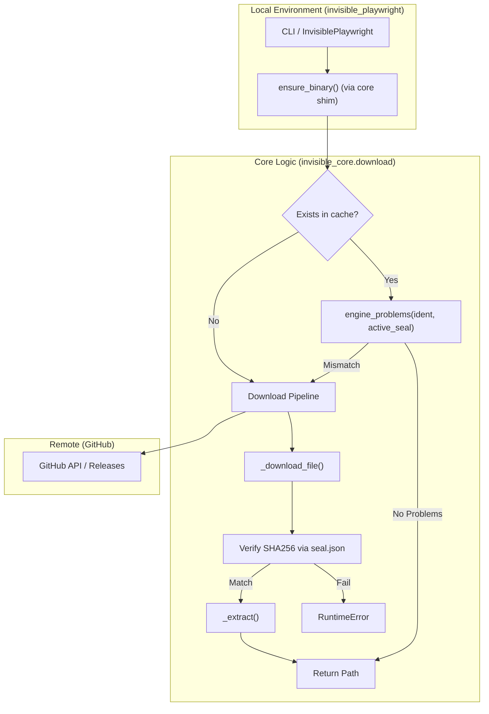
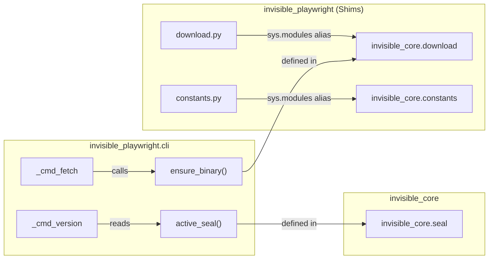

<!-- source: DeepWiki mcp.deepwiki.com · repo feder-cr/invisible_playwright · page 2.3 Binary Management and Download · fetched 2026-10-26 -->

# Binary Management and Download

Relevant source files

The following files were used as context for generating this wiki page:

- [.github/workflows/user-install.yml](.github/workflows/user-install.yml)
- [CHANGELOG.md](CHANGELOG.md)
- [pyproject.toml](pyproject.toml)
- [src/invisible_playwright/_engine.py](src/invisible_playwright/_engine.py)
- [src/invisible_playwright/_geo.py](src/invisible_playwright/_geo.py)
- [src/invisible_playwright/cli.py](src/invisible_playwright/cli.py)
- [src/invisible_playwright/constants.py](src/invisible_playwright/constants.py)
- [src/invisible_playwright/download.py](src/invisible_playwright/download.py)
- [tests/test_cli.py](tests/test_cli.py)
- [tests/test_launcher_config.py](tests/test_launcher_config.py)
- [tests/test_release_e2e.py](tests/test_release_e2e.py)
- [tests/test_seal_wire_version.py](tests/test_seal_wire_version.py)
- [tests/test_suite_boundaries.py](tests/test_suite_boundaries.py)
- [tests/test_upgrade_e2e.py](tests/test_upgrade_e2e.py)
- [tests/test_version.py](tests/test_version.py)

The `invisible_playwright` package requires a specific, patched build of Firefox to function. This page describes the automated system for fetching, verifying, and caching these binaries. Following the 2026-07-03 architecture split, the core logic for binary management now resides in `invisible_core`, with `invisible_playwright` providing backward-compatibility shims and CLI entry points.

## Binary Lifecycle and Pipeline

The binary management system follows a "cache-check-then-download" pipeline. When the library or CLI requests the browser path, the system first checks the local filesystem. If the binary is missing or belongs to an outdated version, it initiates a secure download from GitHub Releases.

### Download Flow

The primary entry point for this logic is `ensure_binary()`, which is imported into `src/invisible_playwright/cli.py` from `invisible_core.download` [src/invisible_playwright/cli.py:38]().

1.  **Platform Detection**: The system identifies the host OS and architecture.
2.  **Cache Lookup**: It checks for the existence of the binary in the versioned cache directory (e.g., `~/.cache/invisible-playwright/firefox-19/`) [src/invisible_playwright/cli.py:111]().
3.  **Verification (Seal Check)**: Before using a cached binary, the system validates it against the `seal.json`. The `engine_problems` function checks if the cached tree matches the active seal [src/invisible_playwright/cli.py:64]().
4.  **Download & Verification**: If not found or invalid, it downloads the archive. Verification is performed using SHA256 checksums provided in the engine release's `seal.json` asset [CHANGELOG.md:11-14]().
5.  **Extraction**: Upon successful verification, the archive is extracted into the permanent cache directory.

### Download Pipeline Architecture

**Sources:** [src/invisible_playwright/cli.py:47-88](), [src/invisible_playwright/download.py:1-5](), [CHANGELOG.md:11-14]()

## Configuration and Versioning

Binary versioning is decoupled from the Python package version. The expected core version is strictly pinned in `pyproject.toml` to ensure the wrapper drives a compatible engine [pyproject.toml:52]().

| Code Entity | Description | Location |
| :--- | :--- | :--- |
| `BINARY_VERSION` | The unique tag for the patched Firefox build (e.g., `firefox-19`). | [src/invisible_playwright/cli.py:37]() |
| `FIREFOX_UPSTREAM_VERSION` | The base Firefox version (e.g., `151.0`). | [src/invisible_playwright/cli.py:37]() |
| `active_seal()` | Returns the `Seal` object containing BuildID and digest. | [src/invisible_playwright/cli.py:58]() |
| `cache_root()` | The filesystem location where engines are stored. | [src/invisible_playwright/cli.py:111]() |

**Sources:** [src/invisible_playwright/cli.py:37-44](), [pyproject.toml:52-59]()

## Verification and Deadlines

### Seal Verification
Every run of `fetch` checks every cached engine against the seal [src/invisible_playwright/cli.py:10-13](). A mismatching tree is reported to `stderr` and replaced by `ensure_binary` [src/invisible_playwright/cli.py:72-78](). This replaces the legacy `doctor` command.

### Download Deadlines
To prevent hanging on slow connections, the system enforces a download deadline via `INVISIBLE_DOWNLOAD_DEADLINE` (default 1800s). This is managed at the `requests` level within the core engine [CHANGELOG.md:47]().

**Sources:** [src/invisible_playwright/cli.py:47-88](), [CHANGELOG.md:47]()

## GitHub Authentication

The system supports authenticated requests to avoid GitHub API rate limits (60 calls/hour for unauthenticated IPs). The CLI and download logic respect the following environment variables:
1.  `STEALTHFOX_GITHUB_TOKEN`
2.  `GITHUB_TOKEN` [tests/test_release_e2e.py:147]()

Authentication is critical for CI/CD workflows (like `user-install.yml`) that perform multiple version checks in rapid succession [.github/workflows/user-install.yml:142-147]().

**Sources:** [tests/test_release_e2e.py:142-147](), [.github/workflows/user-install.yml:142-147]()

### Entity Mapping: CLI to Core Implementation

**Sources:** [src/invisible_playwright/cli.py:47-112](), [src/invisible_playwright/download.py:1-5](), [src/invisible_playwright/constants.py:1-5]()

## CLI Reference for Binary Management

The CLI surface has been simplified to two primary commands [src/invisible_playwright/cli.py:3-30]().

*   **`fetch`**: Checks all cached engines against the seal, downloads the required binary if missing or invalid, and prints the absolute path to the executable as the last line of `stdout` [src/invisible_playwright/cli.py:47-87]().
    *   *Usage*: `$(invisible-playwright fetch)` for scripting.
*   **`version`**: Prints the versions of the wrapper, the installed core, and the sealed engine (Tag, Firefox version, BuildID, and Seal digest) [src/invisible_playwright/cli.py:90-112](). It also displays the `cache_root` location.

**Sources:** [src/invisible_playwright/cli.py:3-30](), [tests/test_cli.py:32-56]()

---

