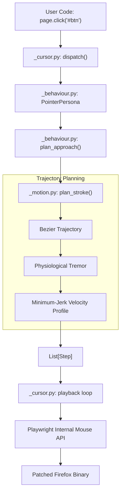
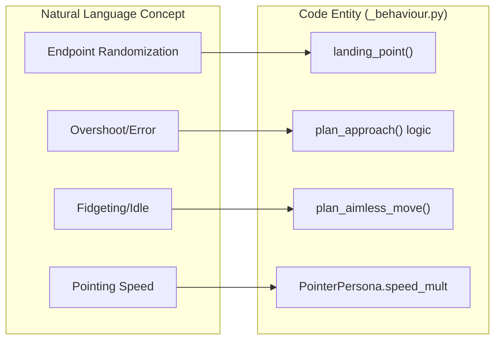

<!-- source: DeepWiki mcp.deepwiki.com · repo feder-cr/invisible_playwright · page 2.4 Humanized Cursor Motion · fetched 2026-10-26 -->

# Humanized Cursor Motion

Relevant source files

The following files were used as context for generating this wiki page:

- [.github/workflows/firefox-launch-matrix.yml](.github/workflows/firefox-launch-matrix.yml)
- [.github/workflows/publish.yml](.github/workflows/publish.yml)
- [.github/workflows/tests.yml](.github/workflows/tests.yml)
- [.github/workflows/webrtc-e2e.yml](.github/workflows/webrtc-e2e.yml)
- [src/invisible_playwright/_behaviour.py](src/invisible_playwright/_behaviour.py)
- [src/invisible_playwright/_cursor.py](src/invisible_playwright/_cursor.py)
- [src/invisible_playwright/_motion.py](src/invisible_playwright/_motion.py)
- [src/invisible_playwright/_recaptcha_seed.py](src/invisible_playwright/_recaptcha_seed.py)
- [src/invisible_playwright/async_api.py](src/invisible_playwright/async_api.py)
- [src/invisible_playwright/launcher.py](src/invisible_playwright/launcher.py)
- [tests/test_async_api.py](tests/test_async_api.py)
- [tests/test_behaviour.py](tests/test_behaviour.py)
- [tests/test_cursor_dispatch.py](tests/test_cursor_dispatch.py)
- [tests/test_launcher_helpers.py](tests/test_launcher_helpers.py)
- [tests/test_motion.py](tests/test_motion.py)
- [tests/test_motion_fingerprint.py](tests/test_motion_fingerprint.py)
- [tests/test_mouse.py](tests/test_mouse.py)
- [tests/test_recaptcha_seed.py](tests/test_recaptcha_seed.py)
- [tests/test_webrtc_realness.py](tests/test_webrtc_realness.py)

The humanized cursor motion system in `invisible_playwright` transforms discrete, instantaneous pointer "teleports" typical of automation into continuous, human-like trajectories. It operates by intercepting Playwright's low-level pointer calls and expanding them into a series of intermediate movements defined by Bezier curves, physiological tremor models, and macro-scale behavioral patterns.

## Architecture Overview

The system is split into three layers to separate trajectory math from behavioral logic and API integration:

1.  **`_motion.py` (Micro-scale)**: Responsible for the mathematical generation of a single stroke. It handles Bezier path planning, velocity profiles (Minimum Jerk), and the physiological tremor model [src/invisible_playwright/_motion.py:1-50]().
2.  **`_behaviour.py` (Macro-scale)**: Plans the "why and when." It decides where endpoints should land within an element (distribution), when to perform "fidget" moves, and how long idle periods should last [src/invisible_playwright/_behaviour.py:37-55]().
3.  **`_cursor.py` (Integration)**: The wiring layer that intercepts Playwright's `page.click`, `page.hover`, and `mouse.move` calls to inject the planned movements into the browser [src/invisible_playwright/_cursor.py:1-30]().

### Data Flow: From Call to Cursor

The following diagram illustrates how a standard Playwright call is processed by the humanization engine.

**Pointer Instruction Pipeline**

Sources: [src/invisible_playwright/_cursor.py:75-120](), [src/invisible_playwright/_behaviour.py:37-81](), [src/invisible_playwright/_motion.py:20-60]().

---

## Configuration and Control

The motion engine is primarily controlled via the `InvisiblePlaywright` constructor and environment variables.

| Parameter / Variable | Type | Description |
| :--- | :--- | :--- |
| `humanize` | `bool \| float` | `True` enables default behavior (1.5s cap). A `float` sets a custom time cap per movement. `False` disables humanization. |
| `INVPW_CURSOR_ENGINE` | `env` | `python` (default): Uses this Python-side engine. `binary`: Uses the engine inside the C++ binary. `off`: Disables motion process-wide. |
| `seed` | `int` | The session seed drives all random parameters (speed, overshoot, tremor) making them deterministic for that session. |

Sources: [src/invisible_playwright/launcher.py:118-118](), [src/invisible_playwright/_cursor.py:32-55]().

---

## Behavioral Planning (`_behaviour.py`)

This module defines the `PointerPersona` class, which encapsulates session-specific behavioral traits derived from the `seed` [src/invisible_playwright/_behaviour.py:204-220]().

### Key Behavioral Features
*   **Endpoint Distribution**: Instead of clicking the center of a bounding box, `landing_point()` uses a beta distribution to favor the center while occasionally hitting edges [src/invisible_playwright/_behaviour.py:240-265]().
*   **Idle Fidgets**: When the script is idle, the system may plan "aimless moves" to prevent the cursor from being perfectly static, which is a signature of automation [src/invisible_playwright/_behaviour.py:15-20]().
*   **Overshoot and Correction**: Based on the `PointerPersona`'s `overshoot_prob`, moves may over-travel the target and require a corrective sub-movement, simulating human motor control errors [src/invisible_playwright/_behaviour.py:530-550]().

**Entity Mapping: Behavior to Code**

Sources: [src/invisible_playwright/_behaviour.py:86-103](), [src/invisible_playwright/_behaviour.py:240-250](), [src/invisible_playwright/_behaviour.py:314-330]().

---

## Motion Generation (`_motion.py`)

The micro-scale movement is generated using `plan_stroke()`.

### Mathematical Models
1.  **Bezier Paths**: Uses cubic Bezier curves where control points are jittered based on the distance between start and end [src/invisible_playwright/_motion.py:110-130]().
2.  **Minimum-Jerk Profile**: Velocity is not constant; it follows a "minimum-jerk" curve (smooth acceleration and deceleration) common in biological movements [src/invisible_playwright/_motion.py:150-165]().
3.  **Tremor Model**: Adds high-frequency (8-12 Hz) low-amplitude noise to the path to simulate physiological hand tremor [src/invisible_playwright/_motion.py:180-200]().

Sources: [src/invisible_playwright/_motion.py:100-210]().

---

## Dispatch and Interception (`_cursor.py`)

The `_cursor.py` module wraps the `BrowserContext` to intercept calls.

### Integration Mechanism
When `InvisiblePlaywright` starts a session, it calls `enable_for(context)` [src/invisible_playwright/_cursor.py:230-245](). This function performs the following:
*   Attaches a `MoveStrategy` to the context.
*   Wraps the `page.mouse.move` and `page.click` methods.
*   When a user calls `page.click(selector)`, the wrapper:
    1.  Calculates the target coordinates using Playwright's internal element handle logic.
    2.  Calculates the current cursor position.
    3.  Calls the planner to generate a `List[Step]`.
    4.  Iterates through the steps, executing `time.sleep(step.delay)` and then a low-level, non-humanized move to the intermediate coordinate [src/invisible_playwright/_cursor.py:150-190]().

**Sources:**
* `src/invisible_playwright/launcher.py:94-99` (Usage and default cap)
* `src/invisible_playwright/_cursor.py:1-55` (Engine resolution and constants)
* `src/invisible_playwright/_cursor.py:75-120` (Dispatch logic)
* `src/invisible_playwright/_behaviour.py:1-81` (Behavioral design philosophy)
* `src/invisible_playwright/_behaviour.py:204-220` (PointerPersona definition)
* `src/invisible_playwright/_motion.py:1-50` (Motion design and tremor theory)
* `src/invisible_playwright/_motion.py:110-165` (Bezier and velocity math)

---

