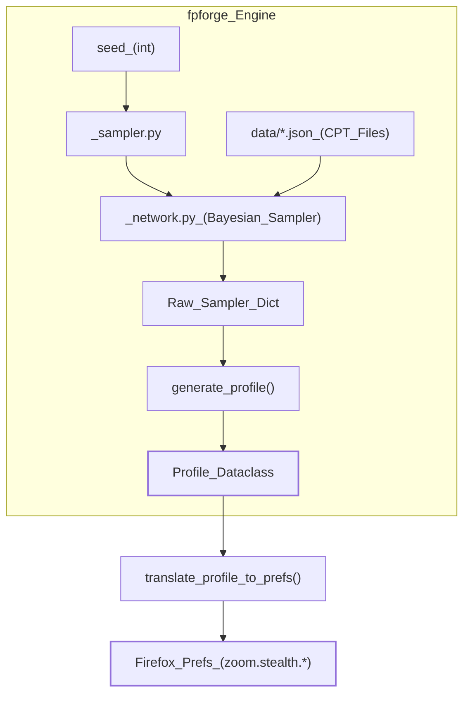
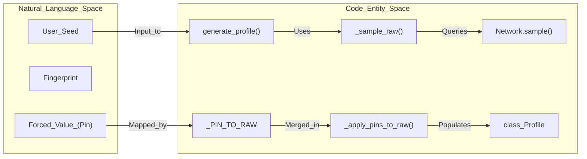

<!-- source: DeepWiki mcp.deepwiki.com · repo feder-cr/invisible_playwright · page 3 Fingerprint Engine (fpforge) · fetched 2026-10-26 -->

# Fingerprint Engine (fpforge)

Relevant source files

The following files were used as context for generating this wiki page:

- [docs/configuration.md](docs/configuration.md)
- [docs/pinning.md](docs/pinning.md)
- [docs/quickstart.md](docs/quickstart.md)
- [docs/recaptcha-v3-score.md](docs/recaptcha-v3-score.md)
- [docs/sannysoft-explained.md](docs/sannysoft-explained.md)
- [docs/screen-size-headless-tells.md](docs/screen-size-headless-tells.md)
- [src/invisible_playwright/__init__.py](src/invisible_playwright/__init__.py)
- [src/invisible_playwright/_fpforge/__init__.py](src/invisible_playwright/_fpforge/__init__.py)
- [src/invisible_playwright/_headless.py](src/invisible_playwright/_headless.py)
- [src/invisible_playwright/_pin.py](src/invisible_playwright/_pin.py)
- [src/invisible_playwright/_proxy.py](src/invisible_playwright/_proxy.py)
- [tests/test_backcompat.py](tests/test_backcompat.py)
- [tests/test_cloak.py](tests/test_cloak.py)
- [tests/test_core_pin.py](tests/test_core_pin.py)
- [tests/test_fingerprint_surface.py](tests/test_fingerprint_surface.py)
- [tests/test_seal_floor.py](tests/test_seal_floor.py)

The `_fpforge` package is the internal engine responsible for generating unique, coherent browser fingerprints. Now part of the `invisible_core` foundation, it ensures that every `InvisiblePlaywright` session presents a statistically plausible identity. Unlike standard anti-detect tools that use static profiles or independent random values, `fpforge` utilizes a Bayesian network to ensure that all spoofed attributes—such as GPU, screen resolution, hardware concurrency, and audio capabilities—are mutually consistent.

This engine is designed specifically for the patched Firefox binary and ensures that the browser "tells the truth" at the C++ level, avoiding the detection of JavaScript-based shims.

## Core Concepts

### Bayesian Coherence
The primary challenge in browser spoofing is maintaining "internal coherence." Anti-bot scripts like CreepJS detect "lies" by identifying contradictions, such as a high-end RTX 4090 GPU paired with a dual-core CPU and a 720p screen [docs/sannysoft-explained.md:71-77](). `fpforge` solves this by sampling from a directed acyclic graph where child nodes are conditioned on their parents [src/invisible_playwright/_fpforge/_sampler.py:9-25]().

### The Sampling Pipeline
The engine follows a strict topological order to generate a profile:
1. **Root Sampling**: A real-world GPU is selected from a pool of 444 Windows ANGLE renderers [src/invisible_playwright/_fpforge/_sampler.py:64-64]().
2. **Classification**: The `classify_gpu` function maps the raw renderer string to a `gpu_class` (e.g., `high_end`, `integrated_modern`) [src/invisible_playwright/_fpforge/_sampler.py:98-155]().
3. **Conditional Sampling**: Screen dimensions, hardware concurrency, and MSAA levels are sampled based on the `gpu_class` and a hidden `intra_tier` variable to ensure they match the hardware's expected performance bracket [src/invisible_playwright/_fpforge/_sampler.py:66-72]().

### System Architecture Diagram

This diagram shows how the `fpforge` internal components interact to transform a seed into a set of browser preferences.

Sources: [src/invisible_playwright/_fpforge/_sampler.py:9-25](), [src/invisible_playwright/_fpforge/profile.py:176-200](), [src/invisible_playwright/_fpforge/_network.py:1-10]()

## Sub-Modules

### [Bayesian Sampler and Network](#3.1)
The logic for graph traversal and probability calculation. It uses a `Network` class containing `Node` objects. It manages the `intra_tier` variable, which prevents "average" hardware from being sampled for "high-end" GPUs by triangulating dependencies.
*   **Key Entities**: `Network`, `Node`, `classify_gpu`, `_LOCKED` identity constants.
*   For details, see [Bayesian Sampler and Network](#3.1).

### [Profile Dataclasses](#3.2)
Typed containers that structure the raw sampler output. These dataclasses (e.g., `GPUProfile`, `ScreenProfile`, `HardwareProfile`) provide a clean API for the library to consume fingerprint data and convert it to browser preferences via `to_prefs_dict()`.
*   **Key Entities**: `Profile`, `GPUProfile`, `HardwareProfile`, `AudioProfile`, `CodecProfile`.
*   For details, see [Profile Dataclasses](#3.2).

### [Pinning System](#3.3)
A mechanism to bypass the Bayesian sampler for specific fields while keeping the rest of the fingerprint deterministic. This allows users to force specific screen resolutions or GPU models via the `pin` parameter in `InvisiblePlaywright` [docs/pinning.md:11-29]().
*   **Key Entities**: `_PIN_GROUPS`, `_PIN_TO_RAW`, `_apply_pins_to_raw()`, `_validate_pin_key()`.
*   For details, see [Pinning System](#3.3).

### [CPT Data Files](#3.4)
The "brain" of the engine. These JSON files in `_fpforge/data/` contain the Conditional Probability Tables (CPTs) derived from real-world telemetry. They define the likelihood of specific hardware combinations.
*   **Key Files**: `webgl_renderer_pool.json`, `cpt_screen_given_class_tier.json`, `priors_independent.json`.
*   For details, see [CPT Data Files](#3.4).

### [Cookie and History Seeding](#3.5)
The persona generated by `fpforge` includes a sampled browsing history. The `_recaptcha_seed.py` module uses this to pre-populate the browser context with realistic cookies (Google NID/CONSENT, analytics, etc.) to improve trust scores [docs/recaptcha-v3-score.md:94-100]().
*   **Key Entities**: `seed_recaptcha_cookies_sync`, `_sub_seed`, `ga_consent_clarity`.
*   For details, see [Cookie and History Seeding](#3.5).

## Data Flow: From Seed to Code Entities

The following diagram maps the transition from the high-level concept of a "Fingerprint" to the specific code entities in the `_fpforge` package.

Sources: [src/invisible_playwright/_fpforge/profile.py:108-176](), [src/invisible_playwright/_fpforge/_sampler.py:194-210](), [src/invisible_playwright/_fpforge/_network.py:70-85]()

## Locked Identity
While most fields are sampled, certain identity markers are locked to match the patched Firefox 150 binary's compiled-in values. This ensures that the `User-Agent` and `platform` always match the underlying engine's behavior and avoid contradictions with the binary's internal strings.

| Property | Locked Value |
| :--- | :--- |
| `user_agent` | `Mozilla/5.0 (Windows NT 10.0; Win64; x64; rv:150.0) Gecko/20100101 Firefox/150.0.1` |
| `platform` | `Win32` |
| `oscpu` | `Windows NT 10.0; Win64; x64` |
| `webdriver` | `False` |

Sources: [src/invisible_playwright/_fpforge/_sampler.py:46-58]()

---

