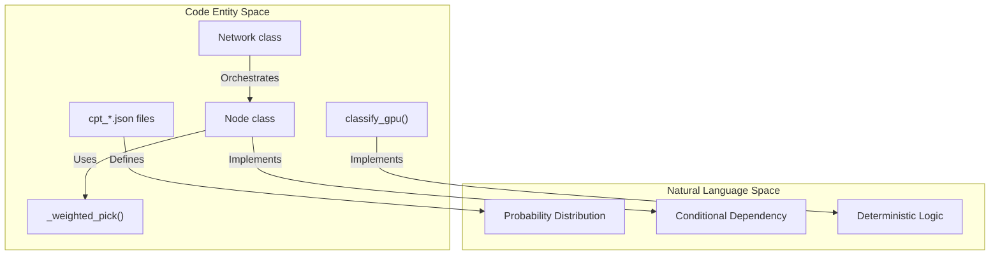
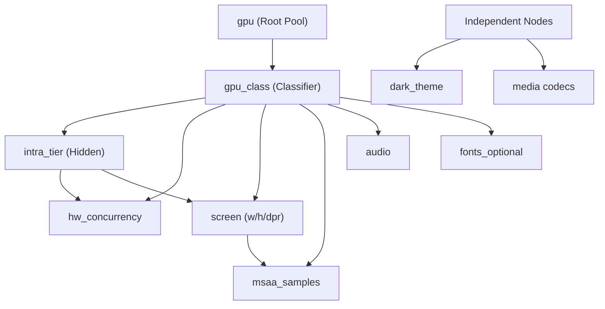

<!-- source: DeepWiki mcp.deepwiki.com · repo feder-cr/invisible_playwright · page 3.1 Bayesian Sampler and Network · fetched 2026-10-26 -->

# Bayesian Sampler and Network

Relevant source files

The following files were used as context for generating this wiki page:

- [docs/configuration.md](docs/configuration.md)
- [docs/creepjs-explained.md](docs/creepjs-explained.md)
- [docs/headless-fonts-differ.md](docs/headless-fonts-differ.md)
- [docs/navigator-webdriver-explained.md](docs/navigator-webdriver-explained.md)
- [docs/pinning.md](docs/pinning.md)
- [docs/playwright-detected-as-bot.md](docs/playwright-detected-as-bot.md)
- [docs/playwright-stealth-levels.md](docs/playwright-stealth-levels.md)
- [docs/quickstart.md](docs/quickstart.md)
- [docs/recaptcha-v3-score.md](docs/recaptcha-v3-score.md)
- [docs/sannysoft-explained.md](docs/sannysoft-explained.md)
- [docs/screen-size-headless-tells.md](docs/screen-size-headless-tells.md)
- [docs/webgl-renderer-strings.md](docs/webgl-renderer-strings.md)
- [src/invisible_playwright/_fpforge/__init__.py](src/invisible_playwright/_fpforge/__init__.py)
- [src/invisible_playwright/_headless.py](src/invisible_playwright/_headless.py)
- [src/invisible_playwright/_proxy.py](src/invisible_playwright/_proxy.py)
- [tests/test_backcompat.py](tests/test_backcompat.py)
- [tests/test_cloak.py](tests/test_cloak.py)
- [tests/test_fingerprint_surface.py](tests/test_fingerprint_surface.py)

The `invisible_playwright` fingerprint engine utilizes a Bayesian network to generate coherent, realistic browser fingerprints. This system ensures that sampled attributes (like GPU, screen resolution, and hardware concurrency) are statistically consistent with one another, mimicking real-world hardware distributions found in the Windows Firefox ecosystem.

## Core Implementation

The system is split between a generic Bayesian implementation in `_network.py` and a fingerprint-specific configuration in `_sampler.py`.

### Bayesian Entities

The engine defines two primary classes to handle the probabilistic logic:

*   **`Node`**: Represents a single fingerprint attribute (e.g., `gpu`, `hw_concurrency`). It can be marginal (independent), conditional (dependent on parents), or deterministic (calculated via a classifier) [[src/invisible_playwright/_fpforge/_network.py:27-45]]().
*   **`Network`**: A collection of `Node` objects. It performs a topological sort upon initialization to ensure that parent nodes are always sampled before their children [[src/invisible_playwright/_fpforge/_network.py:71-82]]().

### Data Flow and Sampling

Sampling is deterministic based on a `stealth_seed` provided to the `Forge` or `sample` entry points [[src/invisible_playwright/_fpforge/_sampler.py:26-27]]().

1.  **Topological Sort**: The `Network` ensures nodes are processed in an order where dependencies are resolved first [[src/invisible_playwright/_fpforge/_network.py:109-131]]().
2.  **Weighted Picking**: For probabilistic nodes, the system performs a weighted selection from a Conditional Probability Table (CPT) or marginal list [[src/invisible_playwright/_fpforge/_network.py:87-98]]().
3.  **Parent Key Generation**: Conditional nodes look up their distribution by creating a stable JSON key from the values of their parent nodes [[src/invisible_playwright/_fpforge/_network.py:101-106]]().

### Code Entity Space to Bayesian Logic

The following diagram illustrates how Python classes and functions map to the theoretical Bayesian components.

**Entity Mapping: Sampler Architecture**

Sources: [[src/invisible_playwright/_fpforge/_network.py:27-82]](), [[src/invisible_playwright/_fpforge/_sampler.py:98-155]]().

## The Sampling Graph

The network architecture defines specific relationships to prevent "impossible" hardware combinations (e.g., a high-end RTX 4090 paired with a 2-core CPU).

**Fingerprint Dependency Graph**

Sources: [[src/invisible_playwright/_fpforge/_sampler.py:9-25]]().

### GPU Pool and Classification
The root of the network is the `gpu` node, which samples from a pool of 444 real Windows ANGLE renderer strings [[src/invisible_playwright/_fpforge/_sampler.py:11-13]](). These strings are then passed to `classify_gpu()`, which categorizes them into one of six tiers: `integrated_old`, `integrated_modern`, `low_end`, `mid_range`, `high_end`, or `workstation` [[src/invisible_playwright/_fpforge/_sampler.py:92-95]]().

*   **NVIDIA Sanitization**: Firefox's internal `SanitizeRenderer.cpp` collapses modern GeForce cards into vintage buckets (e.g., GTX 980). The sampler replicates this by routing these specific strings to the `low_end` class to maintain consistency with CPU/Screen tiers [[src/invisible_playwright/_fpforge/_sampler.py:119-130]]().

### The Hidden `intra_tier` Variable
To achieve high-fidelity triangulation between `hw_concurrency`, `screen`, and `storage`, the network uses a hidden variable called `intra_tier` [[src/invisible_playwright/_fpforge/_sampler.py:65-70]](). This variable ensures that within a `gpu_class` (e.g., `mid_range`), the sampler consistently picks either "high-mid" or "low-mid" components across different attributes.

### Font Whitelist Derivation
Fonts are handled through a two-tier system:
1.  **Core Fonts**: A "always-included" list from `font_pool.json` [[src/invisible_playwright/_fpforge/_sampler.py:84]]().
2.  **Optional Fonts**: Sampled based on the `gpu_class` CPT [[src/invisible_playwright/_fpforge/_sampler.py:86]]().

The final whitelist is derived by combining these and applying a deterministic hash of the `stealth_seed` to exclude a small subset, mimicking natural variation in user-installed fonts [[src/invisible_playwright/_fpforge/_sampler.py:23-24]]().

## Locked Identity Constants

While hardware varies, certain identity fields are "locked" to match the patched Firefox binary. These values never vary regardless of the seed, ensuring the browser's reported identity matches its actual capabilities.

| Field | Value | Notes |
| :--- | :--- | :--- |
| `user_agent` | `Mozilla/5.0 (Windows NT 10.0; Win64; x64; rv:150.0) Gecko/20100101 Firefox/150.0.1` | Fixed Firefox identity [[src/invisible_playwright/_fpforge/_sampler.py:46-48]]() |
| `platform` | `Win32` | Standard Windows platform string [[src/invisible_playwright/_fpforge/_sampler.py:50]]() |
| `oscpu` | `Windows NT 10.0; Win64; x64` | Windows 10/11 OS identifier [[src/invisible_playwright/_fpforge/_sampler.py:51]]() |
| `webdriver` | `False` | Essential for stealth [[src/invisible_playwright/_fpforge/_sampler.py:54]]() |
| `max_touch_points` | `0` | Desktop default [[src/invisible_playwright/_fpforge/_sampler.py:57]]() |

Sources: [[src/invisible_playwright/_fpforge/_sampler.py:46-58]]().

## Conditional Probability Tables (CPTs)

The network logic is decoupled from the data, which is stored in JSON files within `_fpforge/data/`.

*   **`cpt_hwc_given_class.json`**: Maps CPU core counts to GPU tiers (e.g., `integrated_old` has a 60% probability of having 4 cores).
*   **`cpt_screen_given_class.json`**: Maps resolutions and DPR (Device Pixel Ratio) to GPU tiers. It restricts widths to $\ge 1920$ to avoid server-side normalization by anti-fingerprinting services [[docs/pinning.md:35-42]]().
*   **`webgl_renderer_pool.json`**: Contains the 444 real-world ANGLE renderer strings used as the network root [[docs/webgl-renderer-strings.md:85-91]]().

Sources: [[src/invisible_playwright/_fpforge/_sampler.py:64-87]](), [[docs/pinning.md:35-63]](), [[docs/webgl-renderer-strings.md:85-103]]().

---

