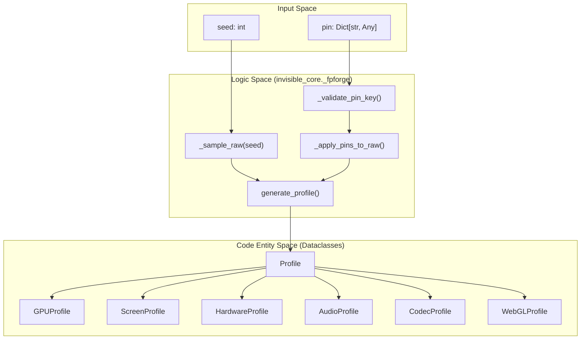
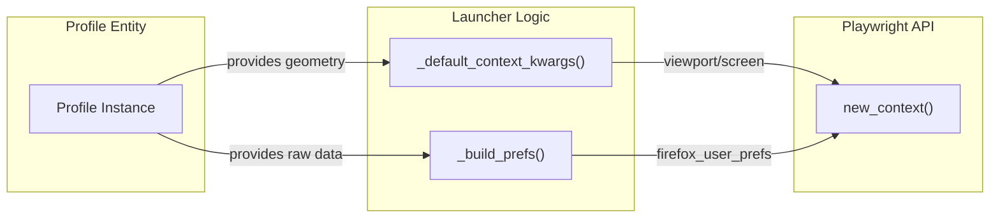

<!-- source: DeepWiki mcp.deepwiki.com · repo feder-cr/invisible_playwright · page 3.2 Profile Dataclasses · fetched 2026-10-26 -->

# Profile Dataclasses

Relevant source files

The following files were used as context for generating this wiki page:

- [docs/configuration.md](docs/configuration.md)
- [docs/pinning.md](docs/pinning.md)
- [docs/quickstart.md](docs/quickstart.md)
- [docs/recaptcha-v3-score.md](docs/recaptcha-v3-score.md)
- [docs/sannysoft-explained.md](docs/sannysoft-explained.md)
- [docs/screen-size-headless-tells.md](docs/screen-size-headless-tells.md)
- [src/invisible_playwright/_fpforge/__init__.py](src/invisible_playwright/_fpforge/__init__.py)
- [src/invisible_playwright/_headless.py](src/invisible_playwright/_headless.py)
- [src/invisible_playwright/_proxy.py](src/invisible_playwright/_proxy.py)
- [src/invisible_playwright/_recaptcha_seed.py](src/invisible_playwright/_recaptcha_seed.py)
- [src/invisible_playwright/async_api.py](src/invisible_playwright/async_api.py)
- [src/invisible_playwright/launcher.py](src/invisible_playwright/launcher.py)
- [tests/test_async_api.py](tests/test_async_api.py)
- [tests/test_backcompat.py](tests/test_backcompat.py)
- [tests/test_cloak.py](tests/test_cloak.py)
- [tests/test_fingerprint_surface.py](tests/test_fingerprint_surface.py)
- [tests/test_launcher_helpers.py](tests/test_launcher_helpers.py)
- [tests/test_recaptcha_seed.py](tests/test_recaptcha_seed.py)

The `invisible_playwright` fingerprint engine represents browser identities using a hierarchy of immutable dataclasses. These classes provide a type-safe, structured view of the raw values generated by the underlying Bayesian network. The primary entry point for creating these objects is the `generate_profile()` function.

### Overview of Data Flow

The lifecycle of a profile begins with an integer seed and optional "pins". The engine samples a flat dictionary of raw values from the Bayesian network, applies any overrides, and then maps these values into the `Profile` dataclass and its specialized sub-profiles.

**Profile Generation and Mapping Diagram**

**Sources:** [src/invisible_playwright/launcher.py:18-18](), [src/invisible_playwright/async_api.py:19-19](), [docs/pinning.md:31-45]()

---

### The Profile Dataclass

The `Profile` class is the root container for all sampled fingerprint data. It is an immutable representation of a browser persona.

| Field | Type | Description |
| :--- | :--- | :--- |
| `seed` | `int` | The original seed used for sampling. |
| `gpu` | `GPUProfile` | Graphics card and renderer details. |
| `screen` | `ScreenProfile` | Resolution, available area, and pixel density. |
| `hardware` | `HardwareProfile` | CPU concurrency, storage limits, and media devices. |
| `audio` | `AudioProfile` | Sample rates and channel counts. |
| `codec` | `CodecProfile` | Media capability flags (AV1, WebM, etc.). |
| `webgl` | `WebGLProfile` | WebGL-specific parameters like MSAA. |
| `fonts` | `List[str]` | A list of available system fonts. |
| `dark_theme` | `bool` | User color scheme preference. |
| `browsing_history` | `List[Dict]` | Sampled history used by the reCAPTCHA seed system. |

**Sources:** [src/invisible_playwright/launcher.py:103-104](), [src/invisible_playwright/_recaptcha_seed.py:3-9](), [docs/pinning.md:157-181]()

---

### Sub-Profile Components

Each sub-profile groups related browser attributes. These are all defined as frozen dataclasses within the `invisible_core` engine.

#### GPUProfile
Defines the hardware acceleration identity used by WebGL's `UNMASKED_RENDERER_WEBGL`.
*   `vendor`: The WebGL vendor string (e.g., "Google Inc. (NVIDIA)").
*   `renderer`: The WebGL renderer string (e.g., "ANGLE (NVIDIA, NVIDIA GeForce RTX 4090 Direct3D11)").
*   `class_tier`: A classification used for Bayesian grouping (e.g., `high_end`, `integrated_modern`).

#### ScreenProfile
Captures the geometry of the display and the browser window.
*   `width` / `height`: Physical screen resolution.
*   `avail_width` / `avail_height`: Screen area minus OS taskbars/menus.
*   `dpr`: Device Pixel Ratio.
*   `taskbar_px`: The height of the OS taskbar, used to calculate `avail_height`.
*   `chrome_w` / `chrome_h`: The dimensions of the browser's own UI chrome.

#### Hardware & Audio Profiles
*   **HardwareProfile**: Contains `concurrency` (logical cores), `storage_quota_mb`, `max_touch_points`, and `fake_media_devices` status.
*   **AudioProfile**: Contains `sample_rate`, `max_channel_count`, and `ac_state_running`.

#### Codec & WebGL Profiles
*   **CodecProfile**: Boolean flags for `av1_enabled`, `webm_encoder_enabled`, `mediasource_webm`, and `webspeech_synth`.
*   **WebGLProfile**: Tracks `msaa_samples`.

**Sources:** [docs/pinning.md:50-88](), [src/invisible_playwright/launcher.py:51-70](), [tests/test_launcher_helpers.py:136-152]()

---

### Generating Profiles

The `generate_profile()` function coordinates the transition from a seed to a fully populated `Profile` object.

1.  **Sampling**: It uses the seed to sample values from the Bayesian network.
2.  **Pinning**: If a `pin` dictionary is provided, it overrides individual fields. Pinning breaks the conditional chain; unpinned children are still sampled from their original distributions.
3.  **Instantiation**: The engine maps the raw sampler output into the typed dataclasses.

**Pin Mapping Logic**
The engine uses dotted-path pins to override specific raw sampler keys.

| Pin Key (Dotted) | Raw Sampler Key | Description |
| :--- | :--- | :--- |
| `gpu.class_tier` | `gpu_class_tier` | The root of the Bayesian network. |
| `screen.width` | `screen_w` | Physical width in pixels. |
| `hardware.concurrency` | `hw_concurrency` | `navigator.hardwareConcurrency`. |
| `screen.taskbar_px` | `taskbar_px` | Taskbar height for `availHeight` calculation. |

**Sources:** [docs/pinning.md:9-45](), [docs/pinning.md:52-81](), [src/invisible_playwright/launcher.py:103-104]()

---

### Seeded History and Cookies

The `Profile` includes a `browsing_history` field, which is a Bayesian-sampled list of visited sites. Each entry includes a `cookie_profile` tag (e.g., `ga_cf`, `ga_consent_clarity`).

The reCAPTCHA seed system (`_recaptcha_seed.py`) consumes this history to pre-populate the browser context with realistic cookies:
*   **Google Batch**: Always seeds `NID`, `CONSENT`, `SOCS`, `_GRECAPTCHA`, and `ENID` on `.google.com`.
*   **Per-Site Cookies**: Builds 1-5 cookies (like `_ga`, `_gid`, `__cf_bm`) based on the site's `cookie_profile`.
*   **Determinism**: All values are derived from the persona seed via `_sub_seed` (an FNV-1a mix), ensuring the same persona always presents the same cookies.

**Sources:** [src/invisible_playwright/_recaptcha_seed.py:3-21](), [src/invisible_playwright/_recaptcha_seed.py:46-52](), [src/invisible_playwright/_recaptcha_seed.py:86-126]()

---

### Integration: Profile to Preferences

The `Profile` dataclass is the primary input for the preference translation layer. The launcher uses the profile's fields to build the `firefox_user_prefs` dictionary and calculate the Playwright `viewport` and `screen` parameters.

**Integration Diagram: Profile to Browser Context**

**Sources:** [src/invisible_playwright/launcher.py:126-152](), [tests/test_launcher_helpers.py:136-162](), [src/invisible_playwright/async_api.py:126-148]()

---

