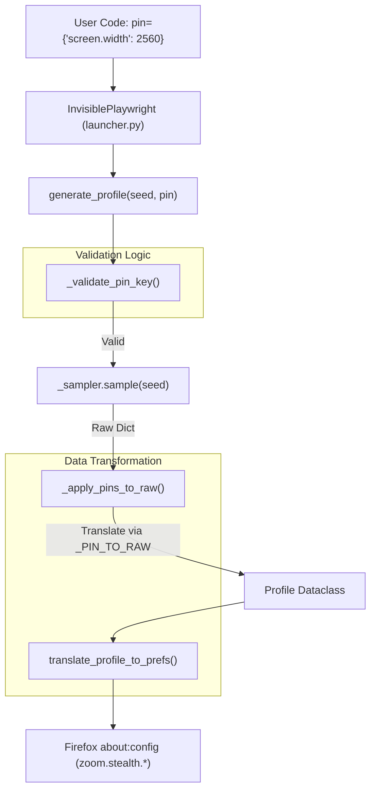
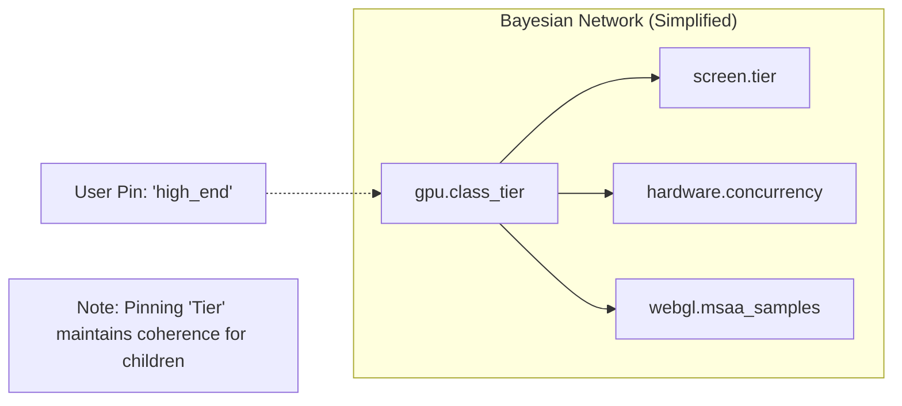

<!-- source: DeepWiki mcp.deepwiki.com · repo feder-cr/invisible_playwright · page 3.3 Pinning System · fetched 2026-10-26 -->

# Pinning System

Relevant source files

The following files were used as context for generating this wiki page:

- [docs/configuration.md](docs/configuration.md)
- [docs/pinning.md](docs/pinning.md)
- [docs/quickstart.md](docs/quickstart.md)
- [docs/recaptcha-v3-score.md](docs/recaptcha-v3-score.md)
- [docs/sannysoft-explained.md](docs/sannysoft-explained.md)
- [docs/screen-size-headless-tells.md](docs/screen-size-headless-tells.md)
- [src/invisible_playwright/__init__.py](src/invisible_playwright/__init__.py)
- [src/invisible_playwright/_pin.py](src/invisible_playwright/_pin.py)
- [tests/test_core_pin.py](tests/test_core_pin.py)
- [tests/test_pin.py](tests/test_pin.py)
- [tests/test_seal_floor.py](tests/test_seal_floor.py)

The pinning system allows users to bypass the default Bayesian sampling for specific fingerprint fields. While `invisible_playwright` typically generates a coherent, high-entropy fingerprint based on an integer `seed`, the `pin` parameter enables forcing exact values for attributes like GPU renderer strings, screen resolutions, or hardware concurrency [docs/pinning.md:9-13]().

## Core Logic and Data Structures

The pinning system is integrated into the `generate_profile()` function within the `_fpforge` internal package (housed in `invisible_core`). It operates by intercepting the raw output of the Bayesian sampler and overwriting specific keys before they are packaged into the typed `Profile` dataclass [docs/pinning.md:37-42]().

### Validation Tables
To ensure API stability and prevent typos, the system uses two primary allowlists:
*   **`_PIN_GROUPS`**: A dictionary mapping group names (e.g., `gpu`, `screen`) to sets of valid field names.
*   **`_PIN_TOP`**: A set of top-level keys that do not require a dot-notation prefix, such as `dark_theme` [docs/pinning.md:46-56]().

### Internal Mapping (`_PIN_TO_RAW`)
Because the user-facing `pin` keys use a clean "dotted" syntax (e.g., `screen.width`), but the internal Bayesian sampler uses flat, abbreviated keys, a mapping layer serves as the translation mechanism.

| Pin Key (User) | Description | Example |
| :--- | :--- | :--- |
| `gpu.class_tier` | Root of the Bayesian network | `"high_end"` |
| `screen.width` | Screen width in pixels | `2560` |
| `hardware.concurrency` | `navigator.hardwareConcurrency` | `16` |
| `audio.sample_rate` | AudioContext sample rate | `48000` |
| `hardware.fake_media_devices` | Spoof `enumerateDevices` | `True` |

**Sources:** [docs/pinning.md:46-87](), [tests/test_pin.py:8-31]()

## Implementation Flow

The following diagram illustrates how a user-provided `pin` dictionary moves from the `InvisiblePlaywright` constructor through the validation and application stages to reach the final browser preferences.

### Pin Propagation Pipeline

**Sources:** [src/invisible_playwright/launcher.py:65-75](), [docs/pinning.md:15-29](), [tests/test_pin.py:8-12]()

## Key Functions

### `_validate_pin_key(key: str)`
This function enforces the dotted-path schema. It ensures that keys are either in the top-level allowlist or follow the `group.field` format. Unknown groups or fields within a known group trigger a `ValueError` [tests/test_pin.py:33-52]().

### `_apply_pins_to_raw(raw, pin)`
This function performs the actual mutation. It iterates through the validated pins and updates the raw sampler dictionary. The same seed produces different output once a pin is applied because the pinned value overrides the sampled one [tests/test_pin.py:59-65]().

**Sources:** [tests/test_pin.py:33-73]()

## Bayesian Coherence Implications

Pinning creates a "disconnection" in the Bayesian network. The generator is designed such that fields are conditioned on parents (e.g., `gpu_class_tier` influences `screen.tier` and `webgl.msaa_samples`) [docs/pinning.md:31-36]().

When a field is pinned:
1.  The pinned value is written directly, bypassing the sampler [docs/pinning.md:39]().
2.  **Crucially**, unpinned children are still sampled from their conditionals using the parent's original posterior, not the pinned value [docs/pinning.md:40-42]().

For example, if you pin `gpu.renderer` to an `RTX 4090` but leave the `screen` unpinned, the sampler might pick a `low_end` screen tier based on the original seed, resulting in an implausible "RTX 4090 + 1366x768" pairing [docs/pinning.md:42-43]().

### Coherence Mapping

**Sources:** [docs/pinning.md:31-63](), [docs/screen-size-headless-tells.md:92-104]()

## Supported Pin Keys

| Group | Key | Type | Notes |
| :--- | :--- | :--- | :--- |
| **GPU** | `gpu.class_tier` | `str` | `"low_end"`, `"mid_range"`, `"high_end"`, etc. [docs/pinning.md:54]() |
| | `gpu.renderer` | `str` | Windows ANGLE string [docs/pinning.md:56]() |
| **Screen** | `screen.width` | `int` | `screen.width` [docs/pinning.md:69]() |
| | `screen.dpr` | `float` | `devicePixelRatio` [docs/pinning.md:73]() |
| | `screen.color_depth`| `int` | `screen.colorDepth` (usually 24) [docs/pinning.md:75]() |
| **Hardware**| `hardware.concurrency`| `int` | CPU cores [docs/pinning.md:81]() |
| | `hardware.storage_quota_mb`| `int` | Storage estimate quota [docs/pinning.md:82]() |
| | `hardware.fake_media_devices`| `bool` | Spoof media devices [docs/pinning.md:85]() |
| **Top-level**| `dark_theme` | `bool` | Force color scheme [tests/test_pin.py:54-56]() |

**Sources:** [docs/pinning.md:50-87](), [tests/test_pin.py:8-56]()

---

