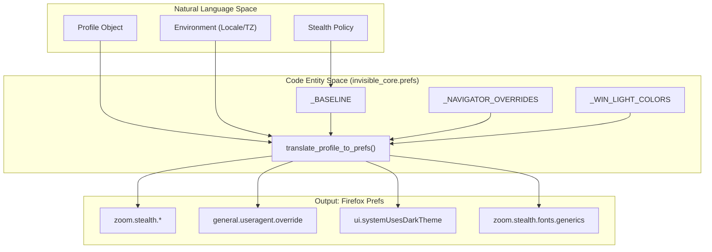
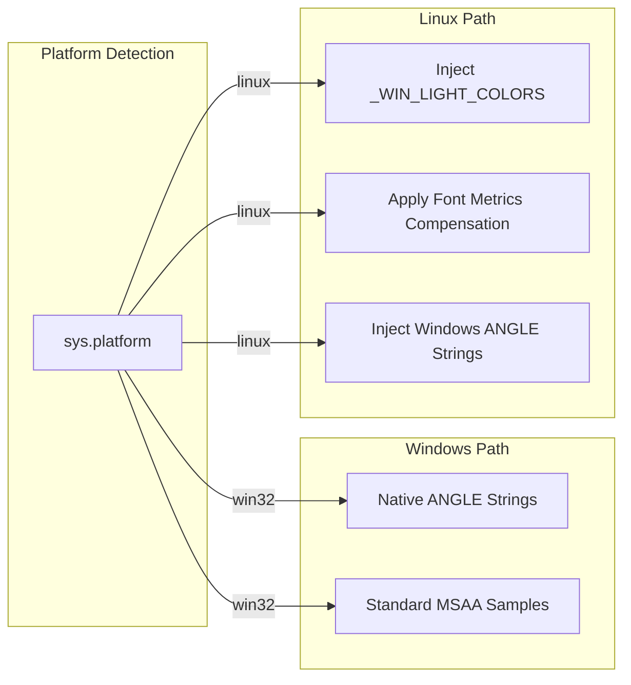

<!-- source: DeepWiki mcp.deepwiki.com · repo feder-cr/invisible_playwright · page 4 Firefox Preference Translation · fetched 2026-10-26 -->

# Firefox Preference Translation

Relevant source files

The following files were used as context for generating this wiki page:

- [docs/configuration.md](docs/configuration.md)
- [docs/pinning.md](docs/pinning.md)
- [docs/quickstart.md](docs/quickstart.md)
- [docs/recaptcha-v3-score.md](docs/recaptcha-v3-score.md)
- [docs/sannysoft-explained.md](docs/sannysoft-explained.md)
- [docs/screen-size-headless-tells.md](docs/screen-size-headless-tells.md)
- [scripts/ci_font_gate.py](scripts/ci_font_gate.py)
- [src/invisible_playwright/_session.py](src/invisible_playwright/_session.py)
- [src/invisible_playwright/_webgl_personas.py](src/invisible_playwright/_webgl_personas.py)
- [src/invisible_playwright/prefs.py](src/invisible_playwright/prefs.py)
- [tests/test_canvas_render_stealth.py](tests/test_canvas_render_stealth.py)
- [tests/test_ci_font_gate_declaration.py](tests/test_ci_font_gate_declaration.py)
- [tests/test_integration.py](tests/test_integration.py)
- [tests/test_prefs_composition_arm.py](tests/test_prefs_composition_arm.py)

The `invisible_playwright` library translates a generated `Profile` into a flat dictionary of Firefox preferences. These preferences are passed to the patched Firefox binary via Playwright's `firefox_user_prefs` parameter. The patched binary uses these values—specifically those in the `zoom.stealth.*` namespace—to override internal C++ behaviors and JavaScript APIs, ensuring the browser's fingerprint matches the sampled identity.

In recent versions, the core translation logic has been moved to `invisible_core.prefs`, with `src/invisible_playwright/prefs.py` serving as a backward-compatible shim [src/invisible_playwright/prefs.py:1-5]().

## Overview of the Translation Pipeline

The translation process is primarily handled by the `translate_profile_to_prefs()` function. This function acts as an orchestrator that combines a static "stealth baseline" with dynamic data from a `Profile` object, alongside environment-specific settings like locale and timezone [tests/test_integration.py:80-85]().

### The Stealth Namespace
Most spoofing logic relies on the `zoom.stealth.*` preference namespace. These are not standard Firefox preferences; they are custom keys read by the patches in the `invisible_playwright` Firefox binary to control low-level features like Canvas noise, WebGL renderer strings, and hardware concurrency [tests/test_integration.py:45-71]().

### Determinism
The translation is purely functional and deterministic. Given the same `Profile` (which is typically generated from a seed) and the same input parameters, the pipeline will always produce an identical preference dictionary [tests/test_integration.py:176-181]().

### System Architecture

The following diagram illustrates how the high-level `Profile` dataclass is decomposed into the specific preference keys used by the patched binary.

**Profile to Preference Mapping**

Sources: [src/invisible_playwright/prefs.py:1-5](), [tests/test_integration.py:45-71](), [tests/test_ci_font_gate_declaration.py:48-52]()

## Baseline and Identity Overrides

Before applying profile-specific data, the engine establishes a `_BASELINE` set of preferences. This baseline enforces a global stealth policy by:
* Disabling standard Firefox fingerprinting resistance (`privacy.resistFingerprinting = False`) to avoid the "RFP-on" signature [tests/test_integration.py:68-68]().
* Blocking WebRTC leaks and disabling Safebrowsing [tests/test_integration.py:69-69]().
* Hardcoding the Navigator identity to a specific "locked" version via `_NAVIGATOR_OVERRIDES` to ensure consistency regardless of the host OS [tests/test_integration.py:70-70]().

For details on how these constants are merged and how specific profile fields (like `screen` or `audio`) are overlaid, see [translate_profile_to_prefs](#4.1).

## Platform-Specific Branching

The translation logic branches based on `sys.platform` to handle discrepancies between Windows and Linux environments. This is critical because certain features (like system colors or font rendering) behave differently at the OS level, which can leak the host's true identity even if the User Agent is spoofed.

### Cross-Platform Normalization
The engine performs several platform-specific adjustments:
* **System Colors:** Injects `_WIN_LIGHT_COLORS` on Linux to prevent GTK themes from leaking through CSS system keywords [tests/test_integration.py:20-23]().
* **WebGL Handling:** On Windows, it clears renderer strings to let the native ANGLE driver report hardware naturally, while on Linux, it injects specific ANGLE strings to mimic a Windows environment.
* **Font Metrics:** Applies specific font factors to compensate for the different bounding boxes of Linux fonts (like DejaVu) compared to the Windows fonts bundled with the engine [scripts/ci_font_gate.py:2-19]().

For details on GPU spoofing, Xvfb workarounds, and color palette injection, see [Platform-Specific Preference Logic](#4.2).

**Platform Branching Logic**

Sources: [tests/test_integration.py:7-10](), [scripts/ci_font_gate.py:2-19]()

## Key Preference Categories

The translation covers several distinct categories of browser behavior:

| Category | Primary Keys | Description |
| :--- | :--- | :--- |
| **Identity** | `general.useragent.override`, `intl.accept_languages` | Spoofs the UA string, platform, and language headers [tests/test_integration.py:58-70](). |
| **Screen** | `zoom.stealth.screen.*`, `layout.css.devPixelsPerPx` | Configures viewport, resolution, and Device Pixel Ratio [tests/test_integration.py:46-49](). |
| **Hardware** | `zoom.stealth.hw_concurrency`, `zoom.stealth.storage.quota_mb` | Controls `navigator.hardwareConcurrency` and storage API limits [tests/test_integration.py:50-51](). |
| **Graphics** | `zoom.stealth.webgl.*`, `zoom.stealth.canvas.noise_skip_mask` | Configures WebGL renderers and Canvas fingerprint noise [tests/test_integration.py:63-66](). |
| **Media** | `zoom.stealth.audio.*`, `media.av1.enabled` | Sets audio sample rates, latencies, and supported codecs [tests/test_integration.py:52-56](). |
| **Fonts** | `zoom.stealth.fonts.generics` | Maps CSS generic families (serif, etc.) to specific Windows fonts [tests/test_ci_font_gate_declaration.py:51-52](). |

For a full list of required keys and their roles in the integration pipeline, see [tests/test_integration.py:45-71]().

---

