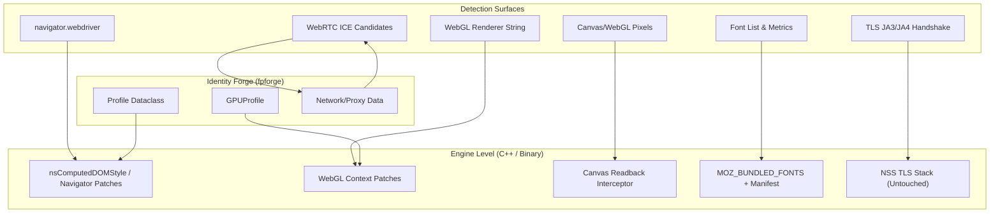
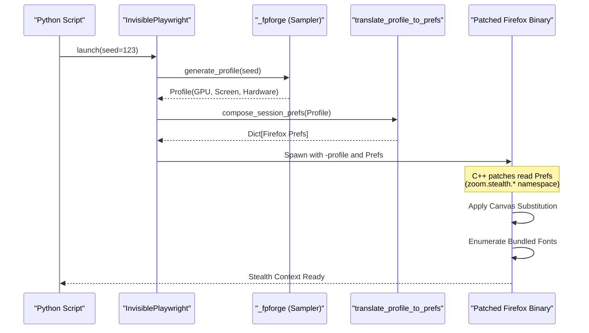

<!-- source: DeepWiki mcp.deepwiki.com · repo feder-cr/invisible_playwright · page 8.1 Detection Surfaces and Fingerprinting · fetched 2026-10-26 -->

# Detection Surfaces and Fingerprinting

Relevant source files

The following files were used as context for generating this wiki page:

- [docs/ai-browser-agents-stealth.md](docs/ai-browser-agents-stealth.md)
- [docs/audiocontext-fingerprinting.md](docs/audiocontext-fingerprinting.md)
- [docs/browser-use-detection.md](docs/browser-use-detection.md)
- [docs/bundled-fonts-cross-platform.md](docs/bundled-fonts-cross-platform.md)
- [docs/canvas-fingerprint-noise.md](docs/canvas-fingerprint-noise.md)
- [docs/canvas-webgl-cross-platform-consistency.md](docs/canvas-webgl-cross-platform-consistency.md)
- [docs/crawl4ai-stealth-custom-browser.md](docs/crawl4ai-stealth-custom-browser.md)
- [docs/creepjs-explained.md](docs/creepjs-explained.md)
- [docs/hardware-concurrency-device-memory.md](docs/hardware-concurrency-device-memory.md)
- [docs/headless-fonts-differ.md](docs/headless-fonts-differ.md)
- [docs/hover-mouse-movement-bug.md](docs/hover-mouse-movement-bug.md)
- [docs/human-mouse-movement.md](docs/human-mouse-movement.md)
- [docs/ja3-ja4-tls-fingerprint.md](docs/ja3-ja4-tls-fingerprint.md)
- [docs/navigator-webdriver-explained.md](docs/navigator-webdriver-explained.md)
- [docs/playwright-detected-as-bot.md](docs/playwright-detected-as-bot.md)
- [docs/playwright-docker-detection.md](docs/playwright-docker-detection.md)
- [docs/playwright-stealth-levels.md](docs/playwright-stealth-levels.md)
- [docs/resist-fingerprinting.md](docs/resist-fingerprinting.md)
- [docs/service-workers-storage-partitioning.md](docs/service-workers-storage-partitioning.md)
- [docs/speech-synthesis-voices.md](docs/speech-synthesis-voices.md)
- [docs/timezone-proxy-mismatch.md](docs/timezone-proxy-mismatch.md)
- [docs/tostring-native-code-detection.md](docs/tostring-native-code-detection.md)
- [docs/web-scraping-getting-blocked-proxies.md](docs/web-scraping-getting-blocked-proxies.md)
- [docs/web-workers-fingerprint.md](docs/web-workers-fingerprint.md)
- [docs/webgl-renderer-strings.md](docs/webgl-renderer-strings.md)
- [docs/webrtc-leak-proxy.md](docs/webrtc-leak-proxy.md)

The `invisible_playwright` engine operates at "Level 3" stealth by patching the browser engine's C++ source code to address detection surfaces that are unreachable by JavaScript injection or driver-level patches [docs/playwright-stealth-levels.md:71-87](). By modifying the browser's native code paths, the distinction between a spoofed value and a real one disappears [docs/playwright-stealth-levels.md:78-81]().

## Core Identity Surfaces

Anti-bot systems probe the `navigator` object for consistency and automation artifacts. `invisible_playwright` addresses these at the engine level to ensure descriptor hygiene and native behavior.

| Surface | Detection Vector | `invisible_playwright` Intervention |
| :--- | :--- | :--- |
| `navigator.webdriver` | Standard property set to `true` by automation drivers [docs/navigator-webdriver-explained.md:11-16](). | Patched in the engine to remain `undefined`, matching a clean browser [docs/navigator-webdriver-explained.md:48-54](). |
| `buildID` / `productSub` | Hardcoded browser build constants used to verify version consistency. | Derived from the engine's real version to prevent version-mismatch contradictions [docs/ja3-ja4-tls-fingerprint.md:97-100](). |
| `Function.prototype.toString` | Detection of JS-based overrides by checking for `[native code]` [docs/playwright-stealth-levels.md:39-43](). | No JS overrides are used; values are native to the engine, so `toString` remains honest [docs/playwright-stealth-levels.md:78-81](). |

**Sources:** [docs/playwright-stealth-levels.md:71-87](), [docs/navigator-webdriver-explained.md:11-54](), [docs/ja3-ja4-tls-fingerprint.md:97-100]()

## Graphics and Rendering (WebGL & Canvas)

The WebGL and Canvas surfaces are high-entropy signals that reveal the underlying hardware.

### WebGL Renderer and ANGLE
On Windows, Firefox uses the ANGLE translation layer (Google Inc.) to map OpenGL to Direct3D [docs/webgl-renderer-strings.md:33-38](). `invisible_playwright` spoofs these strings to match consumer hardware while maintaining internal consistency with shader precision and extensions [docs/webgl-renderer-strings.md:121-141]().

### Canvas Fingerprinting
Instead of adding detectable noise, `invisible_playwright` uses **full substitution** at the readback layer (e.g., `toDataURL`, `getImageData`) [docs/canvas-webgl-cross-platform-consistency.md:26-36]().
*   **Low-entropy protection:** Buffers with few distinct colors (like solid UI elements) are left untouched to avoid breaking site functionality [docs/canvas-webgl-cross-platform-consistency.md:49-57]().
*   **High-entropy substitution:** Complex scenes are replaced with a pure function of the session seed and pixel position, ensuring byte-identical hashes across Windows and Linux [docs/canvas-webgl-cross-platform-consistency.md:64-69]().

**Sources:** [docs/webgl-renderer-strings.md:33-43](), [docs/canvas-webgl-cross-platform-consistency.md:26-69]()

## Font Subsystem and Metrics

Fonts are a primary "this is a server" tell. Standard headless browsers lack the fontconfig or desktop environment required to resolve aliases like `sans-serif` correctly [docs/headless-fonts-differ.md:28-34]().

`invisible_playwright` solves this by:
1.  **Bundling:** Carrying real Windows font files (`.ttc`, `.ttf`) inside the browser binary [docs/bundled-fonts-cross-platform.md:29-33]().
2.  **Manifest-based Enumeration:** Using a single offline-generated manifest to ensure DirectWrite (Windows), Fontconfig (Linux), and CoreText (macOS) report identical family lists [docs/bundled-fonts-cross-platform.md:43-48]().
3.  **Blocking Fallbacks:** Patching each backend to fail toward an empty list rather than falling back to host system fonts [docs/bundled-fonts-cross-platform.md:69-85]().

**Sources:** [docs/headless-fonts-differ.md:28-34](), [docs/bundled-fonts-cross-platform.md:29-85]()

## Network and Environment Consistency

### WebRTC ICE Candidates
A SOCKS5 proxy only handles TCP, causing WebRTC (UDP) to leak the real public IP via STUN [docs/webrtc-leak-proxy.md:12-14](). `invisible_playwright` patches the WebRTC stack to:
*   Report the proxy's exit IP as the `srflx` candidate [docs/webrtc-leak-proxy.md:135-136]().
*   Maintain the `.local` mDNS obfuscation for host candidates [docs/webrtc-leak-proxy.md:44-47]().

### TLS/JA3/JA4 Fingerprints
TLS fingerprints are determined by the network stack before any JS runs [docs/ja3-ja4-tls-fingerprint.md:12-14](). `invisible_playwright` uses the real Firefox NSS library, ensuring the `ClientHello` (ciphers, extensions) is byte-identical to a stock Firefox build [docs/ja3-ja4-tls-fingerprint.md:89-94]().

### Timezone and Locale
The engine applies a per-realm override for `Intl` and `Date` objects [docs/timezone-proxy-mismatch.md:75-81](). It derives the timezone and locale automatically from the proxy's egress IP to prevent the "US Proxy + European Timezone" contradiction [docs/timezone-proxy-mismatch.md:97-108]().

**Sources:** [docs/webrtc-leak-proxy.md:12-136](), [docs/ja3-ja4-tls-fingerprint.md:12-94](), [docs/timezone-proxy-mismatch.md:75-108]()

## Implementation Mapping

### From Detection Surface to Code Entity

This diagram maps specific browser detection surfaces to the internal logic and data structures used to secure them.

**Sources:** [docs/playwright-stealth-levels.md:71-87](), [docs/bundled-fonts-cross-platform.md:43-48](), [docs/canvas-webgl-cross-platform-consistency.md:26-36]()

### Data Flow: Profile to Browser Surface

The following diagram illustrates how a seeded `Profile` travels from the Python API into the patched browser surfaces.

**Sources:** [docs/playwright-stealth-levels.md:112-126](), [docs/bundled-fonts-cross-platform.md:29-33](), [docs/canvas-webgl-cross-platform-consistency.md:44-48]()

## Summary of Detection Resistance

| Surface | Detector Technique | invisible_playwright Defense |
| :--- | :--- | :--- |
| **Iframe Consistency** | Probing `contentWindow` of a fresh iframe to find unpatched built-ins [docs/creepjs-explained.md:42-47](). | Engine-level patches apply to all realms (top-level, iframes, workers) by default. |
| **Storage Quota** | Checking if disk space matches claimed device memory. | `fpforge` samples hardware concurrency and memory together for Bayesian coherence [docs/playwright-detected-as-bot.md:80-81](). |
| **Web Workers Drift** | Measuring clock drift or property mismatches in Workers [docs/creepjs-explained.md:22-25](). | Patches are implemented in the C++ DOM/Worker implementation, ensuring no drift. |
| **AudioContext** | Fingerprinting the way the audio stack rounds floating point values [docs/playwright-stealth-levels.md:82-84](). | Patched audio pipeline ensures consistent rounding regardless of host OS. |

**Sources:** [docs/creepjs-explained.md:42-47](), [docs/playwright-detected-as-bot.md:80-81](), [docs/playwright-stealth-levels.md:82-84]()

---

