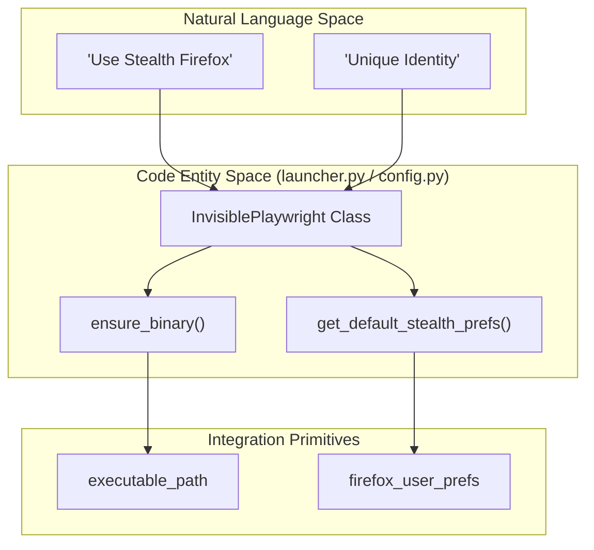
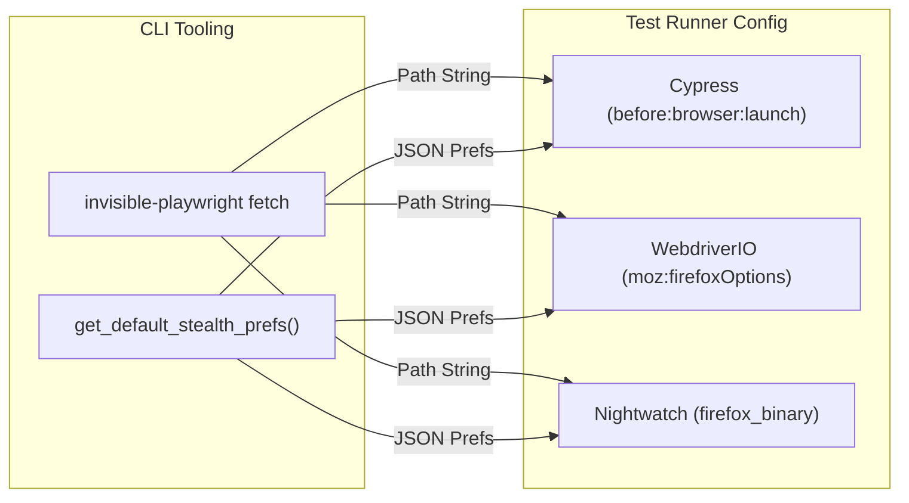

<!-- source: DeepWiki mcp.deepwiki.com · repo feder-cr/invisible_playwright · page 9 Integrations · fetched 2026-10-26 -->

# Integrations

Relevant source files

The following files were used as context for generating this wiki page:

- [README.md](README.md)
- [docs/README.md](docs/README.md)
- [docs/badges/telegram.svg](docs/badges/telegram.svg)
- [docs/banner-dark.png](docs/banner-dark.png)
- [docs/banner-light.png](docs/banner-light.png)
- [docs/integrations/README.md](docs/integrations/README.md)
- [docs/integrations/codeceptjs.md](docs/integrations/codeceptjs.md)
- [docs/integrations/crawlee-js.md](docs/integrations/crawlee-js.md)
- [docs/integrations/crawlee-python.md](docs/integrations/crawlee-python.md)
- [docs/integrations/other-languages.md](docs/integrations/other-languages.md)
- [docs/integrations/playwright-mcp.md](docs/integrations/playwright-mcp.md)
- [docs/integrations/robot-framework.md](docs/integrations/robot-framework.md)
- [docs/integrations/scrapy-playwright.md](docs/integrations/scrapy-playwright.md)
- [docs/integrations/test-runners.md](docs/integrations/test-runners.md)
- [src/invisible_playwright/config.py](src/invisible_playwright/config.py)
- [tests/test_readme_claims.py](tests/test_readme_claims.py)
- [tests/unit/test_config_public.py](tests/unit/test_config_public.py)

The `invisible_playwright` package is designed to be compatible with the standard Playwright API, making it a drop-in replacement in many Python projects. However, many users operate within higher-level frameworks like Scrapy, Crawlee, or Robot Framework. This page outlines how to integrate the two core components of the system—the **patched engine** and the **seeded profile**—into third-party tools.

## The Integration Pattern

Every integration on this page relies on the same fundamental distinction:

1.  **The Engine**: A Firefox binary patched at the C++ source level. This is pointed to via the `executable_path` launch option.
2.  **The Profile**: A set of browser identities (fingerprints) generated from a seed. This is delivered via the `firefox_user_prefs` launch option.

Frameworks that allow passing arbitrary launch options can support both halves. Frameworks that only allow setting a "browser path" can only carry the engine, which provides engine-level stealth but lacks per-session identity uniqueness [docs/integrations/README.md:26-37]().

### Integration Architecture
The following diagram shows how the Python wrapper translates a high-level `InvisiblePlaywright` request into the two primitives required by third-party frameworks.

**High-Level to Primitive Translation**

Sources: [docs/integrations/README.md:26-37](), [src/invisible_playwright/config.py:1-50]() (implied by usage in integrations)

---

## Framework Integrations

These integrations cover specialized scraping and automation frameworks. They often require the use of the `get_default_stealth_prefs()` and `get_default_args()` APIs to manually construct the configuration that the `InvisiblePlaywright` context manager would normally handle automatically.

| Framework | Mechanism | Support Level |
| :--- | :--- | :--- |
| **Scrapy** | `PLAYWRIGHT_BROWSER_PROVIDER` | Full (Engine + Profile) |
| **Crawlee (Python)** | `PlaywrightBrowserPlugin` subclass | Full (Engine + Profile) |
| **Robot Framework** | `New Browser` keyword arguments | Full (Engine + Profile) |
| **Crawlee (JS)** | `launchOptions` in Node.js | Engine + Profile (Requires Python for setup) |
| **Other Languages** | `executable_path` + `firefox_user_prefs` | Varies by Playwright binding |

For detailed setup guides, see **[Framework Integrations](#9.1)**.

Sources: [docs/integrations/README.md:15-24](), [docs/integrations/scrapy-playwright.md:31-71](), [docs/integrations/robot-framework.md:10-24]()

---

## AI Agent and MCP Integrations

AI-driven browser agents have unique requirements for stealth, particularly when running multiple parallel sessions. Because these agents often use Playwright under the hood, they can be configured to use the patched Firefox binary.

*   **Playwright MCP**: Integration via flags on the MCP server.
*   **Browser-use / Crawl4AI**: Typically involves passing the `executable_path` from `ensure_binary()` into the agent's browser configuration.

For details on maintaining distinct fingerprints across parallel agent sessions, see **[AI Agent and MCP Integrations](#9.2)**.

Sources: [docs/integrations/README.md:19-19](), [docs/integrations/playwright-mcp.md:1-10]()

---

## Test Runner Integrations

Test runners like Cypress, WebdriverIO, and Nightwatch can often be pointed at the `invisible_playwright` engine. However, there are trade-offs regarding humanized motion and dynamic timezone resolution.

**Integration Flow for Test Runners**

Sources: [docs/integrations/test-runners.md:14-19](), [docs/integrations/test-runners.md:29-57]()

### Summary of Test Runner Support
| Runner | Engine Support | Profile Support | Mechanism |
| :--- | :--- | :--- | :--- |
| **Cypress** | Yes | Yes | `--browser` path + `launchOptions.preferences` |
| **WebdriverIO** | Yes | Yes | `moz:firefoxOptions` (binary + prefs) |
| **Nightwatch** | Yes | Yes | `firefox_binary` + `moz:firefoxOptions.prefs` |
| **TestCafe** | Yes | **No** | `path:` provider (no preference injection) |

For details, see **[Framework Integrations](#9.1)**.

Sources: [docs/integrations/test-runners.md:14-19](), [docs/integrations/test-runners.md:94-110]()

---

