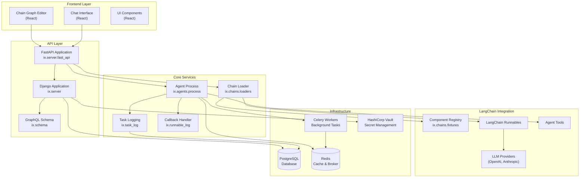
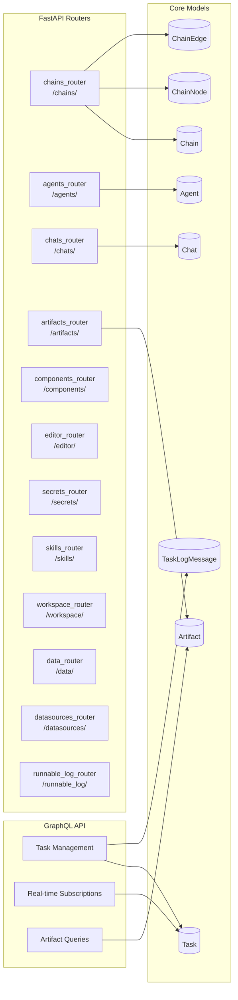
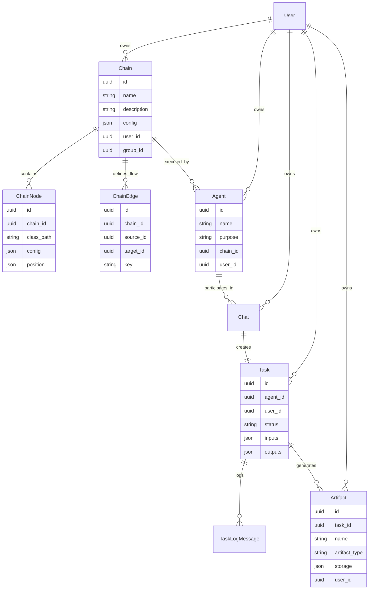
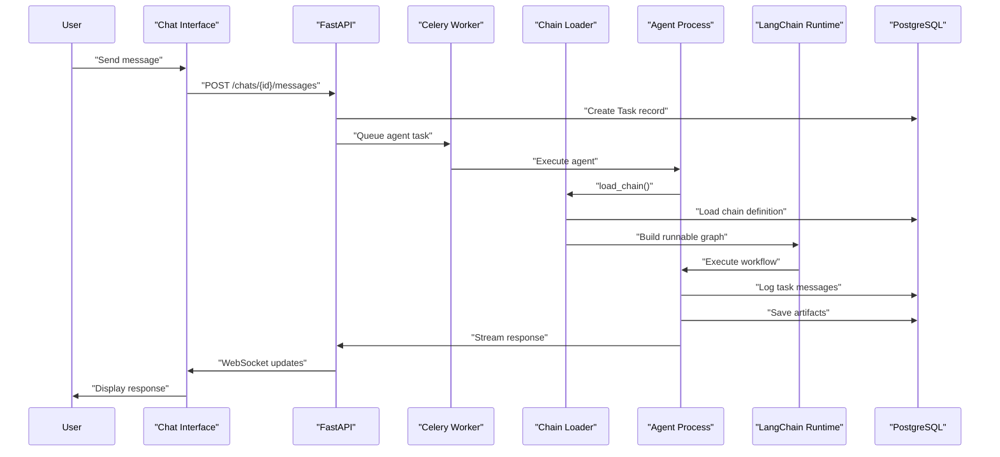
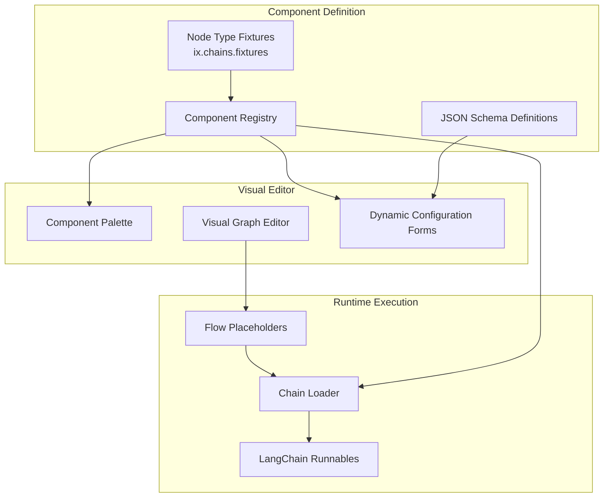

<!-- source: DeepWiki mcp.deepwiki.com · repo kreneskyp/ix · page 1 Overview · fetched 2026-10-26 -->

# Overview

Relevant source files

The following files were used as context for generating this wiki page:

- [README.md](README.md)
- [docs/FizzBuzzExample.gif](docs/FizzBuzzExample.gif)
- [docs/chat.png](docs/chat.png)
- [docs/chat_interactions.png](docs/chat_interactions.png)
- [docs/create_task.png](docs/create_task.png)
- [ix/api/artifacts/endpoints.py](ix/api/artifacts/endpoints.py)
- [ix/api/artifacts/types.py](ix/api/artifacts/types.py)
- [ix/api/tests/test_artifacts.py](ix/api/tests/test_artifacts.py)
- [ix/runnable/tests/__init__.py](ix/runnable/tests/__init__.py)
- [ix/server/fast_api.py](ix/server/fast_api.py)
- [ix/server/settings.py](ix/server/settings.py)
- [ix/server/test_settings.py](ix/server/test_settings.py)
- [ix/task_log/fixtures/dev_data.json~](ix/task_log/fixtures/dev_data.json~)
- [ix/task_log/migrations/0011_artifact_group_artifact_user.py](ix/task_log/migrations/0011_artifact_group_artifact_user.py)

## Purpose and Scope

IX is a platform for designing, deploying, and managing autonomous and semi-autonomous LLM-powered agents and workflows. This page provides a high-level overview of the IX platform architecture, core components, and system design. It covers the fundamental concepts and technical structure needed to understand how IX enables visual no-code agent creation, multi-agent orchestration, and scalable AI workflow execution.

For detailed information about specific subsystems, see [Core Architecture](#3), [API Reference](#4), and [Frontend Documentation](#5). For setup and deployment instructions, see [Getting Started](#2).

## Platform Architecture

IX is built as a modern web application with a React frontend, Django/FastAPI backend, and distributed task execution system. The platform integrates deeply with LangChain to provide a visual interface for building AI agent workflows.

### System Overview

Sources: [ix/server/fast_api.py:1-95](), [ix/server/settings.py:1-268](), [README.md:30-87]()

## Core Concepts

### Chains
Chains are visual workflows that define the logic and flow of AI agent operations. They are built using a graph-based editor and executed through the LangChain framework.

### Agents  
Agents are autonomous entities that can execute chains, use tools, and interact with users through chat interfaces. Multiple agents can collaborate within a single conversation.

### Components
Components are LangChain-compatible building blocks (LLMs, tools, memory systems, etc.) that can be visually connected in the chain editor to create complex workflows.

### Tasks
Tasks represent individual execution instances of agent operations, providing logging, artifact management, and conversation history.

## API Structure

IX exposes its functionality through both REST and GraphQL APIs, organized into distinct routers for different domains:

Sources: [ix/server/fast_api.py:8-38](), [ix/api/artifacts/endpoints.py:1-122]()

## Data Models and Relationships

The IX platform uses a relational data model centered around chains, agents, tasks, and artifacts:

Sources: [ix/task_log/migrations/0011_artifact_group_artifact_user.py:1-33](), [ix/api/artifacts/types.py:1-40]()

## Execution Flow

When a user interacts with an agent through the chat interface, IX follows this execution pattern:

Sources: [ix/server/fast_api.py:1-95](), [ix/server/settings.py:193-196]()

## Component Integration

IX provides a component configuration layer that maps LangChain components to visual node types in the chain editor:

Sources: [README.md:82-87](), [ix/server/settings.py:288-289]()

This architecture enables IX to provide a visual, no-code interface for building sophisticated AI agent workflows while maintaining the full power and flexibility of the LangChain ecosystem.

---

