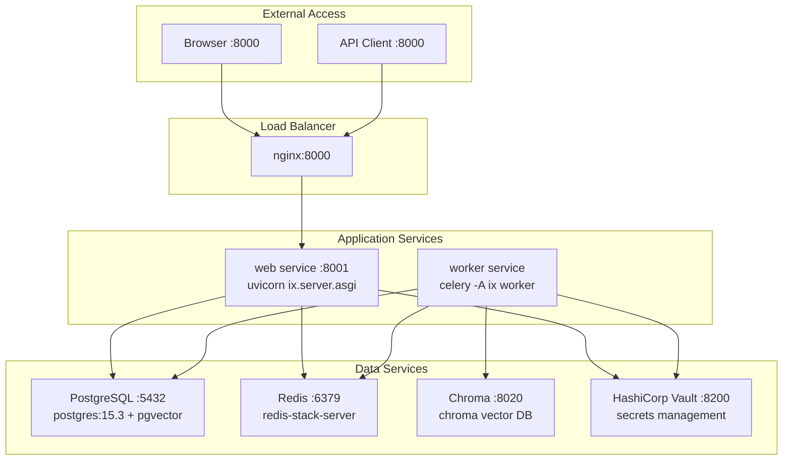
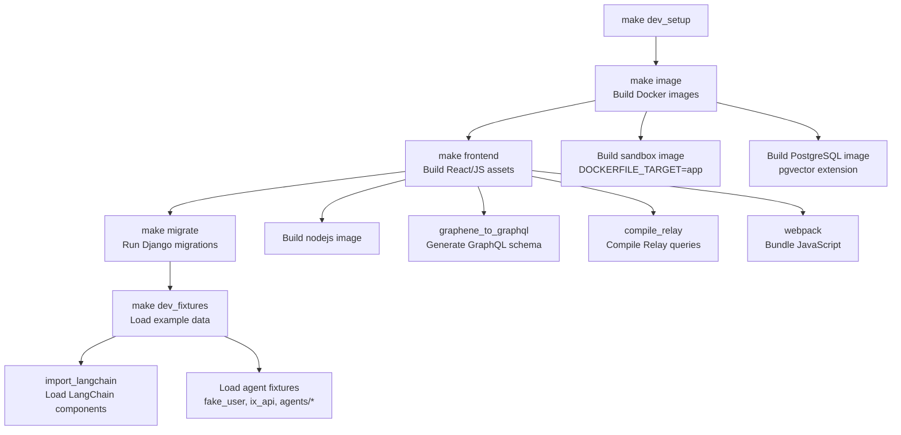

<!-- source: DeepWiki mcp.deepwiki.com · repo kreneskyp/ix · page 2 Getting Started · fetched 2026-10-26 -->

# Getting Started

<details>
<summary>Relevant source files</summary>

The following files were used as context for generating this wiki page:

- [.github/actions/run-docker/action.yml](.github/actions/run-docker/action.yml)
- [.github/workflows/publish-dev.yml](.github/workflows/publish-dev.yml)
- [.github/workflows/publish.yml](.github/workflows/publish.yml)
- [.github/workflows/test.yml](.github/workflows/test.yml)
- [.gitignore](.gitignore)
- [Dockerfile](Dockerfile)
- [Makefile](Makefile)
- [bin/get_uuid.py](bin/get_uuid.py)
- [docker-compose.yml](docker-compose.yml)
- [ix/chains/fixtures/agent/code2.json](ix/chains/fixtures/agent/code2.json)
- [ix/chains/fixtures/agent/each.json](ix/chains/fixtures/agent/each.json)
- [ix/chains/fixtures/agent/gemini.json](ix/chains/fixtures/agent/gemini.json)
- [ix/chains/fixtures/agent/ingest.json](ix/chains/fixtures/agent/ingest.json)
- [ix/chains/fixtures/agent/ingest_url.json](ix/chains/fixtures/agent/ingest_url.json)
- [ix/chains/fixtures/agent/knowledge.json](ix/chains/fixtures/agent/knowledge.json)
- [ix/chains/fixtures/agent/readme.json](ix/chains/fixtures/agent/readme.json)
- [ix/data/fixtures/ix_api.json](ix/data/fixtures/ix_api.json)
- [ix/task_log/management/commands/setup.py](ix/task_log/management/commands/setup.py)
- [psql.Dockerfile](psql.Dockerfile)

</details>


This document provides step-by-step instructions for installing, configuring, and deploying the IX AI agent platform. It covers everything from initial setup through verification that the system is running correctly.

The IX platform is a visual no-code agent builder that integrates with LangChain to create and deploy AI agents through a web interface. For detailed information about the core architecture and how components work together, see [Core Architecture](#3). For API usage and integration details, see [API Reference](#4).

## Prerequisites

Before starting, ensure you have the following installed on your system:

- **Docker** and **Docker Compose** - The platform runs entirely in containers
- **Make** - Used for build automation and common tasks
- **Git** - For cloning the repository
- At least **8GB RAM** and **4 CPU cores** recommended for optimal performance

## Quick Start

The fastest way to get IX running is using the automated development setup:

```bash
# Clone the repository
git clone https://github.com/kreneskyp/ix.git
cd ix

# Run complete development setup
make dev_setup
```

This single command handles the entire setup process, including building Docker images, running database migrations, loading LangChain components, and setting up example agents.

### Service Architecture



Sources: [docker-compose.yml:1-107](), [Makefile:181-189](), [nginx.conf:1-50]()

## Development Setup Process

The `make dev_setup` command executes several steps in sequence. Understanding these steps helps with troubleshooting and customization:

### Build Process Flow



Sources: [Makefile:107-109](), [Makefile:127-129](), [ix/task_log/management/commands/setup.py:8-35]()

### Manual Step-by-Step Setup

If you prefer to run setup steps individually or encounter issues:

```bash
# 1. Build Docker images
make image

# 2. Build frontend assets
make frontend

# 3. Start core services
make cluster

# 4. Run database migrations
make migrate

# 5. Load LangChain components
make components

# 6. Load example agents and fixtures
make dev_fixtures
```

### Key Build Targets

| Command | Purpose | Key Files |
|---------|---------|-----------|
| `make image` | Build application containers | [Dockerfile:1-123](), [psql.Dockerfile:1-6]() |
| `make frontend` | Compile React/JavaScript assets | [webpack.config.js](), [package.json]() |
| `make migrate` | Apply database schema changes | Django migrations in `ix/*/migrations/` |
| `make components` | Import LangChain components to database | [ix/chains/management/commands/import_langchain.py]() |

Sources: [Makefile:117-129](), [Makefile:257-304]()

## Service Management

### Starting Services

```bash
# Start all services in background
make up

# Start services and view logs
make server

# Start individual components
make db      # PostgreSQL only
make redis   # Redis only
```

### Service Status and Logs

```bash
# View running containers
docker-compose ps

# View logs for specific services
docker-compose logs web
docker-compose logs worker
docker-compose logs nginx

# Follow logs in real-time
make server  # web + nginx logs
make worker  # worker logs only
```

### Development Containers

For VS Code development or direct database access:

```bash
# Start development containers (DB + Redis only)
make vscode

# Stop development containers
make vscode-down

# Access application shell
make shell    # Django shell_plus
make bash     # Raw bash shell
```

Sources: [Makefile:161-179](), [Makefile:206-229](), [Makefile:239-252]()

## Verification Steps

### 1. Check Service Health

Verify all containers are running:

```bash
docker-compose ps
```

Expected output should show all services as "Up":
- `ix_web_1` - Application server
- `ix_nginx_1` - Load balancer  
- `ix_worker_1` - Background worker
- `ix_db_1` - PostgreSQL database
- `ix_redis_1` - Redis cache/broker
- `ix_chroma_1` - Vector database

### 2. Access Web Interface

Open your browser to `http://localhost:8000`. You should see the IX platform interface with:
- Chain graph editor for building agent workflows
- Chat interface for interacting with agents
- Agent management and configuration options

### 3. Test API Endpoints

```bash
# Check API health
curl http://localhost:8000/api/health

# List available agents
curl http://localhost:8000/agents/

# List available chains  
curl http://localhost:8000/chains/
```

### 4. Verify Agent Functionality

The setup includes several example agents loaded from fixtures:

| Agent | Alias | Purpose | Fixture File |
|-------|-------|---------|--------------|
| IX Readme | `readme` | Answers questions about IX using README | [ix/chains/fixtures/agent/readme.json]() |
| Knowledge | `knowledge` | RAG agent with vector search | [ix/chains/fixtures/agent/knowledge.json]() |
| Coder | `code` | Generates code solutions | [ix/chains/fixtures/agent/code2.json]() |
| Ingestion | `ingest` | Loads data into vector stores | [ix/chains/fixtures/agent/ingest.json]() |

Test an agent through the chat interface by typing: `@readme What is IX?`

Sources: [ix/chains/fixtures/agent/readme.json:1-379](), [ix/chains/fixtures/agent/knowledge.json:1-449](), [ix/task_log/management/commands/setup.py:12-35]()

## Configuration

### Environment Variables

Copy and customize the environment configuration:

```bash
cp .env.example .env
```

Key configuration options:

| Variable | Purpose | Default |
|----------|---------|---------|
| `OPENAI_API_KEY` | OpenAI API access | Required for most agents |
| `DJANGO_SECRET_KEY` | Django security | Auto-generated in container |
| `POSTGRES_*` | Database configuration | Set in docker-compose.yml |
| `VAULT_*` | Secrets management | Optional for development |

### LLM Provider Setup

To use different LLM providers, configure API keys in your `.env` file:

```bash
# OpenAI (most common)
OPENAI_API_KEY=your_openai_key

# Google Gemini
GOOGLE_API_KEY=your_google_key  

# Anthropic Claude
ANTHROPIC_API_KEY=your_anthropic_key
```

For detailed LLM configuration, see [LLM Configuration](#6.1).

Sources: [docker-compose.yml:30-36](), [Dockerfile:92-96]()

## Troubleshooting

### Common Issues

**Port conflicts**: If port 8000 is in use, modify the port mapping in [docker-compose.yml:40-41]()

**Memory issues**: Increase Docker memory allocation to at least 8GB for optimal performance

**Frontend build failures**: Ensure Node.js assets build correctly:
```bash
make nodejs
make webpack
```

**Database connection errors**: Verify PostgreSQL is running:
```bash
make db
docker-compose logs db
```

### Reset and Clean Commands

```bash
# Reset worker processes
make worker-reset

# Clean build artifacts
make clean

# Full restart
make restart

# Fix file ownership issues (Linux)
make fix-file-ownership
```

Sources: [Makefile:222-234](), [Makefile:361-373]()

## Next Steps

Once IX is running successfully:

1. **Explore the Interface**: Visit [Chain Graph Editor](#5.1) to learn about building agent workflows visually
2. **Try the Examples**: Interact with the pre-loaded agents through the [Chat Interface](#5.2)  
3. **Build Custom Agents**: See [Agent Execution System](#3.2) for details on agent architecture
4. **Add Tools and Components**: Check [Tool Integration](#6.2) for extending agent capabilities
5. **Deploy to Production**: Review [Deployment](#7.2) for production deployment strategies

The IX platform provides a complete environment for building, testing, and deploying AI agents. The visual editor makes it accessible to non-programmers while maintaining the flexibility needed for complex agent workflows.

---

