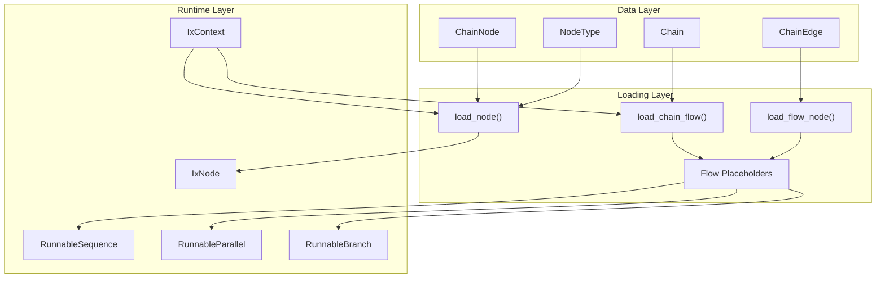
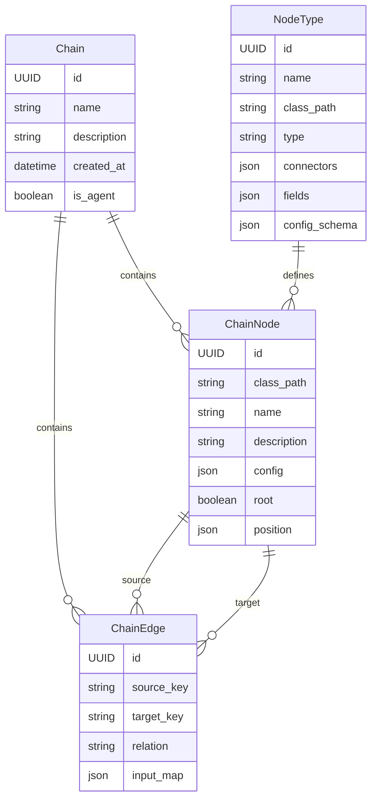
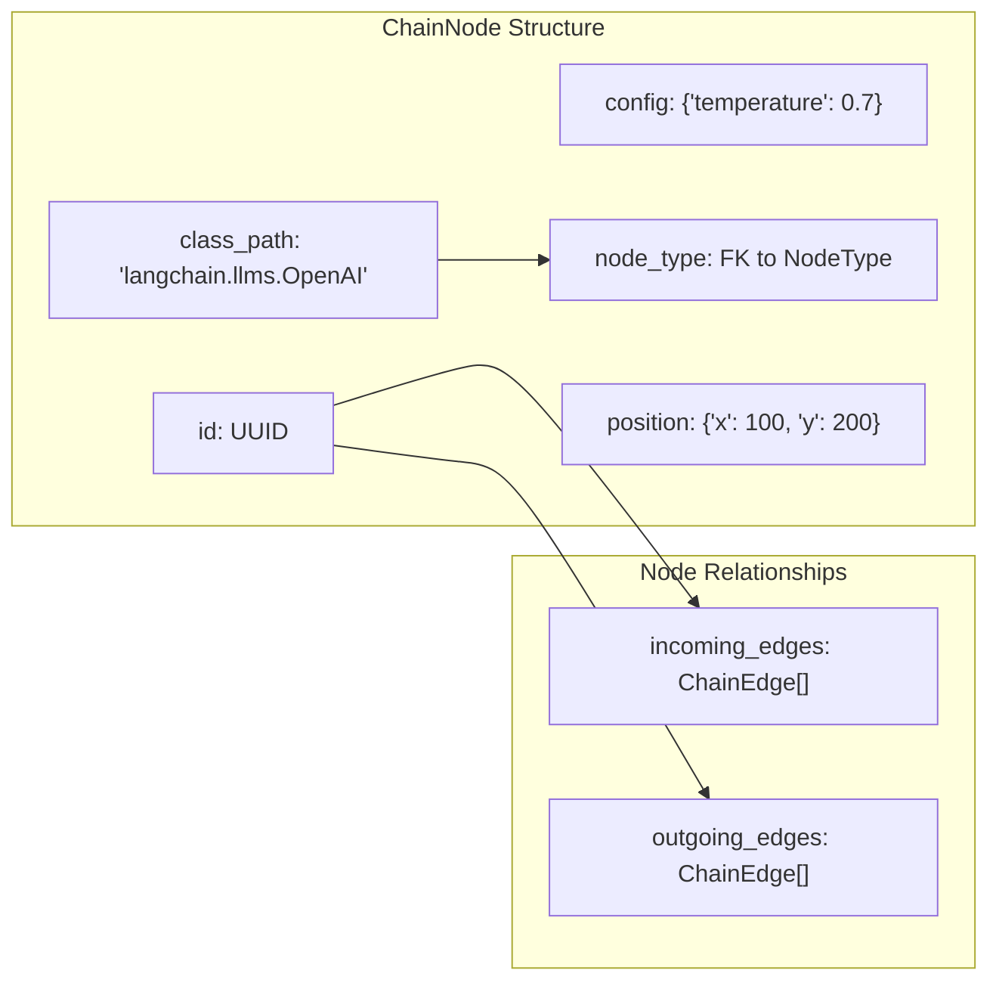
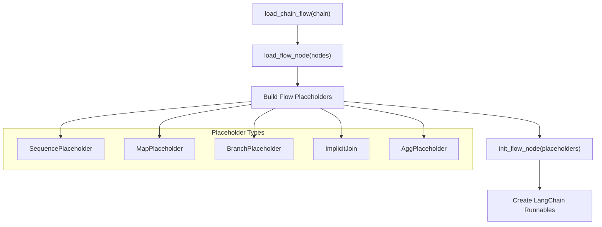
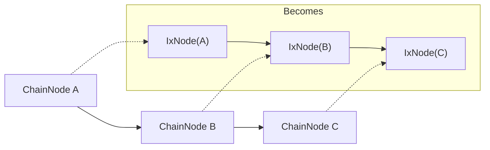
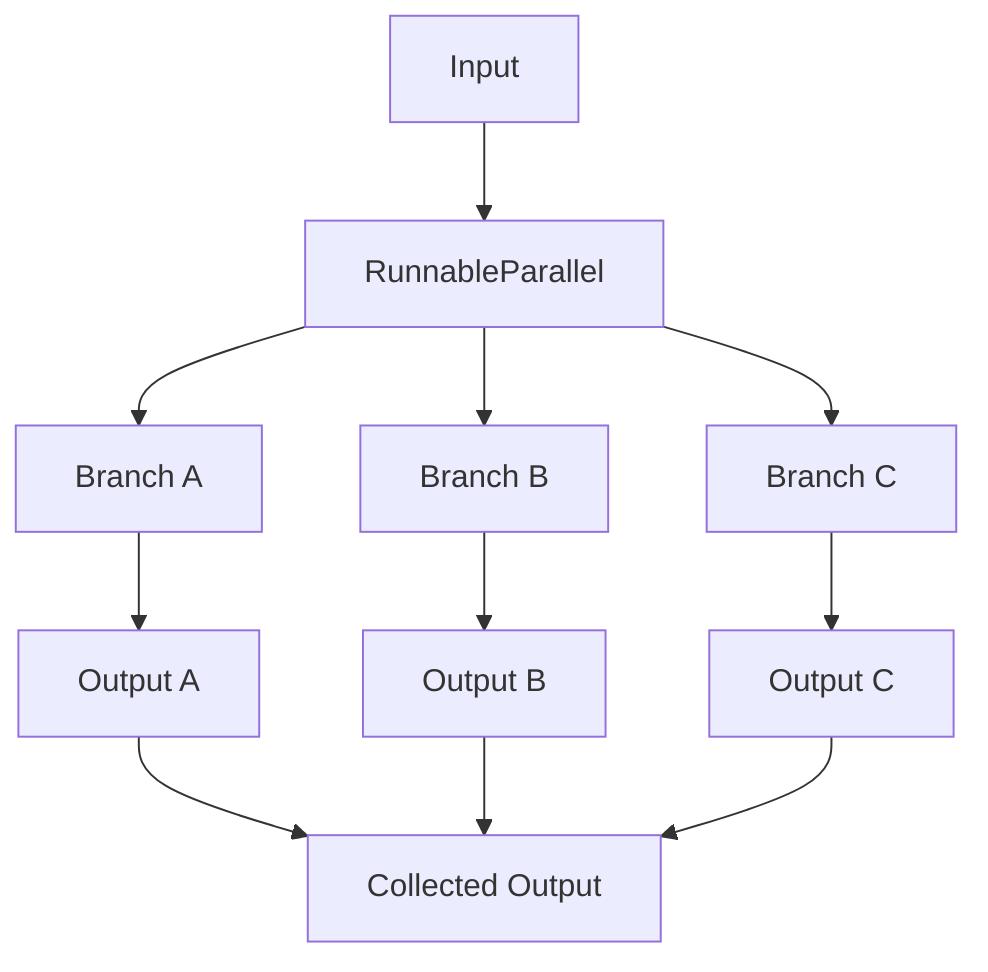
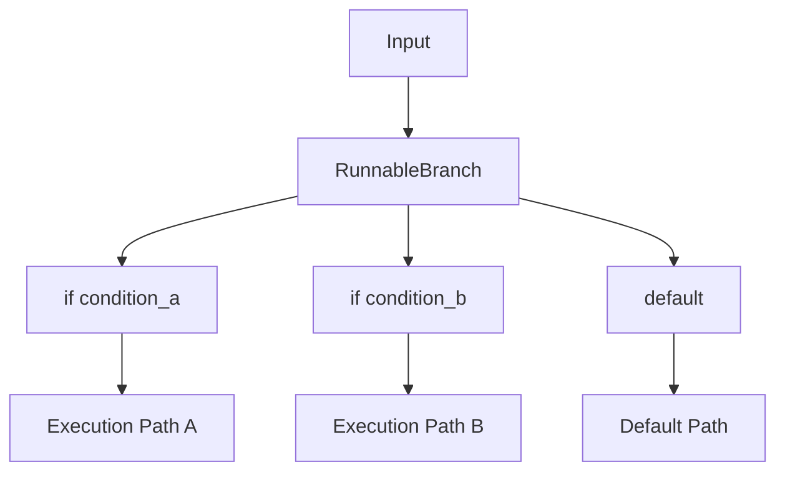
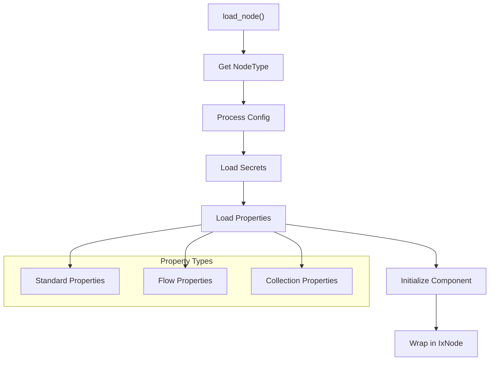
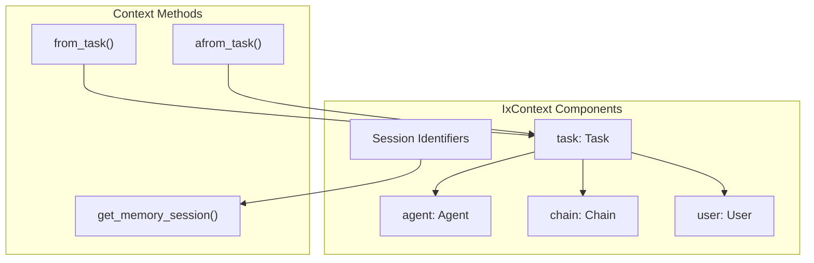

<!-- source: DeepWiki mcp.deepwiki.com · repo kreneskyp/ix · page 3.1 Chain System · fetched 2026-10-26 -->

# Chain System

<details>
<summary>Relevant source files</summary>

The following files were used as context for generating this wiki page:

- [ix/agents/callback_manager.py](ix/agents/callback_manager.py)
- [ix/api/components/types.py](ix/api/components/types.py)
- [ix/chains/functions.py](ix/chains/functions.py)
- [ix/chains/json.py](ix/chains/json.py)
- [ix/chains/llm_chain.py](ix/chains/llm_chain.py)
- [ix/chains/loaders/__init__.py](ix/chains/loaders/__init__.py)
- [ix/chains/loaders/core.py](ix/chains/loaders/core.py)
- [ix/chains/loaders/memory.py](ix/chains/loaders/memory.py)
- [ix/chains/loaders/tools.py](ix/chains/loaders/tools.py)
- [ix/chains/migrations/0005_refine_node_type.py](ix/chains/migrations/0005_refine_node_type.py)
- [ix/chains/models.py](ix/chains/models.py)
- [ix/chains/routing.py](ix/chains/routing.py)
- [ix/chains/tests/conftest.py](ix/chains/tests/conftest.py)
- [ix/chains/tests/fake.py](ix/chains/tests/fake.py)
- [ix/chains/tests/mock_configs.py](ix/chains/tests/mock_configs.py)
- [ix/chains/tests/mock_memory.py](ix/chains/tests/mock_memory.py)
- [ix/chains/tests/test_config_loader.py](ix/chains/tests/test_config_loader.py)
- [ix/chains/tests/test_llm_chain.py](ix/chains/tests/test_llm_chain.py)
- [ix/chains/tests/test_routing.py](ix/chains/tests/test_routing.py)
- [ix/conftest.py](ix/conftest.py)
- [ix/pg_vector/tests/models.py](ix/pg_vector/tests/models.py)

</details>


The Chain System is the core workflow engine of the IX platform that handles chain definition, loading, and execution. It provides a visual graph-based interface for building AI workflows while translating them into executable LangChain components at runtime. This system bridges the gap between the visual node-and-edge representation used in the UI and the LangChain Expression Language (LCEL) components that execute the actual workflows.

For information about agent execution and task management, see [Agent Execution System](#3.2). For details on UI components and the visual editor, see [Chain Graph Editor](#5.1).

## Core Architecture

The Chain System consists of three primary layers: the data models that define chain structure, the loading system that converts graphs to executable components, and the runtime execution context.



Sources: [ix/chains/models.py:1-362](), [ix/chains/loaders/core.py:1-968](), [ix/chains/loaders/context.py:1-50]()

## Chain Models and Data Structure

The Chain System uses four core Django models to represent workflow graphs in the database.

### Chain Model

The `Chain` model represents a complete workflow with metadata and references to its constituent nodes.



Key methods on the `Chain` model include:
- `load_chain(context)` - Loads the chain into executable components
- `aload_chain(context)` - Async version of chain loading
- `chat_root` - Property that finds the root node for chat workflows

Sources: [ix/chains/models.py:288-362]()

### ChainNode Model

The `ChainNode` model represents individual components in the workflow graph. Each node has a `class_path` that identifies the LangChain component it represents and a `config` containing initialization parameters.



Sources: [ix/chains/models.py:230-261]()

### ChainEdge Model

The `ChainEdge` model defines connections between nodes with two types of relationships:
- `LINK` - Data flow connections that define execution order
- `PROP` - Property connections that inject one node as a property of another

The `source_key` and `target_key` fields specify which outputs and inputs are connected.

Sources: [ix/chains/models.py:263-286]()

### NodeType Model

The `NodeType` model provides metadata about available components, including their configuration schema, connectors, and field definitions. This enables the UI to generate appropriate forms and validates component configurations.

Sources: [ix/chains/models.py:45-104](), [ix/api/components/types.py:484-643]()

## Chain Loading Process

The chain loading process converts the database graph representation into executable LangChain components through a multi-stage pipeline.



### Phase 1: Graph Loading

The `load_chain_flow()` function starts by identifying root nodes and building the flow structure using placeholder objects.

```python
def load_chain_flow(chain: Chain) -> Tuple[Type[BaseModel], FlowPlaceholder]:
    nodes = chain.nodes.filter(incoming_edges__source=chain.chat_root)
    return chain.types.INPUT, load_flow_node(nodes)
```

Sources: [ix/chains/loaders/core.py:564-578]()

### Phase 2: Flow Placeholder Construction

The `load_flow_node()` function traverses the graph and creates placeholder objects that represent different flow patterns:

- **SequencePlaceholder** - Sequential execution of nodes
- **MapPlaceholder** - Parallel execution with different inputs
- **BranchPlaceholder** - Conditional execution paths
- **ImplicitJoin** - Automatic aggregation points

Sources: [ix/chains/loaders/core.py:580-601](), [ix/chains/loaders/core.py:348-464]()

### Phase 3: Component Initialization

The `init_flow_node()` function converts placeholders into actual LangChain `Runnable` components:

```python
def init_flow_node(root: FlowPlaceholder, context: IxContext) -> Runnable:
    if isinstance(root, ChainNode):
        instance = load_node(root, context=context)
        return IxNode(name=root.name, child=instance, context=context)
    elif isinstance(root, SequencePlaceholder):
        nodes = [init_flow_node(node, context) for node in root.steps]
        return init_sequence(steps=nodes)
    # ... handle other placeholder types
```

Sources: [ix/chains/loaders/core.py:895-968]()

## Flow Processing and Placeholders

The Chain System uses placeholder objects to represent different execution patterns before converting them to LangChain components.

### Sequence Processing

Sequences represent linear execution chains where the output of one node becomes the input to the next.



The `load_flow_sequence()` function handles complex traversal logic including loop detection and map node processing.

Sources: [ix/chains/loaders/core.py:706-874]()

### Parallel Processing

Map nodes enable parallel execution where the same input is processed by multiple branches simultaneously.



Sources: [ix/chains/loaders/core.py:603-645]()

### Branch Processing 

Branch nodes implement conditional logic where different execution paths are taken based on input conditions.



Sources: [ix/chains/loaders/core.py:647-700]()

## Component Integration

The Chain System integrates with LangChain components through a flexible loading mechanism that supports various component types.

### Node Loading

The `load_node()` function handles individual component initialization:



Key features of node loading:
- **Secret Management** - Automatically loads secrets from the vault
- **Property Resolution** - Recursively loads connected components
- **Type Conversion** - Handles type-specific loading logic
- **Context Injection** - Provides execution context to components

Sources: [ix/chains/loaders/core.py:154-323]()

### Specialized Loaders

The system includes specialized loaders for different component types:

- **Memory Loader** - Handles memory components with session management
- **Tool Loader** - Loads tools and toolkits for agent use  
- **Prompt Loader** - Processes prompt templates and variables

Sources: [ix/chains/loaders/memory.py:48-171](), [ix/chains/loaders/tools.py:91-145]()

### IxNode Wrapper

All loaded components are wrapped in `IxNode` instances that provide:
- Execution context access
- Task logging integration
- Callback management
- Debugging information

```python
instance = IxNode(
    name=root.name,
    description=root.description, 
    node_id=root.id,
    child=instance,
    context=context,
    config=root.config,
    bind_points=node_type.bind_points,
)
```

Sources: [ix/chains/loaders/core.py:910-918]()

## Execution Context

The `IxContext` class provides runtime context and state management for chain execution.



The context provides:
- **Task Information** - Current task being executed
- **Agent Details** - The agent running the chain
- **User Context** - User who initiated the execution
- **Session Management** - Session IDs for memory and state

Sources: [ix/chains/loaders/context.py:1-50]()

### Context Usage

Components use context for:
- **Memory Scoping** - Session-based memory isolation
- **Secret Access** - User-scoped secret retrieval
- **Callback Management** - Task logging and progress tracking
- **Resource Access** - Database connections and external services

The context system ensures that chains execute with proper isolation and access controls while maintaining observability through the task logging system.

Sources: [ix/chains/loaders/memory.py:101-171](), [ix/chains/loaders/core.py:89-119]()

---

