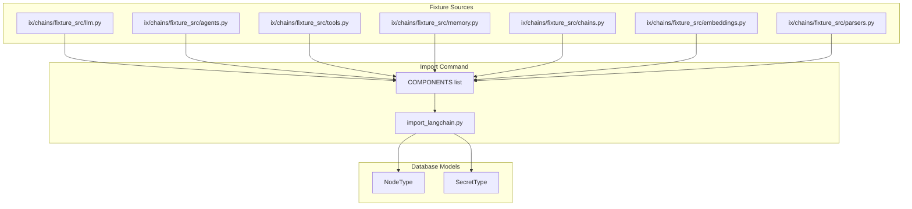
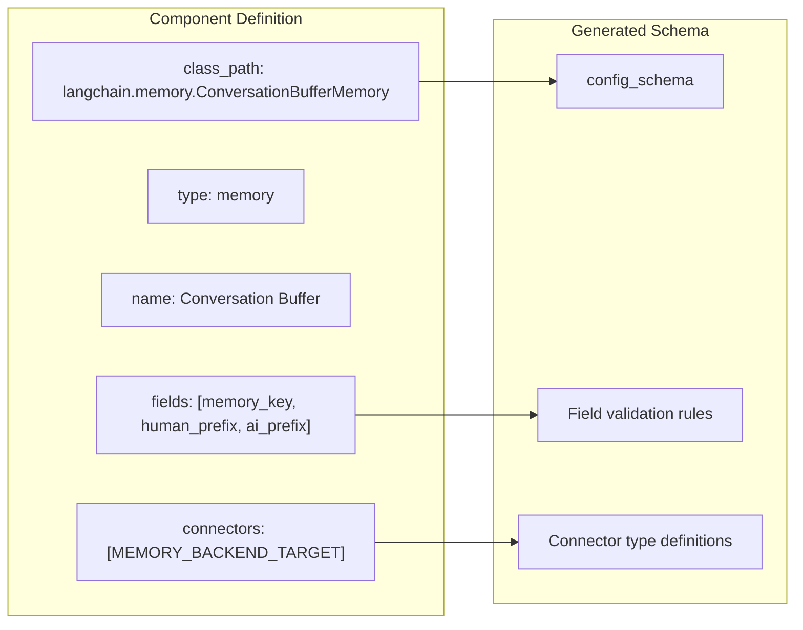
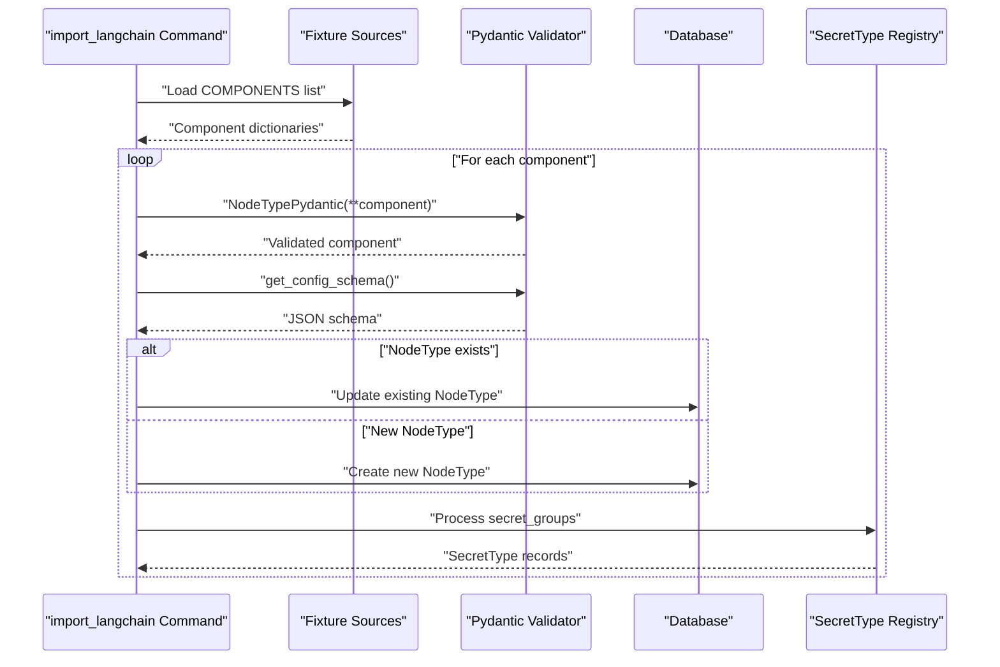
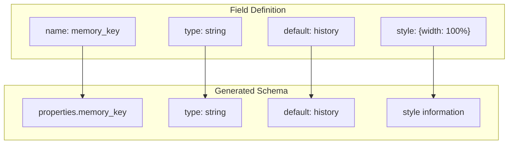
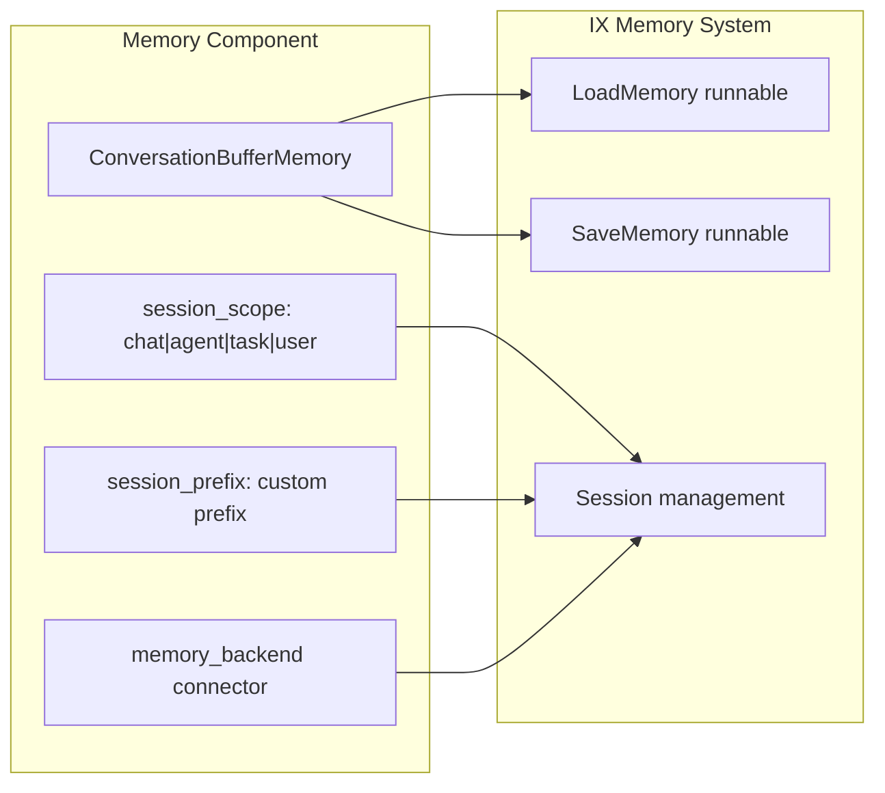
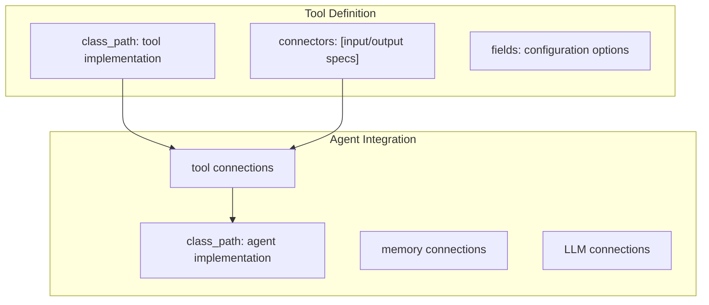
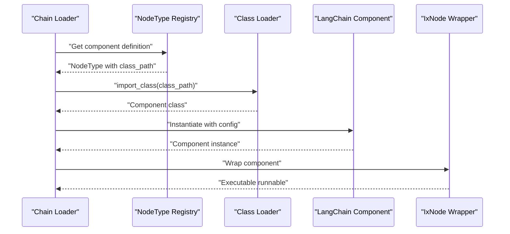
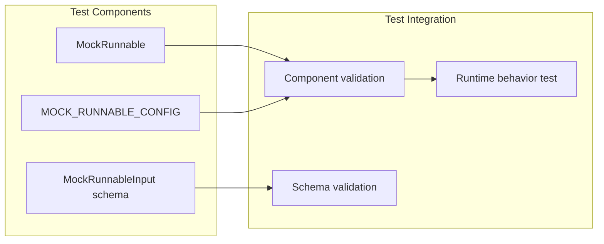
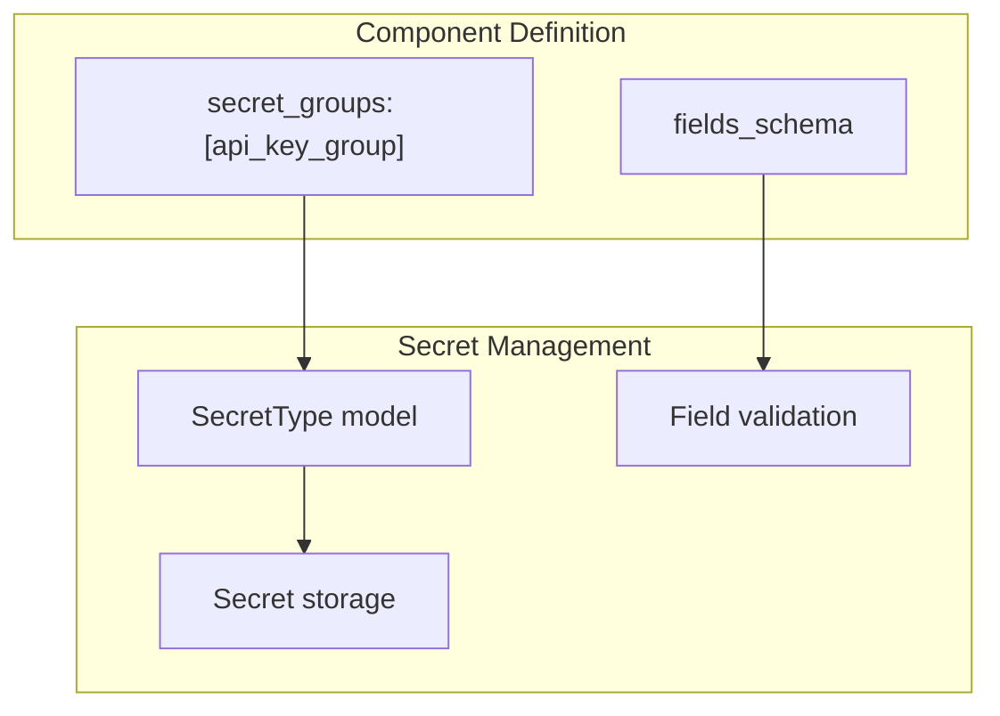

<!-- source: DeepWiki mcp.deepwiki.com · repo kreneskyp/ix · page 3.3 Component Integration · fetched 2026-10-26 -->

# Component Integration

Relevant source files

The following files were used as context for generating this wiki page:

- [ix/chains/components/memory.py](ix/chains/components/memory.py)
- [ix/chains/fixture_src/__init__.py](ix/chains/fixture_src/__init__.py)
- [ix/chains/fixture_src/chat_memory_backend.py](ix/chains/fixture_src/chat_memory_backend.py)
- [ix/chains/fixture_src/common.py](ix/chains/fixture_src/common.py)
- [ix/chains/fixture_src/deprecated.py](ix/chains/fixture_src/deprecated.py)
- [ix/chains/fixture_src/memory.py](ix/chains/fixture_src/memory.py)
- [ix/chains/fixture_src/openai_functions.py](ix/chains/fixture_src/openai_functions.py)
- [ix/chains/management/commands/import_langchain.py](ix/chains/management/commands/import_langchain.py)
- [ix/chains/openapi.py](ix/chains/openapi.py)
- [ix/chains/tests/mock_runnable.py](ix/chains/tests/mock_runnable.py)
- [ix/runnable/tests/test_flow.py](ix/runnable/tests/test_flow.py)
- [requirements.txt](requirements.txt)
- [test_data/snapshots/components/langchain.memory.chat_message_histories.postgres.PostgresChatMessageHistory.json](test_data/snapshots/components/langchain.memory.chat_message_histories.postgres.PostgresChatMessageHistory.json)
- [test_data/snapshots/components/langchain.text_splitter.RecursiveCharacterTextSplitter.from_language.json](test_data/snapshots/components/langchain.text_splitter.RecursiveCharacterTextSplitter.from_language.json)
- [test_data/snapshots/components/langchain_community.document_loaders.parsers.language.language_parser.LanguageParser.json](test_data/snapshots/components/langchain_community.document_loaders.parsers.language.language_parser.LanguageParser.json)

The Component Integration system manages how LangChain components are made available within the IX platform. This system handles the registration, schema generation, and lifecycle management of components that can be used in the visual chain editor. The integration layer converts LangChain's Python-based components into structured definitions that the IX frontend can understand and manipulate.

For information about how components are used during chain execution, see [Chain System](#3.1). For details about the visual editing interface, see [Chain Graph Editor](#5.1).

## Component Definition System

Components in IX are defined through Python fixture files located in [ix/chains/fixture_src/](), which provide structured definitions of LangChain components. These definitions include metadata, configuration schemas, connection points, and field specifications that enable the visual editor to work with the components.

### Fixture Architecture

The component definitions are organized into category-specific fixture files:

The [import_langchain command](ix/chains/management/commands/import_langchain.py:101-159)() aggregates components from all fixture sources and processes them into database records.

Sources: [ix/chains/management/commands/import_langchain.py:1-159]()

### Component Structure

Each component definition follows a standardized structure that includes:

| Field | Purpose | Example |
|-------|---------|---------|
| `class_path` | Python import path to the LangChain class | `"langchain.memory.ConversationBufferMemory"` |
| `type` | Component category | `"memory"`, `"llm"`, `"tool"` |
| `name` | Display name | `"Conversation Buffer"` |
| `description` | Component description | `"Memory that stores conversation history"` |
| `fields` | Configuration fields | Field definitions with types and defaults |
| `connectors` | Input/output connection points | Source and target connectors |

Here's an example from the memory fixtures:

Sources: [ix/chains/fixture_src/memory.py:84-91]()

## NodeType Registration Process

The component registration process converts fixture definitions into `NodeType` database records through the `import_langchain` management command.

### Registration Flow

The registration process performs validation using [NodeTypePydantic](ix/chains/management/commands/import_langchain.py:126-129)() and generates configuration schemas for the frontend.

Sources: [ix/chains/management/commands/import_langchain.py:120-159]()

### Schema Generation

Each component's configuration schema is automatically generated from its field definitions:

Sources: [ix/chains/management/commands/import_langchain.py:129-144]()

## Component Types and Integration Patterns

Different categories of LangChain components follow specific integration patterns within IX.

### Memory Components

Memory components integrate with IX's session management system through scoped memory fields:

Sources: [ix/chains/fixture_src/memory.py:28-63](), [ix/chains/components/memory.py:8-75]()

### Custom IX Components

IX provides custom components that extend LangChain functionality:

| Component | Purpose | Class Path |
|-----------|---------|------------|
| `LoadMemory` | Load memories from storage | `ix.chains.components.memory.LoadMemory` |
| `SaveMemory` | Save memories to storage | `ix.chains.components.memory.SaveMemory` |
| `ParseFunctionCall` | Parse OpenAI function calls | `ix.runnable.output_parser.ParseFunctionCall` |

These components follow the same registration pattern but implement IX-specific functionality.

Sources: [ix/chains/fixture_src/memory.py:151-188](), [ix/chains/fixture_src/openai_functions.py:42-63]()

### Tool and Agent Integration

Tools and agents are registered with connector specifications that define their input/output interfaces:

Sources: [ix/chains/management/commands/import_langchain.py:44-46]()

## Runtime Integration

At runtime, the component integration system works with the chain loading system to instantiate actual LangChain components from their NodeType definitions.

### Component Instantiation Flow

The integration system ensures that components defined in fixtures can be seamlessly instantiated and used within IX chains.

Sources: [ix/runnable/tests/test_flow.py:58-123]()

### Testing Framework

The component integration system includes testing utilities like `MockRunnable` for validating component behavior:

Sources: [ix/chains/tests/mock_runnable.py:14-57]()

## Secret Management Integration

Components that require API keys or other secrets integrate with IX's secret management system through `secret_groups` definitions:

The import command automatically creates `SecretType` records for components that define secret requirements.

Sources: [ix/chains/management/commands/import_langchain.py:151-159]()

---

