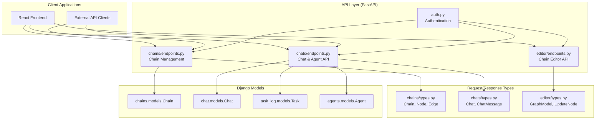
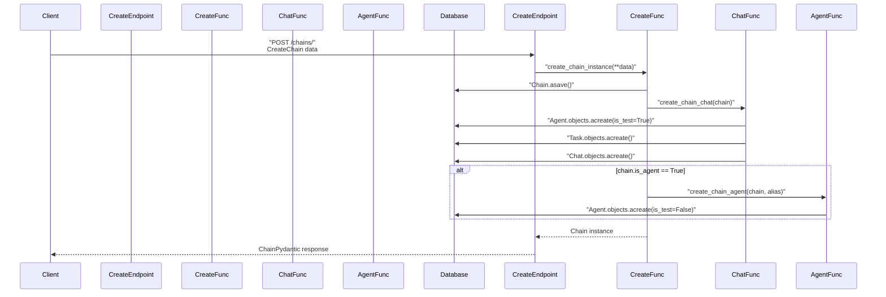
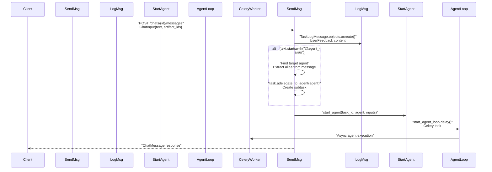
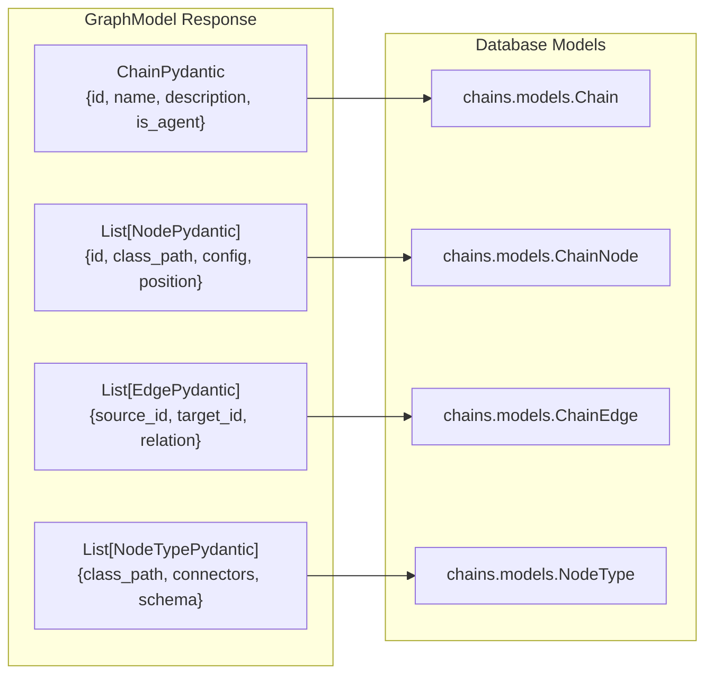
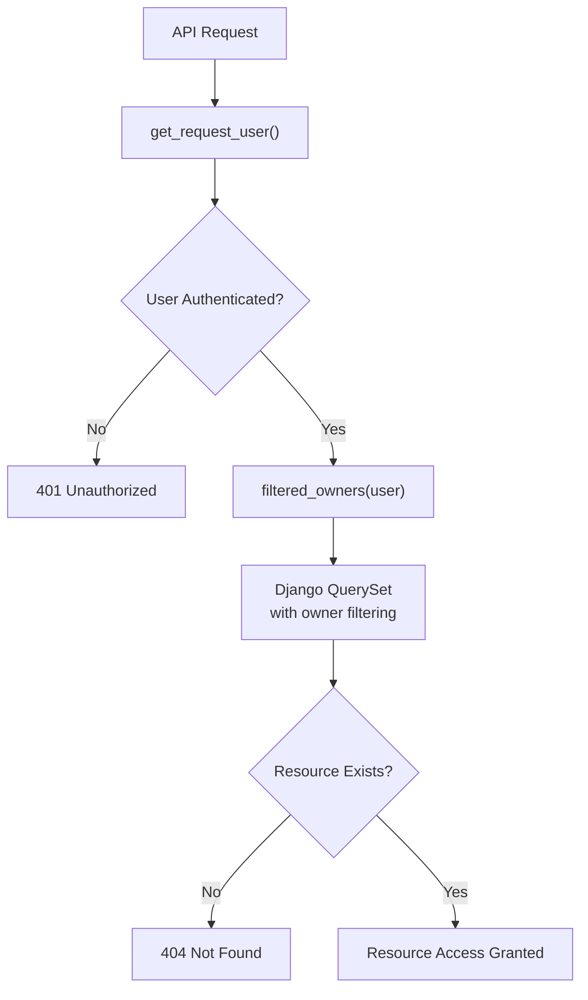

<!-- source: DeepWiki mcp.deepwiki.com · repo kreneskyp/ix · page 4 API Reference · fetched 2026-10-26 -->

# API Reference

<details>
<summary>Relevant source files</summary>

The following files were used as context for generating this wiki page:

- [frontend/chat/hooks/useSendInput.js](frontend/chat/hooks/useSendInput.js)
- [frontend/chat/input/ChatInput.js](frontend/chat/input/ChatInput.js)
- [frontend/chat/input/useSendInput.js](frontend/chat/input/useSendInput.js)
- [ix/api/chains/endpoints.py](ix/api/chains/endpoints.py)
- [ix/api/chains/types.py](ix/api/chains/types.py)
- [ix/api/chats/endpoints.py](ix/api/chats/endpoints.py)
- [ix/api/chats/types.py](ix/api/chats/types.py)
- [ix/api/editor/endpoints.py](ix/api/editor/endpoints.py)
- [ix/api/editor/types.py](ix/api/editor/types.py)
- [ix/api/tests/test_chains.py](ix/api/tests/test_chains.py)
- [ix/api/tests/test_chat.py](ix/api/tests/test_chat.py)
- [ix/chains/migrations/0016_alter_chainedge_relation.py](ix/chains/migrations/0016_alter_chainedge_relation.py)

</details>


This document provides complete documentation of the REST APIs provided by the IX AI agent platform. The APIs enable programmatic management of chains, agents, chats, and the visual chain editor interface.

For information about the underlying chain execution system, see [Core Architecture](#3). For details about GraphQL subscriptions and real-time updates, see [GraphQL API](#4.3).

## API Architecture Overview

The IX platform exposes three primary REST API groups built on FastAPI with Django ORM integration:



All APIs require authentication via the `get_request_user` dependency and support owner-based filtering for multi-tenant access control.

**Sources:** [ix/api/chains/endpoints.py:1-226](), [ix/api/chats/endpoints.py:1-383](), [ix/api/editor/endpoints.py:1-281](), [ix/api/auth.py]()

## Chain Management API

The Chain Management API provides CRUD operations for chains, which represent AI agent workflows and their configurations.

### Core Endpoints

| Method | Endpoint | Operation ID | Purpose |
|--------|----------|--------------|---------|
| GET | `/chains/` | `get_chains` | List chains with pagination and filtering |
| POST | `/chains/` | `create_chain` | Create new chain with optional agent |
| GET | `/chains/{chain_id}` | `get_chain_detail` | Get specific chain details |
| PUT | `/chains/{chain_id}` | `update_chain` | Update chain properties |
| DELETE | `/chains/{chain_id}` | `delete_chain` | Delete chain and cleanup |

### Chain Creation Flow



### Request/Response Models

**CreateChain**: Name, description, `is_agent` flag, and optional `alias` for agent chains
**Chain**: Complete chain data including UUID, timestamps, and agent properties
**ChainQueryPage**: Paginated list response with search and filtering support

**Sources:** [ix/api/chains/endpoints.py:120-131](), [ix/api/chains/types.py:15-51](), [ix/api/chains/endpoints.py:62-117]()

## Chat and Agent API  

The Chat and Agent API manages conversational interfaces, agent interactions, and message handling for AI agent sessions.

### Chat Management

| Method | Endpoint | Operation ID | Purpose |
|--------|----------|--------------|---------|
| POST | `/chats/` | `create_chat` | Create new chat session |
| GET | `/chats/` | `get_chats` | List user's chats with search |
| GET | `/chats/{chat_id}` | `get_chat` | Get chat details |
| PUT | `/chats/{chat_id}` | `update_chat` | Update chat properties |
| DELETE | `/chats/{chat_id}` | `delete_chat` | Delete chat session |

### Agent and Message Operations

| Method | Endpoint | Operation ID | Purpose |
|--------|----------|--------------|---------|
| PUT | `/chats/{chat_id}/agents/{agent_id}` | `add_agent` | Add agent to chat |
| DELETE | `/chats/{chat_id}/agents/{agent_id}` | `remove_agent` | Remove agent from chat |
| GET | `/chats/{chat_id}/graph` | `get_chat_graph` | Get complete chat context |
| GET | `/chats/{chat_id}/messages` | `get_messages` | Get chat message history |
| POST | `/chats/{chat_id}/messages` | `send_message` | Send user message |
| POST | `/chats/{chat_id}/messages/clear` | `clear_messages` | Clear message history |

### Message Processing Flow



The `send_message` endpoint supports agent targeting via `@alias` syntax and artifact attachment through `artifact_ids`.

**Sources:** [ix/api/chats/endpoints.py:284-352](), [ix/api/chats/endpoints.py:372-382](), [ix/api/chats/types.py:103-127]()

## Chain Editor API

The Chain Editor API provides fine-grained control over chain graph construction, enabling the visual editor to manipulate nodes, edges, and chain structure.

### Node Operations

| Method | Endpoint | Operation ID | Purpose |
|--------|----------|--------------|---------|
| POST | `/chains/nodes` | `add_node` | Add node to chain or create new chain |
| PUT | `/chains/nodes/{node_id}` | `update_node` | Update node configuration |
| POST | `/chains/nodes/{node_id}/position` | `move_node` | Update node position |
| DELETE | `/chains/nodes/{node_id}` | `delete_node` | Delete node and connected edges |

### Edge Operations  

| Method | Endpoint | Operation ID | Purpose |
|--------|----------|--------------|---------|
| POST | `/chains/edges` | `add_edge` | Create connection between nodes |
| PUT | `/chains/edges/{edge_id}` | `update_edge` | Update edge properties |
| DELETE | `/chains/edges/{edge_id}` | `delete_edge` | Remove edge connection |

### Graph Operations

| Method | Endpoint | Operation ID | Purpose |
|--------|----------|--------------|---------|
| GET | `/chains/{chain_id}/graph` | `get_chain_graph` | Get complete chain graph |
| POST | `/chains/{chain_id}/set_root` | `set_root` | Set chain root nodes |
| GET | `/chains/{chain_id}/chat` | `get_test_chat` | Get test chat for chain |
| POST | `/nodes/bulk` | `get_nodes` | Bulk fetch nodes by IDs |

### Chain Graph Data Model



The `get_chain_graph` endpoint returns the complete graph structure needed by the frontend editor, including node types for rendering component schemas.

**Sources:** [ix/api/editor/endpoints.py:198-232](), [ix/api/editor/types.py:73-82](), [ix/api/chains/types.py:65-136]()

## Data Models and Types

The API uses Pydantic models for request/response validation with Django ORM models for persistence.

### Core Data Types

**Position**: Coordinate pair for node positioning
```python
class Position(BaseModel):
    x: float
    y: float
```

**Node**: Chain graph node with configuration and positioning
```python
class Node(BaseModel):
    id: UUID
    chain_id: UUID
    class_path: str
    config: dict
    position: Position
    root: bool = False
```

**Edge**: Connection between nodes with relationship type
```python
class Edge(BaseModel):
    id: UUID
    source_id: UUID
    target_id: UUID
    source_key: Optional[str]
    target_key: Optional[str]
    relation: Literal["LINK", "PROP", "GRAPH"]
```

### Chat Data Types

**ChatMessage**: Message in chat conversation
```python
class ChatMessage(BaseModel):
    id: UUID
    agent_id: Optional[UUID]
    role: RoleChoice  # SYSTEM, ASSISTANT, USER
    content: Dict[str, Any]
    created_at: datetime
```

**ChatInput**: User input with optional artifacts
```python
class ChatInput(BaseModel):
    text: str
    artifact_ids: Optional[List[UUID]]
```

### Pagination Support

All list endpoints support pagination through `QueryPage` base class:
- `limit`: Items per page (default 10)
- `offset`: Starting position (default 0)  
- `search`: Text search filter where applicable

**Sources:** [ix/api/chains/types.py:53-136](), [ix/api/chats/types.py:103-127](), [ix/utils/graphene/pagination.py]()

## Authentication and Authorization

All API endpoints require authentication via the `get_request_user` dependency. The system implements owner-based access control where users can only access resources they own or have group access to.

### Access Control Implementation



Models inherit from `OwnedModel` base class which provides:
- `user` field for individual ownership
- `group` field for group-based access
- `filtered_owners(user)` method for query filtering

**Sources:** [ix/api/auth.py](), [ix/ix_users/models.py](), [ix/api/chains/endpoints.py:44-59]()

## Error Handling and Responses

The API returns consistent error responses following FastAPI conventions:

### Standard HTTP Status Codes

| Code | Usage | Example |
|------|-------|---------|
| 200 | Success | Resource retrieved/modified |
| 401 | Unauthorized | Authentication required |
| 404 | Not Found | Resource doesn't exist or no access |
| 422 | Validation Error | Invalid request data |
| 500 | Server Error | Internal processing failure |

### Error Response Format

```python
{
    "detail": "Human readable error message",
    "type": "error_type",  # For validation errors
    "errors": [...],       # Field-specific errors
}
```

### Common Error Patterns

**Resource Not Found**: Raised when querying with `filtered_owners` returns no results
```python
try:
    chain = await Chain.filtered_owners(user).aget(id=chain_id)
except Chain.DoesNotExist:
    raise HTTPException(status_code=404, detail="Chain not found")
```

**Validation Errors**: Automatically handled by Pydantic models with detailed field errors

**Sources:** [ix/api/chains/endpoints.py:144-146](), [ix/api/chats/endpoints.py:97-98](), [ix/api/editor/endpoints.py:117-119]()

---

