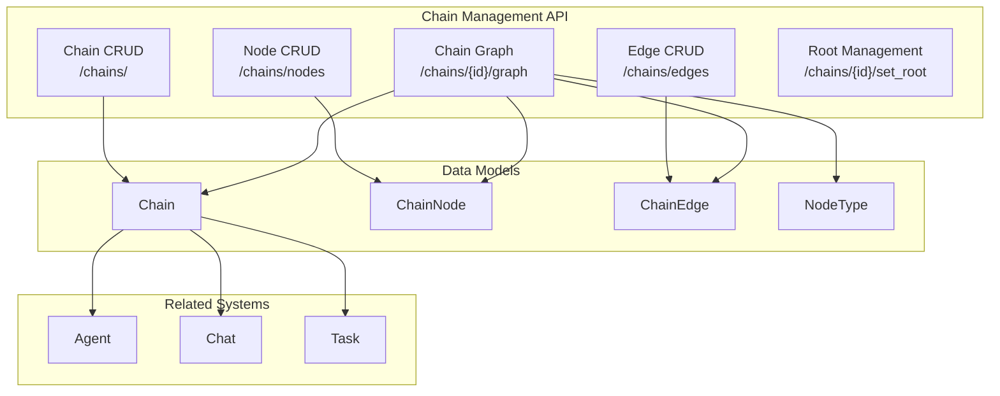
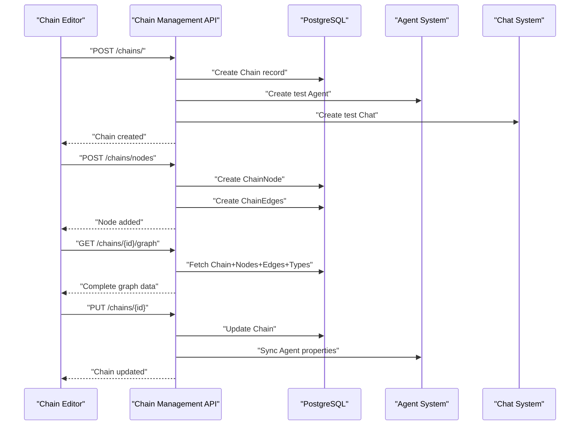

<!-- source: DeepWiki mcp.deepwiki.com · repo kreneskyp/ix · page 4.1 Chain Management API · fetched 2026-10-26 -->

# Chain Management API

<details>
<summary>Relevant source files</summary>

The following files were used as context for generating this wiki page:

- [ix/api/chains/endpoints.py](ix/api/chains/endpoints.py)
- [ix/api/chains/types.py](ix/api/chains/types.py)
- [ix/api/editor/endpoints.py](ix/api/editor/endpoints.py)
- [ix/api/editor/types.py](ix/api/editor/types.py)
- [ix/api/tests/test_chains.py](ix/api/tests/test_chains.py)
- [ix/chains/migrations/0016_alter_chainedge_relation.py](ix/chains/migrations/0016_alter_chainedge_relation.py)

</details>


The Chain Management API provides REST endpoints for creating, updating, and managing chains, nodes, and edges within the IX AI agent platform. This API serves as the primary interface for the visual chain editor and enables programmatic manipulation of agent workflows.

This document covers the REST API endpoints for chain structure management. For chat and agent execution APIs, see [Chat and Agent API](#4.2). For GraphQL subscriptions and real-time updates, see [GraphQL API](#4.3).

## Core Concepts

The Chain Management API operates on three primary entities that form the structure of agent workflows:

### Chain Model

A `Chain` represents a complete agent workflow or reusable component. Chains can be configured as agents (executable workflows) or as reusable components.

| Field | Type | Description |
|-------|------|-------------|
| `id` | UUID | Unique identifier |
| `name` | string | Human-readable name |
| `description` | string | Purpose description |
| `is_agent` | boolean | Whether chain can be executed as agent |
| `alias` | string | Agent alias (when `is_agent=true`) |
| `created_at` | datetime | Creation timestamp |

### Node Model

A `Node` represents a single component within a chain, typically wrapping a LangChain component with configuration and positioning data.

| Field | Type | Description |
|-------|------|-------------|
| `id` | UUID | Unique identifier |
| `chain_id` | UUID | Parent chain reference |
| `class_path` | string | Python class path for component |
| `node_type_id` | UUID | Reference to NodeType definition |
| `config` | dict | Component configuration |
| `position` | Position | Visual editor coordinates |
| `root` | boolean | Whether node is a chain entry point |

### Edge Model

An `Edge` represents a connection between nodes, defining data flow and relationships within the chain.

| Field | Type | Description |
|-------|------|-------------|
| `id` | UUID | Unique identifier |
| `source_id` | UUID | Source node reference |
| `target_id` | UUID | Target node reference |
| `source_key` | string | Output connector on source |
| `target_key` | string | Input connector on target |
| `relation` | enum | Connection type: LINK, PROP, or GRAPH |
| `input_map` | dict | Input transformation mapping |

Sources: [ix/api/chains/types.py:15-137]()

## API Endpoints Overview

The Chain Management API is organized into several endpoint groups handling different aspects of chain management:



Sources: [ix/api/chains/endpoints.py:33-226](), [ix/api/editor/endpoints.py:44-281]()

## Chain CRUD Operations

### List Chains
`GET /chains/` returns paginated chains with filtering support.

**Query Parameters:**
- `search`: Filter by name substring
- `limit`: Results per page (default: 10)
- `offset`: Page offset (default: 0)
- `is_agent`: Filter by agent status

**Response:** `ChainQueryPage` containing Chain objects

### Create Chain
`POST /chains/` creates a new chain with associated test infrastructure.

**Request Body:** `CreateChain`
```json
{
  "name": "string",
  "description": "string",
  "is_agent": false,
  "alias": "string"
}
```

The creation process automatically:
1. Creates the chain record
2. Creates a test chat for development
3. Creates an Agent record if `is_agent=true`

### Get Chain Details
`GET /chains/{chain_id}` retrieves a specific chain with agent alias populated.

### Update Chain
`PUT /chains/{chain_id}` updates chain properties and synchronizes related Agent records.

### Delete Chain
`DELETE /chains/{chain_id}` removes the chain and all related objects.

Sources: [ix/api/chains/endpoints.py:33-226]()

## Node Management

### Add Node
`POST /chains/nodes` creates a new node in a chain. If no `chain_id` is provided, creates a new unnamed chain.

**Request Body:** `AddNode`
```json
{
  "id": "uuid",
  "chain_id": "uuid",
  "class_path": "string",
  "config": {},
  "position": {"x": 0, "y": 0},
  "edges": []
}
```

### Update Node
`PUT /chains/nodes/{node_id}` updates node configuration and properties.

### Update Node Position
`POST /chains/nodes/{node_id}/position` updates only the visual position.

### Delete Node
`DELETE /chains/nodes/{node_id}` removes the node and all connected edges.

Sources: [ix/api/editor/endpoints.py:66-153]()

## Edge Management

### Add Edge
`POST /chains/edges` creates a connection between nodes.

**Request Body:** `Edge`
```json
{
  "source_id": "uuid",
  "target_id": "uuid", 
  "source_key": "string",
  "target_key": "string",
  "relation": "LINK",
  "input_map": {}
}
```

### Update Edge
`PUT /chains/edges/{edge_id}` modifies edge connection properties.

### Delete Edge
`DELETE /chains/edges/{edge_id}` removes the connection.

Sources: [ix/api/editor/endpoints.py:155-196]()

## Chain Graph Operations

### Get Complete Graph
`GET /chains/{chain_id}/graph` returns the complete chain structure including nodes, edges, and node type definitions.

**Response:** `GraphModel`
```json
{
  "chain": {},
  "nodes": [],
  "edges": [],
  "types": []
}
```

### Set Root Nodes
`POST /chains/{chain_id}/set_root` manages which nodes serve as chain entry points.

**Request Body:** `UpdateRoot`
```json
{
  "node_ids": ["uuid1", "uuid2"]
}
```

Sources: [ix/api/editor/endpoints.py:198-233](), [ix/api/editor/endpoints.py:44-64]()

## Data Flow and Integration

The Chain Management API integrates with several other systems to provide complete workflow management:



Sources: [ix/api/chains/endpoints.py:103-118](), [ix/api/editor/endpoints.py:204-233]()

## Error Handling

The API uses standard HTTP status codes and returns structured error responses:

- `404 Not Found`: Chain, node, or edge not found
- `400 Bad Request`: Invalid request data or validation errors
- `500 Internal Server Error`: Unexpected server errors

Common error scenarios include:
- Attempting to update non-existent resources
- Creating edges with invalid node references
- Missing required fields in request bodies

Sources: [ix/api/chains/endpoints.py:146](), [ix/api/editor/endpoints.py:119](), [ix/api/editor/endpoints.py:177]()

## Authentication and Authorization

All endpoints require authentication via the `get_request_user` dependency. The API enforces ownership-based access control through `Chain.filtered_owners()` and related filtering mechanisms.

Users can only access chains they own or have been granted access to through the ownership system.

Sources: [ix/api/chains/endpoints.py:44](), [ix/api/chains/endpoints.py:46]()

---

