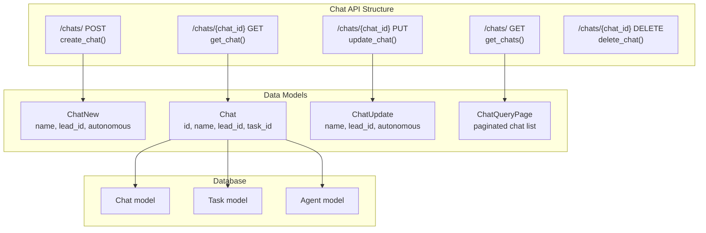
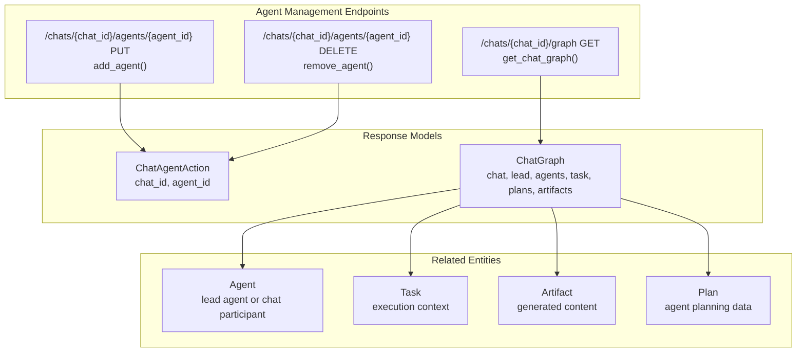
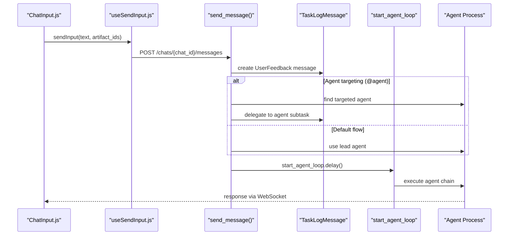
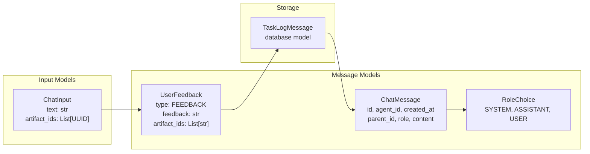
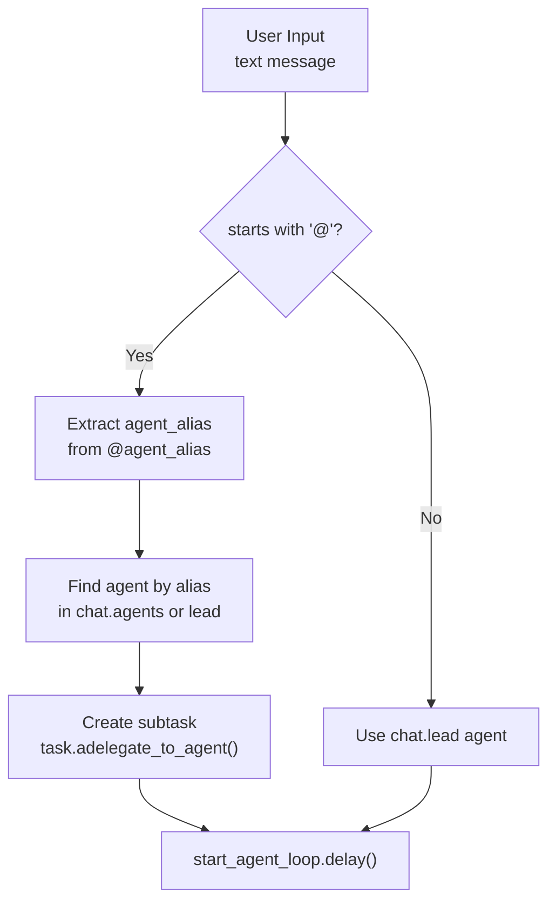
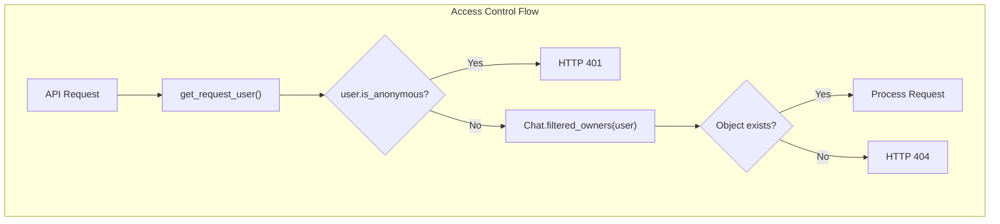
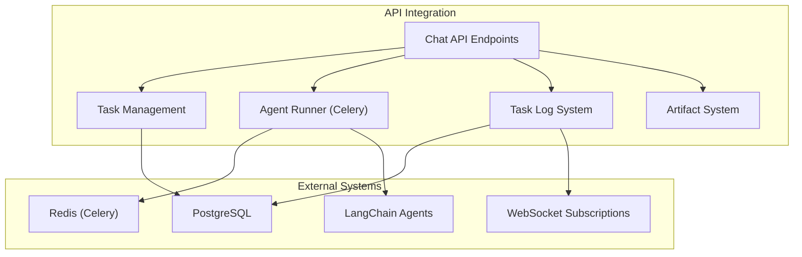

<!-- source: DeepWiki mcp.deepwiki.com · repo kreneskyp/ix · page 4.2 Chat and Agent API · fetched 2026-10-26 -->

# Chat and Agent API

Relevant source files

The following files were used as context for generating this wiki page:

- [frontend/chat/hooks/useSendInput.js](frontend/chat/hooks/useSendInput.js)
- [frontend/chat/input/ChatInput.js](frontend/chat/input/ChatInput.js)
- [frontend/chat/input/useSendInput.js](frontend/chat/input/useSendInput.js)
- [ix/api/chats/endpoints.py](ix/api/chats/endpoints.py)
- [ix/api/chats/types.py](ix/api/chats/types.py)
- [ix/api/tests/test_chat.py](ix/api/tests/test_chat.py)

This document covers the REST API endpoints for managing chat sessions and agent interactions in the IX platform. These endpoints handle chat creation, message exchange, agent management, and real-time communication between users and AI agents.

For information about the GraphQL API used for real-time updates and subscriptions, see [GraphQL API](#4.3). For details about the frontend chat interface components, see [Chat Interface](#5.2).

## Overview

The Chat and Agent API provides REST endpoints for:
- Creating and managing chat sessions
- Sending messages and receiving agent responses  
- Adding and removing agents from chat sessions
- Retrieving chat history and related artifacts
- Coordinating multi-agent conversations

The API is built using FastAPI and integrates with the IX agent execution system to provide real-time AI agent interactions.

## Core Entities

### Chat Session Management

*Sources: [ix/api/chats/endpoints.py:44-158](), [ix/api/chats/types.py:13-67]()*

### Agent Management

*Sources: [ix/api/chats/endpoints.py:160-241](), [ix/api/chats/types.py:69-95]()*

## Message Handling

### Message Flow Architecture

*Sources: [ix/api/chats/endpoints.py:284-382](), [frontend/chat/input/useSendInput.js:1-58](), [frontend/chat/hooks/useSendInput.js:1-36]()*

### Message API Endpoints

| Endpoint | Method | Function | Purpose |
|----------|---------|----------|---------|
| `/chats/{chat_id}/messages` | GET | `get_messages()` | Retrieve paginated message history |
| `/chats/{chat_id}/messages` | POST | `send_message()` | Send user message and trigger agent |
| `/chats/{chat_id}/messages/clear` | POST | `clear_messages()` | Clear all messages in chat |

### Message Data Models

*Sources: [ix/api/chats/types.py:97-127](), [ix/task_log/models.py:34]() (UserFeedback content)*

## Agent Targeting and Delegation

### Agent Selection Logic

The API supports targeting specific agents in multi-agent chats using `@agent_alias` syntax:

*Sources: [ix/api/chats/endpoints.py:315-335]()*

### Agent Management Operations

| Operation | Endpoint | Function | Description |
|-----------|----------|----------|-------------|
| Add Agent | `PUT /chats/{chat_id}/agents/{agent_id}` | `add_agent()` | Add agent to chat participants |
| Remove Agent | `DELETE /chats/{chat_id}/agents/{agent_id}` | `remove_agent()` | Remove agent from chat |
| Get Chat Graph | `GET /chats/{chat_id}/graph` | `get_chat_graph()` | Get complete chat context |

## Authentication and Authorization

All endpoints require authentication via the `get_request_user` dependency. The API implements ownership-based access control:

- Users can only access chats they own or are group members of
- Chat creation requires authentication (`user.is_anonymous` check)
- Agent management operations verify both chat and agent ownership

*Sources: [ix/api/chats/endpoints.py:12](), [ix/api/tests/test_chat.py:366-440]() (ownership tests)*

## Integration Points

### Frontend Integration

The Chat API integrates with React components for real-time chat functionality:

- `ChatInput.js` handles user input with agent mentions and artifact references
- `useSendInput` hook manages API calls and editor state
- Slate.js editor supports rich text with agent and artifact highlighting

### Backend Integration

The API coordinates with several backend systems:

- **Task System**: Creates and manages `Task` objects for agent execution
- **Agent Runner**: Triggers `start_agent_loop` for asynchronous agent processing  
- **Task Logging**: Stores messages in `TaskLogMessage` for conversation history
- **Artifact System**: Links artifacts to messages via `artifact_ids`

*Sources: [ix/api/chats/endpoints.py:35-37]() (imports), [ix/task_log/tasks/agent_runner.py]() (agent execution)*

## Error Handling

The API implements consistent error handling patterns:

- **404 Not Found**: Chat/Agent does not exist or user lacks access
- **401 Unauthorized**: Authentication required or failed
- **400 Bad Request**: Invalid input data or malformed requests

Standard error responses follow FastAPI conventions with structured error messages in the `detail` field.

*Sources: [ix/api/tests/test_chat.py:95-203]() (error handling tests)*

---

