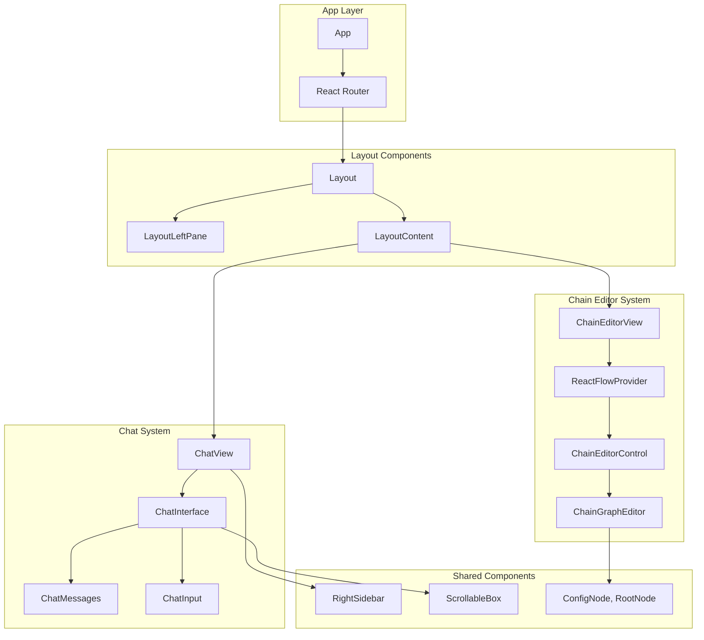
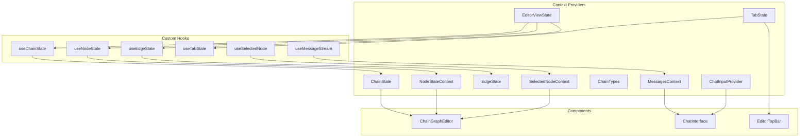
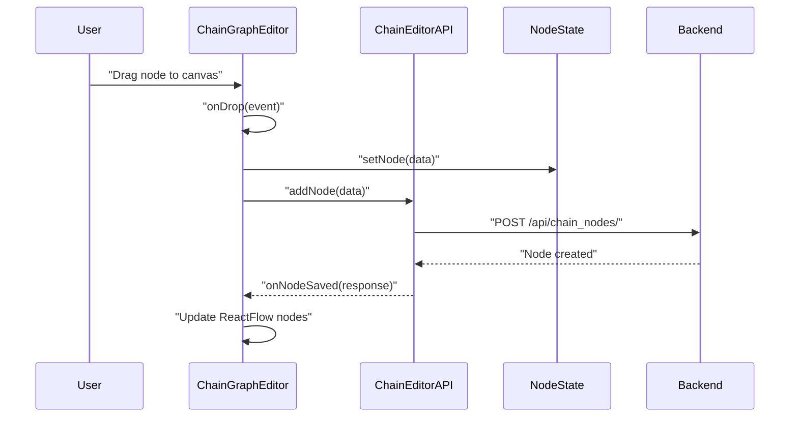
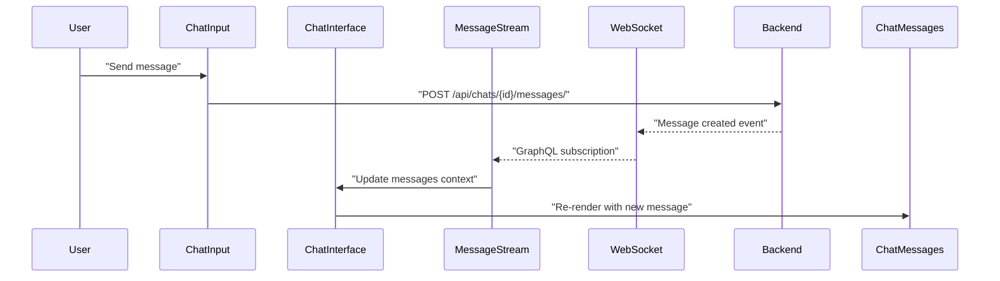

<!-- source: DeepWiki mcp.deepwiki.com · repo kreneskyp/ix · page 5 Frontend Documentation · fetched 2026-10-26 -->

# Frontend Documentation

Relevant source files

The following files were used as context for generating this wiki page:

- [frontend/agents/AgentEditButton.js](frontend/agents/AgentEditButton.js)
- [frontend/chains/ChainEditButton.js](frontend/chains/ChainEditButton.js)
- [frontend/chains/ChainEditorView.js](frontend/chains/ChainEditorView.js)
- [frontend/chains/ChainGraphEditor.js](frontend/chains/ChainGraphEditor.js)
- [frontend/chains/editor/EditorTopBar.js](frontend/chains/editor/EditorTopBar.js)
- [frontend/chains/editor/contexts.js](frontend/chains/editor/contexts.js)
- [frontend/chains/hooks/useChainState.js](frontend/chains/hooks/useChainState.js)
- [frontend/chains/hooks/useEdgeState.js](frontend/chains/hooks/useEdgeState.js)
- [frontend/chat/ChatInterface.js](frontend/chat/ChatInterface.js)
- [frontend/chat/ChatMessages.js](frontend/chat/ChatMessages.js)
- [frontend/chat/ChatView.js](frontend/chat/ChatView.js)
- [frontend/chat/hooks/useChatGraph.js](frontend/chat/hooks/useChatGraph.js)
- [frontend/hooks/useLinkedScroll.js](frontend/hooks/useLinkedScroll.js)
- [frontend/site/RightSidebar.js](frontend/site/RightSidebar.js)
- [frontend/site/ScrollableBox.js](frontend/site/ScrollableBox.js)
- [frontend/site/SidebarTabs.js](frontend/site/SidebarTabs.js)

## Purpose and Scope

This document provides comprehensive documentation for the IX platform's React-based frontend architecture. It covers the main user interface components, state management patterns, and how the frontend integrates with the backend APIs to provide visual chain editing and chat interfaces.

The frontend consists of two primary interfaces: the Chain Graph Editor for visually building AI agent workflows, and the Chat Interface for interacting with deployed agents. For detailed information about specific interface components, see [Chain Graph Editor](#5.1), [Chat Interface](#5.2), and [UI Components](#5.3).

## Frontend Architecture Overview

The IX frontend is built using React with a component-based architecture that emphasizes reusable UI components and centralized state management through React Context providers.

### Component Architecture

Sources: [frontend/chains/ChainEditorView.js:1-245](), [frontend/chat/ChatView.js:1-127](), [frontend/chains/ChainGraphEditor.js:1-510](), [frontend/site/RightSidebar.js:1-113](), [frontend/site/ScrollableBox.js:1-16]()

### State Management Architecture

The frontend uses React Context extensively for state management, with different contexts handling specific domains of application state.

Sources: [frontend/chains/editor/contexts.js:1-11](), [frontend/chains/hooks/useChainState.js:1-36](), [frontend/chains/hooks/useEdgeState.js:1-25](), [frontend/chains/ChainEditorView.js:48-121]()

## Key Frontend Systems

### Chain Graph Editor System

The chain editor is built around `ReactFlow` and provides a visual drag-and-drop interface for building AI agent workflows. The main components include:

- **ChainGraphEditor**: Core ReactFlow-based editor component [frontend/chains/ChainGraphEditor.js:65-509]()
- **ConfigNode**: Configurable node components for different node types [frontend/chains/ChainGraphEditor.js:47-52]()
- **NodeTypes**: Registry of available node types (`node`, `list`, `root`, `direct_root`) [frontend/chains/ChainGraphEditor.js:47-52]()
- **EdgeTypes**: Custom edge components (`PROP`, `LINK`) [frontend/chains/ChainGraphEditor.js:54-57]()

The editor supports:
- Drag-and-drop node creation from component palette
- Visual connection creation between nodes
- Real-time validation of connections
- Auto-save functionality with debounced API calls
- Multi-tab editing with tab state management

### Chat Interface System

The chat system provides real-time messaging with AI agents through WebSocket connections:

- **ChatInterface**: Main chat container with message display and input [frontend/chat/ChatInterface.js:140-163]()
- **ChatMessages**: Scrollable message history display [frontend/chat/ChatMessages.js:8-28]()
- **ChatInput**: Message composition with autocomplete
- **Message streaming**: Real-time token streaming for agent responses

The chat interface includes:
- WebSocket-based message streaming
- Responsive message display with light/dark themes
- Artifact sidebar for generated content
- Agent management and configuration

## Data Flow Patterns

### Editor Data Flow

Sources: [frontend/chains/ChainGraphEditor.js:138-265](), [frontend/chains/hooks/useChainEditorAPI.js]()

### Chat Data Flow

Sources: [frontend/chat/ChatInterface.js:140-163](), [frontend/chat/hooks/useMessageStream.js]()

## API Integration Patterns

The frontend integrates with the backend through several patterns:

### REST API Integration
- **Chain Management**: CRUD operations for chains, nodes, and edges
- **Chat Operations**: Message sending and chat management
- **Agent Configuration**: Agent creation and modification

### GraphQL Subscriptions
- **Real-time Updates**: Task execution status and message streaming
- **Live Data**: Chain execution logs and agent responses

### Custom Hooks for API Integration
- `useChainEditorAPI`: Provides API methods for chain operations [frontend/chains/hooks/useChainEditorAPI.js]()
- `useChatGraph`: Loads chat data and related entities [frontend/chat/hooks/useChatGraph.js:3-5]()
- `useMessageStream`: Manages WebSocket connections for real-time chat
- `usePaginatedAPI`: Generic hook for paginated data loading

## Component Styling and Theming

The frontend uses Chakra UI as the component library with support for light and dark themes:

### Theme Configuration
- **Color Mode**: Automatic light/dark theme switching
- **Component Styles**: Consistent styling across all components
- **Chat Themes**: Specialized styling for chat interface [frontend/chat/ChatInterface.js:25-125]()

### Responsive Design
- **Layout System**: Flexible layout with sidebars and main content areas
- **Sidebar Management**: Collapsible sidebars with size toggle functionality [frontend/site/RightSidebar.js:16-112]()
- **Scrolling**: Custom scrollable components with linked scroll behavior [frontend/hooks/useLinkedScroll.js:9-56]()

Sources: [frontend/chat/ChatInterface.js:25-132](), [frontend/site/RightSidebar.js:1-113](), [frontend/chains/editor/EditorTopBar.js:89-150]()

---

