<!-- source: DeepWiki mcp.deepwiki.com · repo kreneskyp/ix · page 5.1 Chain Graph Editor · fetched 2026-10-26 -->

# Chain Graph Editor

Relevant source files

The following files were used as context for generating this wiki page:

- [frontend/agents/AgentEditButton.js](frontend/agents/AgentEditButton.js)
- [frontend/chains/ChainEditButton.js](frontend/chains/ChainEditButton.js)
- [frontend/chains/ChainEditorView.js](frontend/chains/ChainEditorView.js)
- [frontend/chains/ChainGraphEditor.js](frontend/chains/ChainGraphEditor.js)
- [frontend/chains/editor/ConnectorPopover.js](frontend/chains/editor/ConnectorPopover.js)
- [frontend/chains/editor/EditorTopBar.js](frontend/chains/editor/EditorTopBar.js)
- [frontend/chains/editor/contexts.js](frontend/chains/editor/contexts.js)
- [frontend/chains/editor/styles.js](frontend/chains/editor/styles.js)
- [frontend/chains/editor/useColorMode.js](frontend/chains/editor/useColorMode.js)
- [frontend/chains/flow/BranchNode.js](frontend/chains/flow/BranchNode.js)
- [frontend/chains/flow/ChainNode.js](frontend/chains/flow/ChainNode.js)
- [frontend/chains/flow/ConfigNode.js](frontend/chains/flow/ConfigNode.js)
- [frontend/chains/flow/GraphNode.js](frontend/chains/flow/GraphNode.js)
- [frontend/chains/flow/NodeMenu.js](frontend/chains/flow/NodeMenu.js)
- [frontend/chains/flow/PromptNode.js](frontend/chains/flow/PromptNode.js)
- [frontend/chains/hooks/useChainState.js](frontend/chains/hooks/useChainState.js)
- [frontend/chains/hooks/useEdgeState.js](frontend/chains/hooks/useEdgeState.js)
- [frontend/components/RequiredAsterisk.js](frontend/components/RequiredAsterisk.js)
- [frontend/icons/GraphIcon.js](frontend/icons/GraphIcon.js)

## Purpose and Scope

The Chain Graph Editor is a visual, drag-and-drop interface for building AI agent workflows in the IX platform. It provides a React-based node-graph editor built on ReactFlow that allows users to create, edit, and connect LangChain components without writing code. The editor supports real-time collaboration, multiple tabs, and visual execution feedback.

For information about the backend chain execution system, see [Chain System](#3.1). For details about the REST API that powers the editor, see [Chain Management API](#4.1).

## Architecture Overview

The Chain Graph Editor is built as a React application using ReactFlow for the graph visualization, with a multi-layered architecture for state management, API communication, and component rendering.

### Core Architecture Diagram

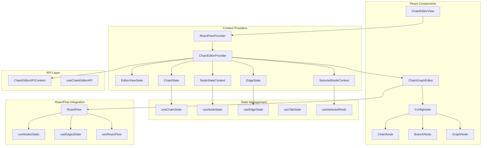

Sources: [frontend/chains/ChainGraphEditor.js:1-509](), [frontend/chains/ChainEditorView.js:1-244](), [frontend/chains/editor/contexts.js:1-11]()

## Core Components

### ChainGraphEditor Component

The main `ChainGraphEditor` component serves as the primary interface, handling drag-and-drop operations, node creation, edge connections, and user interactions.

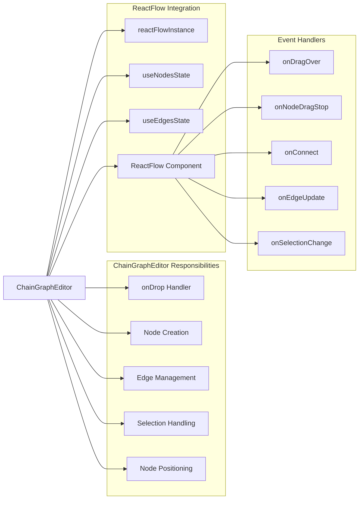

Sources: [frontend/chains/ChainGraphEditor.js:65-509]()

### Node Type System

The editor supports multiple node types through a configurable node type system with specialized rendering components:

| Node Type | Component | Icon | Purpose |
|-----------|-----------|------|---------|
| `node` | `ConfigNode` | Gear | Generic node configuration |
| `list` | `ConfigNode` | Gear | List-based operations |
| `root` | `RootNode` | Keyboard | Entry point for chains |
| `direct_root` | `DirectRootNode` | Keyboard | Direct execution root |

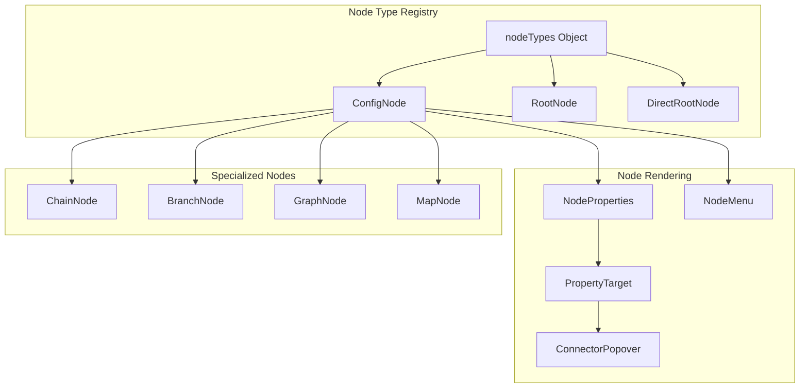

Sources: [frontend/chains/ChainGraphEditor.js:47-52](), [frontend/chains/flow/ConfigNode.js:145-239](), [frontend/chains/editor/styles.js:29-131]()

## Node System

### ConfigNode Architecture

The `ConfigNode` component is the primary node renderer that handles different node types through a pluggable component system:

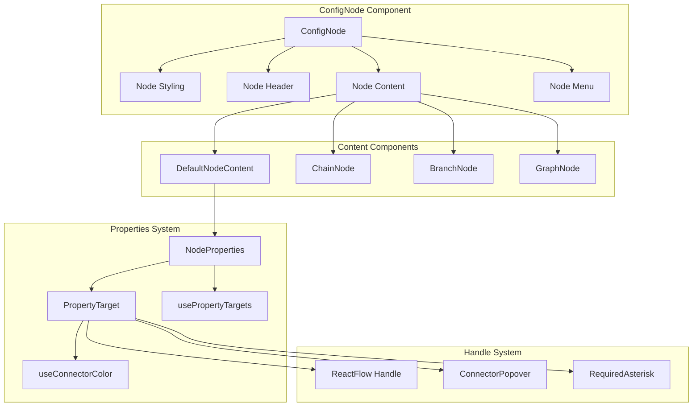

Sources: [frontend/chains/flow/ConfigNode.js:145-239](), [frontend/chains/flow/ConfigNode.js:39-135]()

### Node Properties and Connectors

Each node exposes connection points (connectors) that define how components can be linked together:

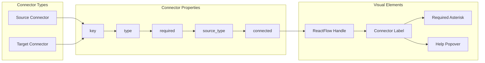

Sources: [frontend/chains/flow/ConfigNode.js:72-135](), [frontend/chains/editor/ConnectorPopover.js:28-98]()

## Edge System

### Edge Types and Relationships

The editor supports two primary edge types for different kinds of connections:

| Edge Type | Purpose | Visual Style |
|-----------|---------|--------------|
| `PROP` | Property connections between components | Dotted lines |
| `LINK` | Sequential flow connections | Solid lines |

```mermaid
graph TD
    subgraph "Edge Type System"
        edgeTypes["edgeTypes Object"]
        PropEdge["PropEdge"]
        LinkEdge["LinkEdge"]
    end
    
    subgraph "Edge Creation"
        onConnect["onConnect Handler"]
        onDrop["onDrop Handler"]
        addEdge["ReactFlow addEdge"]
        edgeValidation["Connection Validation"]
    end
    
    subgraph "Edge Management"
        onEdgeUpdate["onEdgeUpdate"]
        onEdgeUpdateStart["onEdgeUpdateStart"]
        onEdgeUpdateEnd["onEdgeUpdateEnd"]
        deleteEdge["Edge Deletion"]
    end
    
    subgraph "Edge Styling"
        getEdgeStyle["getEdgeStyle"]
        colorMode["Color Mode"]
        edgeColors["Edge Colors"]
    end
    
    edgeTypes --> PropEdge
    edgeTypes --> LinkEdge
    
    onConnect --> addEdge
    onDrop --> addEdge
    addEdge --> edgeValidation
    
    onEdgeUpdate --> onEdgeUpdateStart
    onEdgeUpdateStart --> onEdgeUpdateEnd
    onEdgeUpdateEnd --> deleteEdge
    
    getEdgeStyle --> colorMode
    colorMode --> edgeColors
```

Sources: [frontend/chains/ChainGraphEditor.js:54-57](), [frontend/chains/ChainGraphEditor.js:294-426]()

### Connection Validation

The editor includes sophisticated connection validation to ensure only compatible components can be connected:

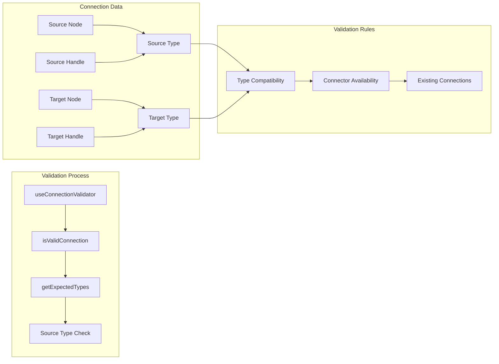

Sources: [frontend/chains/ChainGraphEditor.js:59-63](), [frontend/chains/ChainGraphEditor.js:356]()

## State Management

### Context-Based State Architecture

The editor uses a comprehensive context-based state management system to handle different aspects of the application state:

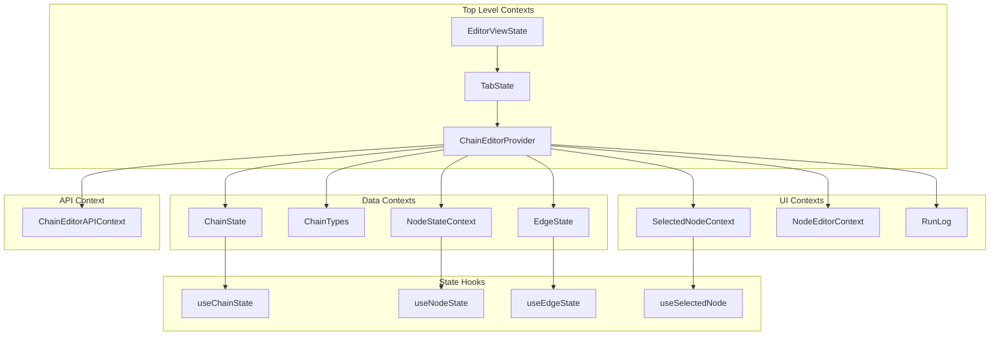

Sources: [frontend/chains/editor/contexts.js:1-11](), [frontend/chains/ChainEditorView.js:123-159]()

### Tab State Management

The editor supports multiple tabs through a sophisticated tab state system that manages individual chain editing sessions:

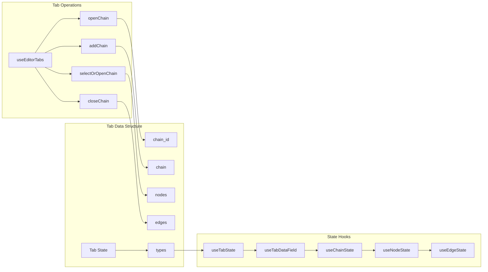

Sources: [frontend/chains/ChainEditorView.js:48-121](), [frontend/chains/hooks/useChainState.js:8-35]()

## Drag and Drop System

### Node Creation Flow

The drag and drop system enables users to create nodes by dragging components from the sidebar and dropping them onto the canvas:

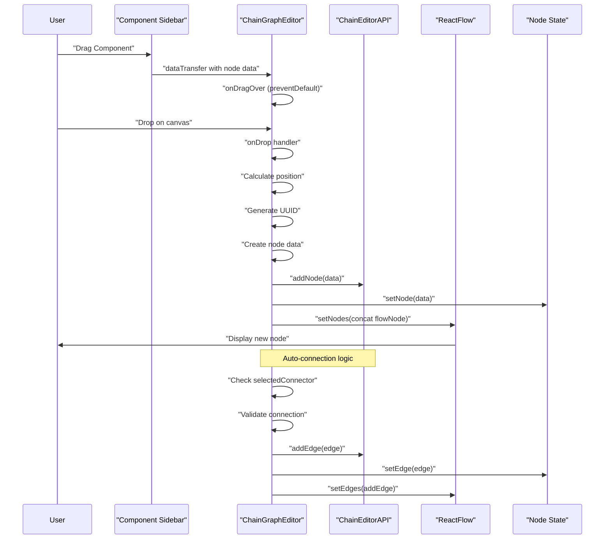

Sources: [frontend/chains/ChainGraphEditor.js:97-265]()

### Auto-Connection Logic

The editor includes intelligent auto-connection that automatically creates edges when dropping compatible nodes:

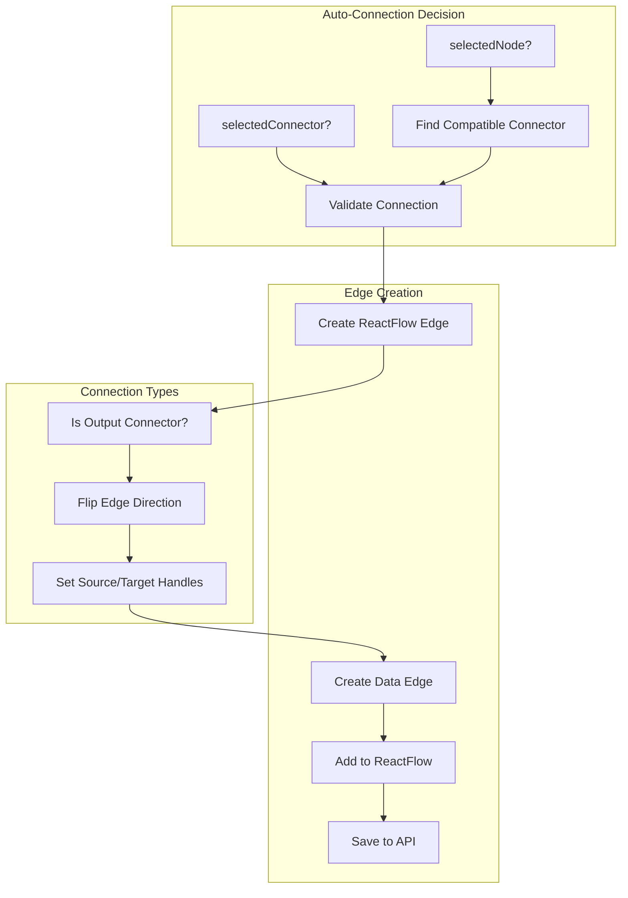

Sources: [frontend/chains/ChainGraphEditor.js:176-254]()

## Styling and Theming

### Color Mode System

The editor supports both light and dark themes through a comprehensive color mode system:

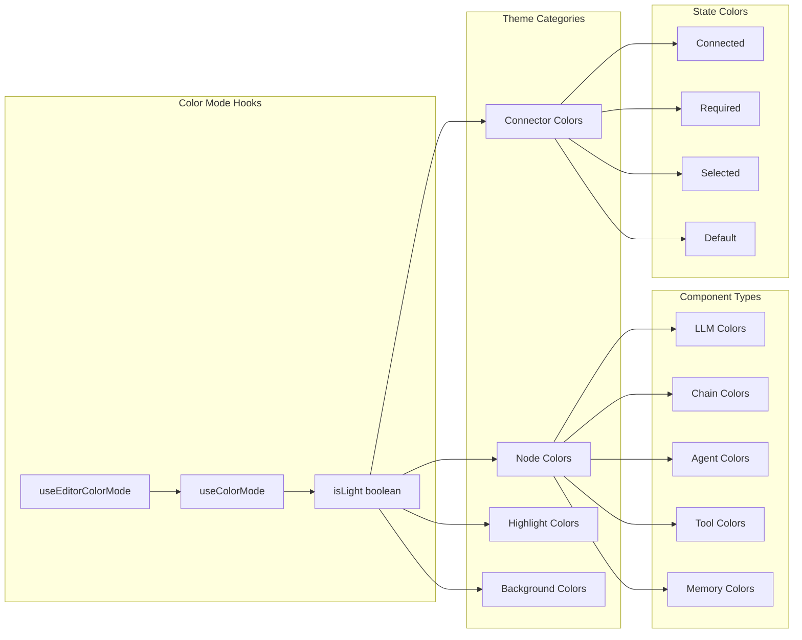

Sources: [frontend/chains/editor/useColorMode.js:4-174]()

### Node Visual Styles

Each node type has specific visual styling including icons, colors, and specialized components:

| Node Type | Background Color | Icon | Component |
|-----------|------------------|------|-----------|
| `llm` | Red | Brain | `ChainNode` |
| `chain` | Blue | Chain | `ChainNode` |
| `agent` | Green | Robot | `ChainNode` |
| `tool` | Yellow | Tools | `ChainNode` |
| `memory` | Purple | Memory | Default |
| `branch` | Gray | Split | `BranchNode` |
| `graph` | Green | Graph | `GraphNode` |

Sources: [frontend/chains/editor/styles.js:29-131](), [frontend/chains/editor/useColorMode.js:62-88]()

---

