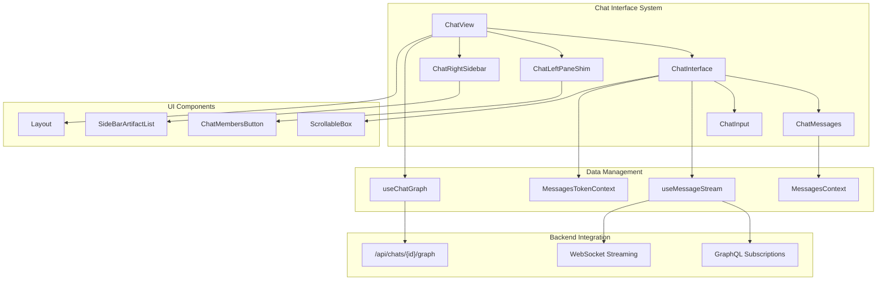
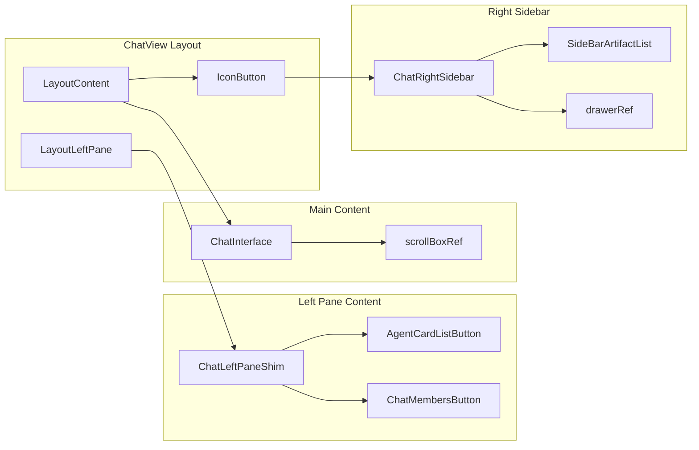
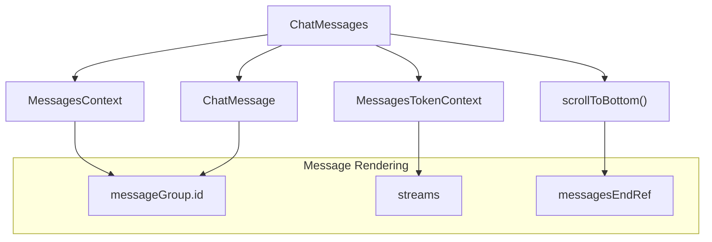
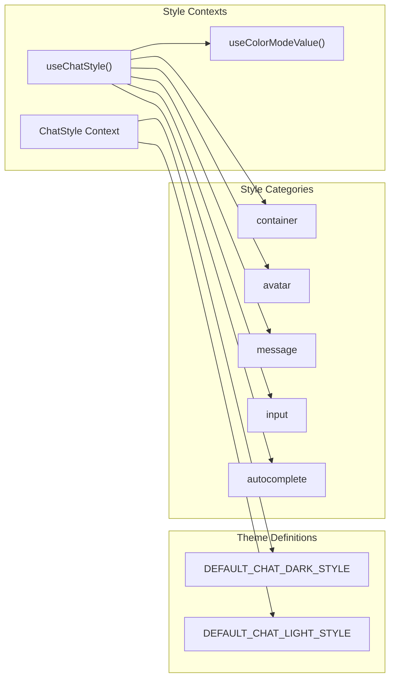

<!-- source: DeepWiki mcp.deepwiki.com · repo kreneskyp/ix · page 5.2 Chat Interface · fetched 2026-10-26 -->

# Chat Interface

Relevant source files

The following files were used as context for generating this wiki page:

- [frontend/chat/ChatInterface.js](frontend/chat/ChatInterface.js)
- [frontend/chat/ChatMessages.js](frontend/chat/ChatMessages.js)
- [frontend/chat/ChatView.js](frontend/chat/ChatView.js)
- [frontend/chat/hooks/useChatGraph.js](frontend/chat/hooks/useChatGraph.js)
- [frontend/hooks/useLinkedScroll.js](frontend/hooks/useLinkedScroll.js)
- [frontend/site/RightSidebar.js](frontend/site/RightSidebar.js)
- [frontend/site/ScrollableBox.js](frontend/site/ScrollableBox.js)
- [frontend/site/SidebarTabs.js](frontend/site/SidebarTabs.js)
- [frontend/site/key_frames.js](frontend/site/key_frames.js)

The Chat Interface provides the frontend user interface for interacting with AI agents through conversational messaging. This system enables users to send messages to agents, view responses in real-time with streaming support, and access related artifacts and agent information through integrated sidebars.

For information about the backend chat API that powers this interface, see [Chat and Agent API](#4.2). For details about the visual chain editor interface, see [Chain Graph Editor](#5.1).

## Architecture Overview

The Chat Interface is built as a React-based system that combines message display, input handling, and contextual sidebars into a unified conversational experience. The interface connects to backend services through GraphQL subscriptions for real-time message streaming and REST APIs for chat management.

Sources: [frontend/chat/ChatView.js:1-127](), [frontend/chat/ChatInterface.js:1-168](), [frontend/chat/ChatMessages.js:1-31]()

## Core Components

### ChatView Component

The `ChatView` component serves as the main container orchestrating the entire chat interface. It manages the three-pane layout with left sidebar for agents, central chat area, and collapsible right sidebar for artifacts.

The component uses the `useChatGraph` hook to load chat data and implements linked scrolling between the main content and right sidebar through `useLinkedScroll`.

Sources: [frontend/chat/ChatView.js:69-126](), [frontend/hooks/useLinkedScroll.js:9-56]()

### ChatInterface Component

The `ChatInterface` component provides the core conversational experience with message display and input functionality. It manages real-time message streaming and token-level updates through React contexts.

Key features:
- Message streaming with `useMessageStream` hook
- Token-level streaming context with `MessagesTokenContext`
- Scrollable message history with auto-scroll to bottom
- Integrated chat input with styling context

Sources: [frontend/chat/ChatInterface.js:140-163](), [frontend/chat/ChatMessages.js:8-28]()

### Message Display System

The message display system renders conversation history with support for streaming content updates:

The system automatically scrolls to the bottom when new messages or streaming tokens arrive, ensuring users always see the latest content.

Sources: [frontend/chat/ChatMessages.js:1-31]()

## Layout and UI Structure

### Three-Pane Layout

The chat interface uses a responsive three-pane layout implemented through the `Layout` component system:

| Pane | Component | Purpose |
|------|-----------|---------|
| Left | `ChatLeftPaneShim` | Agent management and chat members |
| Center | `ChatInterface` | Message display and input |
| Right | `ChatRightSidebar` | Artifacts and additional context |

The right sidebar is collapsible and supports multiple width sizes that users can toggle through.

Sources: [frontend/chat/ChatView.js:82-125](), [frontend/site/RightSidebar.js:16-108]()

### Scrollable Content Management

The interface uses `ScrollableBox` for message history with custom scrollbar styling and `useLinkedScroll` to synchronize scrolling between the main content area and right sidebar:

- Main chat area: Fixed height calculation `calc(100vh - 50px - 100px)`
- Automatic scroll to bottom on new messages
- Linked scroll synchronization when sidebar is open
- Custom scrollbar CSS for consistent appearance

Sources: [frontend/site/ScrollableBox.js:5-15](), [frontend/chat/ChatInterface.js:14-18](), [frontend/hooks/useLinkedScroll.js:9-56]()

## Styling and Theming

### Chat Style System

The chat interface implements a comprehensive theming system with light and dark mode support through the `ChatStyle` context:

The theming system provides consistent styling across:
- Message containers and content areas
- Avatar appearance and borders  
- Input field styling and autocomplete
- Scrollbox dimensions and positioning

Sources: [frontend/chat/ChatInterface.js:25-132]()

### Responsive Design Elements

The interface adapts to different screen sizes through:
- Fixed-width message containers (800px)
- Responsive sidebar sizing (xs, sm, xl options)
- Flexible layout components with Chakra UI
- Overlay management for mobile interactions

Sources: [frontend/chat/ChatInterface.js:37-115](), [frontend/site/RightSidebar.js:14-30]()

## Integration Points

### Backend Connectivity

The Chat Interface connects to backend services through several integration points:

| Integration | Endpoint/Method | Purpose |
|-------------|----------------|---------|
| Chat Graph Loading | `/api/chats/{id}/graph` | Load chat metadata and context |
| Agent Management | `/api/agents/` | Manage chat participants |
| Message Streaming | GraphQL Subscriptions | Real-time message updates |
| Token Streaming | WebSocket connections | Live typing indicators |

Sources: [frontend/chat/hooks/useChatGraph.js:3-5](), [frontend/chat/ChatView.js:27-34]()

### Context Providers

The system uses React contexts to manage state across the component tree:

- `ChatGraph.Provider` - Chat metadata and agent information
- `ChatAgents.Provider` - Agent list and management state  
- `MessagesContext.Provider` - Message history state
- `MessagesTokenContext.Provider` - Streaming token state
- `SubscriptionActiveContext.Provider` - WebSocket connection status
- `ChatInputProvider` - Input field state and handlers

These contexts enable components to access shared state without prop drilling through the component hierarchy.

Sources: [frontend/chat/ChatView.js:42-51](), [frontend/chat/ChatInterface.js:147-161]()

---

