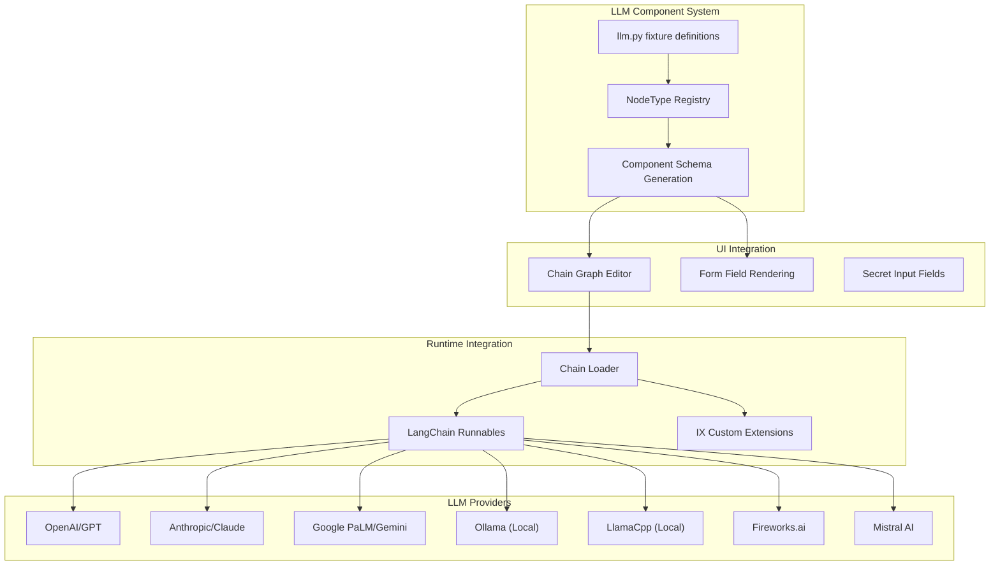
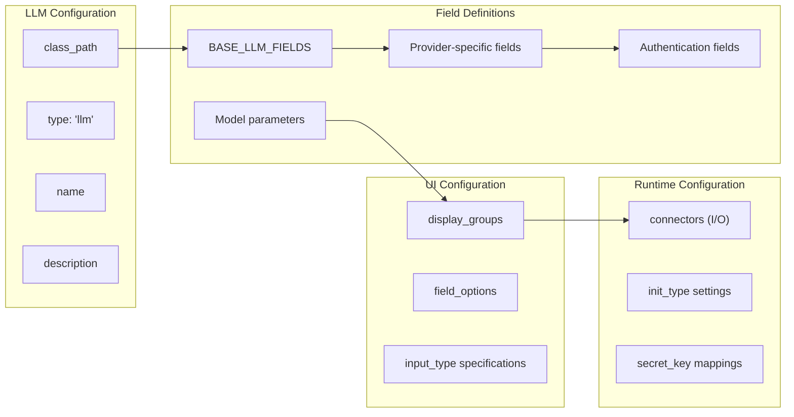
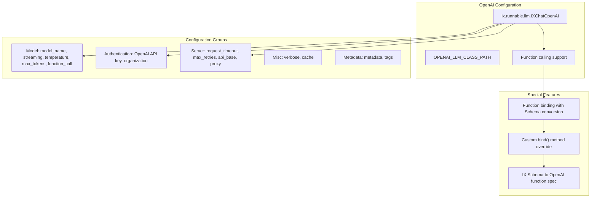
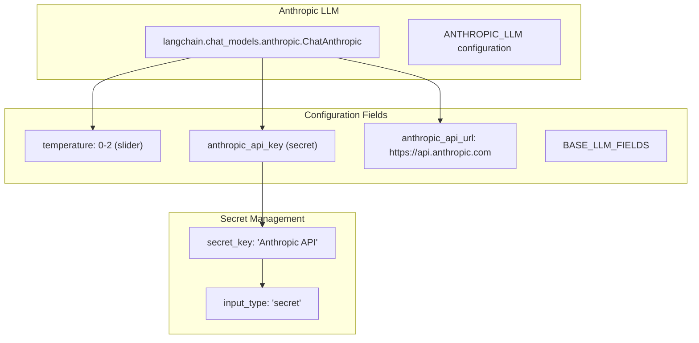
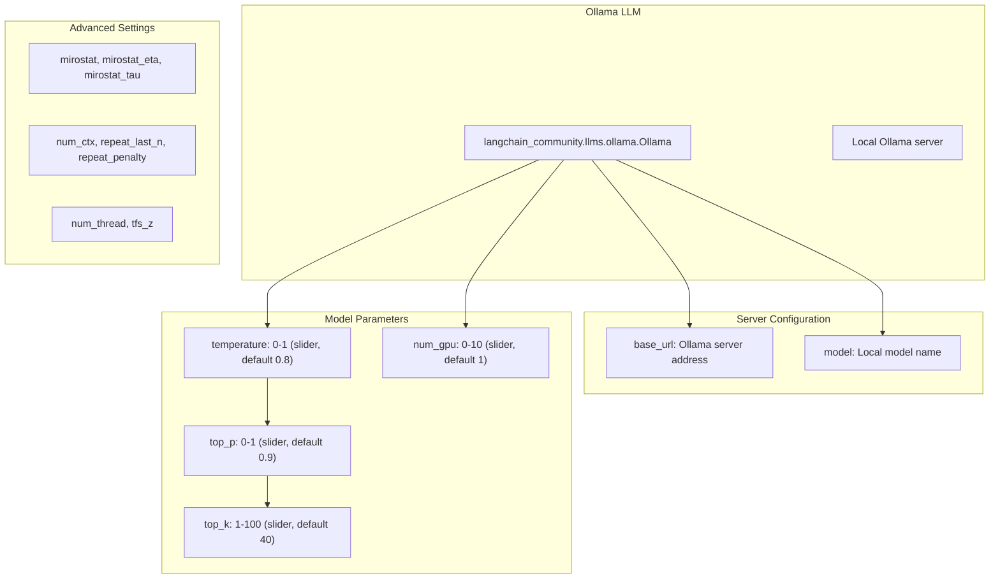
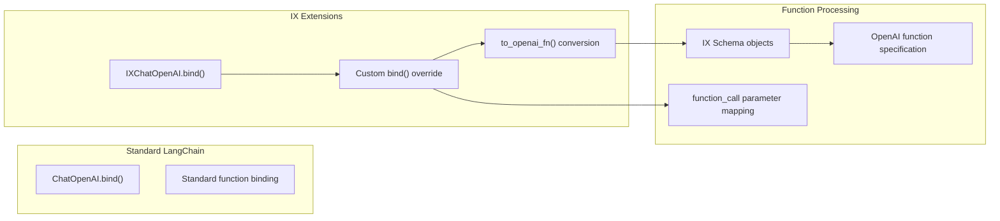
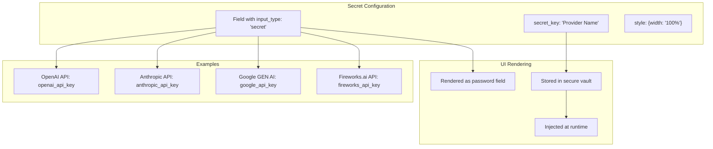

<!-- source: DeepWiki mcp.deepwiki.com · repo kreneskyp/ix · page 6.1 LLM Configuration · fetched 2026-10-26 -->

# LLM Configuration

<details>
<summary>Relevant source files</summary>

The following files were used as context for generating this wiki page:

- [ix/chains/fixture_src/llm.py](ix/chains/fixture_src/llm.py)
- [ix/runnable/llm.py](ix/runnable/llm.py)
- [test_data/snapshots/components/langchain.chat_models.anthropic.ChatAnthropic.json](test_data/snapshots/components/langchain.chat_models.anthropic.ChatAnthropic.json)
- [test_data/snapshots/components/langchain.chat_models.fireworks.ChatFireworks.json](test_data/snapshots/components/langchain.chat_models.fireworks.ChatFireworks.json)
- [test_data/snapshots/components/langchain.chat_models.google_palm.ChatGooglePalm.json](test_data/snapshots/components/langchain.chat_models.google_palm.ChatGooglePalm.json)
- [test_data/snapshots/components/langchain.llms.fireworks.Fireworks.json](test_data/snapshots/components/langchain.llms.fireworks.Fireworks.json)
- [test_data/snapshots/components/langchain.llms.llamacpp.LlamaCpp.json](test_data/snapshots/components/langchain.llms.llamacpp.LlamaCpp.json)

</details>


This document covers the configuration and integration of Large Language Model (LLM) providers within the IX AI agent platform. It explains how LLM components are defined, configured, and integrated into the visual chain editor and execution engine.

For information about integrating custom tools and functions with LLMs, see [Tool Integration](#6.2). For details about the chain execution system that uses these LLMs, see [Chain System](#3.1).

## LLM Provider Architecture

The IX platform uses a component-based architecture for LLM integration, where each LLM provider is defined as a configurable node type that can be used within agent chains. The system supports multiple providers with standardized configuration interfaces.



**Sources:** [ix/chains/fixture_src/llm.py:1-639]()

## Configuration Components

Each LLM provider configuration consists of several key components that define how the model appears and behaves in the IX platform:

### Base Configuration Structure



**Sources:** [ix/chains/fixture_src/llm.py:12-26](), [ix/chains/fixture_src/llm.py:28-54]()

### Common Base Fields

All LLM configurations inherit from `BASE_LLM_FIELDS` which provides standard LangChain LLM properties:

| Field | Type | Description |
|-------|------|-------------|
| `cache` | boolean | Enable response caching |
| `verbose` | boolean | Enable verbose logging |
| `tags` | list | Tags for categorization |
| `metadata` | dict | Additional metadata |

**Sources:** [ix/chains/fixture_src/llm.py:12-26]()

## Supported LLM Providers

### OpenAI Configuration

The platform provides two OpenAI configurations: a legacy version and an enhanced version with function calling support.

#### Enhanced OpenAI LLM (`IXChatOpenAI`)



**Key Features:**
- Supports GPT-4, GPT-3.5 Turbo, and other OpenAI models
- Function calling with automatic schema conversion
- Custom binding logic for IX-specific functionality
- Comprehensive model parameter configuration

**Sources:** [ix/chains/fixture_src/llm.py:197-240](), [ix/runnable/llm.py:25-45]()

### Anthropic Configuration



**Sources:** [ix/chains/fixture_src/llm.py:349-381]()

### Google LLM Providers

The platform supports two Google LLM services:

#### Google PaLM
- Model: `models/chat-bison-001`
- Authentication: Google GEN AI API key
- Parameters: temperature, top_p, top_k, sample count

#### Google Generative AI (Gemini)
- Models: `gemini-pro`, `gemini-pro-vision`
- Enhanced parameter control with display groups

**Sources:** [ix/chains/fixture_src/llm.py:292-347]()

### Local Model Providers

#### Ollama Configuration



**Sources:** [ix/chains/fixture_src/llm.py:424-485]()

#### LlamaCpp Configuration

Provides direct integration with llama.cpp for running local GGML/GGUF models:

**Key Configuration Areas:**
- **Model Loading**: `model_path`, `lora_base`, `n_ctx`, `n_parts`
- **Hardware Settings**: `n_gpu_layers`, `n_threads`, `use_mlock`, `use_mmap`
- **Generation Parameters**: `temperature`, `top_p`, `max_tokens`, `repeat_penalty`
- **Advanced Options**: `rope_freq_base`, `rope_freq_scale`, `streaming`

**Sources:** [ix/chains/fixture_src/llm.py:383-422]()

### Cloud API Providers

#### Fireworks.ai
- Supports both LLM and Chat LLM variants
- Default model: `accounts/fireworks/models/llama-v2-7b-chat`
- Configurable retry logic (up to 50 retries)

#### Mistral AI
- Native Mistral API integration
- Model selection and safety controls
- Concurrent request management

**Sources:** [ix/chains/fixture_src/llm.py:534-625]()

## Custom LLM Extensions

The platform includes custom extensions to enhance LLM functionality beyond standard LangChain implementations.

### IXChatOpenAI Function Calling



The `IXChatOpenAI` class extends the standard ChatOpenAI implementation with:

1. **Schema Conversion**: Automatically converts IX `Schema` objects to OpenAI function specifications
2. **Function Call Mapping**: Maps string function names to proper OpenAI function call format
3. **Enhanced Descriptions**: Includes schema descriptions in function descriptions for better LLM understanding

**Sources:** [ix/runnable/llm.py:10-45]()

## Secret Management Integration

LLM configurations integrate with IX's secret management system for secure API key handling:



**Common Secret Keys:**
- `"OpenAI API"` - OpenAI API keys
- `"Anthropic API"` - Anthropic/Claude API keys  
- `"Google GEN AI"` - Google AI API keys
- `"Fireworks.ai API"` - Fireworks.ai API keys

**Sources:** [ix/chains/fixture_src/llm.py:134-138](), [ix/chains/fixture_src/llm.py:366-371]()

## Configuration Registration

All LLM configurations are registered through the `LLMS` list which is used by the component system:

```python
LLMS = [
    ANTHROPIC_LLM,
    GOOGLE_GEN_AI,
    GOOGLE_PALM,
    LLAMA_CPP_LLM,
    MISTRAL_LLM,
    OLLAMA_LLM,
    OPENAI_LLM_DEP,
    OPENAI_LLM,
    FIREWORKS_LLM,
    FIREWORKS_CHAT_LLM,
]
```

This list is processed by the fixture loading system to make LLM components available in the chain editor interface.

**Sources:** [ix/chains/fixture_src/llm.py:627-638]()

---

