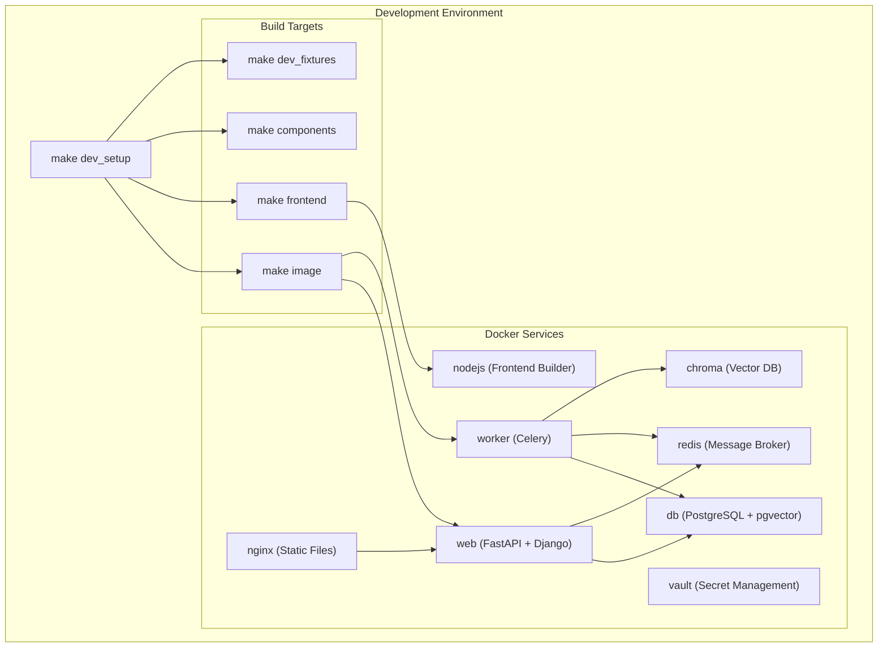
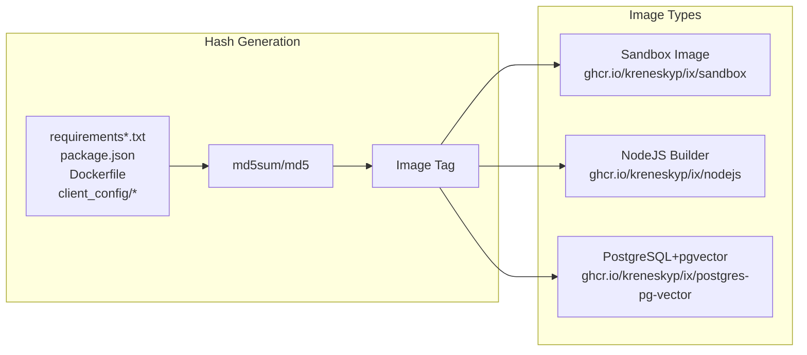
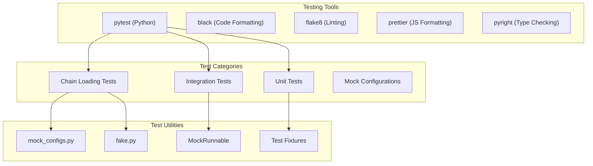
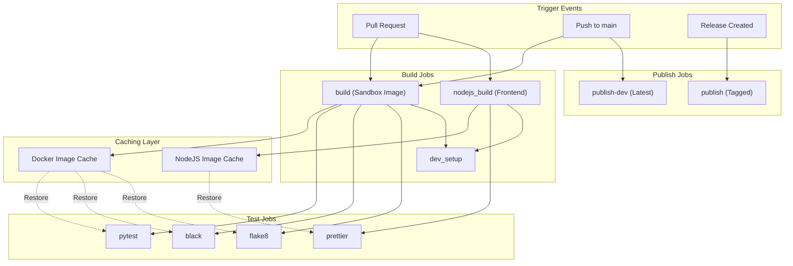

<!-- source: DeepWiki mcp.deepwiki.com · repo kreneskyp/ix · page 7 Development Guide · fetched 2026-10-26 -->

# Development Guide

<details>
<summary>Relevant source files</summary>

The following files were used as context for generating this wiki page:

- [.github/actions/run-docker/action.yml](.github/actions/run-docker/action.yml)
- [.github/workflows/publish-dev.yml](.github/workflows/publish-dev.yml)
- [.github/workflows/publish.yml](.github/workflows/publish.yml)
- [.github/workflows/test.yml](.github/workflows/test.yml)
- [.gitignore](.gitignore)
- [Dockerfile](Dockerfile)
- [Makefile](Makefile)
- [bin/get_uuid.py](bin/get_uuid.py)
- [docker-compose.yml](docker-compose.yml)
- [ix/chains/loaders/tools.py](ix/chains/loaders/tools.py)
- [ix/chains/tests/conftest.py](ix/chains/tests/conftest.py)
- [ix/chains/tests/fake.py](ix/chains/tests/fake.py)
- [ix/chains/tests/mock_configs.py](ix/chains/tests/mock_configs.py)
- [ix/chains/tests/test_config_loader.py](ix/chains/tests/test_config_loader.py)
- [psql.Dockerfile](psql.Dockerfile)

</details>


This guide covers the development workflow, testing practices, and deployment processes for the IX AI agent platform. It provides practical instructions for contributors working on the codebase, including environment setup, testing procedures, and CI/CD pipeline usage.

For information about configuring LLMs and tools for production use, see [Configuration and Extensions](#6). For production deployment strategies, see [Deployment](#7.2).

## Development Environment Setup

The IX platform uses Docker-based development with a comprehensive Makefile for build automation. The development environment consists of multiple services orchestrated through Docker Compose.

### Prerequisites

- Docker and Docker Compose
- Make (for build automation)
- Git (for version control)

### Core Development Services



**Sources:** [Makefile:106-108](), [docker-compose.yml:1-104]()

### Initial Setup

The primary setup command initializes the complete development environment:

```bash
make dev_setup
```

This command executes several build targets in sequence defined in the Makefile:

- `image`: Builds the main application Docker image
- `frontend`: Compiles JavaScript and React components
- `migrate`: Applies database migrations
- `dev_fixtures`: Loads development data including agents and components

**Sources:** [Makefile:106-108]()

### Service Management

The platform provides several commands for managing development services:

| Command | Purpose | Services Started |
|---------|---------|------------------|
| `make cluster` | Start core services | web, nginx, worker |
| `make server` | Start with logs | web, nginx (with log output) |
| `make worker` | Worker logs only | worker (log output) |
| `make db` | Database only | PostgreSQL with pgvector |
| `make redis` | Cache only | Redis server |

**Sources:** [Makefile:181-184](), [Makefile:207-210](), [Makefile:161-164]()

## Development Workflow

### Image Building System

IX uses a content-addressable image building system where image tags are generated from file hashes to enable efficient caching:



**Sources:** [Makefile:14-16](), [Makefile:23-25](), [Makefile:32-34]()

### Frontend Development

The frontend build process involves multiple compilation steps:

```bash
# Full frontend build
make frontend

# Individual steps
make graphene_to_graphql  # Generate GraphQL schema
make compile_relay        # Compile Relay queries  
make webpack             # Bundle JavaScript
make webpack-watch       # Watch mode for development
```

**Sources:** [Makefile:126-128](), [Makefile:146-148](), [Makefile:151-153]()

### Database and Component Management

```bash
# Database operations
make migrate        # Apply migrations
make migrations     # Generate new migrations

# Load development data
make components     # Import LangChain components
make agents        # Load agent fixtures
make dev_fixtures  # Load all development data
```

**Sources:** [Makefile:258-260](), [Makefile:263-265](), [Makefile:301-303](), [Makefile:276-297]()

## Testing Infrastructure

The testing system provides comprehensive coverage across Python backend, JavaScript frontend, and integration scenarios.

### Test Architecture



**Sources:** [Makefile:314-315](), [ix/chains/tests/test_config_loader.py:1-1500](), [ix/chains/tests/fake.py:1-387](), [ix/chains/tests/mock_configs.py:1-271]()

### Running Tests

| Command | Purpose |
|---------|---------|
| `make test` | Run all tests and linting |
| `make pytest` | Python tests only |
| `make lint` | All linting checks |
| `make format` | Auto-format code |

**Sources:** [Makefile:314-315](), [Makefile:317-318](), [Makefile:320-321]()

### Test Utilities

The testing infrastructure includes several utility modules for creating test scenarios:

- **mock_configs.py**: Predefined configurations for common components like LLMs, memory, and tools
- **fake.py**: Factory functions for creating test chains, nodes, and edges
- **conftest.py**: Pytest fixtures for complex LCEL (LangChain Expression Language) scenarios

**Sources:** [ix/chains/tests/mock_configs.py:17-271](), [ix/chains/tests/fake.py:22-387](), [ix/chains/tests/conftest.py:1-850]()

## Build and Deployment Pipeline

The CI/CD system uses GitHub Actions with Docker image caching and multi-platform builds.

### CI/CD Architecture



**Sources:** [.github/workflows/test.yml:1-217](), [.github/workflows/publish-dev.yml:1-100](), [.github/workflows/publish.yml:1-101]()

### Image Caching Strategy  

The CI system uses content-based cache keys to avoid rebuilding identical images:

```bash
# Cache key generation
IMAGE_URL=`make image-url`  # Content hash-based tag
key: ${{ steps.load_image_url.outputs.image-url }}
```

This approach ensures that images are only rebuilt when their dependencies change, significantly reducing build times.

**Sources:** [.github/workflows/test.yml:16-21](), [.github/actions/run-docker/action.yml:13-18]()

### Multi-Platform Publishing

Release builds target multiple architectures:

```yaml
platforms: linux/amd64,linux/arm64
tags: |
  ghcr.io/kreneskyp/ix/sandbox:latest
  ghcr.io/kreneskyp/ix/sandbox:${{ github.event.release.tag_name }}
```

**Sources:** [.github/workflows/publish.yml:96-100]()

## Secret Management with Vault

The development environment includes HashiCorp Vault for secure secret management:

```bash
# Vault setup commands
make vault-ready    # Initialize and unseal Vault
make init-vault     # First-time Vault initialization  
make unseal-vault   # Unseal existing Vault
make clean-vault    # Reset Vault completely
```

**Sources:** [Makefile:415-422](), [Makefile:401-405](), [Makefile:408-412](), [Makefile:425-429]()

## Development Shell Access

Various shell access methods are available for debugging and development:

| Command | Purpose |
|---------|---------|
| `make bash` | Standard bash shell in web container |
| `make shell` | Django shell with shell_plus extensions |
| `make nodejs-bash` | Bash shell in NodeJS container |

**Sources:** [Makefile:240-242](), [Makefile:249-251](), [Makefile:244-246]()

## Code Quality and Formatting

The project enforces code quality through automated formatting and linting:

```bash
# Formatting
make black          # Format Python code
make prettier       # Format JavaScript code
make format         # Format all code

# Quality checks  
make black-check    # Check Python formatting
make prettier-check # Check JavaScript formatting
make flake8         # Python linting
make pyright        # Python type checking
```

**Sources:** [Makefile:323-325](), [Makefile:347-349](), [Makefile:320-321](), [Makefile:327-329](), [Makefile:343-345]()

This development guide provides the foundation for contributing to the IX platform. The Docker-based workflow ensures consistent environments across different development machines, while the comprehensive testing and CI/CD pipeline maintains code quality and deployment reliability.

---

