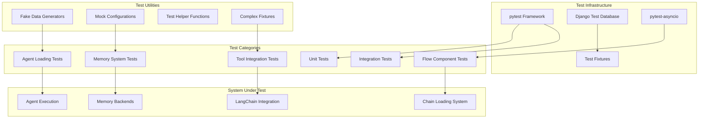
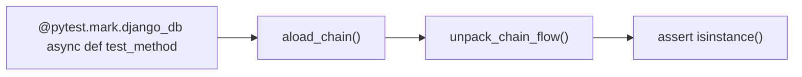
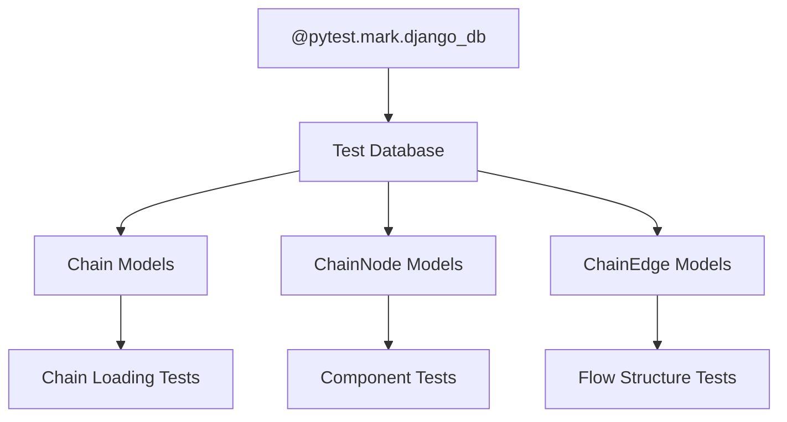
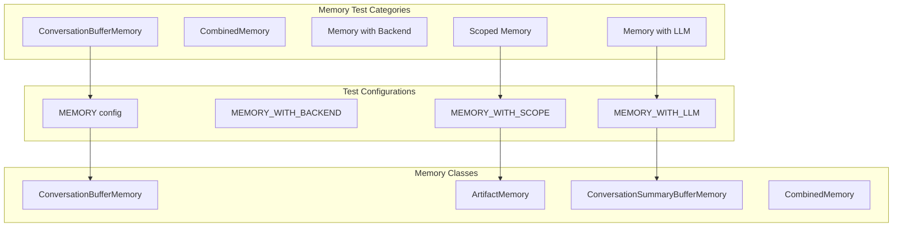
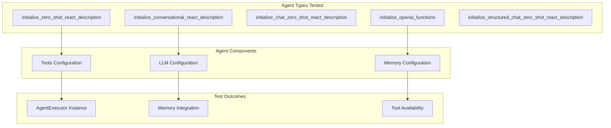
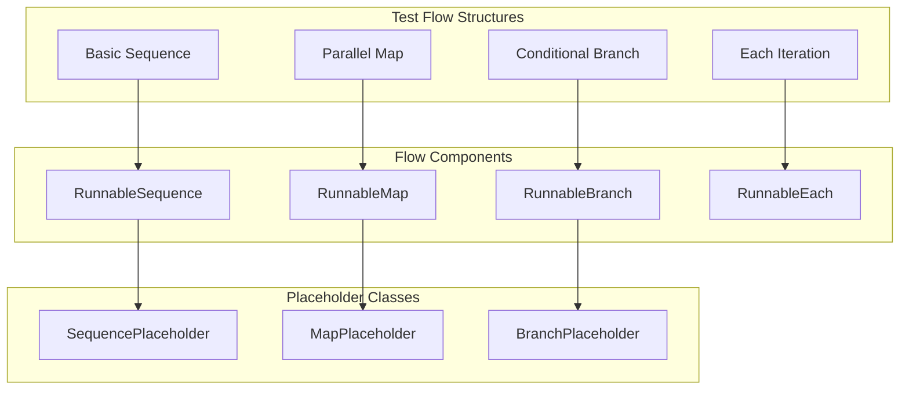
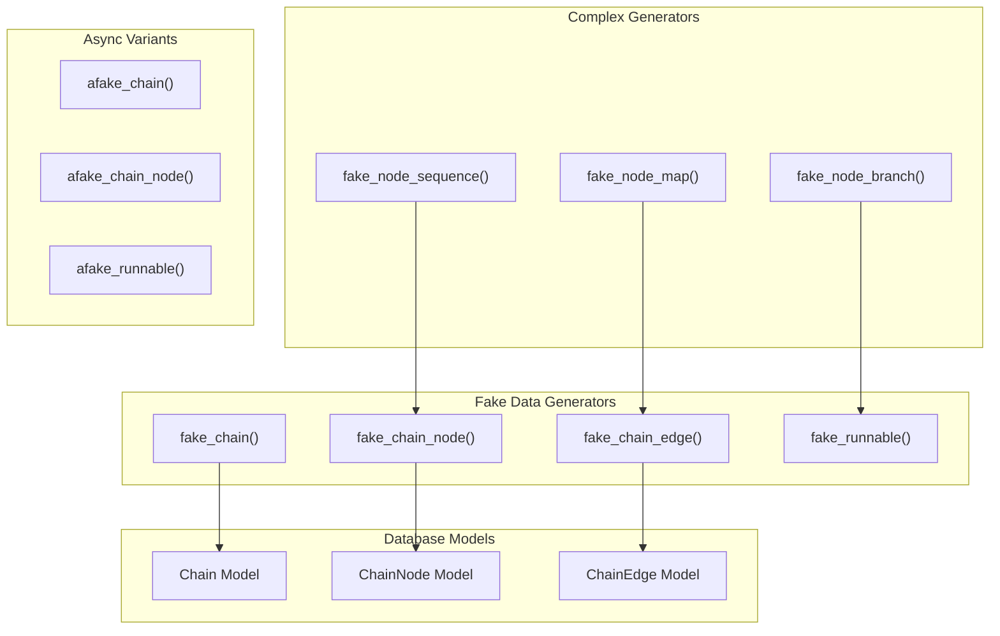
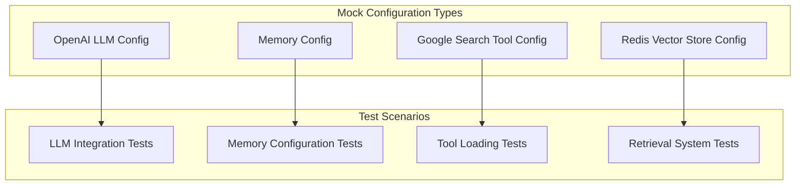
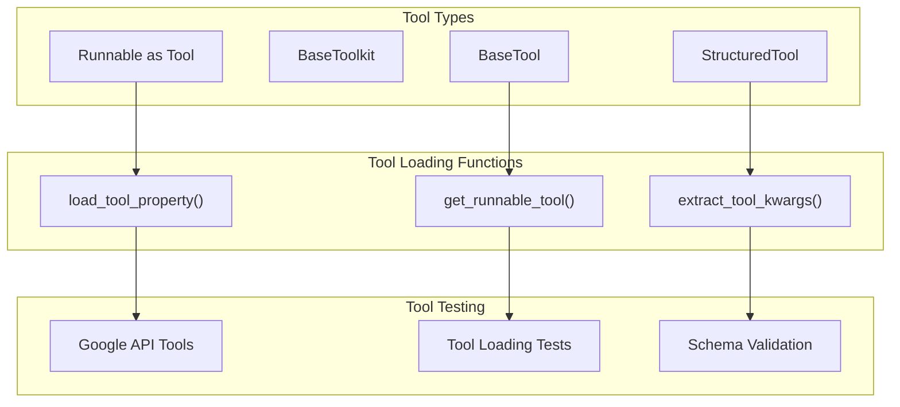

<!-- source: DeepWiki mcp.deepwiki.com · repo kreneskyp/ix · page 7.1 Testing · fetched 2026-10-26 -->

# Testing

Relevant source files

The following files were used as context for generating this wiki page:

- [ix/chains/loaders/tools.py](ix/chains/loaders/tools.py)
- [ix/chains/tests/conftest.py](ix/chains/tests/conftest.py)
- [ix/chains/tests/fake.py](ix/chains/tests/fake.py)
- [ix/chains/tests/mock_configs.py](ix/chains/tests/mock_configs.py)
- [ix/chains/tests/test_config_loader.py](ix/chains/tests/test_config_loader.py)

## Purpose and Scope

This document describes the testing infrastructure and practices used in the IX AI agent platform. It covers the test architecture, testing patterns, fixtures, and utilities that ensure the reliability and correctness of chain loading, agent execution, and component integration.

For information about deployment and production considerations, see [7.2](#7.2). For details about the core chain system being tested, see [3.1](#3.1).

## Test Infrastructure Overview

The IX testing system is built on pytest with Django integration, using async test patterns to match the platform's asynchronous execution model. The testing infrastructure provides comprehensive coverage of the chain loading system, agent execution, and LangChain component integration.

### Test Architecture

**Sources:** [ix/chains/tests/test_config_loader.py:1-50](), [ix/chains/tests/conftest.py:1-25]()

## Core Testing Patterns

### Async Test Implementation

The testing framework uses `pytest-asyncio` to support asynchronous test execution, matching the async nature of the chain loading and agent execution systems.

The `unpack_chain_flow()` helper function [ix/chains/tests/test_config_loader.py:89-110]() extracts the actual runnable components from the default sequence wrapper, allowing tests to verify the correct component types and configurations.

**Sources:** [ix/chains/tests/test_config_loader.py:112-195](), [ix/chains/tests/test_config_loader.py:89-110]()

### Database Integration Testing

Tests use Django's test database with the `@pytest.mark.django_db` decorator to ensure database operations work correctly during chain loading and agent configuration.

**Sources:** [ix/chains/tests/test_config_loader.py:112-195](), [ix/chains/tests/fake.py:22-45]()

## Component-Specific Testing

### Memory System Testing

The memory testing framework validates various memory backends and configurations used by agents and chains.

The `TestLoadMemory` class [ix/chains/tests/test_config_loader.py:113-194]() provides comprehensive coverage of memory loading scenarios, including session scoping and backend configuration.

**Sources:** [ix/chains/tests/test_config_loader.py:113-194](), [ix/chains/tests/mock_configs.py:54-102]()

### Agent Loading Testing

Agent tests verify that different LangChain agent types can be properly loaded and configured with tools, memory, and LLMs.

The `TestLoadAgents` class [ix/chains/tests/test_config_loader.py:395-490]() includes parametrized tests that verify all supported agent types can be loaded correctly.

**Sources:** [ix/chains/tests/test_config_loader.py:395-490](), [ix/chains/tests/mock_configs.py:220-225]()

### Flow Component Testing

Flow component tests validate the complex graph structures that represent LangChain execution flows.

The `TestFlowComponents` class [ix/chains/tests/test_config_loader.py:595-780]() provides extensive testing of nested flow structures and complex execution patterns.

**Sources:** [ix/chains/tests/test_config_loader.py:595-780](), [ix/chains/tests/conftest.py:24-973]()

## Test Utilities and Fixtures

### Fake Data Generation

The fake data generation system in [ix/chains/tests/fake.py]() provides utilities for creating test chains, nodes, and edges with realistic configurations.

**Sources:** [ix/chains/tests/fake.py:22-387]()

### Complex Test Fixtures

The conftest.py file [ix/chains/tests/conftest.py]() defines complex fixtures for testing nested flow structures like maps within sequences, branches within maps, and other intricate combinations.

| Fixture Name | Purpose | Structure |
|--------------|---------|-----------|
| `lcel_sequence` | Basic sequence testing | Two connected nodes |
| `lcel_map` | Parallel execution testing | Map with multiple branches |
| `lcel_branch` | Conditional execution testing | Branch with default and conditions |
| `lcel_map_in_sequence` | Nested structures | Map embedded in sequence |
| `lcel_branch_in_branch` | Complex branching | Nested conditional logic |

**Sources:** [ix/chains/tests/conftest.py:24-973]()

### Mock Configurations

Mock configurations provide realistic test data for various component types:

**Sources:** [ix/chains/tests/mock_configs.py:17-271]()

## Tool Integration Testing

### Tool Loading and Execution

The tool testing framework validates that various tool types can be loaded and integrated into agent workflows.

The `get_runnable_tool()` function [ix/chains/loaders/tools.py:52-88]() creates structured tools from runnables, with comprehensive testing in [ix/chains/tests/test_config_loader.py:494-547]().

**Sources:** [ix/chains/loaders/tools.py:52-88](), [ix/chains/tests/test_config_loader.py:494-547](), [ix/chains/tests/test_config_loader.py:378-392]()

## Testing Best Practices

### Async Test Patterns

1. Use `@pytest.mark.django_db` for database-dependent tests
2. Use `pytest-asyncio` fixtures for async test setup
3. Use `unpack_chain_flow()` to extract components from test flows
4. Mock external services (OpenAI, Google APIs) in test environments

### Mock and Fixture Usage

1. Use fake data generators for creating test database objects
2. Use mock configurations for consistent test scenarios
3. Use complex fixtures for testing nested flow structures
4. Use parametrized tests for testing multiple similar scenarios

### Component Validation

1. Verify correct component types are instantiated
2. Test component configuration and initialization
3. Validate integration between components
4. Test error handling and edge cases

**Sources:** [ix/chains/tests/test_config_loader.py:89-110](), [ix/chains/tests/fake.py:1-387](), [ix/chains/tests/conftest.py:1-973]()

---

