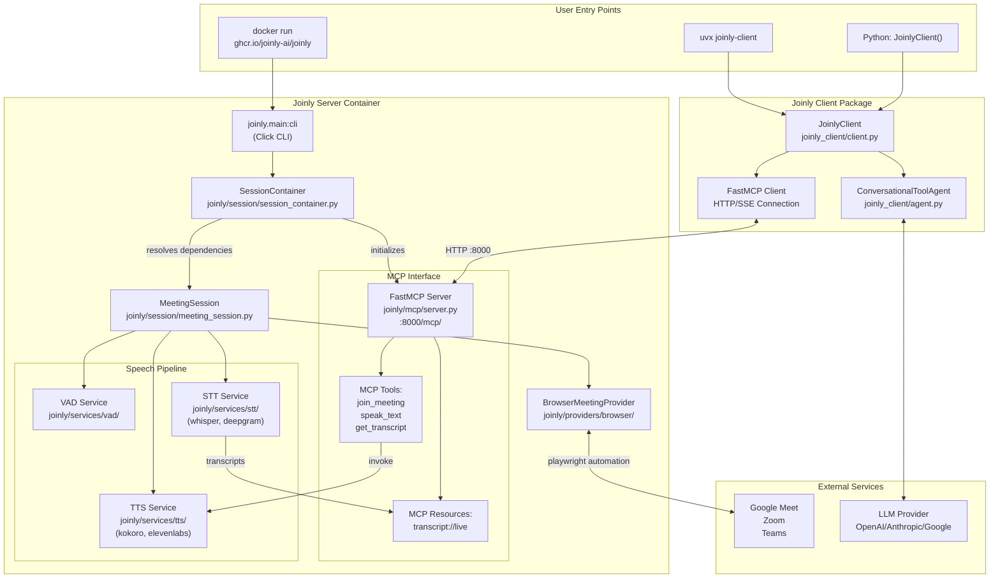
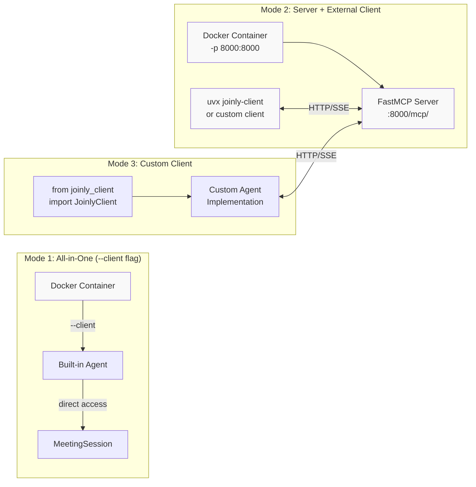
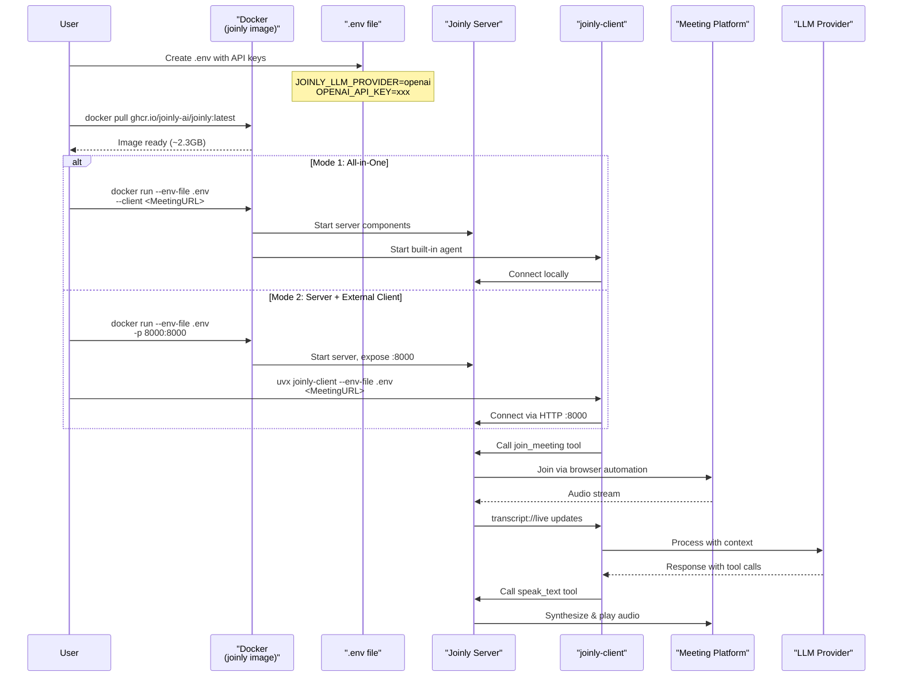
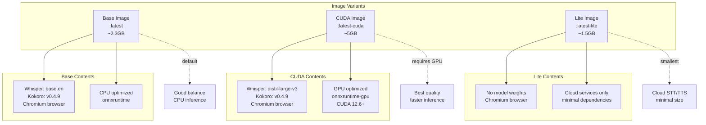

<!-- source: DeepWiki mcp.deepwiki.com · repo joinly-ai/joinly · page 2 Getting Started · fetched 2026-10-26 -->

# Getting Started

<details>
<summary>Relevant source files</summary>

The following files were used as context for generating this wiki page:

- [.env.example](.env.example)
- [CHANGELOG.md](CHANGELOG.md)
- [README.md](README.md)
- [joinly/services/tts/resemble.py](joinly/services/tts/resemble.py)
- [pyproject.toml](pyproject.toml)
- [uv.lock](uv.lock)

</details>


This page provides an overview of how to get started with joinly, covering system setup, basic usage patterns, and the initial workflow for running your first meeting agent. The guide assumes you want to quickly deploy a meeting agent that can join video calls and interact using AI.

For detailed installation instructions, see [Installation and Dependencies](#2.1). For a step-by-step walkthrough with example commands, see [Quick Start Guide](#2.2). For comprehensive configuration options, see [Configuration and Settings](#2.3).

## System Overview

Joinly consists of two main components that work together to enable AI agents in meetings:

1. **Joinly Server** - A Docker container that manages meeting connections, handles audio processing (speech-to-text and text-to-speech), and exposes an MCP (Model Context Protocol) server interface
2. **Joinly Client** - A Python package that connects to the MCP server, manages LLM interactions, and orchestrates agent behavior

### Component Architecture

The following diagram shows the core components and how they map to code entities:



**Sources:** [joinly/main.py](), [joinly/session/session_container.py](), [joinly/session/meeting_session.py](), [joinly/mcp/server.py](), [joinly_client/client.py](), [joinly_client/agent.py](), [joinly/providers/browser/browser_meeting_provider.py](), [README.md:1-290]()

## Deployment Modes

Joinly supports three primary deployment patterns, each suited for different use cases:



**Sources:** [README.md:53-126](), [joinly/main.py:32-58]()

### Mode Comparison

| Mode | Use Case | Command Pattern | Advantages |
|------|----------|----------------|------------|
| **All-in-One** | Quick testing, simple deployments | `docker run --client <URL>` | Simplest setup, no external dependencies |
| **Server + External Client** | Production use, multi-client scenarios | Server: `docker run -p 8000:8000`<br/>Client: `uvx joinly-client <URL>` | Separation of concerns, supports external MCP servers |
| **Custom Client** | Custom agent logic, specialized workflows | `from joinly_client import JoinlyClient` | Full control over agent behavior |

**Sources:** [README.md:87-138]()

## Basic Getting Started Workflow

The typical workflow for getting started with joinly follows these steps:



**Sources:** [README.md:52-101](), [joinly/main.py](), [joinly_client/__main__.py]()

## Prerequisites

Before starting, ensure you have:

1. **Docker** - For running the joinly server container
2. **API Keys** - At minimum, an API key for an LLM provider (OpenAI, Anthropic, Google, or Azure)
3. **Optional: uv** - For running external clients (Mode 2 or 3)
4. **Meeting Link** - A valid Google Meet, Zoom, or Microsoft Teams meeting URL

For detailed installation instructions, see [Installation and Dependencies](#2.1).

**Sources:** [README.md:56-57](), [.env.example:1-48]()

## Configuration Overview

Joinly is configured through a combination of:

1. **Environment Variables** - Stored in a `.env` file for API keys and provider settings
2. **Command-Line Arguments** - For runtime options like `--tts`, `--stt`, `--lang`, `--name`
3. **HTTP Headers** - For session-specific settings when using external clients (via `joinly-settings` header)

### Essential Environment Variables

The minimum required configuration is an LLM provider setup. Example for OpenAI:

```env
JOINLY_LLM_PROVIDER=openai
JOINLY_LLM_MODEL=gpt-4o
OPENAI_API_KEY=your-api-key-here
```

**Sources:** [.env.example:1-10](), [README.md:58-73]()

### Speech Service Configuration

By default, joinly uses local models (Whisper for STT, Kokoro for TTS), but supports cloud alternatives:

| Service | Provider Options | Configuration |
|---------|-----------------|---------------|
| **Text-to-Speech (TTS)** | `kokoro` (default), `elevenlabs`, `deepgram`, `resemble` | `--tts <provider>` |
| **Speech-to-Text (STT)** | `whisper` (default), `deepgram` | `--stt <provider>` |
| **Voice Activity Detection (VAD)** | `hybrid` (default), `webrtc`, `silero` | `--vad <provider>` |

Cloud providers require API keys in the `.env` file:

```env
DEEPGRAM_API_KEY=your-key
ELEVENLABS_API_KEY=your-key
RESEMBLE_API_KEY=your-key
```

**Sources:** [README.md:160-184](), [.env.example:37-44](), [joinly/services/tts/](), [joinly/services/stt/]()

For comprehensive configuration details, see [Configuration and Settings](#2.3).

## Docker Image Variants

Joinly provides three Docker image variants optimized for different scenarios:



**Sources:** [README.md:76-214](), [Dockerfile](), [pyproject.toml:32-35]()

### Choosing an Image

- **Base (`:latest`)** - Default choice for most users. Includes `base.en` Whisper model for reasonable quality on CPU.
- **CUDA (`:latest-cuda`)** - For GPU-accelerated inference. Automatically uses `distil-large-v3` Whisper model for better quality. Requires NVIDIA Container Toolkit and CUDA 12.6+.
- **Lite (`:latest-lite`)** - Minimal image without local model weights. Requires cloud STT/TTS services (Deepgram, ElevenLabs, etc.).

**Sources:** [README.md:200-214](), [CHANGELOG.md:133-134]()

## First Steps After Installation

Once you have Docker and your `.env` file ready:

1. **Pull the image:**
   ```bash
   docker pull ghcr.io/joinly-ai/joinly:latest
   ```

2. **Start a meeting and get the URL** from Google Meet, Zoom, or Teams

3. **Run joinly** using one of the deployment modes:
   - All-in-one: `docker run --env-file .env ghcr.io/joinly-ai/joinly:latest --client <MeetingURL>`
   - Server mode: `docker run --env-file .env -p 8000:8000 ghcr.io/joinly-ai/joinly:latest`

4. **Monitor the logs** for connection status and agent activity

For detailed step-by-step instructions with troubleshooting, see [Quick Start Guide](#2.2).

**Sources:** [README.md:76-85]()

## MCP Server Interface

When running in server mode, joinly exposes a FastMCP server on port 8000 that provides standardized tools and resources for meeting interaction:

### Available Tools

| Tool | Purpose | Key Parameters |
|------|---------|----------------|
| `join_meeting` | Join a video call | `url`, `participant_name`, `passcode?` |
| `leave_meeting` | Leave the current meeting | None |
| `speak_text` | Speak using TTS | `text` |
| `send_chat_message` | Send a chat message | `message` |
| `mute_yourself` / `unmute_yourself` | Control microphone | None |
| `get_transcript` | Retrieve transcript with filters | `minutes?` |
| `get_chat_history` | Get meeting chat | None |
| `get_participants` | List current participants | None |
| `get_video_snapshot` | Capture screen/video frame | None |

### Available Resources

| Resource URI | Description | Subscribable |
|--------------|-------------|--------------|
| `transcript://live` | Real-time meeting transcript with speaker attribution and timestamps | Yes |
| `usage://current` | Current session usage metrics (LLM tokens, STT/TTS minutes) | No |

**Sources:** [README.md:220-238](), [joinly/mcp/server.py]()

## Next Steps

After completing initial setup:

- **For installation details:** See [Installation and Dependencies](#2.1)
- **For a guided walkthrough:** See [Quick Start Guide](#2.2)
- **For configuration reference:** See [Configuration and Settings](#2.3)
- **For architecture details:** See [Architecture](#3)
- **For building custom agents:** See [Client SDK](#6)
- **For adding external MCP servers:** See [LLM and External Service Integration](#7)

**Sources:** [README.md:1-290]()

---

