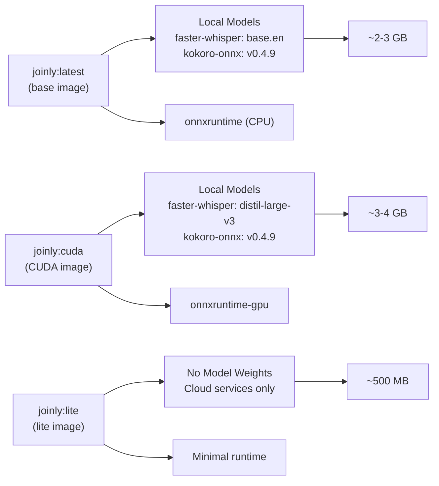
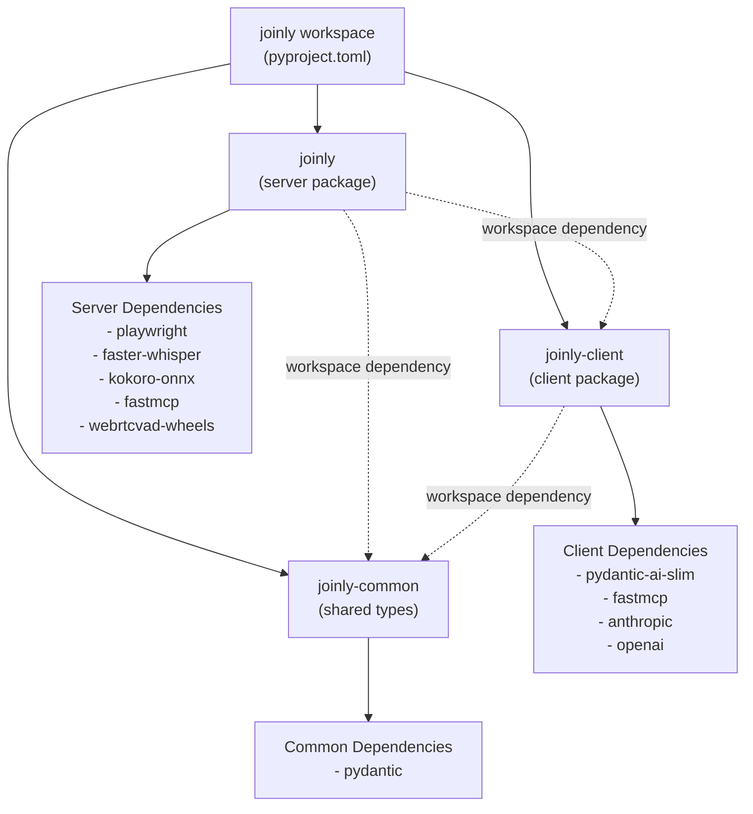
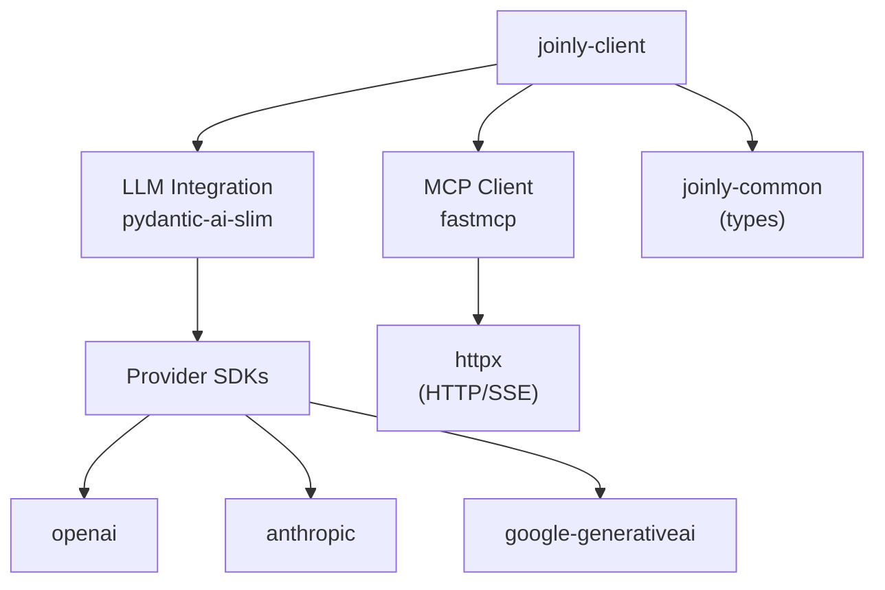
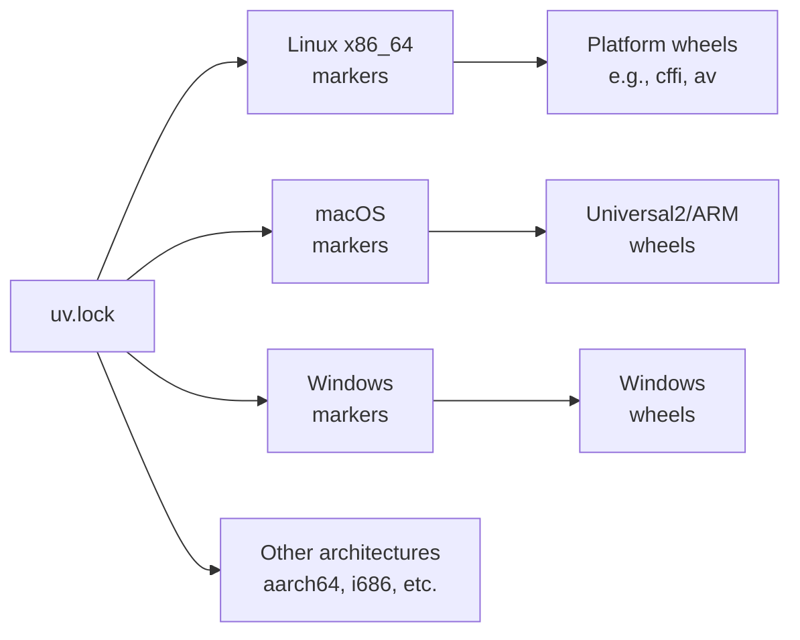

<!-- source: DeepWiki mcp.deepwiki.com · repo joinly-ai/joinly · page 2.1 Installation and Dependencies · fetched 2026-10-26 -->

# Installation and Dependencies

<details>
<summary>Relevant source files</summary>

The following files were used as context for generating this wiki page:

- [CHANGELOG.md](CHANGELOG.md)
- [client/README.md](client/README.md)
- [client/joinly_client/__init__.py](client/joinly_client/__init__.py)
- [pyproject.toml](pyproject.toml)
- [uv.lock](uv.lock)

</details>


This document covers the installation of the joinly system, including both the server and client components, system requirements, and dependency management. For detailed development environment setup, see [Development Environment Setup](#8.1). For information about Docker image variants and deployment, see [Docker Images and Variants](#9.1). For dependency internals and the build system, see [Build System and Dependencies](#8.2).

## System Requirements

### Python Version

The joinly system requires **Python 3.12 or higher**. This requirement is enforced across all packages in the workspace.

**Sources:** [pyproject.toml:9](), [uv.lock:3]()

### Platform Support

The system supports multiple platforms with platform-specific dependency resolution:

| Platform | Architecture | Support Level |
|----------|-------------|---------------|
| Linux | x86_64 | Full support (CPU and CUDA) |
| Linux | aarch64 | Full support (CPU only) |
| Linux | i686 | Full support (CPU only) |
| macOS | x86_64 | Full support |
| macOS | ARM64 (Apple Silicon) | Full support |
| Windows | x86_64 | Full support |

**Sources:** [uv.lock:4-11]()

### System Dependencies

For Docker deployments, all system dependencies are included in the container images. For local installations, the following system-level dependencies may be required:

- **Playwright browsers**: Automatically installed via `playwright install` command
- **PulseAudio** (Linux): Required for virtual audio devices
- **FFmpeg**: Required by the `av` package for audio/video processing
- **ONNX Runtime dependencies**: Included with the Python packages

**Sources:** [pyproject.toml:10-27](), High-level system diagrams

## Installation Methods

### Docker Installation (Recommended)

Docker is the recommended installation method for the joinly server, as it includes all dependencies and system-level requirements pre-configured.

```bash
# Pull and run the latest base image (CPU, local models)
docker run -p 8000:8000 ghcr.io/joinly-ai/joinly:latest

# Pull and run the CUDA image (GPU acceleration)
docker run --gpus all -p 8000:8000 ghcr.io/joinly-ai/joinly:cuda

# Pull and run the lite image (cloud services only, minimal size)
docker run -p 8000:8000 ghcr.io/joinly-ai/joinly:lite
```

#### Image Variants



**Image Characteristics:**

| Variant | Local STT | Local TTS | GPU Support | Image Size | Use Case |
|---------|-----------|-----------|-------------|------------|----------|
| `latest` (base) | faster-whisper (base.en) | kokoro-onnx | No | ~2-3 GB | General purpose, CPU |
| `cuda` | faster-whisper (distil-large-v3) | kokoro-onnx | Yes | ~3-4 GB | High performance, GPU available |
| `lite` | None (cloud only) | None (cloud only) | No | ~500 MB | Cloud-only, minimal footprint |

**Sources:** [CHANGELOG.md:134](), Deployment Modes diagram, [pyproject.toml:33-35]()

### uv Installation (Development/Local)

[uv](https://github.com/astral-sh/uv) is the recommended tool for local development and client-only usage. It provides fast dependency resolution and virtual environment management.

#### Installing uv

```bash
# macOS and Linux
curl -LsSf https://astral.sh/uv/install.sh | sh

# Windows
powershell -c "irm https://astral.sh/uv/install.ps1 | iex"
```

#### Installing joinly Server Locally

```bash
# Clone the repository
git clone https://github.com/joinly-ai/joinly.git
cd joinly

# Create virtual environment and install with uv
uv sync

# Run the server
uv run joinly --help
```

#### Installing joinly Client

The client can be used without installing, via `uvx`:

```bash
# Run client directly (downloads and caches automatically)
uvx joinly-client --joinly-url http://localhost:8000/mcp/ <MeetingUrl>
```

Or install it in a project:

```bash
# Add to project dependencies
uv add joinly-client

# Or install globally
uv tool install joinly-client
```

**Sources:** [client/README.md:33-38](), [client/README.md:72-98]()

### pip Installation

While uv is recommended, pip can also be used for installation:

```bash
# Install server with dependencies
pip install joinly

# Install client separately
pip install joinly-client

# Install with CUDA support
pip install joinly[cuda]
```

**Sources:** [pyproject.toml:1-36]()

## Dependency Overview

### Workspace Structure

The joinly project is organized as a uv workspace with three packages:



**Sources:** [pyproject.toml:61-65](), [uv.lock:13-18]()

### Core Server Dependencies

The server package has extensive dependencies for meeting automation and speech processing:

| Category | Package | Purpose | Version Constraint |
|----------|---------|---------|-------------------|
| **Web Automation** | playwright | Browser automation for meeting platforms | >=1.51.0 |
| **Speech-to-Text** | faster-whisper | Local STT using Whisper models | >=1.1.1 |
| | deepgram-sdk | Cloud STT service | >=4.1.1 |
| **Text-to-Speech** | kokoro-onnx | Local TTS using ONNX models | >=0.4.9 |
| | elevenlabs | Cloud TTS service | >=2.5.0 |
| **Voice Activity** | webrtcvad-wheels | VAD for speech detection | >=2.0.14 |
| **MCP Server** | fastmcp | FastMCP server implementation | >=2.10.5 |
| **Audio Processing** | numpy | Numerical operations for audio | >=2.2.4 |
| | onnxruntime | ONNX model inference (CPU) | >=1.21.1 |
| **Utilities** | click | CLI framework | >=8.1.8 |
| | python-dotenv | Environment variable management | >=1.1.0 |
| | aiohttp | Async HTTP client/server | >=3.11.18 |

**Sources:** [pyproject.toml:10-27]()

#### Optional Dependencies

```python
# CUDA acceleration for local models
[project.optional-dependencies]
cuda = [
    "onnxruntime-gpu>=1.22.0",
]
```

The CUDA optional dependency replaces `onnxruntime` with `onnxruntime-gpu` to enable GPU acceleration for Whisper (STT) and Kokoro (TTS) models.

**Sources:** [pyproject.toml:33-35]()

### Client Dependencies

The client package focuses on LLM integration and MCP communication:



The client package is designed to be lightweight, with LLM provider SDKs as the primary dependencies.

**Sources:** [client/joinly_client/__init__.py:1-9](), Package importance scores

### Development Dependencies

Development dependencies are specified in a `[dependency-groups]` section:

```python
[dependency-groups]
dev = [
    "aiofiles>=24.1.0",
    "aiohttp>=3.11.18",
    "jiwer>=3.1.0",           # Word error rate for testing
    "pre-commit>=4.2.0",      # Git hooks
    "pyright>=1.1.399",       # Type checking
    "pytest>=8.3.5",          # Testing framework
    "pytest-asyncio>=0.26.0", # Async test support
    "rich>=14.0.0",           # Terminal formatting
    "ruff>=0.11.6",           # Linting and formatting
]
```

**Sources:** [pyproject.toml:37-48]()

## Dependency Resolution

### Platform-Specific Resolution

The lockfile uses resolution markers to handle platform-specific dependencies:



For example, the `aiohttp` package has different wheels for each platform:

```
aiohttp-3.11.18-cp312-cp312-macosx_10_13_universal2.whl
aiohttp-3.11.18-cp312-cp312-manylinux_2_17_x86_64.whl
aiohttp-3.11.18-cp312-cp312-win_amd64.whl
```

**Sources:** [uv.lock:4-11](), [uv.lock:60-92]()

### Workspace Dependencies

The `[tool.uv.sources]` section specifies workspace dependencies:

```toml
[tool.uv.sources]
joinly-client = { workspace = true }
joinly-common = { workspace = true }
```

This ensures that the server package uses the local workspace versions of `joinly-client` and `joinly-common` rather than published versions, enabling coordinated development across packages.

**Sources:** [pyproject.toml:50-52]()

## Version Management

### Package Versions

Current versions as of the latest release:

| Package | Version |
|---------|---------|
| joinly (server) | 0.5.1 |
| joinly-client | 0.1.18 |
| joinly-common | 0.1.3 |

**Sources:** [pyproject.toml:3](), [CHANGELOG.md:4-5]()

### Dependency Updates

Dependencies are locked in `uv.lock` with exact versions to ensure reproducible builds. The lockfile tracks:

- Package versions
- Package hashes (SHA256)
- Wheel URLs
- Source distributions (sdist)
- Resolution markers for platform-specific builds

Example lockfile entry:

```toml
[[package]]
name = "fastmcp"
version = "2.10.5"
source = { registry = "https://pypi.org/simple" }
dependencies = [
    { name = "httpx" },
    { name = "pydantic" },
    ...
]
```

**Sources:** [uv.lock:1-11](), [uv.lock:20-46]()

## CLI Entry Points

The server package provides a CLI entry point:

```toml
[project.scripts]
joinly = "joinly.main:cli"
```

After installation, the `joinly` command invokes the `cli` function in `joinly.main`.

The client package similarly provides:

```toml
[project.scripts]
joinly-client = "joinly_client.main:main"
```

**Sources:** [pyproject.toml:29-30]()

## Next Steps

After installation, proceed to:
- [Quick Start Guide](#2.2) for running the system for the first time
- [Configuration and Settings](#2.3) for detailed configuration options
- [Development Environment Setup](#8.1) for setting up a development environment

---

