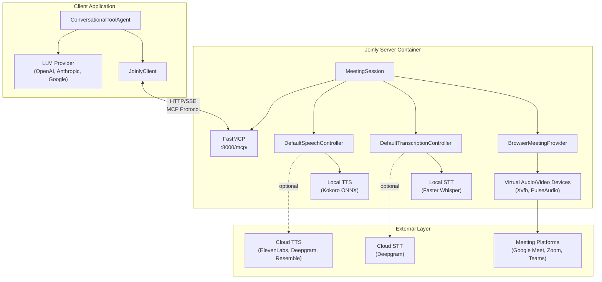
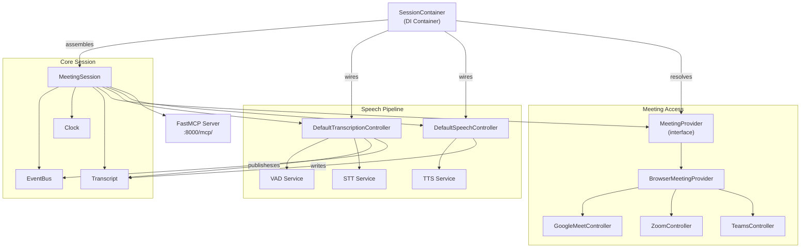
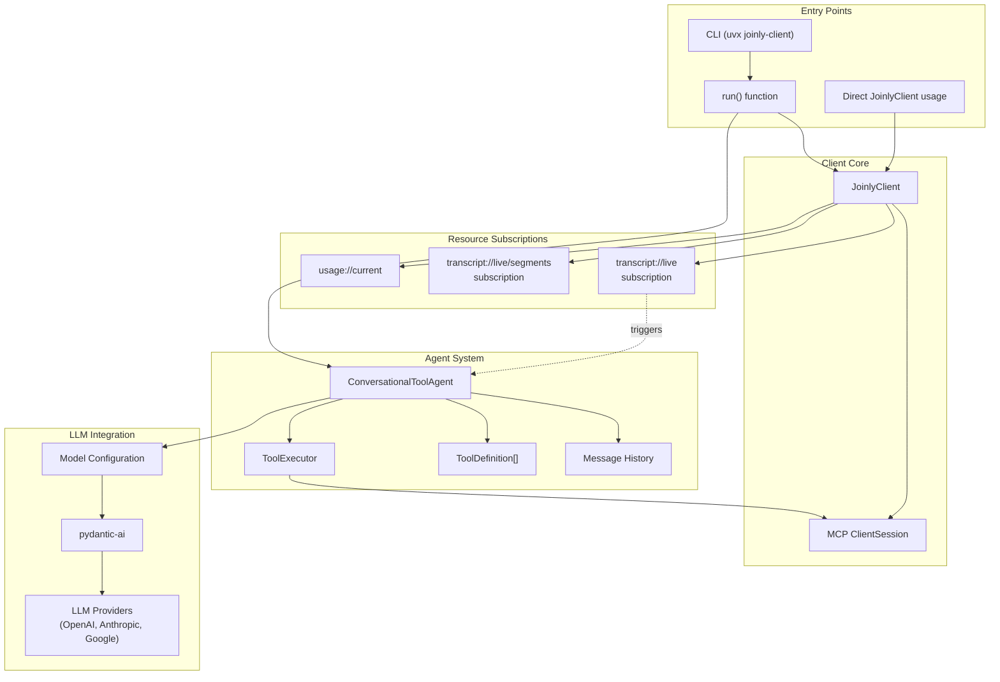
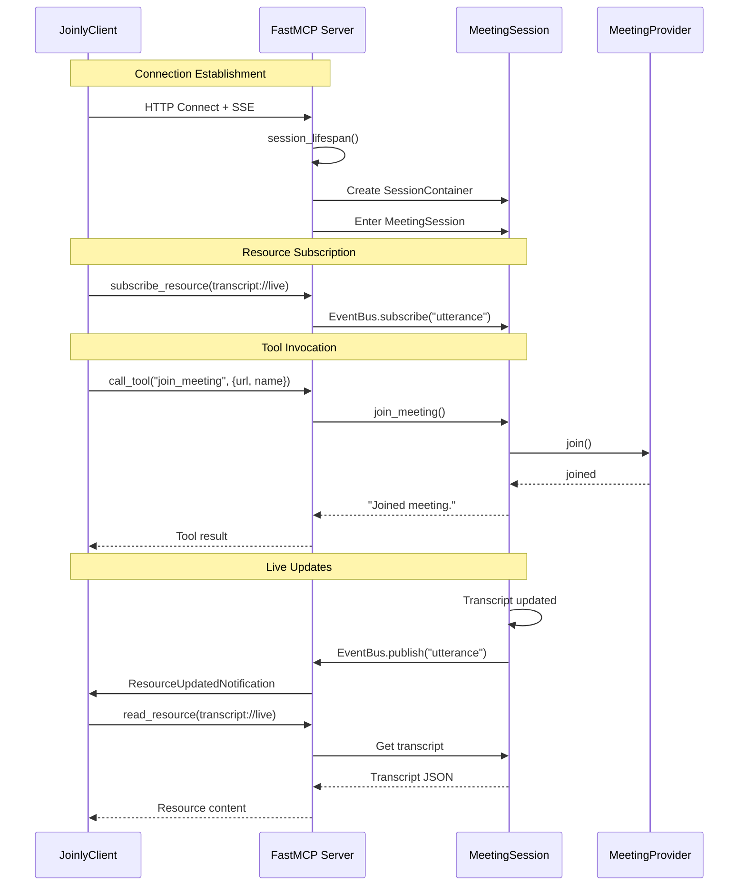
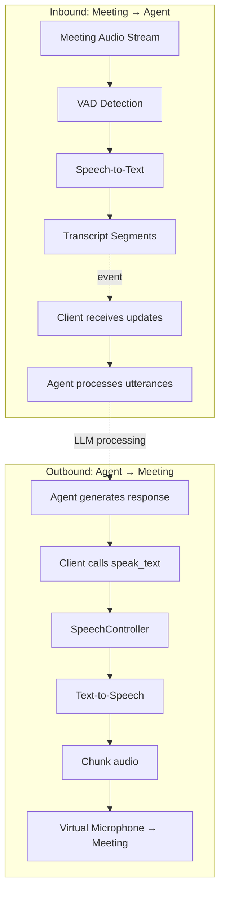

<!-- source: DeepWiki mcp.deepwiki.com · repo joinly-ai/joinly · page 3 Architecture · fetched 2026-10-26 -->

# Architecture

<details>
<summary>Relevant source files</summary>

The following files were used as context for generating this wiki page:

- [CHANGELOG.md](CHANGELOG.md)
- [client/joinly_client/agent.py](client/joinly_client/agent.py)
- [client/joinly_client/client.py](client/joinly_client/client.py)
- [client/joinly_client/main.py](client/joinly_client/main.py)
- [client/joinly_client/prompts.py](client/joinly_client/prompts.py)
- [client/joinly_client/types.py](client/joinly_client/types.py)
- [client/joinly_client/utils.py](client/joinly_client/utils.py)
- [common/joinly_common/types.py](common/joinly_common/types.py)
- [joinly/server.py](joinly/server.py)
- [joinly/utils/events.py](joinly/utils/events.py)
- [joinly/utils/usage.py](joinly/utils/usage.py)
- [pyproject.toml](pyproject.toml)
- [uv.lock](uv.lock)

</details>


This document explains the high-level architecture of the joinly system, focusing on the separation between server and client components, their communication protocol, and how they integrate to enable AI agents in meetings. For detailed information about specific subsystems, see [MCP Server and Client Communication](#3.1), [Session Management and Dependency Injection](#3.2), and [Data Types and Models](#3.3). For operational deployment patterns, see [Deployment Modes](#9.2).

## System Overview

Joinly follows a **server-client architecture** where the server handles meeting connections and real-time audio processing, while clients orchestrate conversational AI agents with LLM integration. The two components communicate over the **Model Context Protocol (MCP)**, an HTTP/SSE-based protocol that provides a standardized interface for resources, tools, and subscriptions.

### Server-Client Separation



**Sources:** [joinly/server.py:1-342](), [client/joinly_client/client.py:1-428](), [client/joinly_client/agent.py:1-480]()

The architecture provides clear separation of concerns:

| Component | Responsibility | Key Classes |
|-----------|---------------|-------------|
| **Server** | Meeting access, audio I/O, speech processing | `MeetingSession`, `BrowserMeetingProvider`, `DefaultTranscriptionController`, `DefaultSpeechController` |
| **Client** | Conversational AI, LLM orchestration, tool execution | `JoinlyClient`, `ConversationalToolAgent` |
| **Protocol** | Communication, resource subscription, tool invocation | `FastMCP` (server), MCP client session (client) |

## Core Components

### Server Components

The server side is organized around the `MeetingSession` orchestrator that coordinates all meeting-related functionality.



**Sources:** [joinly/session.py](), [joinly/container.py](), [joinly/server.py:34-122](), [joinly/providers/meeting.py](), [joinly/controllers/transcription.py](), [joinly/controllers/speech.py]()

#### SessionContainer (Dependency Injection)

The `SessionContainer` class [joinly/container.py]() acts as a dependency injection container that dynamically resolves and wires components based on configuration. It uses a `_resolve` method to instantiate services from configuration strings like `"whisper"` or `"joinly.services.stt.deepgram:DeepgramSTT"`.

#### MeetingSession (Orchestrator)

The `MeetingSession` class [joinly/session.py]() serves as the central orchestrator, coordinating:
- Meeting lifecycle (join, leave)
- Shared resources (`Clock`, `Transcript`, `EventBus`)
- Audio processing pipelines (transcription and speech)
- Event publishing for real-time updates

#### Speech Processing Pipeline

Two controllers manage bidirectional audio:

- **DefaultTranscriptionController**: Receives audio from the meeting → VAD detects speech → STT transcribes → writes segments to `Transcript`
- **DefaultSpeechController**: Receives text to speak → chunks text → TTS generates audio → plays through virtual microphone

### Client Components

The client side focuses on conversational AI orchestration and MCP communication.



**Sources:** [client/joinly_client/client.py:1-428](), [client/joinly_client/agent.py:1-480](), [client/joinly_client/main.py:1-397](), [client/joinly_client/utils.py:1-312]()

#### JoinlyClient

The `JoinlyClient` class [client/joinly_client/client.py:32-428]() provides:
- MCP session management and connection lifecycle
- Resource subscription handling with callbacks
- Tool invocation methods (`join_meeting`, `speak_text`, etc.)
- Transcript filtering and segment delivery to callbacks

#### ConversationalToolAgent

The `ConversationalToolAgent` class [client/joinly_client/agent.py:30-480]() implements the conversational AI loop:
- Maintains message history with `ModelRequest`/`ModelResponse` objects
- Calls LLM with system prompt, history, and available tools
- Executes tool calls via `ToolExecutor`
- Handles interruptions and turn management
- Truncates large tool results to manage token usage

## Communication Protocol

The server and client communicate via the Model Context Protocol (MCP), a standardized protocol for AI-tool integration.



**Sources:** [joinly/server.py:73-122](), [client/joinly_client/client.py:201-239]()

### MCP Resources

The server exposes three primary resources:

| Resource URI | Content Type | Description | Handler |
|--------------|--------------|-------------|---------|
| `transcript://live` | `application/json` | Participant utterances only | [joinly/server.py:127-136]() |
| `transcript://live/segments` | `application/json` | All transcript segments including agent speech | [joinly/server.py:138-147]() |
| `usage://current` | `application/json` | Service usage statistics (tokens, audio minutes) | [joinly/server.py:149-157]() |

### MCP Tools

The server exposes meeting control tools:

| Tool Name | Purpose | Key Parameter | Handler |
|-----------|---------|---------------|---------|
| `join_meeting` | Join a meeting | `meeting_url`, `participant_name` | [joinly/server.py:159-184]() |
| `leave_meeting` | Leave current meeting | none | [joinly/server.py:186-197]() |
| `speak_text` | Synthesize speech in meeting | `text` | [joinly/server.py:199-214]() |
| `send_chat_message` | Send chat message | `message` | [joinly/server.py:216-228]() |
| `get_chat_history` | Retrieve chat messages | none | [joinly/server.py:230-240]() |
| `get_transcript` | Get transcript with filters | `mode`, `minutes` | [joinly/server.py:242-276]() |
| `get_participants` | List meeting participants | none | [joinly/server.py:278-288]() |
| `get_video_snapshot` | Capture video frame | none | [joinly/server.py:290-306]() |
| `mute_yourself` | Mute microphone | none | [joinly/server.py:308-319]() |
| `unmute_yourself` | Unmute microphone | none | [joinly/server.py:321-332]() |

## Data Flow Architecture

### Event-Driven Transcript Updates

The system uses an event-driven architecture for real-time transcript distribution.

```mermaid
graph LR
    Audio["Meeting Audio"]
    VAD["VAD Service"]
    STT["STT Service"]
    TransCtrl["TranscriptionController"]
    Transcript["Transcript Store"]
    EventBus["EventBus"]
    FastMCP["FastMCP Server"]
    Client["JoinlyClient"]
    Agent["ConversationalToolAgent"]
    
    Audio --> VAD
    VAD -->|"SpeechWindow"| STT
    STT -->|"transcribed text"| TransCtrl
    TransCtrl -->|"add_segment()"| Transcript
    TransCtrl -->|"publish('segment')"| EventBus
    TransCtrl -->|"publish('utterance')"| EventBus
    EventBus -->|"notify subscribers"| FastMCP
    FastMCP -->|"ResourceUpdatedNotification"| Client
    Client -->|"read_resource()"| FastMCP
    FastMCP -->|"Transcript JSON"| Client
    Client -->|"on_utterance(segments)"| Agent
```



**Sources:** [joinly/controllers/transcription.py](), [joinly/types.py](), [joinly/utils/events.py:1-73](), [client/joinly_client/client.py:253-284](), [client/joinly_client/agent.py:98-151]()

#### Event Types

The `EventBus` class [joinly/utils/events.py:11-73]() supports two event types defined as `EventType = Literal["segment", "utterance"]`:

- **segment**: Published after every transcript segment is added (all speakers)
- **utterance**: Published after participant segments are added (excludes agent speech)

Clients subscribe to the corresponding resource URI (`transcript://live` for utterances, `transcript://live/segments` for segments), and the server automatically manages the event subscription lifecycle in `session_lifespan` [joinly/server.py:86-106]().

### Bidirectional Speech Pipeline



**Sources:** [joinly/controllers/transcription.py](), [joinly/controllers/speech.py](), [client/joinly_client/agent.py:112-151]()

The inbound pipeline detects voice activity, transcribes speech, and publishes segments to subscribed clients. The outbound pipeline receives text from clients, synthesizes speech with optional pre-chunking, and interrupts gracefully if new speech is detected from participants.

## Shared Data Types

The `joinly-common` package [common/joinly_common/types.py:1-292]() defines shared data types used throughout the system:

### Core Types

| Type | Purpose | Key Fields | Immutable |
|------|---------|-----------|-----------|
| `TranscriptSegment` | Single utterance | `text`, `start`, `end`, `speaker`, `role` | Yes |
| `Transcript` | Collection of segments | `segments` (computed property), methods like `after()`, `compact()` | No (mutable set internally) |
| `SpeakerRole` | Speaker classification | `participant`, `assistant` | Enum |
| `Usage` | Service usage tracking | Root dict of `ServiceUsage` by service name | No |
| `MeetingParticipant` | Participant metadata | `name`, `email`, `infos` | Yes |
| `MeetingChatMessage` | Chat message | `text`, `timestamp`, `sender` | Yes |

**Sources:** [common/joinly_common/types.py:16-292]()

### Transcript Model

The `Transcript` class [common/joinly_common/types.py:54-168]() maintains an internal `_segments` set and provides methods for filtering and manipulation:

- `after(seconds)` / `before(seconds)`: Temporal filtering
- `with_role(role)`: Filter by speaker role
- `compact(max_gap=0.5)`: Merge nearby segments from the same speaker

The computed `segments` property returns a sorted list, making the transcript's order deterministic.

### Usage Tracking

The `Usage` and `ServiceUsage` classes [common/joinly_common/types.py:218-292]() track resource consumption:

```python
# Usage structure (conceptual)
{
    "llm": {
        "usage": {"input_tokens": 1234, "output_tokens": 567},
        "meta": {"model": "gpt-4o", "provider": "openai"}
    },
    "stt": {
        "usage": {"audio_minutes": 2.5},
        "meta": {"service": "deepgram", "model": "nova-2"}
    },
    "tts": {
        "usage": {"characters": 450},
        "meta": {"service": "elevenlabs", "voice_id": "xyz"}
    }
}
```

Usage is accumulated in a context variable [joinly/utils/usage.py:1-56]() on the server side and merged from the server in the client's agent [client/joinly_client/main.py:390-392]().

## Configuration and Settings

### Server Configuration

The server uses a `Settings` class [joinly/settings.py]() loaded from environment variables or CLI arguments. Key settings include:

- Service selection: `vad`, `stt`, `tts` (e.g., `"whisper"`, `"deepgram"`)
- Service arguments: `vad_args`, `stt_args`, `tts_args` (passed to service constructors)
- Controller arguments: `transcription_controller_args`, `speech_controller_args`
- Language: `language` (e.g., `"en"` for English)

Settings can be overridden per-session via HTTP headers [joinly/server.py:41-71]():

```python
# Extracted from HTTP header "joinly-settings"
settings = _extract_settings()
settings_token = set_settings(settings)
```

### Client Configuration

The client accepts configuration through CLI arguments [client/joinly_client/main.py:39-222]() or programmatically via the `run()` function [client/joinly_client/main.py:294-393](). The `settings` dictionary is passed to the server via the `joinly-settings` HTTP header [client/joinly_client/client.py:218-220]().

| Configuration | Purpose | Default |
|---------------|---------|---------|
| `llm_provider` | LLM provider name | `"openai"` |
| `llm_model` | Model name | `"gpt-4o"` |
| `prompt` | System prompt | Template with instructions |
| `prompt_style` | Instruction style | `"mpc"` (multi-party) or `"dyadic"` |
| `name_trigger` | Only respond when mentioned | `False` |
| `mcp_config` | Additional MCP servers | `None` |

The `get_llm()` function [client/joinly_client/utils.py:29-84]() supports multiple providers including `"openai"`, `"anthropic"`, `"google"`, `"azure_openai"`, and `"ollama"`.

## Deployment Architecture

The system supports flexible deployment patterns based on operational requirements.

```mermaid
graph TB
    subgraph "Pattern 1: Separate Server and Client"
        Docker1["Docker Container<br/>(joinly server)"]
        ExtClient1["External Client<br/>(uvx/Python)"]
        
        Docker1 <-->|"HTTP/SSE :8000"| ExtClient1
    end
    
    subgraph "Pattern 2: All-in-One"
        Docker2["Docker Container<br/>(--client flag)"]
        BuiltInAgent["Built-in Agent + LLM"]
        
        Docker2 --> BuiltInAgent
    end
    
    subgraph "Pattern 3: Custom Integration"
        CustomApp["Custom Python Application"]
        CustomAgent["Custom Agent Logic"]
        JCLowLevel["JoinlyClient API"]
        RemoteServer["joinly Server<br/>(local or remote)"]
        
        CustomApp --> CustomAgent
        CustomAgent --> JCLowLevel
        JCLowLevel <--> RemoteServer
    end
```



**Sources:** [joinly/main.py](), [client/joinly_client/main.py:294-393](), [client/joinly_client/client.py:32-428]()

### Docker Image Variants

The build system [pyproject.toml:1-155](), [uv.lock:1-...]() provides three Docker image variants:

| Variant | Use Case | Model Weights | Hardware |
|---------|----------|---------------|----------|
| `base` | CPU deployment with local models | Whisper `base.en`, Kokoro | CPU-only |
| `cuda` | GPU-accelerated transcription | Whisper `distil-large-v3`, Kokoro | NVIDIA GPU |
| `lite` | Cloud-only services | None (uses cloud APIs) | CPU-only, minimal |

The `cuda` variant includes `onnxruntime-gpu` [pyproject.toml:33-35]() for GPU acceleration of Whisper and Kokoro models.

## Summary

The joinly architecture separates meeting access (server) from conversational AI orchestration (client), connected via the MCP protocol. The server manages virtual devices, speech processing pipelines, and meeting platform automation. The client handles LLM integration, tool execution, and agent conversation flow. This separation enables flexible deployment, supports multiple LLM providers and speech services, and provides a clean abstraction for building meeting-aware AI agents.

Key architectural decisions:
- **Event-driven updates**: Real-time transcript distribution via EventBus and MCP subscriptions
- **Dependency injection**: Dynamic service resolution enables swapping STT/TTS/VAD providers
- **Shared data models**: Common types package ensures consistency across server and client
- **Tool-based interface**: MCP tools provide standardized meeting control operations
- **Modular speech pipeline**: Separate controllers for transcription and speech synthesis with pluggable services

---

