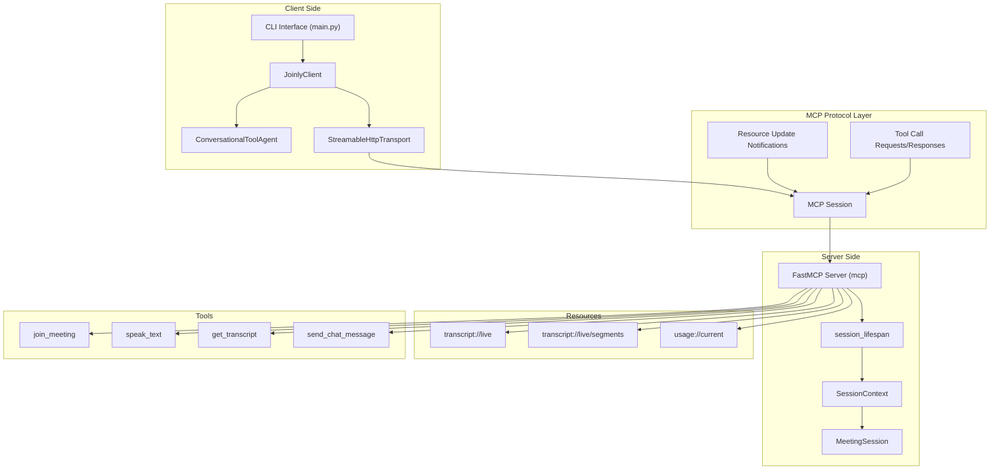
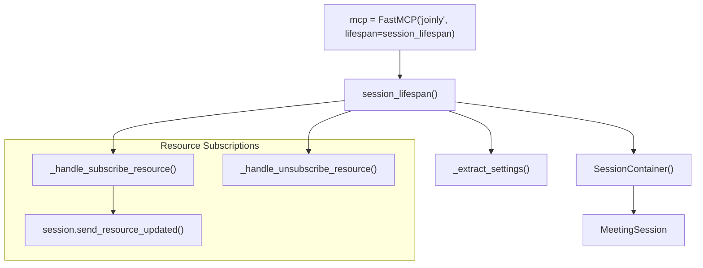
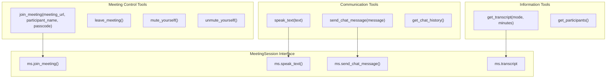
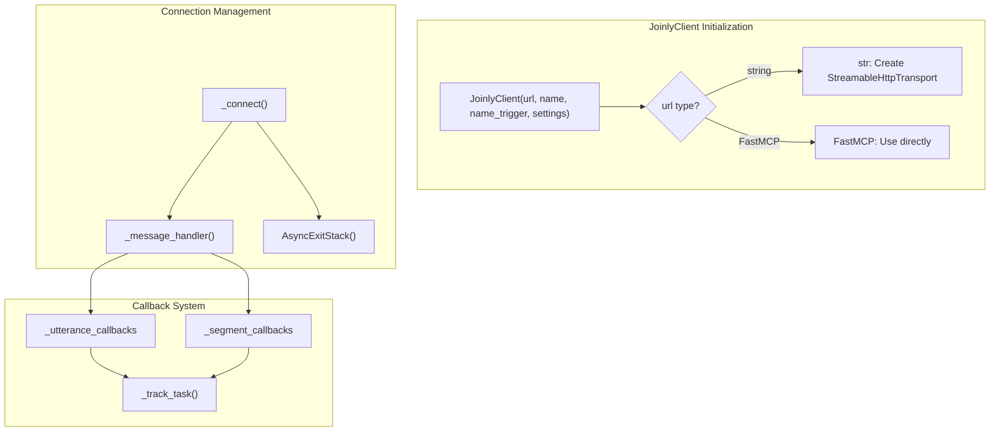
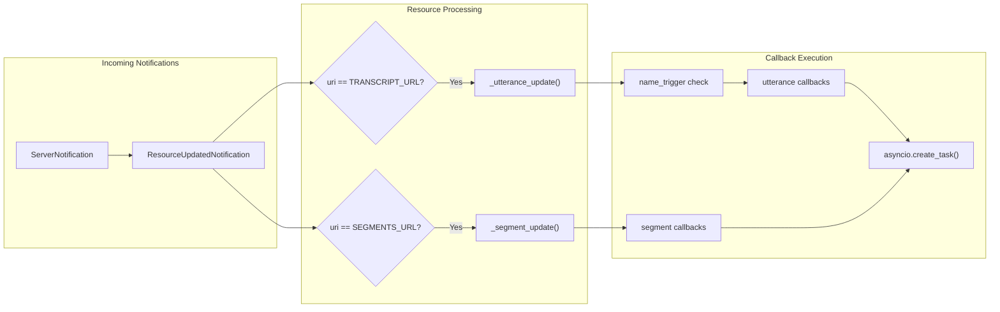
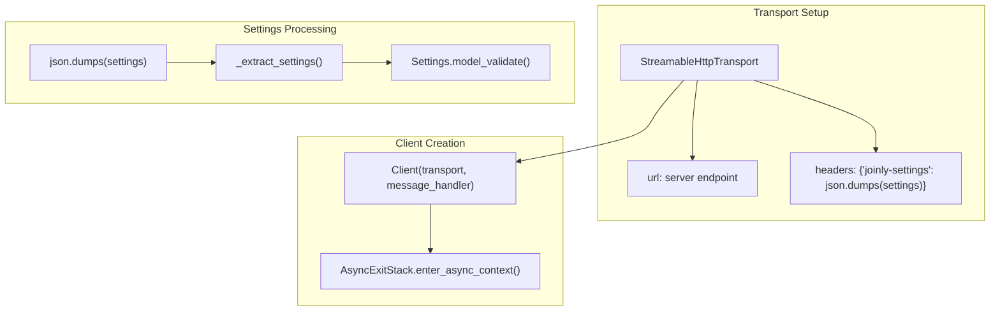
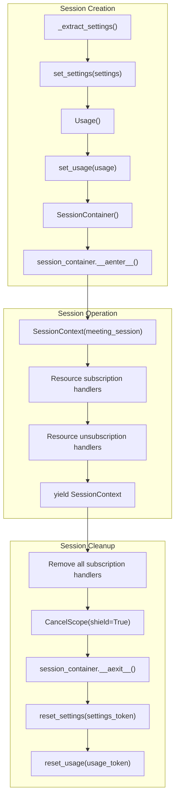

<!-- source: DeepWiki mcp.deepwiki.com · repo joinly-ai/joinly · page 3.1 MCP Server and Client Communication · fetched 2026-10-26 -->

# MCP Server and Client Communication

Relevant source files

The following files were used as context for generating this wiki page:

- [client/joinly_client/agent.py](client/joinly_client/agent.py)
- [client/joinly_client/client.py](client/joinly_client/client.py)
- [client/joinly_client/main.py](client/joinly_client/main.py)
- [client/joinly_client/prompts.py](client/joinly_client/prompts.py)
- [client/joinly_client/types.py](client/joinly_client/types.py)
- [client/joinly_client/utils.py](client/joinly_client/utils.py)
- [common/joinly_common/types.py](common/joinly_common/types.py)
- [joinly/server.py](joinly/server.py)
- [joinly/utils/events.py](joinly/utils/events.py)
- [joinly/utils/usage.py](joinly/utils/usage.py)

This document covers the Model Context Protocol (MCP) server and client communication architecture in joinly. It details how the FastMCP-based server exposes meeting functionality through resources and tools, and how clients connect and interact with these services.

For information about the broader system architecture, see [Architecture](#3). For details about session lifecycle and dependency injection patterns, see [Session Management and Dependency Injection](#3.2).

## Architecture Overview

The MCP communication layer forms the core interface between joinly clients and the meeting infrastructure. The server exposes meeting capabilities as MCP resources and tools, while clients connect via HTTP transport to access these services.

**Sources:** [joinly/server.py:1-322](), [client/joinly_client/client.py:1-319](), [client/joinly_client/main.py:1-344]()

## Server Implementation

The MCP server is implemented using the FastMCP framework and provides a session-based architecture for managing meeting connections.

### Core Server Setup

The server instance is created with a custom lifespan handler that manages session creation and cleanup:

**Sources:** [joinly/server.py:122](), [joinly/server.py:71-120](), [joinly/server.py:39-68]()

### Settings Injection

Client settings are extracted from HTTP headers and injected into the session context:

| Component | Purpose | Implementation |
|-----------|---------|----------------|
| `_extract_settings()` | Extract settings from `joinly-settings` header | [joinly/server.py:39-68]() |
| `set_settings()` | Apply settings to context variables | [joinly/server.py:76]() |
| `reset_settings()` | Cleanup settings on session end | [joinly/server.py:118]() |

**Sources:** [joinly/server.py:39-68](), [joinly/server.py:75-76](), [joinly/server.py:118]()

### Resource Providers

The server exposes three main resources for real-time meeting data access:

| Resource URI | Purpose | Response Type | Implementation |
|-------------|---------|---------------|----------------|
| `transcript://live` | Live participant utterances | `Transcript` | [joinly/server.py:125-133]() |
| `transcript://live/segments` | Raw transcript segments | `Transcript` | [joinly/server.py:136-144]() |
| `usage://current` | Service usage statistics | `Usage` | [joinly/server.py:147-154]() |

**Sources:** [joinly/server.py:125-154](), [joinly/server.py:28-29]()

### Tool Implementations

The server provides meeting control tools through the MCP tool interface:

**Sources:** [joinly/server.py:157-286]()

## Client Implementation

The client side is implemented through the `JoinlyClient` class, which handles MCP communication and resource subscriptions.

### Client Connection Architecture

**Sources:** [client/joinly_client/client.py:24-63](), [client/joinly_client/client.py:210-248]()

### Resource Subscription Model

The client implements a callback-based system for handling real-time transcript updates:

| Callback Type | Resource URI | Trigger Condition | Implementation |
|---------------|-------------|-------------------|----------------|
| Utterance callbacks | `transcript://live` | Complete utterances from participants | [client/joinly_client/client.py:79-120]() |
| Segment callbacks | `transcript://live/segments` | Raw transcript segments | [client/joinly_client/client.py:122-163]() |

**Sources:** [client/joinly_client/client.py:19-21](), [client/joinly_client/client.py:79-163]()

### Message Handling Pipeline

**Sources:** [client/joinly_client/client.py:216-223](), [client/joinly_client/client.py:262-292]()

## Communication Protocols

### Transport Layer Configuration

The client uses HTTP-based transport with custom header injection for settings:

**Sources:** [client/joinly_client/client.py:225-234](), [joinly/server.py:39-68]()

### Resource Update Flow

The server implements resource subscription handling through event-driven notifications:

| Step | Component | Action | Code Reference |
|------|-----------|--------|----------------|
| 1 | Client | Subscribe to resource | [client/joinly_client/client.py:100]() |
| 2 | Server | Register subscription handler | [joinly/server.py:84-97]() |
| 3 | Meeting | Trigger event (utterance/segment) | [joinly/server.py:97]() |
| 4 | Server | Send resource update notification | [joinly/server.py:95]() |
| 5 | Client | Receive and process notification | [client/joinly_client/client.py:216-223]() |
| 6 | Client | Execute registered callbacks | [client/joinly_client/client.py:276-278]() |

**Sources:** [joinly/server.py:84-105](), [client/joinly_client/client.py:216-223](), [client/joinly_client/client.py:262-292]()

## Session Management

### Session Lifecycle

The server manages session state through the `session_lifespan` async context manager:

**Sources:** [joinly/server.py:71-120]()

### Context Variable Management

The system uses context variables for managing per-session state:

| Context Variable | Purpose | Module | Implementation |
|------------------|---------|--------|----------------|
| Settings | Per-session configuration | `joinly.settings` | [joinly/server.py:76]() |
| Usage | Service usage tracking | `joinly.utils.usage` | [joinly/utils/usage.py:9]() |

**Sources:** [joinly/server.py:75-78](), [joinly/server.py:118-119](), [joinly/utils/usage.py:9-55]()

## Code Entity Mapping

This diagram maps the high-level MCP communication concepts to specific code entities in the codebase:

```mermaid
graph TB
    subgraph "Server Code Entities"
        ServerPy["joinly/server.py"]
        McpVar["mcp = FastMCP('joinly')"]
        SessionLifespanFunc["session_lifespan()"]
        SessionContextClass["SessionContext"]
        ExtractSettingsFunc["_extract_settings()"]
        
        subgraph "Resource Decorators"
            GetTranscriptResource["@mcp.resource('transcript://live')"]
            GetSegmentsResource["@mcp.resource('transcript://live/segments')"]
            GetUsageResource["@mcp.resource('usage://current')"]
        end
        
        subgraph "Tool Decorators"
            JoinMeetingTool["@mcp.tool('join_meeting')"]
            SpeakTextTool["@mcp.tool('speak_text')"]
            GetTranscriptTool["@mcp.tool('get_transcript')"]
        end
    end
    
    subgraph "Client Code Entities"
        ClientPy["client/joinly_client/client.py"]
        JoinlyClientClass["class JoinlyClient"]
        ConnectMethod["_connect()"]
        MessageHandlerFunc["_message_handler()"]
        UtteranceUpdateMethod["_utterance_update()"]
        SegmentUpdateMethod["_segment_update()"]
        
        subgraph "Transport Classes"
            StreamableHttpTransportClass["StreamableHttpTransport"]
            ClientClass["Client"]
        end
        
        subgraph "Callback Collections"
            UtteranceCallbacksVar["_utterance_callbacks"]
            SegmentCallbacksVar["_segment_callbacks"]
        end
    end
    
    subgraph "Agent Code Entities"
        AgentPy["client/joinly_client/agent.py"]
        ConversationalToolAgentClass["class ConversationalToolAgent"]
        OnUtteranceMethod["on_utterance()"]
        RunLoopMethod["_run_loop()"]
        CallLlmMethod["_call_llm()"]
        CallToolsMethod["_call_tools()"]
    end
    
    ServerPy --> McpVar
    McpVar --> SessionLifespanFunc
    SessionLifespanFunc --> SessionContextClass
    SessionLifespanFunc --> ExtractSettingsFunc
    
    ClientPy --> JoinlyClientClass
    JoinlyClientClass --> ConnectMethod
    ConnectMethod --> MessageHandlerFunc
    MessageHandlerFunc --> UtteranceUpdateMethod
    MessageHandlerFunc --> SegmentUpdateMethod
    
    AgentPy --> ConversationalToolAgentClass
    ConversationalToolAgentClass --> OnUtteranceMethod
    OnUtteranceMethod --> RunLoopMethod
```

**Sources:** [joinly/server.py:1-322](), [client/joinly_client/client.py:1-319](), [client/joinly_client/agent.py:1-242]()

---

