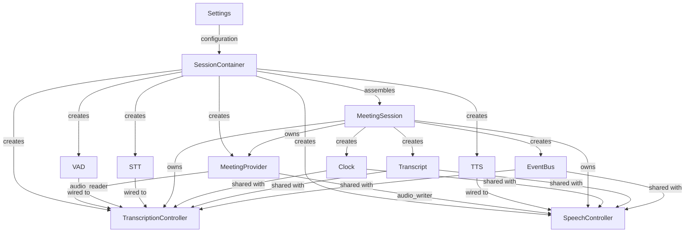
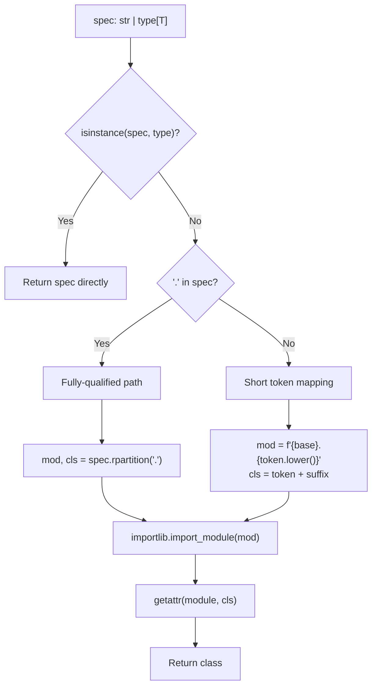
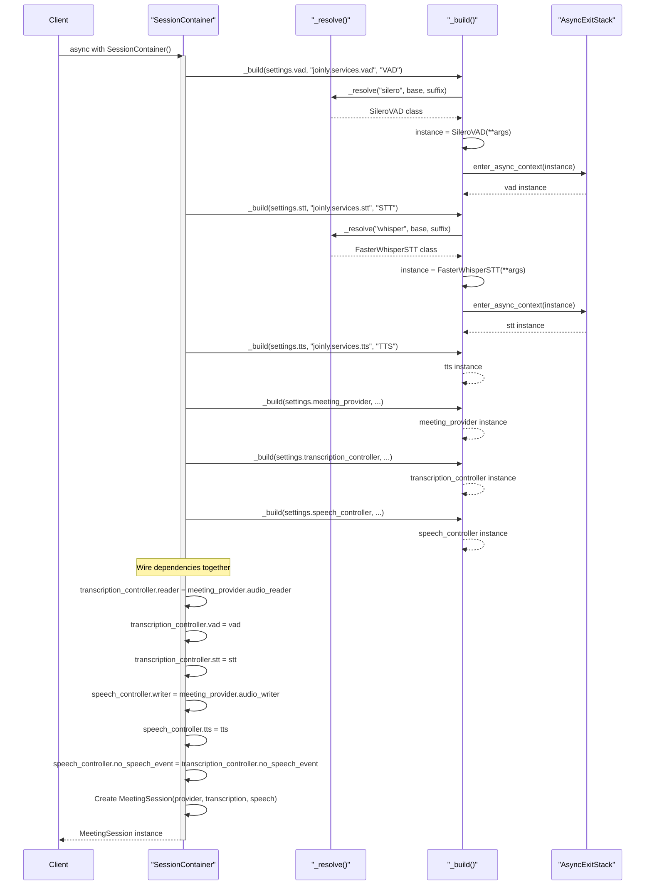
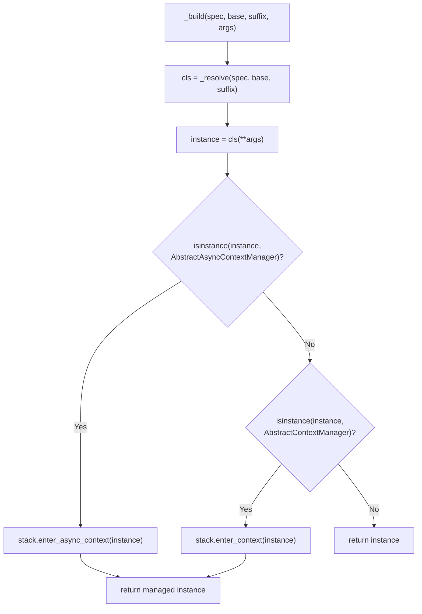
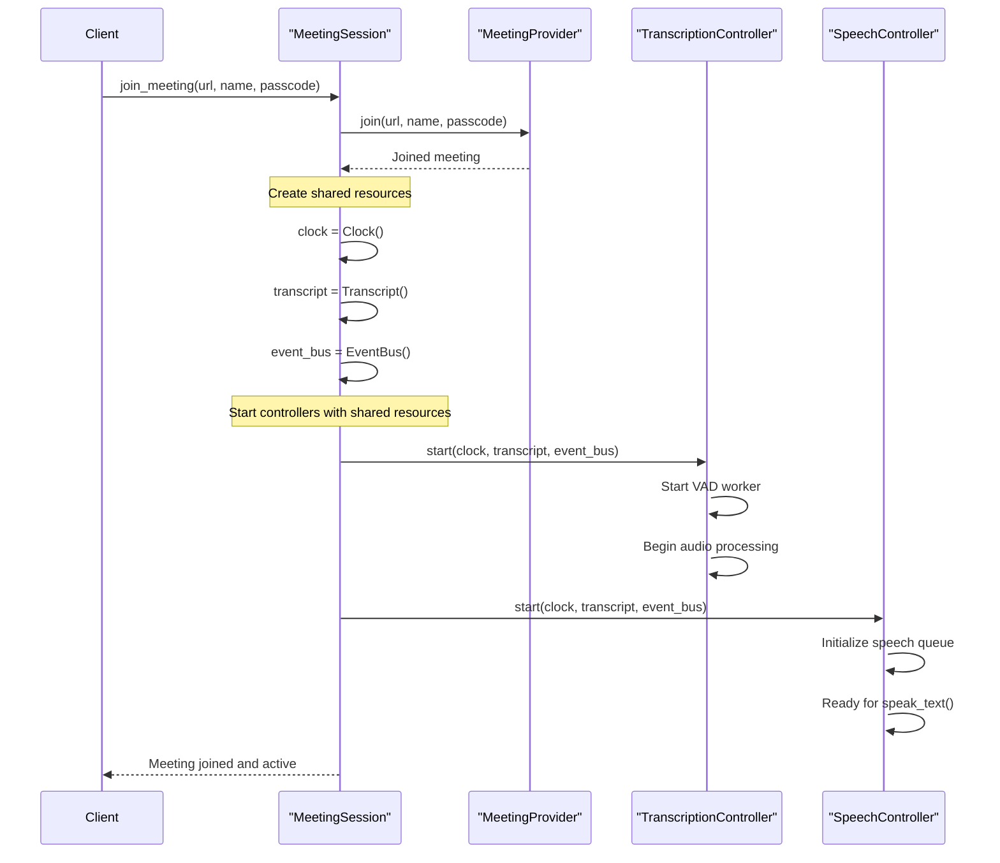
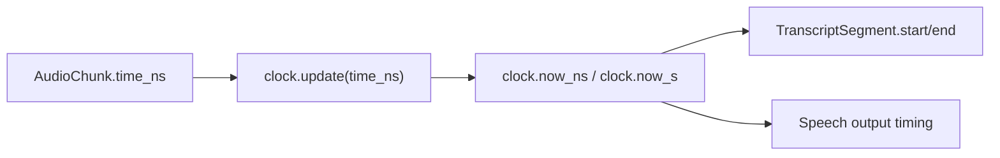
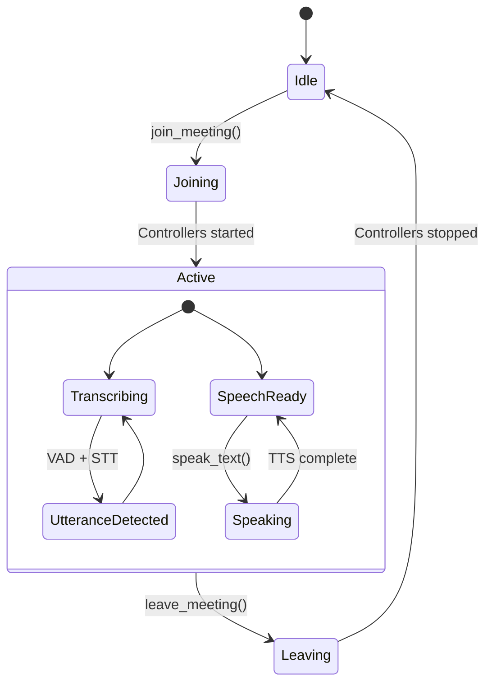
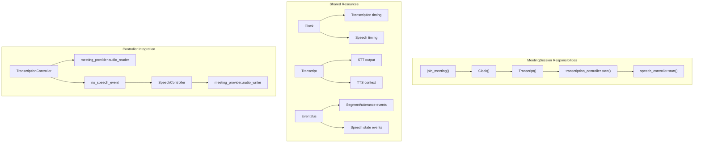

<!-- source: DeepWiki mcp.deepwiki.com · repo joinly-ai/joinly · page 3.2 Session Management and Dependency Injection · fetched 2026-10-26 -->

# Session Management and Dependency Injection

<details>
<summary>Relevant source files</summary>

The following files were used as context for generating this wiki page:

- [joinly/container.py](joinly/container.py)
- [joinly/controllers/transcription/default.py](joinly/controllers/transcription/default.py)
- [joinly/core.py](joinly/core.py)
- [joinly/providers/browser/meeting_provider.py](joinly/providers/browser/meeting_provider.py)
- [joinly/session.py](joinly/session.py)
- [joinly/utils/clock.py](joinly/utils/clock.py)

</details>


This document details how `MeetingSession` orchestrates meeting operations and how `SessionContainer` dynamically wires dependencies based on configuration. The dependency injection system resolves service implementations from configuration strings, manages async lifecycles, and wires components together through protocol-based interfaces.

For information about the MCP server interface that uses these components, see page 3.1. For details about individual service implementations (VAD, STT, TTS), see page 5.3.

## Dependency Injection Overview

The dependency injection system has two primary components:

1. **`SessionContainer`** - Resolves and instantiates service implementations from configuration strings, wires dependencies between components, and manages async context lifecycles.

2. **`MeetingSession`** - Orchestrates meeting operations by coordinating the meeting provider, transcription controller, and speech controller through shared resources (`Clock`, `Transcript`, `EventBus`).

### High-Level Component Relationships



Sources: [joinly/container.py:59-178](), [joinly/session.py:23-172]()

## Service Resolution: The `_resolve()` Function

The `_resolve()` function is the core of the dependency injection system, converting configuration strings into class objects. It supports three resolution modes:

| Resolution Mode | Example Input | Resolution Path |
|----------------|---------------|-----------------|
| Direct type | `FasterWhisperSTT` (class) | Return as-is |
| Fully-qualified path | `"joinly.services.stt.whisper.FasterWhisperSTT"` | Import module, get class |
| Short token | `"whisper"` | Map to `joinly.services.stt.whisper.WhisperSTT` |

### `_resolve()` Token Mapping Algorithm



**Example resolution for `stt="whisper"`:**

1. Base: `"joinly.services.stt"`
2. Suffix: `"STT"`
3. Module path: `"joinly.services.stt.whisper"`
4. Class name: `"WhisperSTT"`
5. Result: `joinly.services.stt.whisper.WhisperSTT` class

Sources: [joinly/container.py:16-56]()

## `SessionContainer`: Dependency Injection Implementation

The `SessionContainer.__aenter__()` method orchestrates the complete dependency injection process: resolving service classes, instantiating them with configuration, managing async contexts, and wiring components together.

### `SessionContainer.__aenter__()` Execution Flow



Sources: [joinly/container.py:67-161]()

### Dependency Wiring Code

The container explicitly wires dependencies after instantiation:

```
Line 143: transcription_controller.reader = meeting_provider.audio_reader
Line 144: transcription_controller.vad = vad
Line 145: transcription_controller.stt = stt

Line 147: speech_controller.writer = meeting_provider.audio_writer
Line 148: speech_controller.tts = tts
Line 149: speech_controller.no_speech_event = transcription_controller.no_speech_event
```

These assignments satisfy the protocol requirements defined in [joinly/core.py:239-321]().

| Protocol | Required Attributes | Wired From |
|----------|-------------------|------------|
| `TranscriptionController` | `reader`, `vad`, `stt` | `meeting_provider.audio_reader`, VAD service, STT service |
| `SpeechController` | `writer`, `tts`, `no_speech_event` | `meeting_provider.audio_writer`, TTS service, `transcription_controller.no_speech_event` |

Sources: [joinly/container.py:143-149](), [joinly/core.py:239-321]()

### Async Context Management with `AsyncExitStack`

The container uses `AsyncExitStack` to manage async context managers. The `_build()` method automatically enters contexts for services that implement `AbstractAsyncContextManager`:



When `__aexit__()` is called, the stack automatically cleans up all managed contexts in reverse order.

Sources: [joinly/container.py:167-177]()

### Configuration-to-Service Mapping

| Setting Key | Base Path | Suffix | Example Resolution |
|------------|-----------|--------|-------------------|
| `settings.vad` | `joinly.services.vad` | `VAD` | `"silero"` → `SileroVAD` |
| `settings.stt` | `joinly.services.stt` | `STT` | `"whisper"` → `FasterWhisperSTT` |
| `settings.tts` | `joinly.services.tts` | `TTS` | `"kokoro"` → `KokoroTTS` |
| `settings.meeting_provider` | `joinly.providers` | `MeetingProvider` | `"browser"` → `BrowserMeetingProvider` |
| `settings.transcription_controller` | `joinly.controllers.transcription` | `TranscriptionController` | `"default"` → `DefaultTranscriptionController` |
| `settings.speech_controller` | `joinly.controllers.speech` | `SpeechController` | `"default"` → `DefaultSpeechController` |

Sources: [joinly/container.py:70-141]()

## `MeetingSession`: Component Orchestration

The `MeetingSession` class coordinates meeting operations by managing the meeting provider, transcription controller, and speech controller. It creates and shares common resources (`Clock`, `Transcript`, `EventBus`) between controllers.

### `MeetingSession.join_meeting()` Initialization



Sources: [joinly/session.py:81-117]()

### Shared Resource Architecture

The three shared resources enable coordination between controllers:

| Resource | Purpose | Usage by TranscriptionController | Usage by SpeechController |
|----------|---------|--------------------------------|-------------------------|
| `Clock` | Synchronized timing | Updates clock from audio timestamps | Timestamps speech output |
| `Transcript` | Conversation history | Adds `TranscriptSegment` from STT | Adds own speech segments |
| `EventBus` | Event notifications | Publishes `"segment"` and `"utterance"` events | Subscribes to events for coordination |

**`Clock` synchronization:**

The `Clock` provides a unified timeline anchored to audio timestamps:



**`Transcript` shared state:**

Both controllers write to the same `Transcript` instance:

```
DefaultTranscriptionController.add_segment()  →  transcript.add_segment(segment)
DefaultSpeechController.speak_text()          →  transcript.add_segment(segment)
```

This provides a complete conversation history accessible via `MeetingSession.transcript`.

**`EventBus` pub/sub:**

Controllers use the event bus for loose coupling:

```
TranscriptionController  →  event_bus.publish("segment")
TranscriptionController  →  event_bus.publish("utterance")

MeetingSession           →  event_bus.subscribe("segment", handler)
```

Sources: [joinly/session.py:47-49, 81-117](), [joinly/controllers/transcription/default.py:70-88](), [joinly/utils/clock.py:1-36]()

## MeetingSession Orchestration

The `MeetingSession` class orchestrates meeting operations by coordinating the meeting provider, transcription controller, and speech controller. It manages the session state and provides a unified interface for meeting actions.

### Session State Management



### Component Coordination



The session provides a clean API that abstracts the complexity of coordinating multiple audio processing pipelines and ensures proper resource sharing between components.

Sources: [joinly/session.py:16-143](), [joinly/server.py:122](), [joinly/core.py:214-297]()

## Service Configuration Examples

The container supports various service configurations through the settings system:

| Service Type | Setting Key | Example Values |
|--------------|-------------|----------------|
| VAD | `vad` | `"silero"`, `"webrtc"` |
| STT | `stt` | `"whisper"`, `"deepgram"` |
| TTS | `tts` | `"kokoro"`, `"deepgram"` |
| Meeting Provider | `meeting_provider` | `"browser"` |
| Controllers | `transcription_controller`, `speech_controller` | `"default"` |

Each service type has corresponding `*_args` settings for passing constructor arguments to the resolved classes.

Sources: [joinly/container.py:70-93](), [joinly/settings.py]()

---

