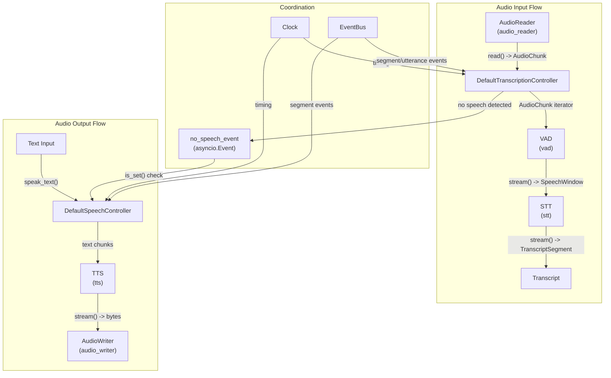
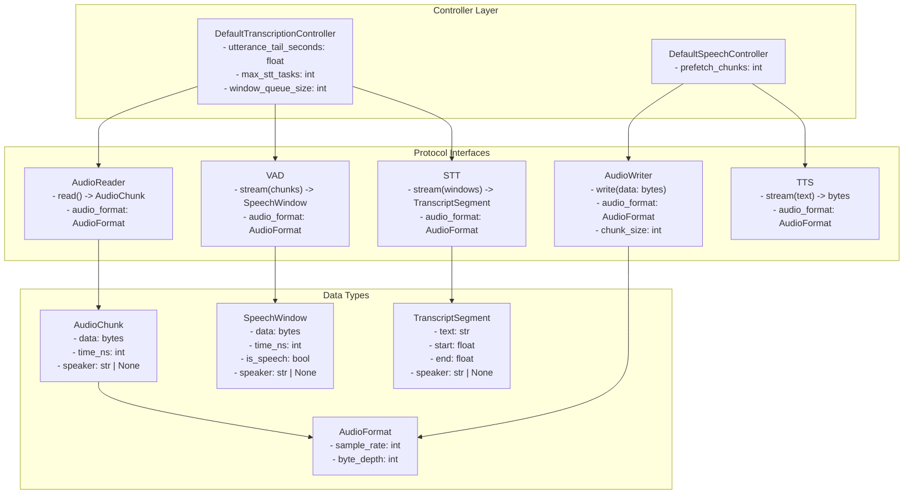
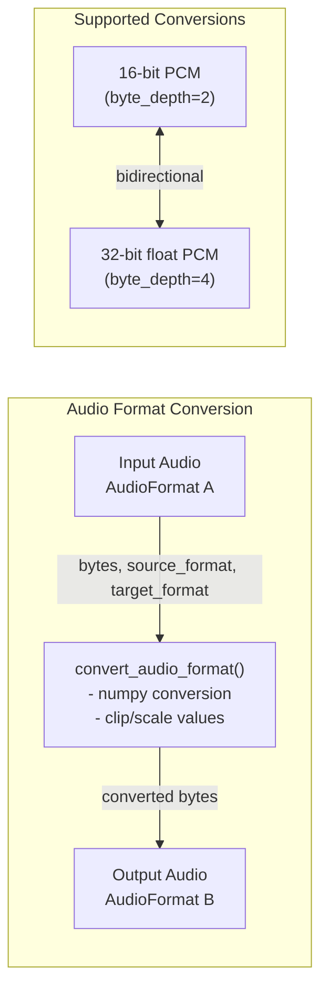
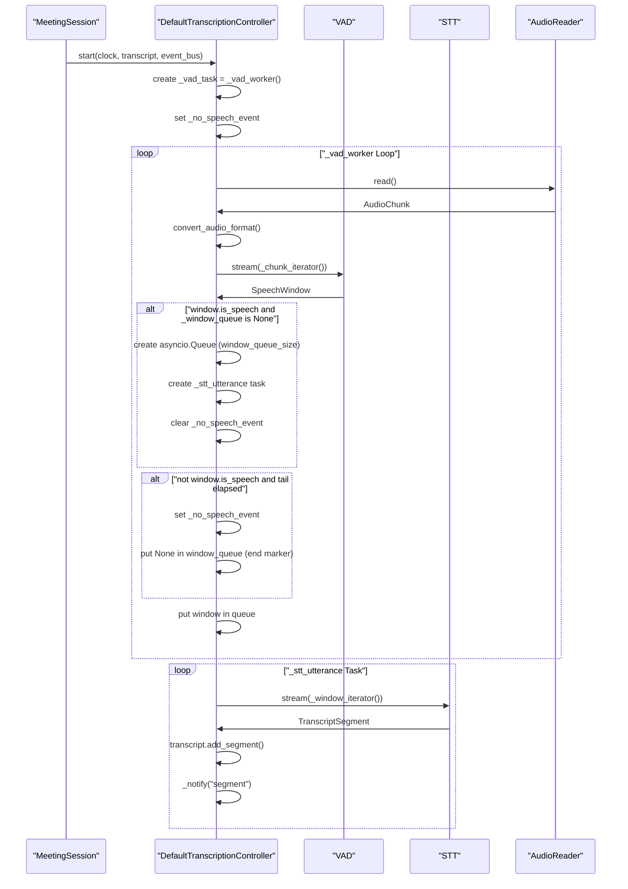
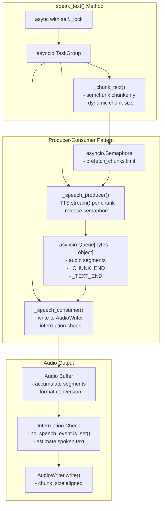
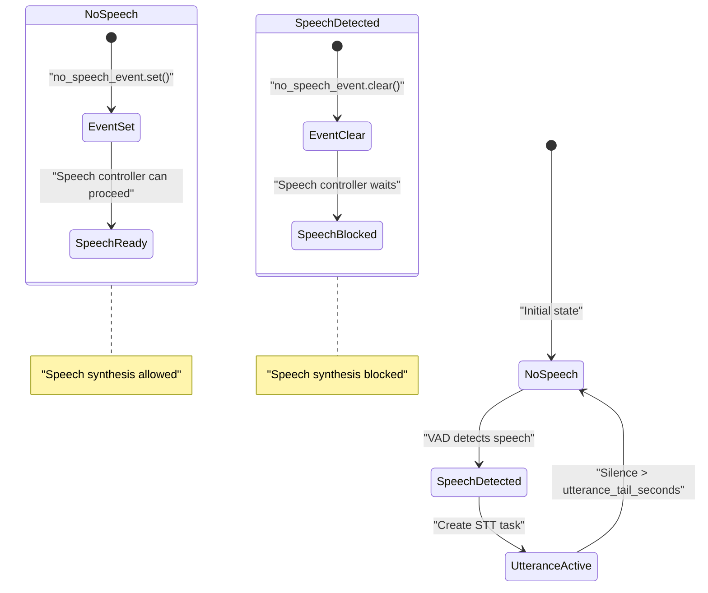

<!-- source: DeepWiki mcp.deepwiki.com · repo joinly-ai/joinly · page 5 Audio Processing Pipeline · fetched 2026-10-26 -->

# Audio Processing Pipeline

Relevant source files

The following files were used as context for generating this wiki page:

- [joinly/controllers/speech/default.py](joinly/controllers/speech/default.py)
- [joinly/controllers/transcription/default.py](joinly/controllers/transcription/default.py)
- [joinly/core.py](joinly/core.py)
- [joinly/services/stt/deepgram.py](joinly/services/stt/deepgram.py)
- [joinly/services/stt/whisper.py](joinly/services/stt/whisper.py)
- [joinly/services/tts/deepgram.py](joinly/services/tts/deepgram.py)
- [joinly/services/tts/elevenlabs.py](joinly/services/tts/elevenlabs.py)
- [joinly/session.py](joinly/session.py)
- [joinly/types.py](joinly/types.py)
- [joinly/utils/clock.py](joinly/utils/clock.py)

The Audio Processing Pipeline is joinly's real-time audio processing system that handles bidirectional audio flow during meeting participation. It manages the complete lifecycle of audio data from meeting capture through transcription to synthetic speech output, coordinating Voice Activity Detection (VAD), Speech-to-Text (STT), and Text-to-Speech (TTS) services.

For detailed implementation of individual audio processing components, see [Transcription Controller](#5.1), [Speech Controller](#5.2), and [Service Providers](#5.3). For browser-based audio device management, see [Browser Meeting Provider](#4.3).

## Architecture Overview

The audio processing pipeline operates as a bidirectional system with separate input and output flows, coordinated by controller components that manage turn-taking and interruption handling.

### Audio Processing Flow

Sources: [joinly/controllers/transcription/default.py:17-265](), [joinly/controllers/speech/default.py:26-279](), [joinly/core.py:18-297]()

### Component Integration

Sources: [joinly/controllers/transcription/default.py:24-44](), [joinly/controllers/speech/default.py:33-44](), [joinly/core.py:18-297](), [joinly/types.py:44-87]()

## Audio Format Management

The pipeline handles audio format conversion transparently between components that may operate with different sample rates and bit depths. All audio processing uses PCM format with configurable parameters.

### AudioFormat Type

The `AudioFormat` dataclass standardizes audio properties across the pipeline:

| Property | Type | Description |
|----------|------|-------------|
| `sample_rate` | `int` | Sample rate in Hz (commonly 16000) |
| `byte_depth` | `int` | Bytes per sample (2 for int16, 4 for float32) |

### Format Conversion

Audio format conversion occurs automatically at component boundaries using the utilities in [joinly/utils/audio.py:9-57](). The system supports conversion between 16-bit integer and 32-bit float PCM formats while maintaining the same sample rate.

Sources: [joinly/utils/audio.py:9-71](), [joinly/types.py:19-30]()

## Transcription Flow

The transcription flow processes incoming meeting audio through VAD and STT services, coordinated by the `DefaultTranscriptionController`.

### Transcription Controller Lifecycle

Sources: [joinly/controllers/transcription/default.py:66-265]()

### Speech Window Processing

The transcription controller manages speech detection using configurable timing parameters:

| Parameter | Default | Description |
|-----------|---------|-------------|
| `utterance_tail_seconds` | 0.6 | Silence duration before ending utterance |
| `max_stt_tasks` | 5 | Maximum concurrent STT operations |
| `window_queue_size` | 100 | Buffer size for speech windows |

Sources: [joinly/controllers/transcription/default.py:22-48]()

## Speech Synthesis Flow

The speech synthesis flow converts text to audio output through TTS services, managed by the `DefaultSpeechController` using a producer-consumer pattern with interruption handling.

### Speech Controller Architecture

Sources: [joinly/controllers/speech/default.py:93-279]()

### Interruption Handling

The speech controller implements interruption logic during audio output to handle natural conversation flow:

| Feature | Implementation |
|---------|----------------|
| **Speech Detection** | Checks `no_speech_event.is_set()` during audio writing |
| **Interrupt Timing** | Checks between `chunk_size` audio writes |
| **Interrupt Behavior** | Raises `SpeechInterruptedError` when speech detected |
| **Recovery** | Estimates spoken text using duration and words-per-second |
| **Transcript Update** | Adds partial segment with "..." suffix on interruption |

Sources: [joinly/controllers/speech/default.py:230-253](), [joinly/controllers/speech/default.py:261-278]()

## Turn-Taking Coordination

The pipeline coordinates turn-taking between transcription and speech synthesis using the `no_speech_event` mechanism.

### Event Coordination Flow

Sources: [joinly/controllers/transcription/default.py:47-57](), [joinly/controllers/transcription/default.py:134-156](), [joinly/controllers/speech/default.py:252-253]()

## Error Handling and Resource Management

The audio processing pipeline implements comprehensive error handling and resource cleanup through async context managers.

### Resource Lifecycle Management

Both controllers implement proper async context management:

- **Transcription Controller**: Manages VAD worker task, STT task pool, and event state
- **Speech Controller**: Manages worker task, job queue, and TTS resources
- **Audio Devices**: Virtual speaker/microphone lifecycle tied to browser session

### Exception Types

| Exception | Usage |
|-----------|-------|
| `SpeechInterruptedError` | Raised when speech is interrupted by detected speech |
| `IncompatibleAudioFormatError` | Raised for unsupported audio format conversions |
| `RuntimeError` | General pipeline state errors (already started, not initialized) |

Sources: [joinly/types.py:11-17](), [joinly/controllers/speech/default.py:286-293]()

## Performance Characteristics

The audio processing pipeline is designed for real-time operation with configurable performance parameters:

### Latency Management

- **STT Latency**: Tracked and logged with warnings for >1 second delays
- **TTS Streaming**: Chunked text processing to reduce initial latency  
- **Buffer Management**: Queue size limits prevent memory exhaustion
- **Concurrent Processing**: Multiple STT tasks can run simultaneously

### Memory Management

- **Frame Dropping**: Graceful degradation when queues are full
- **Buffer Cleanup**: Proper cleanup of audio buffers and tasks
- **Resource Limits**: Bounded queues and semaphores prevent resource exhaustion

Sources: [joinly/controllers/transcription/default.py:174-183](), [joinly/controllers/transcription/default.py:216-220](), [joinly/controllers/speech/default.py:220-227]()

---

