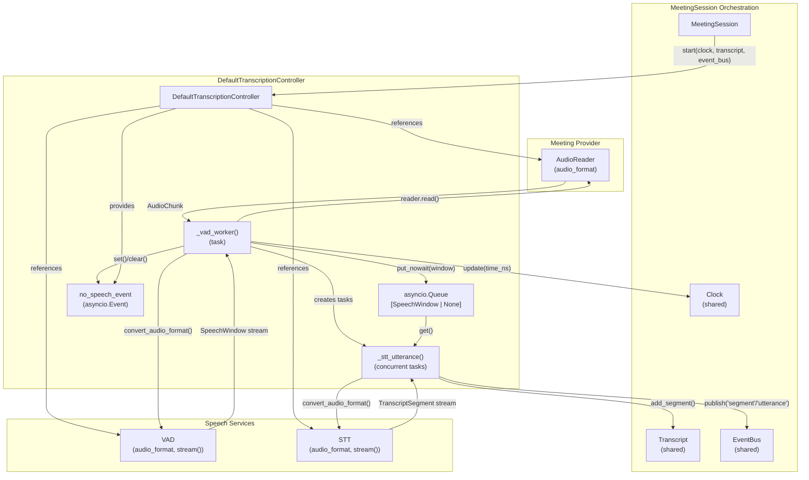
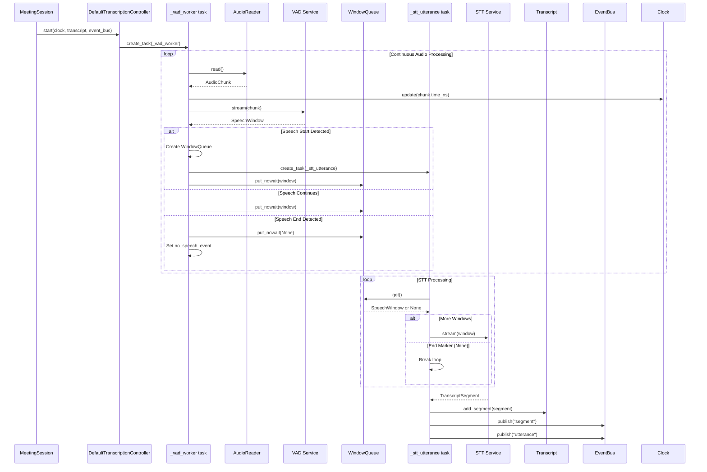
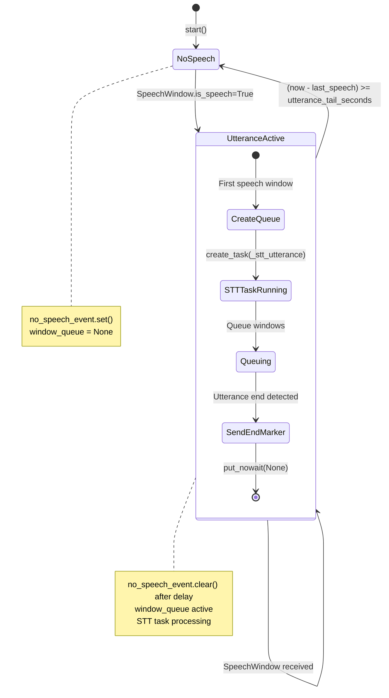
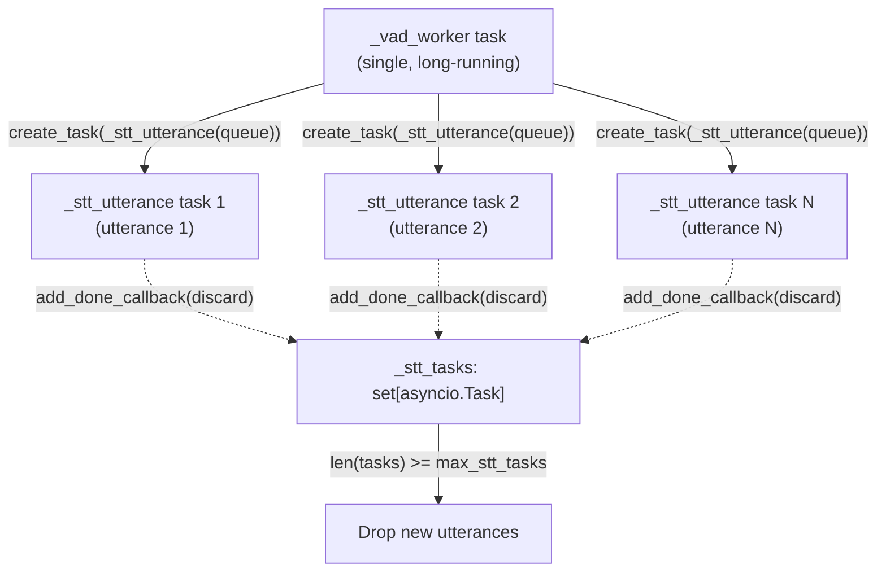

<!-- source: DeepWiki mcp.deepwiki.com · repo joinly-ai/joinly · page 5.1 Transcription Controller · fetched 2026-10-26 -->

# Transcription Controller

<details>
<summary>Relevant source files</summary>

The following files were used as context for generating this wiki page:

- [joinly/controllers/transcription/default.py](joinly/controllers/transcription/default.py)
- [joinly/core.py](joinly/core.py)
- [joinly/session.py](joinly/session.py)
- [joinly/utils/clock.py](joinly/utils/clock.py)

</details>


## Purpose and Scope

The Transcription Controller manages the audio-to-text pipeline in the joinly system. It coordinates Voice Activity Detection (VAD) and Speech-to-Text (STT) services to convert meeting audio into structured transcript segments. This document covers the `DefaultTranscriptionController` implementation, its integration with VAD and STT services, and utterance boundary detection.

For information about speech synthesis (text-to-audio), see [Speech Controller](#5.2). For available VAD/STT service implementations, see [Service Providers (VAD, STT, TTS)](#5.3).

## Overview

The `TranscriptionController` protocol defines the interface for managing transcription processes. The `DefaultTranscriptionController` is the primary implementation, providing a complete pipeline from raw audio to structured transcript segments.

**Key Responsibilities:**
- Read audio chunks from an `AudioReader` (meeting provider)
- Detect speech boundaries using a `VAD` service
- Transcribe detected speech using an `STT` service
- Write `TranscriptSegment` objects to the shared `Transcript` store
- Publish events to the `EventBus` for segment and utterance notifications
- Maintain the meeting `Clock` based on audio timestamps
- Signal speech/no-speech state via `no_speech_event`

Sources: [joinly/controllers/transcription/default.py:17-56](), [joinly/core.py:239-277]()

## Architecture and Data Flow

### Component Interaction Diagram



Sources: [joinly/controllers/transcription/default.py:62-109](), [joinly/session.py:112-117]()

### Pipeline Sequence Diagram



Sources: [joinly/controllers/transcription/default.py:122-277]()

## DefaultTranscriptionController Implementation

### Configuration Parameters

The `DefaultTranscriptionController.__init__()` accepts the following tuning parameters:

| Parameter | Type | Default | Description |
|-----------|------|---------|-------------|
| `utterance_tail_seconds` | float | 0.6 | Duration to wait after last detected speech before considering utterance complete |
| `no_speech_event_delay` | float | 0.4 | Duration before clearing `no_speech_event` when speech is detected |
| `max_stt_tasks` | int | 5 | Maximum number of concurrent STT transcription tasks |
| `window_queue_size` | int | 100 | Maximum size of the window queue for each utterance |

Sources: [joinly/controllers/transcription/default.py:24-48]()

### Protocol Requirements

The controller requires three protocol-compliant components to be set as attributes:

- **`reader: AudioReader`** - Provides audio chunks from the meeting
- **`vad: VAD`** - Detects speech in audio chunks
- **`stt: STT`** - Transcribes speech windows into text

These are typically wired by the `SessionContainer` during dependency injection.

Sources: [joinly/controllers/transcription/default.py:20-22](), [joinly/core.py:239-252]()

### Lifecycle Management

The controller implements async context manager protocol and provides explicit lifecycle methods:

```python
# Context manager usage
async with controller:
    # Controller is active
    pass

# Explicit lifecycle
await controller.start(clock, transcript, event_bus)
# ... transcription is active ...
await controller.stop()
```

**`start(clock, transcript, event_bus)`** [joinly/controllers/transcription/default.py:70-88]():
- Validates the controller is not already started
- Stores references to shared `Clock`, `Transcript`, and `EventBus`
- Sets `no_speech_event` to indicate no speech initially
- Creates the `_vad_worker` task to begin audio processing

**`stop()`** [joinly/controllers/transcription/default.py:90-109]():
- Cancels the `_vad_worker` task
- Clears `no_speech_event`
- Cancels all active `_stt_utterance` tasks
- Clears internal state references

Sources: [joinly/controllers/transcription/default.py:62-109]()

## VAD Worker Pipeline

The `_vad_worker()` method [joinly/controllers/transcription/default.py:122-211]() is the core audio processing loop. It runs continuously as an asyncio task from `start()` until `stop()`.

### VAD Worker State Diagram



Sources: [joinly/controllers/transcription/default.py:122-211]()

### Audio Chunk Processing

**Chunk Iterator** [joinly/controllers/transcription/default.py:129-145]():
1. Reads `AudioChunk` from `self.reader.read()`
2. Calculates offset on first chunk to normalize timestamps to start at 0
3. Updates the shared `Clock` with normalized timestamp
4. Converts audio format from reader format to VAD format using `convert_audio_format()`
5. Yields normalized chunk to VAD

**VAD Streaming** [joinly/controllers/transcription/default.py:147-148]():
- Calls `self.vad.stream(_chunk_iterator())`
- Receives `SpeechWindow` objects with `is_speech` boolean flag

Sources: [joinly/controllers/transcription/default.py:129-148]()

### Utterance Boundary Detection

The worker maintains state variables:
- `last_speech: int | None` - Timestamp (ns) of last detected speech
- `utterance_start: int | None` - Timestamp (ns) when current utterance started
- `dropped_windows: int` - Counter for dropped windows due to full queue

**Utterance Start** [joinly/controllers/transcription/default.py:149-168]():
- Triggered when `window.is_speech` and `window_queue is None`
- Logs utterance start time
- Checks if `len(self._stt_tasks) >= self.max_stt_tasks`, drops window if limit reached
- Creates new `asyncio.Queue` with `maxsize=self.window_queue_size`
- Creates new `_stt_utterance` task and adds to `_stt_tasks` set

**Utterance End** [joinly/controllers/transcription/default.py:170-190]():
- Triggered when `not window.is_speech` and enough time has passed since `last_speech`
- Condition: `(window.time_ns - last_speech) / 1e9 >= self.utterance_tail_seconds`
- Logs utterance end time
- Sets `no_speech_event` to signal no active speech
- Sends `None` to queue as end marker (handles `QueueFull` by dropping middle frame)
- Sets `window_queue = None`

**Window Queueing** [joinly/controllers/transcription/default.py:192-211]():
- When in utterance (`window_queue is not None`), queues windows
- Clears `no_speech_event` after `no_speech_event_delay` seconds of speech
- Uses `put_nowait()` and handles `QueueFull` by incrementing `dropped_windows` counter
- Logs warning if windows are dropped

Sources: [joinly/controllers/transcription/default.py:149-211]()

## STT Utterance Processing

The `_stt_utterance()` method [joinly/controllers/transcription/default.py:213-277]() processes a single utterance (one queue of speech windows) through the STT service.

### Window Iterator

**`_window_iterator()` inner function** [joinly/controllers/transcription/default.py:222-242]():
- Reads `SpeechWindow` objects from the queue until `None` is received
- Tracks `start` time (first window timestamp in seconds)
- Tracks `end` time (last window timestamp + audio duration)
- Records `end_ts` (monotonic time when end marker received) for latency calculation
- Converts audio format from VAD format to STT format
- Yields converted `SpeechWindow` objects to STT service

Sources: [joinly/controllers/transcription/default.py:222-242]()

### STT Streaming and Segment Creation

**Processing Loop** [joinly/controllers/transcription/default.py:244-267]():
1. Calls `self.stt.stream(_window_iterator())` to get segment stream
2. For each `TranscriptSegment` from STT:
   - Clamps segment times to utterance boundaries (`[start, end]`)
   - Creates `TranscriptSegment` with text, timing, and speaker info
   - Adds segment to shared `Transcript` via `self._transcript.add_segment()`
   - Publishes `"segment"` event to `EventBus`
   - Logs segment details (speaker, text, timing)
3. Increments `seg_count` for each segment

**Error Handling** [joinly/controllers/transcription/default.py:268-270]():
- Catches and logs any exceptions during STT processing
- Re-raises exception after logging

Sources: [joinly/controllers/transcription/default.py:244-270]()

### Latency Tracking

**Utterance Completion** [joinly/controllers/transcription/default.py:272-277]():
- If segments were produced (`seg_count > 0`):
  - Calculates latency from `end_ts` to completion as `time.monotonic() - end_ts`
  - Logs at WARNING level if latency > 0.3s, DEBUG otherwise
  - Publishes `"utterance"` event to `EventBus`

This latency measure captures the time from utterance end detection to final STT segment production.

Sources: [joinly/controllers/transcription/default.py:272-277]()

## Concurrency and Task Management

### Task Lifecycle



Sources: [joinly/controllers/transcription/default.py:49-51](), [joinly/controllers/transcription/default.py:166-168]()

### Concurrent STT Processing

- **Single VAD Task**: One `_vad_worker` task processes audio and detects utterances
- **Multiple STT Tasks**: Up to `max_stt_tasks` concurrent `_stt_utterance` tasks
- Each STT task processes one utterance independently via its own queue
- Tasks self-remove from `_stt_tasks` set via `add_done_callback()`
- If limit reached, new utterances are dropped with a warning log

This design allows overlapping utterances (e.g., multiple speakers) to be transcribed in parallel.

Sources: [joinly/controllers/transcription/default.py:156-168]()

### Queue Management

- **Per-Utterance Queue**: Each active utterance has its own `asyncio.Queue[SpeechWindow | None]`
- **Queue Size Limit**: `maxsize=self.window_queue_size` (default 100)
- **Overflow Handling**: Uses `put_nowait()`, counts dropped windows on `QueueFull`
- **End Marker**: `None` is sent to signal utterance end; receiver breaks iteration loop

Sources: [joinly/controllers/transcription/default.py:163-165](), [joinly/controllers/transcription/default.py:192-211]()

## Audio Format Conversion

The controller handles audio format mismatches between components using `convert_audio_format()` utility.

### Conversion Points

| From | To | Location |
|------|----|----|
| `reader.audio_format` | `vad.audio_format` | [joinly/controllers/transcription/default.py:140-142]() |
| `vad.audio_format` | `stt.audio_format` | [joinly/controllers/transcription/default.py:236-238]() |

The `convert_audio_format()` function [joinly/utils/audio.py]() handles sample rate, channel, and sample width conversions automatically.

Sources: [joinly/controllers/transcription/default.py:140-142](), [joinly/controllers/transcription/default.py:236-238]()

## Event System Integration

The controller publishes events to the `EventBus` for downstream consumers (e.g., MCP server, clients).

### Event Types

| Event Type | Trigger | Published At |
|------------|---------|--------------|
| `"segment"` | Each `TranscriptSegment` added | [joinly/controllers/transcription/default.py:259]() |
| `"utterance"` | Utterance fully transcribed | [joinly/controllers/transcription/default.py:277]() |

The `_notify()` helper [joinly/controllers/transcription/default.py:111-120]() publishes events via `self._event_bus.publish()`.

Sources: [joinly/controllers/transcription/default.py:111-120](), [joinly/controllers/transcription/default.py:259](), [joinly/controllers/transcription/default.py:277]()

### No Speech Event

The `no_speech_event: asyncio.Event` property signals speech activity state to other components:

- **Set (no speech)**: 
  - Initially in `start()` [joinly/controllers/transcription/default.py:84]()
  - When utterance ends [joinly/controllers/transcription/default.py:177]()
- **Cleared (speech detected)**:
  - After `no_speech_event_delay` seconds of speech [joinly/controllers/transcription/default.py:200]()

The `SpeechController` uses this event to coordinate interruption handling (see [Speech Controller](#5.2)).

Sources: [joinly/controllers/transcription/default.py:52](), [joinly/controllers/transcription/default.py:58-60](), [joinly/controllers/transcription/default.py:194-200]()

## Clock Synchronization

The controller updates the shared `Clock` object as audio chunks arrive, synchronizing all components to meeting time.

**Update Location** [joinly/controllers/transcription/default.py:137-138]():
```python
if self._clock is not None:
    self._clock.update(chunk.time_ns - offset)
```

The `offset` is calculated from the first chunk to normalize timestamps to start at 0. This ensures the meeting clock begins at `0.0` seconds regardless of the audio reader's initial timestamp.

Sources: [joinly/controllers/transcription/default.py:131-145](), [joinly/utils/clock.py:1-36]()

## Integration with MeetingSession

The `MeetingSession` orchestrates the controller lifecycle:

**Startup** [joinly/session.py:112-117]():
```python
await self._transcription_controller.start(
    self._clock, self._transcript, self._event_bus
)
```

**Shutdown** [joinly/session.py:122]():
```python
await self._transcription_controller.stop()
```

The session provides shared resources (`Clock`, `Transcript`, `EventBus`) that the controller uses to coordinate with other components.

Sources: [joinly/session.py:81-117](), [joinly/session.py:119-123]()

---

