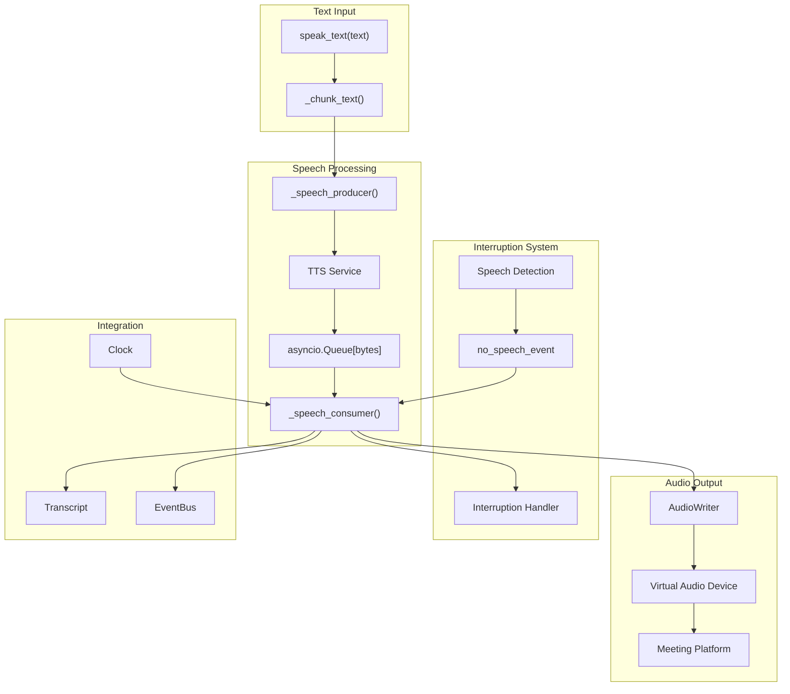
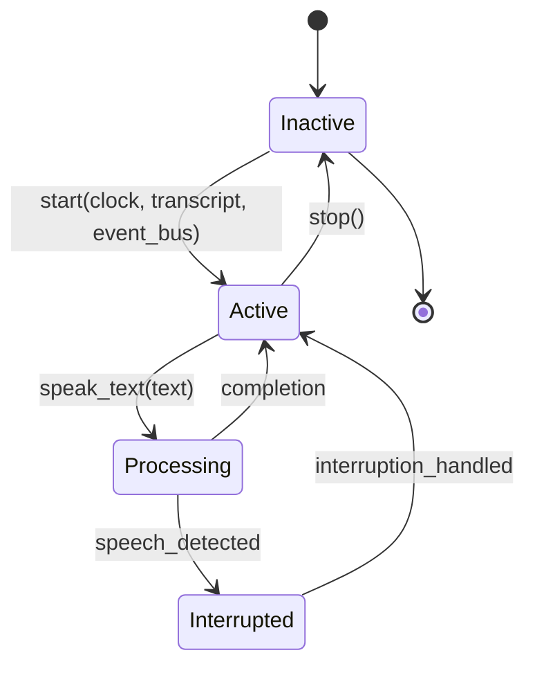
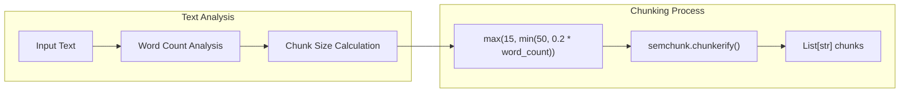
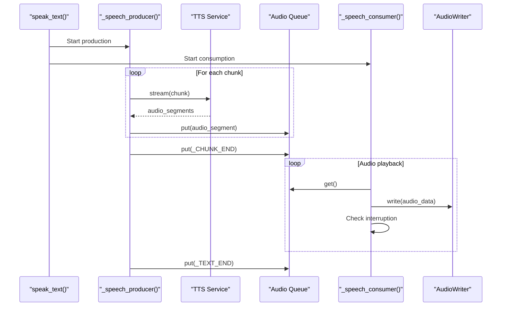
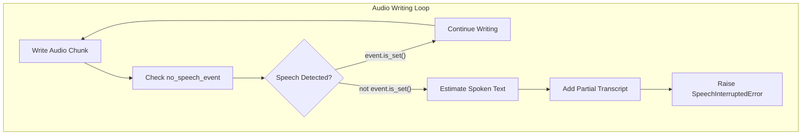
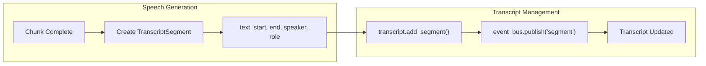
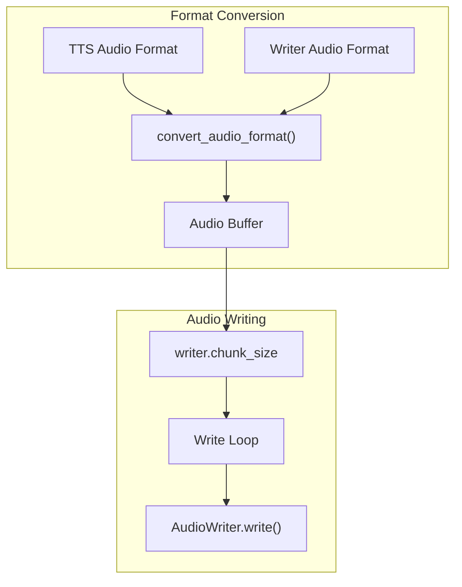

<!-- source: DeepWiki mcp.deepwiki.com · repo joinly-ai/joinly · page 5.2 Speech Controller · fetched 2026-10-26 -->

# Speech Controllers

Relevant source files

The following files were used as context for generating this wiki page:

- [joinly/controllers/speech/default.py](joinly/controllers/speech/default.py)
- [joinly/types.py](joinly/types.py)

This document covers the speech controller subsystem responsible for converting text to speech and managing audio output in joinly meetings. Speech controllers handle text-to-speech (TTS) processing, audio synthesis, speech interruption detection, and integration with virtual audio devices. For information about audio-to-text processing, see [Transcription Controllers](#6.1). For voice activity detection, see [Voice Activity Detection](#6.3).

## Architecture Overview

Speech controllers in joinly manage the complete text-to-speech pipeline from text input to audio output in meeting platforms. The system implements an asynchronous, streaming approach with built-in interruption handling and transcript integration.

### Speech Controller Architecture

Sources: [joinly/controllers/speech/default.py:26-279]()

## DefaultSpeechController Implementation

The `DefaultSpeechController` class implements the core speech controller functionality using an asynchronous producer-consumer pattern with speech interruption capabilities.

### Core Components

| Component | Type | Purpose |
|-----------|------|---------|
| `writer` | `AudioWriter` | Outputs audio to virtual devices |
| `tts` | `TTS` | Text-to-speech service interface |
| `no_speech_event` | `asyncio.Event` | Signals when speech should not be interrupted |
| `prefetch_chunks` | `int` | Number of audio chunks to prefetch (default: 3) |

### Lifecycle Management

The speech controller implements async context manager protocol for proper resource management:

The controller maintains references to core dependencies during its active lifecycle:
- `_clock`: Timing for transcript segments
- `_transcript`: Transcript management for spoken text
- `_event_bus`: Event notifications for segment completion

Sources: [joinly/controllers/speech/default.py:26-81]()

## Text Processing and Chunking

### Text Chunking Strategy

The `_chunk_text()` method breaks input text into optimal chunks for TTS processing using semantic chunking:

The chunking algorithm uses adaptive sizing based on text length:
- Minimum chunk size: 15 words
- Maximum chunk size: 50 words  
- Dynamic sizing: 20% of total word count

Sources: [joinly/controllers/speech/default.py:125-139]()

## Audio Streaming and Interruption Handling

### Producer-Consumer Pattern

The speech system uses a dual-task architecture for efficient audio streaming:

### Speech Interruption System

The interruption system monitors for concurrent speech and gracefully handles conflicts:

| Interruption Component | Function | Implementation |
|------------------------|----------|----------------|
| `no_speech_event` | Speech state monitoring | `asyncio.Event` |
| Interruption detection | Check during audio writing | `not self.no_speech_event.is_set()` |
| Text estimation | Calculate spoken portion | Word-per-second estimation (2.0 WPS) |
| Graceful termination | Add partial transcript | `SpeechInterruptedError` with spoken text |

The interruption flow:

Sources: [joinly/controllers/speech/default.py:141-279]()

## Error Handling and Types

### Speech-Specific Exceptions

The speech system defines custom exceptions for robust error handling:

| Exception | Purpose | Context |
|-----------|---------|---------|
| `SpeechInterruptedError` | Speech interruption by detected speech | Includes partial spoken text |
| `ProviderNotSupportedError` | Unsupported TTS provider feature | Provider capability mismatches |
| `IncompatibleAudioFormatError` | Audio format conversion issues | Format compatibility problems |

### Audio Data Types

Core audio types used throughout the speech pipeline:

| Type | Purpose | Key Fields |
|------|---------|------------|
| `AudioFormat` | PCM audio properties | `sample_rate`, `byte_depth` |
| `AudioChunk` | Raw audio data with metadata | `data`, `time_ns`, `speaker` |
| `SpeechWindow` | VAD-processed audio | `data`, `time_ns`, `is_speech`, `speaker` |

Sources: [joinly/types.py:21-87]()

## Integration with Audio Pipeline

### Transcript Integration

Speech controllers integrate tightly with transcript management, adding segments for spoken text:

Each spoken chunk generates a `TranscriptSegment` with:
- Speaker: Settings name
- Role: `SpeakerRole.assistant`
- Timing: Clock-based start/end times
- Text: Complete chunk or estimated partial text on interruption

### Audio Format Conversion

The system handles audio format conversion between TTS output and audio writer requirements:

Sources: [joinly/controllers/speech/default.py:200-259]()

---

