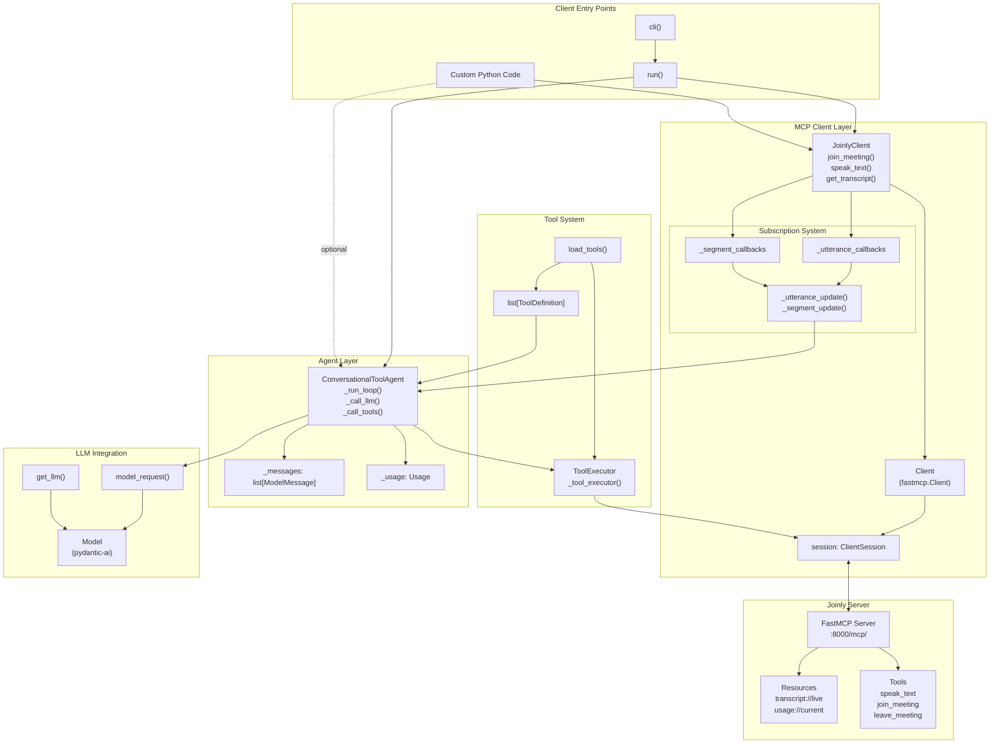
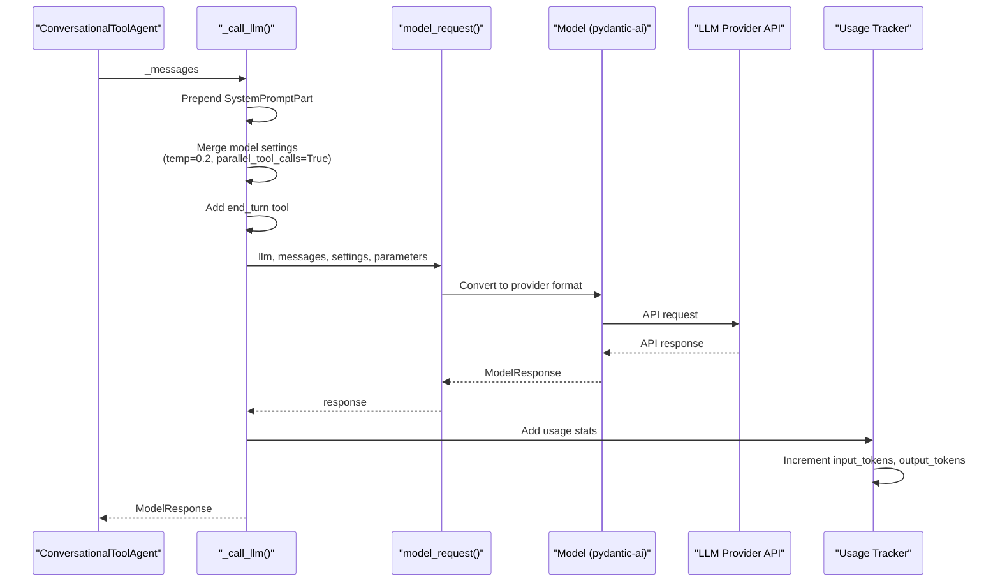
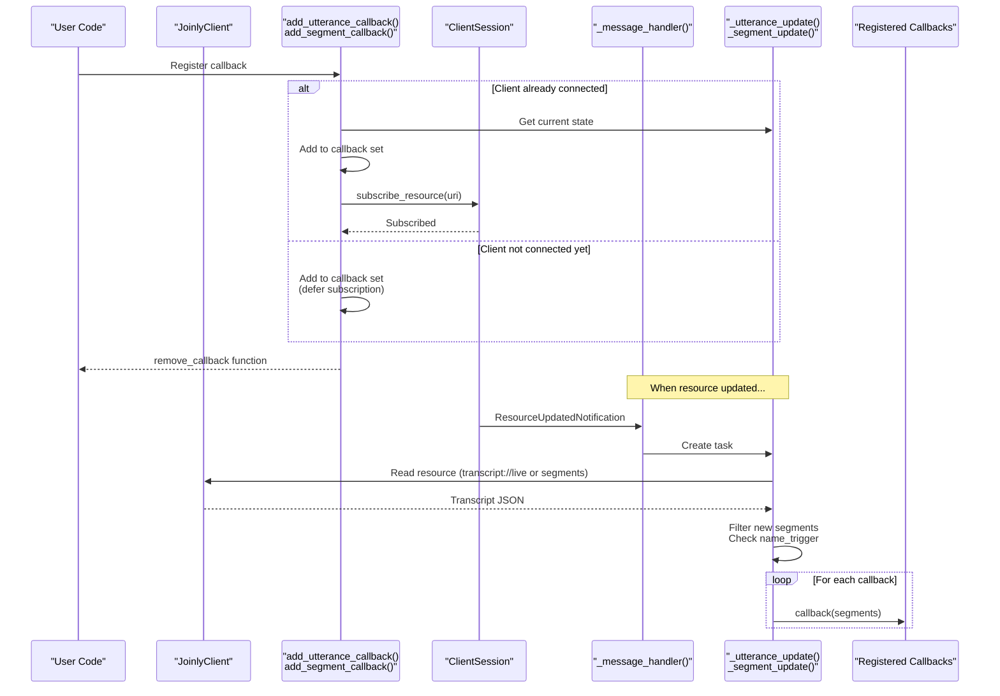

<!-- source: DeepWiki mcp.deepwiki.com · repo joinly-ai/joinly · page 6 Client SDK (joinly-client) · fetched 2026-10-26 -->

# Client SDK (joinly-client)

<details>
<summary>Relevant source files</summary>

The following files were used as context for generating this wiki page:

- [client/joinly_client/agent.py](client/joinly_client/agent.py)
- [client/joinly_client/client.py](client/joinly_client/client.py)
- [client/joinly_client/main.py](client/joinly_client/main.py)
- [client/joinly_client/prompts.py](client/joinly_client/prompts.py)
- [client/joinly_client/types.py](client/joinly_client/types.py)
- [client/joinly_client/utils.py](client/joinly_client/utils.py)
- [client/pyproject.toml](client/pyproject.toml)
- [joinly/utils/events.py](joinly/utils/events.py)

</details>


## Purpose and Scope

The `joinly-client` package provides a Python SDK for building conversational AI agents that participate in meetings. It handles MCP-based communication with the joinly server, manages real-time transcript subscriptions, integrates with LLM providers, and orchestrates tool execution. This document covers the client SDK architecture and core components.

For details on the low-level `JoinlyClient` API, see [JoinlyClient API](#6.1). For the high-level agent implementation, see [ConversationalToolAgent](#6.2). For usage patterns and code examples, see [Usage Patterns and Examples](#6.3). For server-side components, see [Core Server (joinly)](#4).

**Sources:** [client/pyproject.toml:1-35](), [client/joinly_client/main.py:1-397]()

---

## Package Structure

The client package is organized into five main modules:

| Module | Purpose | Key Components |
|--------|---------|----------------|
| `client.py` | MCP client communication | `JoinlyClient` |
| `agent.py` | Conversational agent with LLM | `ConversationalToolAgent` |
| `utils.py` | Utility functions | `get_llm()`, `load_tools()`, `get_prompt()` |
| `types.py` | Type definitions | `McpClientConfig`, `ToolExecutor`, re-exports from common |
| `prompts.py` | System prompts | `DEFAULT_PROMPT_TEMPLATE`, `DYADIC_INSTRUCTIONS`, `MPC_INSTRUCTIONS` |
| `main.py` | CLI and high-level API | `cli()`, `run()` |

**Sources:** [client/joinly_client/client.py:1-428](), [client/joinly_client/agent.py:1-480](), [client/joinly_client/utils.py:1-312](), [client/joinly_client/types.py:1-45](), [client/joinly_client/prompts.py:1-151](), [client/joinly_client/main.py:1-397]()

---

## Core Architecture

### Component Interaction Diagram



**Sources:** [client/joinly_client/main.py:294-393](), [client/joinly_client/client.py:32-428](), [client/joinly_client/agent.py:30-480](), [client/joinly_client/utils.py:29-83](), [client/joinly_client/utils.py:196-269]()

---

## JoinlyClient Component

The `JoinlyClient` class [client/joinly_client/client.py:32-428]() provides low-level MCP communication with the joinly server. It manages connection lifecycle, resource subscriptions, and exposes meeting control methods.

### Key Responsibilities

| Responsibility | Methods | Description |
|----------------|---------|-------------|
| Connection Management | `__aenter__()`, `__aexit__()`, `_connect()` | Establishes and tears down MCP connection |
| Meeting Control | `join_meeting()`, `leave_meeting()` | Joins and leaves meetings |
| Transcript Access | `get_transcript()`, resource subscriptions | Real-time and on-demand transcript access |
| Speech Output | `speak_text()` | Sends text to be spoken in the meeting |
| Chat Interaction | `send_chat_message()`, `get_chat_history()` | Chat message operations |
| Audio Control | `mute()`, `unmute()` | Microphone control |
| Participant Info | `get_participants()` | Lists meeting participants |
| Usage Tracking | `get_usage()` | Retrieves usage statistics |

### Resource Subscriptions

The client subscribes to MCP resources for real-time updates:

- **`transcript://live`** [client/joinly_client/client.py:27]() - Full transcript with utterance boundaries
- **`transcript://live/segments`** [client/joinly_client/client.py:28]() - Individual transcript segments
- **`usage://current`** [client/joinly_client/client.py:29]() - Current usage statistics

When subscribed, the client receives `ResourceUpdatedNotification` messages [client/joinly_client/client.py:207-214]() and triggers registered callbacks.

**Sources:** [client/joinly_client/client.py:32-428](), [client/joinly_client/client.py:185-239](), [client/joinly_client/client.py:253-284]()

---

## ConversationalToolAgent Component

The `ConversationalToolAgent` class [client/joinly_client/agent.py:30-480]() provides a high-level conversational interface with LLM integration. It manages message history, executes tool calls, and implements a response loop.

### Agent Loop

```mermaid
sequenceDiagram
    participant Callback as "Utterance Callback"
    participant Agent as "ConversationalToolAgent"
    participant Loop as "_run_loop()"
    participant Messages as "_messages"
    participant LLM as "_call_llm()"
    participant Tools as "_call_tools()"
    participant Executor as "ToolExecutor"
    participant EndCheck as "_check_end_turn()"
    
    Callback->>Agent: on_utterance(segments)
    Agent->>Loop: Create task
    
    Loop->>Messages: Append UserPromptPart
    
    loop Until end_turn or max_agent_iter
        Loop->>Messages: _limit_messages()
        Loop->>Messages: _truncate_tool_results()
        
        Loop->>LLM: Call with messages
        LLM-->>Loop: ModelResponse
        
        Loop->>Tools: _call_tools(response)
        
        opt Has tool calls
            Tools->>Executor: Execute each tool
            Executor-->>Tools: Tool results
            Tools-->>Loop: ModelRequest with results
        end
        
        Loop->>Messages: Append response
        Loop->>Messages: Append request (if exists)
        
        Loop->>EndCheck: Check if finished
        
        alt end_turn called OR interrupted OR left meeting
            EndCheck-->>Loop: True (exit loop)
        else
            EndCheck-->>Loop: False (continue)
        end
    end
```

**Sources:** [client/joinly_client/agent.py:98-150](), [client/joinly_client/agent.py:152-202](), [client/joinly_client/agent.py:204-225](), [client/joinly_client/agent.py:226-305](), [client/joinly_client/agent.py:307-356]()

### Message History Management

The agent maintains a filtered message history with three processing stages:

1. **On Each Turn** [client/joinly_client/agent.py:131-133]():
   - Truncate tool results to `max_tool_result_chars` (default: 2048)
   - Omit binary content from user prompts

2. **Before LLM Call** [client/joinly_client/agent.py:136-141]():
   - Limit total messages to `max_messages` (default: 50)
   - Truncate tool results to `max_ephemeral_tool_result_chars` (default: 16384)

3. **Processing Methods**:
   - `_limit_messages()` [client/joinly_client/agent.py:450-479]() - Removes oldest messages while preserving tool call/return pairs
   - `_truncate_tool_results()` [client/joinly_client/agent.py:358-406]() - Truncates large tool results with indication
   - `_omit_binary_tool_results()` [client/joinly_client/agent.py:408-448]() - Removes binary content, adds metadata

**Sources:** [client/joinly_client/agent.py:112-150](), [client/joinly_client/agent.py:358-479]()

### Tool Call Handling

The agent processes tool calls with special handling for specific tools:

| Tool | Special Handling | Implementation |
|------|------------------|----------------|
| `end_turn` | Signals end of agent turn | [client/joinly_client/agent.py:239-247]() |
| Binary content results | Extracted to separate user prompts | [client/joinly_client/agent.py:277-305]() |
| `speak_text` with interruption | Detected in response, ends turn | [client/joinly_client/agent.py:330-334]() |
| `leave_meeting` | Ends turn after execution | [client/joinly_client/agent.py:335-339]() |

The `end_turn` tool [client/joinly_client/agent.py:174-181]() is automatically injected into every LLM call to give the model explicit control over when to stop making tool calls.

**Sources:** [client/joinly_client/agent.py:226-305](), [client/joinly_client/agent.py:307-356](), [client/joinly_client/agent.py:162-186]()

---

## Tool System

### Tool Loading and Execution

```mermaid
graph LR
    subgraph "Tool Loading - load_tools()"
        MCPClients["McpClientConfig<br/>dict[str, McpClientConfig]"]
        ListTools["client.list_tools()"]
        FilterTools["Include/Exclude Filters"]
        SanitizeSchema["sanitize_tool_schema()"]
        ToolDefs["list[ToolDefinition]"]
    end
    
    subgraph "Tool Execution - _tool_executor()"
        Parse["Parse tool_name<br/>(split prefix)"]
        ResolveClient["Resolve client by prefix"]
        CallTool["client.call_tool_mcp()"]
        PostCallback["post_callback()"]
        MapResult["_Mapper._map_tool_result_part()"]
        Result["Result (str | list | BinaryContent)"]
    end
    
    MCPClients --> ListTools
    ListTools --> FilterTools
    FilterTools --> SanitizeSchema
    SanitizeSchema --> ToolDefs
    
    ToolDefs -.used by.-> Parse
    Parse --> ResolveClient
    ResolveClient --> CallTool
    CallTool --> PostCallback
    PostCallback --> MapResult
    MapResult --> Result
```



### Tool Schema Sanitization

The `sanitize_tool_schema()` function [client/joinly_client/utils.py:121-193]() removes unsupported JSON schema features to ensure compatibility with LLM providers:

**Removed Features:**
- `allOf`, `anyOf`, `oneOf`, `not` - Complex schema combinators
- `if`, `then`, `else` - Conditional schema logic
- `$schema`, `$id`, `$ref` - Schema references
- `definitions`, `$defs` - Schema definitions
- `patternProperties` - Pattern-based property matching

The function recursively walks the schema tree and ensures:
- All objects have `type: "object"` with `properties` and `additionalProperties`
- All arrays have `type: "array"` with `items`
- Required fields only reference existing properties

**Sources:** [client/joinly_client/utils.py:196-269](), [client/joinly_client/utils.py:121-193]()

### McpClientConfig

The `McpClientConfig` dataclass [client/joinly_client/types.py:34-45]() configures how tools are loaded from each MCP server:

| Field | Type | Purpose |
|-------|------|---------|
| `client` | `Client` | The FastMCP client instance |
| `exclude` | `list[str]` | Tool names to exclude (default: `[]`) |
| `include` | `list[str]` | Tool names to include; if set, only these are loaded (default: `[]`) |
| `post_callback` | Optional callback | Post-processes tool results before returning to agent |

When multiple MCP servers are configured, tools are prefixed with the server name (e.g., `joinly_speak_text`, `tavily_search`).

**Sources:** [client/joinly_client/types.py:34-45](), [client/joinly_client/main.py:362-373](), [client/joinly_client/utils.py:196-269]()

---

## LLM Integration

### Model Initialization

The `get_llm()` function [client/joinly_client/utils.py:29-83]() initializes LLM models with provider-specific configuration:

| Provider | Implementation | Special Configuration |
|----------|----------------|----------------------|
| `openai` | `infer_model("openai:model")` | GPT-5 uses `OpenAIResponsesModel` with reasoning/verbosity controls |
| `anthropic` | `infer_model("anthropic:model")` | Standard pydantic-ai inference |
| `google` | `infer_model("google-gla:model")` | Provider name mapped to `google-gla` |
| `azure_openai` | `infer_model("azure:model")` | Provider name mapped to `azure` |
| `ollama` | `OpenAIModel` with custom base URL | Uses OpenAI-compatible API at custom URL |

**GPT-5 Configuration** [client/joinly_client/utils.py:60-81]():
```python
extra_body={
    "reasoning": {"effort": "minimal"},
    "text": {"verbosity": "low"},
}
profile.update(OpenAIModelProfile(openai_supports_sampling_settings=False))
```

**Sources:** [client/joinly_client/utils.py:29-83]()

### Model Request Flow



**Sources:** [client/joinly_client/agent.py:152-202](), [client/joinly_client/agent.py:162-186]()

---

## Prompt System

### Prompt Components

The default prompt is constructed from three parts [client/joinly_client/utils.py:86-110]():

1. **Template** - `DEFAULT_PROMPT_TEMPLATE` [client/joinly_client/prompts.py:1-101]() with placeholders for:
   - `{date}` - Current date
   - `{name}` - Agent name
   - `{instructions}` - Conversation style instructions

2. **Instructions** - One of two styles:
   - **`DYADIC_INSTRUCTIONS`** [client/joinly_client/prompts.py:103-122]() - For one-on-one meetings, responds to all messages
   - **`MPC_INSTRUCTIONS`** [client/joinly_client/prompts.py:124-150]() - For group meetings, only responds when directly addressed

3. **Custom Overrides** - Users can provide:
   - Custom instructions string (replaces style-based instructions)
   - Complete custom template (replaces entire prompt)

### Prompt Structure

The default template includes these sections:

| Section | Purpose |
|---------|---------|
| `<identity>` | Agent role and capabilities |
| `<instructions>` | Conversation style (dyadic or MPC) |
| `<core_principles>` | Mandatory behaviors (announce actions, respect modality, etc.) |
| `<response_guidelines>` | When to use voice vs chat |
| `<response_style>` | Voice and chat formatting rules |
| `<tool_use_protocol>` | Meeting tool and external tool protocols |
| `<metadata>` | Current date |
| `<operational_constraints>` | Content and transcript handling constraints |

**Sources:** [client/joinly_client/prompts.py:1-151](), [client/joinly_client/utils.py:86-110]()

---

## Subscription and Callback System

### Callback Registration and Flow



### Callback Types

**Utterance Callbacks** [client/joinly_client/client.py:99-140]():
- Subscribe to `transcript://live` resource
- Filters segments by `SpeakerRole.participant` [client/joinly_client/client.py:260-262]()
- Tracks last utterance timestamp to avoid duplicates [client/joinly_client/client.py:266]()
- Compacts consecutive segments from same speaker [client/joinly_client/client.py:269]()
- Optional name-trigger filtering [client/joinly_client/client.py:263-265]()

**Segment Callbacks** [client/joinly_client/client.py:142-183]():
- Subscribe to `transcript://live/segments` resource
- No role filtering (includes both participant and agent speech)
- Tracks last segment timestamp [client/joinly_client/client.py:281]()
- Used for logging and monitoring all meeting speech

**Sources:** [client/joinly_client/client.py:99-183](), [client/joinly_client/client.py:253-284](), [client/joinly_client/client.py:201-238]()

---

## Configuration and Settings

### Settings Propagation

Settings flow from multiple sources to the joinly server via HTTP headers [client/joinly_client/client.py:216-220]():

```python
headers={"joinly-settings": json.dumps(self.settings)}
```

**Sources of Settings:**
1. **CLI Arguments** - `--vad`, `--stt`, `--tts`, `--language`, etc. [client/joinly_client/main.py:139-207]()
2. **Environment Variables** - `JOINLY_VAD`, `JOINLY_STT`, `JOINLY_TTS`, etc.
3. **Direct to `run()` function** - `settings` parameter [client/joinly_client/main.py:305]()
4. **Direct to `JoinlyClient`** - `settings` parameter [client/joinly_client/client.py:41]()

Settings control server-side behavior including:
- Speech service selection (VAD, STT, TTS)
- Service-specific arguments
- Language configuration
- Controller parameters

**Sources:** [client/joinly_client/client.py:35-57](), [client/joinly_client/client.py:216-220](), [client/joinly_client/main.py:139-207](), [client/joinly_client/main.py:287]()

---

## Entry Points and Usage Modes

The client SDK supports three usage modes:

### 1. CLI Mode

```bash
uvx joinly-client [OPTIONS] MEETING_URL
```

Entry point: `joinly_client.main:cli` [client/pyproject.toml:20-21]()

The CLI [client/joinly_client/main.py:39-292]() accepts:
- Connection settings (`--joinly-url`, `--name`)
- LLM configuration (`--llm-provider`, `--llm-model`)
- Prompt customization (`--prompt`, `--prompt-file`, `--prompt-style`)
- MCP server configuration (`--mcp-config`)
- Server settings (`--vad`, `--stt`, `--tts`, `--language`, `--*-arg`)
- Logging control (`-v`, `-q`)

### 2. High-Level `run()` Function

```python
await run(
    joinly_url="http://localhost:8000/mcp/",
    meeting_url="https://meet.google.com/...",
    llm_provider="openai",
    llm_model="gpt-4o",
    name="assistant",
    settings={"tts": "kokoro"}
)
```

Function signature: [client/joinly_client/main.py:294-321]()

This mode automatically:
- Creates and manages `JoinlyClient` instance
- Loads tools from joinly server and optional additional MCP servers
- Initializes `ConversationalToolAgent` with LLM
- Wires callbacks and subscriptions
- Handles cleanup and usage reporting

### 3. Low-Level `JoinlyClient` API

```python
client = JoinlyClient(url, name="my_agent")
async with client:
    await client.join_meeting(meeting_url)
    transcript = await client.get_transcript()
    await client.speak_text("Hello!")
```

This mode provides direct control without the agent layer, suitable for:
- Custom agent implementations
- Non-conversational use cases
- Direct MCP tool access
- Custom transcript processing

**Sources:** [client/joinly_client/main.py:39-292](), [client/joinly_client/main.py:294-393](), [client/joinly_client/client.py:32-428]()

---

## Dependencies

The client package requires:

| Dependency | Purpose | Version Constraint |
|------------|---------|-------------------|
| `fastmcp` | MCP client implementation | `>=2.10.5` |
| `pydantic-ai-slim` | LLM integration | `>=0.4.9` with anthropic, openai, google extras |
| `joinly-common` | Shared types | Workspace dependency |
| `openai` | OpenAI API (for Ollama compatibility) | `<=1.99.1` |
| `click` | CLI framework | `>=8.1.8` |
| `python-dotenv` | Environment variable loading | `>=1.1.0` |
| `rich` | Terminal formatting | `>=14.0.0` |

**Sources:** [client/pyproject.toml:10-18](), [client/pyproject.toml:23-24]()

---

