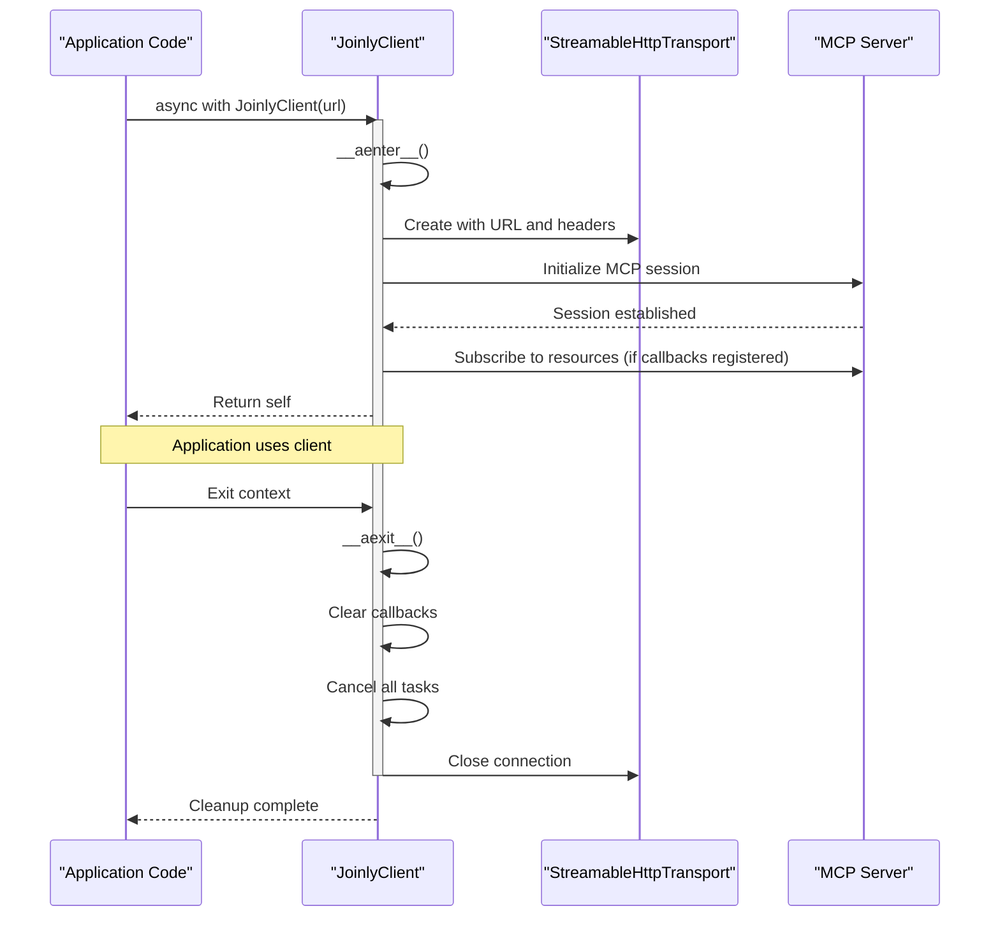
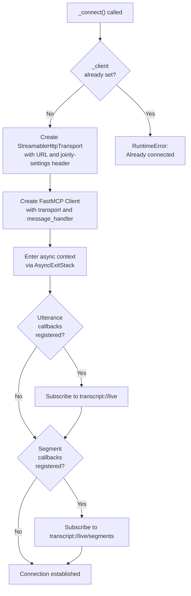
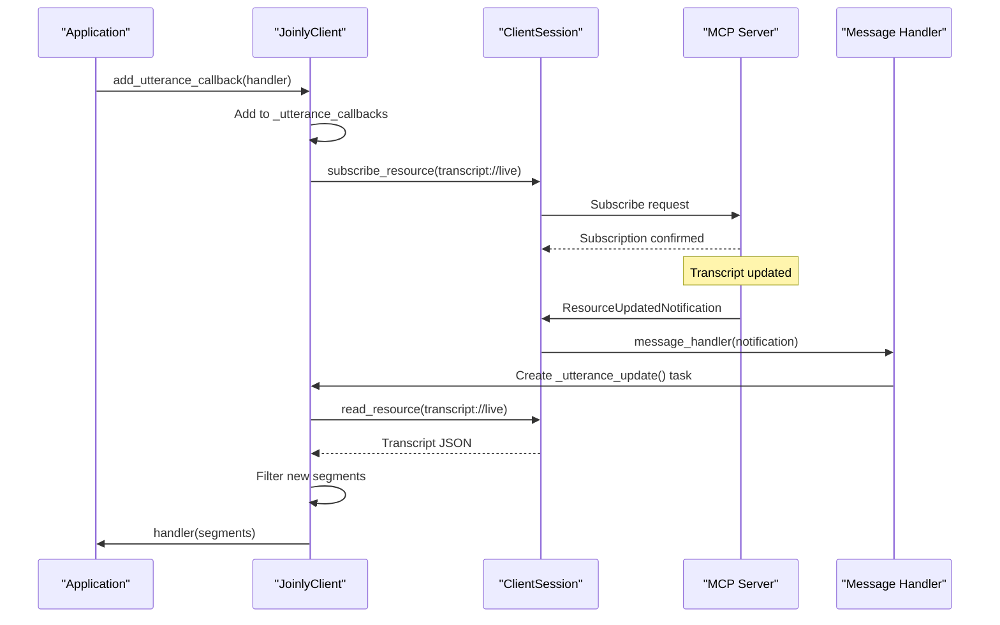
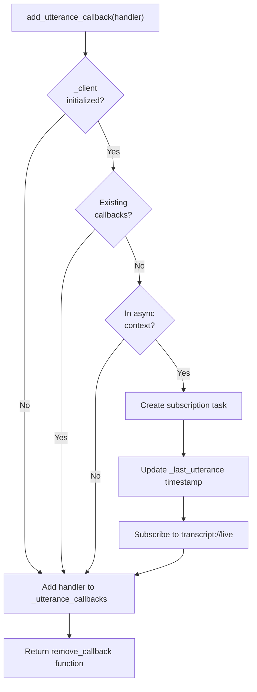
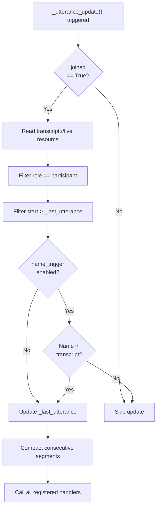
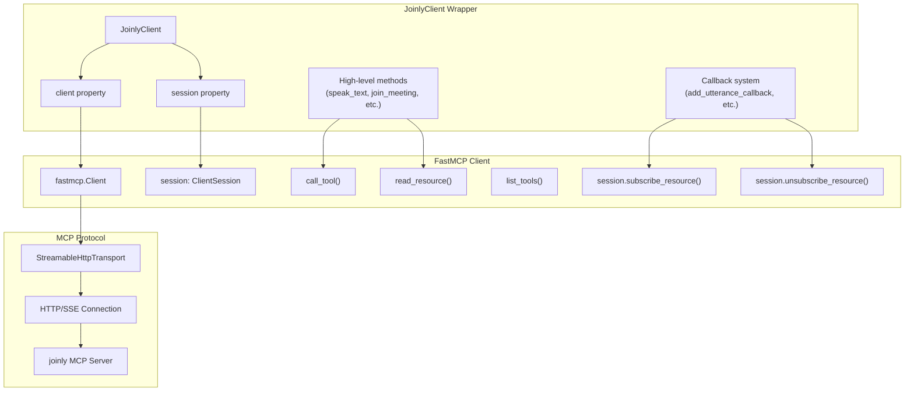
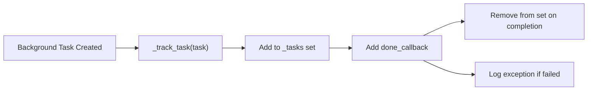

<!-- source: DeepWiki mcp.deepwiki.com · repo joinly-ai/joinly · page 6.1 JoinlyClient API · fetched 2026-10-26 -->

# JoinlyClient API

<details>
<summary>Relevant source files</summary>

The following files were used as context for generating this wiki page:

- [client/README.md](client/README.md)
- [client/joinly_client/__init__.py](client/joinly_client/__init__.py)
- [client/joinly_client/agent.py](client/joinly_client/agent.py)
- [client/joinly_client/client.py](client/joinly_client/client.py)
- [client/joinly_client/main.py](client/joinly_client/main.py)
- [client/joinly_client/prompts.py](client/joinly_client/prompts.py)
- [client/joinly_client/types.py](client/joinly_client/types.py)
- [client/joinly_client/utils.py](client/joinly_client/utils.py)
- [joinly/utils/events.py](joinly/utils/events.py)

</details>


## Purpose and Scope

The `JoinlyClient` class provides a low-level Python API for connecting to a joinly MCP server and building custom conversational meeting agents. It handles MCP communication, resource subscriptions, and provides methods for meeting control, transcript access, and real-time event notifications.

This page documents the core `JoinlyClient` API for developers who want to build custom agents with their own LLM integration or agent logic. For information about the high-level agent implementation with built-in LLM integration, see [ConversationalToolAgent](#6.2). For complete usage examples and patterns, see [Usage Patterns and Examples](#6.3).

## Overview

`JoinlyClient` is the primary interface for custom agent development in the joinly-client package. It provides:

- **MCP Connection Management**: Establishes and maintains HTTP/SSE connection to the joinly server
- **Resource Subscriptions**: Real-time updates from `transcript://live` and `transcript://live/segments` resources
- **Callback System**: Registers handlers for utterance and segment events with filtering options
- **Meeting Control**: Methods for joining, leaving, speaking, and managing meeting state
- **Data Access**: Retrieval of transcripts, chat history, participants, and usage statistics
- **Tool Integration**: Access to all MCP tools exposed by the server

The client is designed for asynchronous operation and uses async context managers for lifecycle management.

## Class Architecture

```mermaid
graph TB
    subgraph "JoinlyClient [client.py:32-428]"
        Init["__init__()<br/>Initialize with URL and settings"]
        Client["client: Client<br/>FastMCP Client property"]
        Session["session: ClientSession<br/>MCP Session property"]
        
        subgraph "Callback Registration"
            AddUtt["add_utterance_callback()<br/>Register utterance handler"]
            AddSeg["add_segment_callback()<br/>Register segment handler"]
        end
        
        subgraph "Lifecycle Management"
            Enter["__aenter__()<br/>Connect to server"]
            Exit["__aexit__()<br/>Cleanup and disconnect"]
        end
        
        subgraph "Meeting Control"
            Join["join_meeting()<br/>Join meeting"]
            Leave["leave_meeting()<br/>Leave meeting"]
            Speak["speak_text()<br/>Speak audio"]
            Chat["send_chat_message()<br/>Send chat"]
            Mute["mute()/unmute()<br/>Audio control"]
        end
        
        subgraph "Data Retrieval"
            GetTrans["get_transcript()<br/>Full transcript"]
            GetChat["get_chat_history()<br/>Chat messages"]
            GetPart["get_participants()<br/>Participant list"]
            GetUsage["get_usage()<br/>Usage statistics"]
            ListTools["list_tools()<br/>Available tools"]
        end
        
        subgraph "Internal State"
            InternalClient["_client: Client | None"]
            Callbacks["_utterance_callbacks<br/>_segment_callbacks"]
            Tasks["_tasks: set[Task]"]
            Stack["_stack: AsyncExitStack"]
        end
    end
    
    subgraph "External Dependencies"
        FastMCPClient["fastmcp.Client"]
        ClientSess["mcp.ClientSession"]
        Transport["StreamableHttpTransport"]
    end
    
    subgraph "MCP Resources"
        TranscriptLive["transcript://live"]
        SegmentsLive["transcript://live/segments"]
        UsageCurrent["usage://current"]
    end
    
    Init --> InternalClient
    Client --> FastMCPClient
    Session --> ClientSess
    Enter --> Transport
    Enter --> InternalClient
    
    AddUtt --> Callbacks
    AddSeg --> Callbacks
    
    GetTrans --> TranscriptLive
    GetUsage --> UsageCurrent
    
    AddUtt -.subscribes.-> TranscriptLive
    AddSeg -.subscribes.-> SegmentsLive
```



**Sources**: [client/joinly_client/client.py:1-428]()

## Connection and Lifecycle Management

### Initialization

The `JoinlyClient` constructor accepts a URL (string or `FastMCP` instance) and optional configuration:

| Parameter | Type | Default | Description |
|-----------|------|---------|-------------|
| `url` | `str \| FastMCP` | Required | joinly server URL (e.g., `http://localhost:8000/mcp/`) or FastMCP instance |
| `name` | `str \| None` | `"joinly"` | Participant name in the meeting |
| `name_trigger` | `bool` | `False` | Only trigger utterance callbacks when name is mentioned |
| `settings` | `dict[str, Any] \| None` | `None` | Additional settings passed to server via HTTP headers |

The `settings` dictionary is serialized to JSON and sent in the `joinly-settings` HTTP header. This allows per-session configuration of server components like VAD, STT, TTS, and language settings without modifying server defaults.

**Sources**: [client/joinly_client/client.py:35-58]()

### Context Manager Pattern

`JoinlyClient` implements the async context manager protocol for automatic lifecycle management:



The `__aenter__` method [client/joinly_client/client.py:185-188]():
1. Calls `_connect()` to establish the MCP session
2. Returns the client instance for use in the context

The `__aexit__` method [client/joinly_client/client.py:190-199]():
1. Clears all registered callbacks
2. Cancels tracked background tasks
3. Closes the async exit stack (which closes the FastMCP client)
4. Resets internal state

**Sources**: [client/joinly_client/client.py:185-199](), [client/joinly_client/client.py:201-238]()

### Connection Process



The connection process [client/joinly_client/client.py:201-238]():
1. Creates a `StreamableHttpTransport` with the server URL and settings header
2. Instantiates a `FastMCP.Client` with a message handler for resource update notifications
3. Enters the client's async context via `AsyncExitStack`
4. Subscribes to any resources for which callbacks were pre-registered

**Sources**: [client/joinly_client/client.py:201-238]()

## Resource Subscription System

### MCP Resource URIs

The client interacts with three MCP resources exposed by the joinly server:

| Resource URI | Type | Description | Used By |
|--------------|------|-------------|---------|
| `transcript://live` | Transcript | Full conversation transcript with all segments | Utterance callbacks |
| `transcript://live/segments` | Transcript | Individual segments only (incremental updates) | Segment callbacks |
| `usage://current` | Usage | Cumulative usage statistics (tokens, API calls, etc.) | `get_usage()` method |

These URIs are defined as constants [client/joinly_client/client.py:27-29]():
```python
TRANSCRIPT_URL = AnyUrl("transcript://live")
SEGMENTS_URL = AnyUrl("transcript://live/segments")
USAGE_URL = AnyUrl("usage://current")
```

**Sources**: [client/joinly_client/client.py:27-29]()

### Subscription Mechanism



The subscription flow:
1. Application registers a callback via `add_utterance_callback()` or `add_segment_callback()`
2. Client subscribes to the corresponding MCP resource
3. Server sends `ResourceUpdatedNotification` when the resource changes
4. Message handler receives notification and triggers update method
5. Update method reads the resource and calls all registered callbacks with new data

**Sources**: [client/joinly_client/client.py:99-183](), [client/joinly_client/client.py:207-214](), [client/joinly_client/client.py:253-283]()

## Callback System

### Callback Types

The client supports two types of callbacks, each tied to a different resource:

**Utterance Callbacks** [client/joinly_client/client.py:99-140]():
- Triggered when the `transcript://live` resource updates
- Receive compacted segments grouped by speaker and role
- Filter out agent's own speech (role != participant)
- Support name-trigger filtering (only fire when name mentioned)
- Signature: `async def callback(segments: list[TranscriptSegment]) -> None`

**Segment Callbacks** [client/joinly_client/client.py:142-183]():
- Triggered when the `transcript://live/segments` resource updates
- Receive individual transcript segments as they arrive
- No filtering by role or name
- Useful for logging or real-time monitoring
- Signature: `async def callback(segments: list[TranscriptSegment]) -> None`

### Callback Registration



Registration process [client/joinly_client/client.py:99-140]():
1. If client is already connected and this is the first callback, subscribe to the resource
2. Add the callback to the internal set
3. Return a removal function that unsubscribes when the last callback is removed

The removal function [client/joinly_client/client.py:126-139]():
- Removes the callback from the set
- If no callbacks remain and client is connected, unsubscribes from the resource

**Sources**: [client/joinly_client/client.py:99-183]()

### Callback Filtering

**Utterance Callback Filtering** [client/joinly_client/client.py:253-270]():



Filtering logic:
1. **Joined check**: Only process updates if `joined == True`
2. **Role filter**: Keep only segments with `role == "participant"` (exclude agent's speech)
3. **Time filter**: Keep only segments after `_last_utterance` timestamp
4. **Name trigger**: If enabled, check if transcript mentions the agent's name
5. **Compaction**: Merge consecutive segments from same speaker

Segment callbacks have simpler filtering [client/joinly_client/client.py:272-283]():
- Only check if joined
- Only filter by timestamp (`start > _last_segment`)
- No role or name filtering

**Sources**: [client/joinly_client/client.py:253-283](), [client/joinly_client/utils.py:286-297]()

## API Methods

### Meeting Control Methods

| Method | Parameters | Returns | Description |
|--------|------------|---------|-------------|
| `join_meeting()` | `meeting_url: str \| None`<br/>`passcode: str \| None`<br/>`participant_name: str \| None` | `None` | Join a meeting and start transcription |
| `leave_meeting()` | None | `None` | Leave the current meeting |

**`join_meeting()` Details** [client/joinly_client/client.py:293-320]():
- Calls the `join_meeting` MCP tool with provided parameters
- Sets `joined = True` on success
- Resets `_last_utterance` and `_last_segment` timestamps
- Updates `self.name` if `participant_name` is provided

**`leave_meeting()` Details** [client/joinly_client/client.py:322-331]():
- Calls the `leave_meeting` MCP tool
- Sets `joined = False`
- Resets timestamp trackers
- Raises `RuntimeError` if not currently joined

**Sources**: [client/joinly_client/client.py:293-331]()

### Audio and Chat Methods

| Method | Parameters | Returns | Description |
|--------|------------|---------|-------------|
| `speak_text()` | `text: str` | `None` | Speak text through meeting audio using TTS |
| `send_chat_message()` | `message: str` | `None` | Send a text message in meeting chat |
| `mute()` | None | `None` | Mute the agent's microphone |
| `unmute()` | None | `None` | Unmute the agent's microphone |

All methods require `joined == True` and raise `RuntimeError` otherwise.

**`speak_text()` Implementation** [client/joinly_client/client.py:383-396]():
- Calls the `speak_text` MCP tool
- Text is processed by the speech controller on the server
- May be interrupted if participant speech is detected

**`send_chat_message()` Implementation** [client/joinly_client/client.py:398-411]():
- Calls the `send_chat_message` MCP tool
- Platform-specific chat implementation via meeting provider

**Mute/Unmute Implementation** [client/joinly_client/client.py:413-428]():
- Call `mute_yourself` and `unmute_yourself` MCP tools respectively
- Control the agent's microphone state in the meeting

**Sources**: [client/joinly_client/client.py:383-428]()

### Data Retrieval Methods

| Method | Parameters | Returns | Description |
|--------|------------|---------|-------------|
| `get_transcript()` | None | `Transcript` | Get full transcript with all segments |
| `get_chat_history()` | None | `MeetingChatHistory` | Get all chat messages exchanged |
| `get_participants()` | None | `MeetingParticipantList` | Get list of meeting participants |
| `get_usage()` | None | `Usage` | Get cumulative usage statistics |
| `list_tools()` | None | `list[Tool]` | List all available MCP tools |

**`get_transcript()` Implementation** [client/joinly_client/client.py:333-343]():
- Calls the `get_transcript` MCP tool
- Returns empty transcript if not joined
- Parses JSON response into `Transcript` model

**`get_chat_history()` Implementation** [client/joinly_client/client.py:345-355]():
- Calls the `get_chat_history` MCP tool
- Returns empty history if not joined
- Parses JSON response into `MeetingChatHistory` model

**`get_participants()` Implementation** [client/joinly_client/client.py:357-367]():
- Calls the `get_participants` MCP tool
- Returns empty list if not joined
- Parses JSON response into `MeetingParticipantList` model

**`get_usage()` Implementation** [client/joinly_client/client.py:369-381]():
- Reads the `usage://current` MCP resource (not a tool call)
- Returns empty `Usage` object on error
- Tracks all service usage (LLM tokens, STT/TTS calls, etc.)

**`list_tools()` Implementation** [client/joinly_client/client.py:285-291]():
- Delegates to `client.list_tools()` from FastMCP
- Returns all tools exposed by the server and any additional MCP servers
- Useful for dynamic tool discovery or integration with other frameworks

**Sources**: [client/joinly_client/client.py:285-291](), [client/joinly_client/client.py:333-381]()

## Integration with FastMCP

### Client Wrapper Pattern



`JoinlyClient` wraps the FastMCP `Client` class to provide joinly-specific functionality:

**Wrapped Components** [client/joinly_client/client.py:72-97]():
- `client` property: Returns the internal `_client` instance (raises if not connected)
- `session` property: Provides direct access to `ClientSession` for low-level operations

**Additional Features**:
1. **Settings Header**: Automatically includes `joinly-settings` JSON header for per-session configuration
2. **Callback System**: Manages resource subscriptions and notification handling
3. **State Tracking**: Maintains `joined` flag and timestamp tracking for filtering
4. **Type Safety**: Returns typed models (`Transcript`, `Usage`, etc.) instead of raw JSON
5. **Convenience Methods**: Provides domain-specific methods like `speak_text()` instead of generic `call_tool()`

**Sources**: [client/joinly_client/client.py:72-97](), [client/joinly_client/client.py:216-225]()

### Message Handler

The client registers a message handler to process MCP notifications [client/joinly_client/client.py:207-214]():

```python
async def _message_handler(message):
    if isinstance(message, ServerNotification) and isinstance(
        message.root, ResourceUpdatedNotification
    ):
        if message.root.params.uri == TRANSCRIPT_URL:
            # Trigger utterance update
        elif message.root.params.uri == SEGMENTS_URL:
            # Trigger segment update
```

This handler:
- Listens for `ResourceUpdatedNotification` messages from the server
- Routes notifications to the appropriate update method based on URI
- Creates background tasks to process updates asynchronously

**Sources**: [client/joinly_client/client.py:207-214]()

### Task Tracking

The client maintains a set of tracked tasks [client/joinly_client/client.py:240-251]():



Task tracking ensures:
1. All background tasks are properly cleaned up on exit
2. Task exceptions are logged but don't crash the client
3. Tasks automatically remove themselves from the set when complete

**Sources**: [client/joinly_client/client.py:240-251]()

## Usage Example

Basic usage pattern for custom agent development:

```python
async def custom_agent():
    # Initialize client
    client = JoinlyClient(
        url="http://localhost:8000/mcp/",
        name="my_agent",
        name_trigger=True,  # Only respond when mentioned
        settings={
            "language": "en",
            "tts": "elevenlabs",
        }
    )
    
    # Define utterance handler
    async def on_utterance(segments: list[TranscriptSegment]) -> None:
        # Custom agent logic here
        text = " ".join(s.text for s in segments)
        if "search" in text.lower():
            # Perform search, then speak result
            await client.speak_text("Here's what I found...")
    
    # Register callback
    client.add_utterance_callback(on_utterance)
    
    # Connect and join meeting
    async with client:
        await client.join_meeting("https://meet.google.com/...")
        
        # Access MCP tools directly if needed
        tools = await client.list_tools()
        
        # Wait for events
        await asyncio.Event().wait()
        
        # Get final transcript
        transcript = await client.get_transcript()
        print(f"Meeting had {len(transcript.segments)} segments")
```

For complete usage patterns including integration with `ConversationalToolAgent`, see [Usage Patterns and Examples](#6.3).

**Sources**: [client/README.md:100-139](), [client/joinly_client/main.py:294-393]()

---

