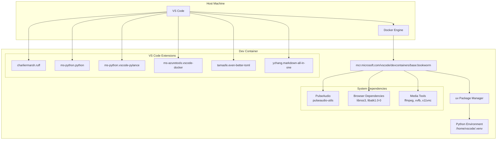
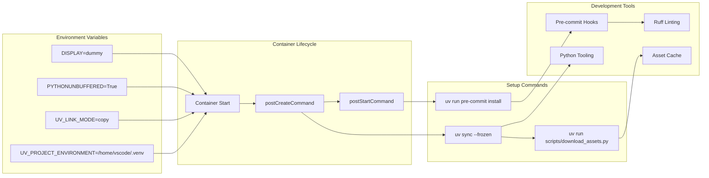
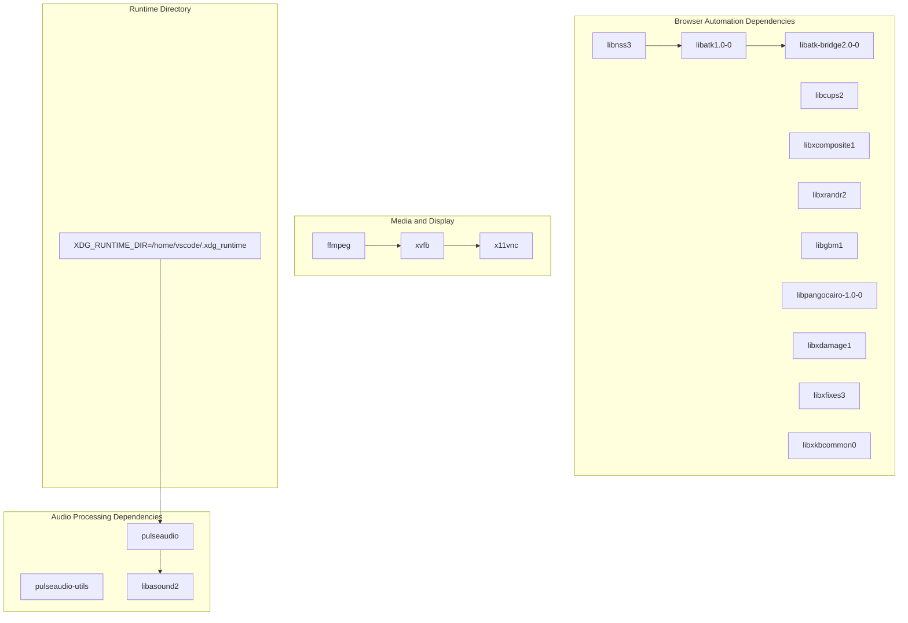

<!-- source: DeepWiki mcp.deepwiki.com · repo joinly-ai/joinly · page 8 Development · fetched 2026-10-26 -->

# Development

Relevant source files

The following files were used as context for generating this wiki page:

- [CHANGELOG.md](CHANGELOG.md)
- [pyproject.toml](pyproject.toml)
- [uv.lock](uv.lock)

This page provides an overview of the development environment, tools, and workflows for contributing to the joinly codebase. It covers the standardized development setup, code quality practices, and asset management systems used in the project.

For detailed information about setting up the development environment, see [Development Environment](#9.1). For specifics about asset management and model downloading, see [Asset Management System](#9.2). For code quality standards and CI/CD workflows, see [Code Quality and CI/CD](#9.3).

## Development Approach

The joinly project uses a containerized development environment to ensure consistency across different developer machines. The development workflow is built around VS Code Dev Containers, the `uv` package manager, and automated code quality tools.

The development environment is designed to handle the complex requirements of the joinly system, including audio processing dependencies, browser automation tools, and AI service integrations.

Sources: [.devcontainer/devcontainer.json:1-34]()

## Development Environment Overview

The development environment is configured through VS Code Dev Containers, providing a standardized setup that includes all necessary dependencies and tools. The environment is based on a Debian Bookworm container with additional packages for audio processing, browser automation, and Python development.

### Development Environment Diagram

Sources: [.devcontainer/devcontainer.json:1-34](), [.devcontainer/Dockerfile:1-29]()

## Development Workflow

The development workflow is automated through container lifecycle commands and integrates package management, asset downloading, and code quality tools.

### Development Workflow Diagram

Sources: [.devcontainer/devcontainer.json:25-33]()

## Code Quality and Tooling

The development environment includes several automated code quality tools and VS Code extensions to maintain consistent code standards across the project.

| Tool | Purpose | Configuration |
|------|---------|---------------|
| `ruff` | Python linting and formatting | Charlier Marsh extension |
| `pre-commit` | Git hook automation | Installed via `postStartCommand` |
| `uv` | Package management | Copy link mode, custom environment path |
| `pylance` | Python language server | Microsoft Python extension |

The environment is configured with specific variables to support the joinly system's requirements:

- `DISPLAY=dummy` - For headless browser automation
- `PYTHONUNBUFFERED=True` - For real-time logging output
- `UV_LINK_MODE=copy` - For consistent package installation
- `UV_PROJECT_ENVIRONMENT=/home/vscode/.venv` - Custom virtual environment location

Sources: [.devcontainer/devcontainer.json:14-33]()

## System Dependencies

The development container includes comprehensive system dependencies required for joinly's audio processing and browser automation capabilities.

### System Dependencies Diagram

Sources: [.devcontainer/Dockerfile:5-26]()

## Package Management

The development environment uses `uv` as the primary package manager, copied from the official Astral SH image. The package management is configured for development-specific requirements including frozen dependency installation and custom virtual environment handling.

The `postCreateCommand` runs `uv sync --frozen` to ensure reproducible dependency installation, followed by asset downloading through the `scripts/download_assets.py` script.

Sources: [.devcontainer/Dockerfile:1-2,28](), [.devcontainer/devcontainer.json:31-32]()

---

