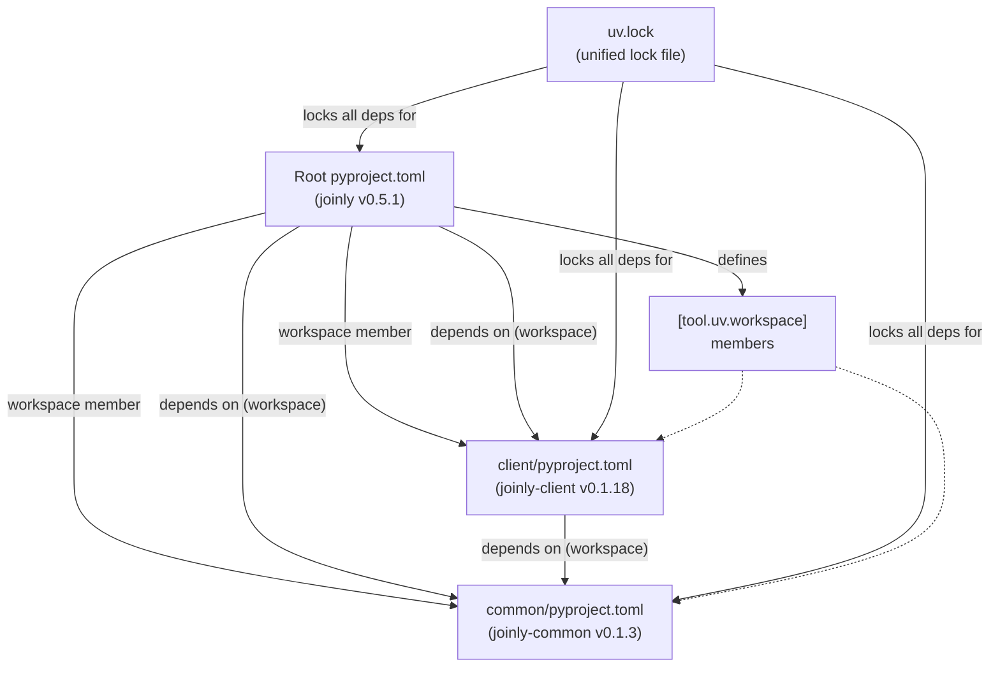
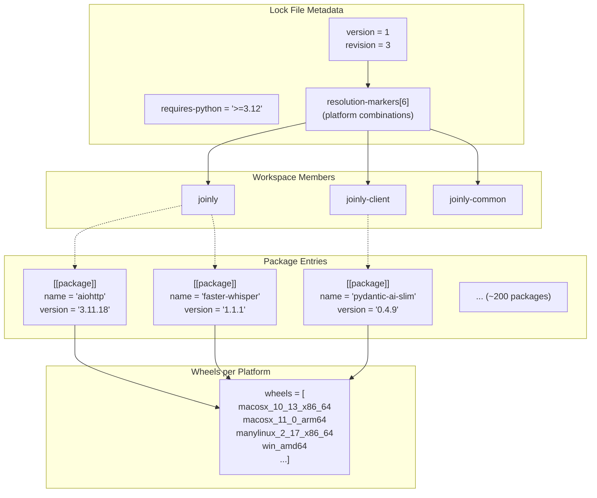
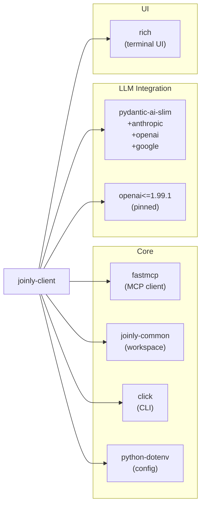
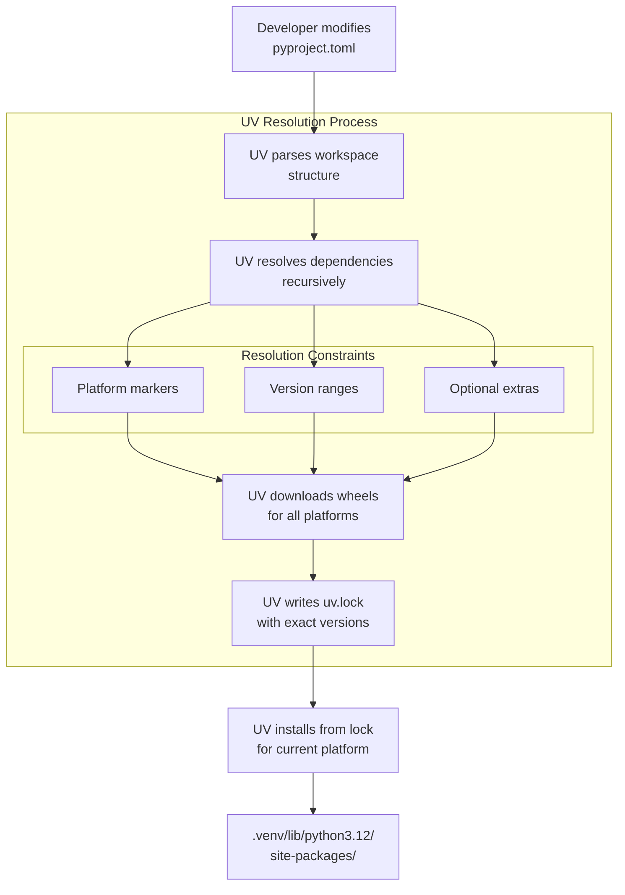
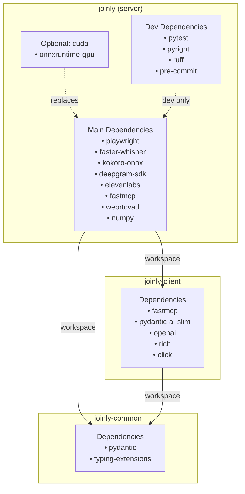

<!-- source: DeepWiki mcp.deepwiki.com · repo joinly-ai/joinly · page 8.2 Build System and Dependencies · fetched 2026-10-26 -->

# Build System and Dependencies

<details>
<summary>Relevant source files</summary>

The following files were used as context for generating this wiki page:

- [CHANGELOG.md](CHANGELOG.md)
- [client/pyproject.toml](client/pyproject.toml)
- [pyproject.toml](pyproject.toml)
- [uv.lock](uv.lock)

</details>


## Purpose and Scope

This document details the build system and dependency management for the joinly project. It covers the UV package manager configuration, workspace structure, dependency resolution and locking, and build system setup. For information about setting up a development environment, see [Development Environment Setup](#8.1). For deployment and Docker image variants, see [Docker Images and Variants](#9.1).

---

## Workspace Structure

The joinly project is organized as a UV workspace with three member packages that share a unified dependency lock file.

### Package Organization



**Workspace Configuration**

The root [pyproject.toml:61-65]() defines the workspace structure:

```toml
[tool.uv.workspace]
members = [
    "client",
    "common",
]
```

**Package Purposes**

| Package | Description | Entry Point |
|---------|-------------|-------------|
| `joinly` | Main server package with meeting automation, audio processing, and MCP server | `joinly` CLI → `joinly.main:cli` |
| `joinly-client` | Client SDK with conversational agent and MCP client | `joinly-client` CLI → `joinly_client.main:cli` |
| `joinly-common` | Shared types and utilities used by both packages | None (library only) |

**Sources:** [pyproject.toml:1-65](), [client/pyproject.toml:1-35](), [uv.lock:13-18]()

---

## UV Lock File System

The project uses UV's lock file system to ensure reproducible builds across all platforms and environments. The lock file captures exact dependency versions and platform-specific wheels.

### Lock File Structure



**Resolution Markers**

The lock file [uv.lock:4-11]() defines six resolution marker combinations to handle platform-specific dependencies:

1. `python_full_version >= '3.12.4' and platform_machine != 'aarch64' and sys_platform == 'linux'`
2. `python_full_version < '3.12.4' and platform_machine != 'aarch64' and sys_platform == 'linux'`
3. `python_full_version >= '3.12.4' and platform_machine == 'aarch64' and sys_platform == 'linux'`
4. `python_full_version < '3.12.4' and platform_machine == 'aarch64' and sys_platform == 'linux'`
5. `python_full_version >= '3.12.4' and sys_platform == 'darwin'`
6. `python_full_version < '3.12.4' and sys_platform == 'darwin'`

These markers ensure correct dependency resolution for different Python micro versions, CPU architectures (x86_64, aarch64), and operating systems (Linux, macOS, Windows).

**Package Entry Format**

Each package entry in [uv.lock]() contains:
- Package name and version
- Source registry URL
- Dependencies list
- Platform-specific wheel URLs with SHA256 hashes
- Source distribution (sdist) URL for packages without prebuilt wheels

**Sources:** [uv.lock:1-11](), [uv.lock:13-18](), [uv.lock:20-93]()

---

## Project Configuration

### Main Package (joinly)

The root [pyproject.toml]() configures the server package with comprehensive dependencies for meeting automation and audio processing.

**Core Dependencies**

| Category | Dependencies | Purpose |
|----------|--------------|---------|
| **HTTP/Networking** | `aiohttp`, `fastmcp` | Async HTTP client and MCP server framework |
| **Meeting Automation** | `playwright`, `pillow` | Browser automation and image processing |
| **Audio Processing** | `faster-whisper`, `webrtcvad-wheels`, `numpy` | STT with Whisper, VAD, audio manipulation |
| **Cloud Services** | `deepgram-sdk`, `elevenlabs` | Cloud STT and TTS providers |
| **Local TTS** | `kokoro-onnx`, `onnxruntime` | Local neural TTS engine |
| **Utilities** | `click`, `python-dotenv`, `semchunk` | CLI, config, text chunking |
| **Workspace** | `joinly-client`, `joinly-common` | Internal workspace dependencies |

**Dependency Declaration**

[pyproject.toml:10-27]() lists all main dependencies:

```toml
dependencies = [
    "aiohttp>=3.11.18",
    "click>=8.1.8",
    "deepgram-sdk>=4.1.1",
    "elevenlabs>=2.5.0",
    "faster-whisper>=1.1.1",
    "fastmcp>=2.10.5",
    "joinly-client>=0.1.18",
    "joinly-common>=0.1.3",
    "kokoro-onnx>=0.4.9",
    # ... more dependencies
]
```

**Workspace Sources**

[pyproject.toml:50-52]() configures workspace member sources:

```toml
[tool.uv.sources]
joinly-client = { workspace = true }
joinly-common = { workspace = true }
```

This tells UV to resolve these packages from the workspace instead of PyPI, enabling local development changes to propagate immediately.

**Sources:** [pyproject.toml:1-52]()

---

### Client Package (joinly-client)

The client package has a focused dependency set for LLM integration and MCP communication.

**Client Dependencies**



**Version Pinning Strategy**

The client uses an upper bound on `openai` [client/pyproject.toml:14]():

```toml
"openai<=1.99.1",
```

This prevents compatibility issues with newer OpenAI SDK releases while the project evaluates changes. See [CHANGELOG.md:83]() for context on this constraint.

**LLM Provider Extras**

[client/pyproject.toml:15]() includes all LLM provider extras:

```toml
"pydantic-ai-slim[anthropic,openai,google]>=0.4.9",
```

This enables support for Anthropic Claude, OpenAI GPT, and Google Gemini models.

**Sources:** [client/pyproject.toml:9-18]()

---

## Dependency Management

### Dependency Resolution Flow



**Transitive Dependencies**

The lock file resolves all transitive dependencies. For example, `faster-whisper` depends on:
- `av` (audio/video processing)
- `ctranslate2` (transformer models)
- `huggingface-hub` (model downloading)
- `tokenizers` (text tokenization)
- And their dependencies recursively

All ~200 packages in [uv.lock]() represent the complete transitive closure.

**Platform-Specific Wheels**

Many packages provide platform-specific binary wheels. Example from [uv.lock:173-192]() showing `av` wheels:

- `macosx_12_0_arm64.whl` (Apple Silicon)
- `macosx_12_0_x86_64.whl` (Intel Mac)
- `manylinux_2_17_x86_64.whl` (Linux x64)
- `manylinux_2_17_aarch64.whl` (Linux ARM64)
- `musllinux_1_2_x86_64.whl` (Alpine Linux)
- `win_amd64.whl` (Windows 64-bit)

UV selects the appropriate wheel based on the current platform during installation.

**Sources:** [uv.lock:1-18](), [uv.lock:170-192]()

---

### Optional Dependencies

The project defines optional dependency groups for specific use cases.

**CUDA Support**

[pyproject.toml:33-35]() defines a CUDA extra for GPU acceleration:

```toml
[project.optional-dependencies]
cuda = [
    "onnxruntime-gpu>=1.22.0",
]
```

This replaces the CPU-only `onnxruntime` with the GPU-enabled version, enabling:
- GPU-accelerated Whisper inference (faster-whisper uses ctranslate2 with CUDA)
- GPU-accelerated TTS inference (kokoro-onnx uses onnxruntime with CUDA)

Install with: `uv pip install -e ".[cuda]"`

**Development Dependencies**

[pyproject.toml:37-48]() defines development tools as a dependency group:

```toml
[dependency-groups]
dev = [
    "aiofiles>=24.1.0",
    "aiohttp>=3.11.18",
    "jiwer>=3.1.0",          # Word error rate metrics
    "pre-commit>=4.2.0",     # Git hooks
    "pyright>=1.1.399",      # Type checker
    "pytest>=8.3.5",         # Test framework
    "pytest-asyncio>=0.26.0", # Async test support
    "rich>=14.0.0",          # Terminal formatting
    "ruff>=0.11.6",          # Linter and formatter
]
```

Install with: `uv sync --group dev`

**Sources:** [pyproject.toml:32-48]()

---

### Cross-Package Dependency Graph



**Shared Dependencies**

Both server and client packages depend on:
- `fastmcp` - MCP protocol implementation
- `click` - CLI framework
- `python-dotenv` - Environment variable loading
- `joinly-common` - Shared types and utilities

These are resolved once in the lock file and installed once in the virtual environment.

**Sources:** [pyproject.toml:10-27](), [client/pyproject.toml:10-18]()

---

## Build System Configuration

### Hatchling Build Backend

All three packages use Hatchling as the build backend.

**Build System Declaration**

[pyproject.toml:54-56]() and [client/pyproject.toml:26-28]():

```toml
[build-system]
requires = ["hatchling"]
build-backend = "hatchling.build"
```

**Package Discovery**

[pyproject.toml:58-59]() configures which directories to include:

```toml
[tool.hatch.build.targets.wheel]
packages = ["joinly"]
```

This tells Hatchling to:
1. Look for a `joinly/` directory in the project root
2. Include it in the built wheel as the top-level package
3. Exclude test files, documentation, and other non-package files

Similarly, the client specifies [client/pyproject.toml:30-31]():

```toml
packages = ["joinly_client"]
```

**Build Artifacts**

Running `uv build` produces:
- `dist/joinly-0.5.1-py3-none-any.whl` - Installable wheel
- `dist/joinly-0.5.1.tar.gz` - Source distribution

**Sources:** [pyproject.toml:54-59](), [client/pyproject.toml:26-31]()

---

### Entry Points and CLI Commands

Both packages define CLI entry points that become executable commands after installation.

**Server Entry Point**

[pyproject.toml:29-30]():

```toml
[project.scripts]
joinly = "joinly.main:cli"
```

This creates a `joinly` command that calls the `cli` function in `joinly/main.py`.

**Client Entry Point**

[client/pyproject.toml:20-21]():

```toml
[project.scripts]
joinly-client = "joinly_client.main:cli"
```

This creates a `joinly-client` command that calls the `cli` function in `joinly_client/main.py`.

**Installation and Usage**

After `uv sync`:
```bash
# Server command
joinly --help

# Client command  
joinly-client --help
```

Or via `uv run` without installation:
```bash
uv run joinly --help
uv run joinly-client --help
```

**Sources:** [pyproject.toml:29-30](), [client/pyproject.toml:20-21]()

---

## Code Quality Configuration

### Ruff Linter and Formatter

[pyproject.toml:67-124]() configures Ruff for code linting and formatting:

**Basic Settings**

```toml
[tool.ruff]
line-length = 88
indent-width = 4
target-version = "py312"
```

**Lint Rules**

```toml
[tool.ruff.lint]
select = ["ALL"]  # Enable all rules
ignore = [
    "COM812",  # Trailing comma conflicts
    "D100",    # Missing module docstring
    "D104",    # Missing public package docstring
    "ISC001",  # Implicit string concatenation
    # ... more exceptions
]
```

**Per-File Overrides**

```toml
[tool.ruff.lint.extend-per-file-ignores]
"tests/**/*.py" = [
    "S101",  # Allow assert statements in tests
]
```

**Sources:** [pyproject.toml:67-124]()

---

### Pyright Type Checker

[pyproject.toml:126-142]() configures Pyright for static type checking:

```toml
[tool.pyright]
pythonVersion = "3.12"
typeCheckingMode = "standard"
include = [
    "joinly",
    "client",
    "common",
    "tests"
]
```

This enables type checking across all workspace members.

**Sources:** [pyproject.toml:126-142]()

---

### Pytest Configuration

[pyproject.toml:144-154]() configures pytest with async support:

```toml
[tool.pytest.ini_options]
asyncio_mode = "auto"
asyncio_default_fixture_loop_scope = "session"
testpaths = ["tests"]
python_files = ["test_*.py"]
log_cli = true
```

This enables:
- Automatic detection of async tests
- Session-scoped event loop for better performance
- CLI logging output during test runs

**Sources:** [pyproject.toml:144-154]()

---

## Dependency Version Strategy

### Version Constraints

The project uses different version constraint strategies based on dependency stability:

| Pattern | Example | Rationale |
|---------|---------|-----------|
| `>=X.Y.Z` | `aiohttp>=3.11.18` | Accept any version at or above, for stable libraries |
| `<=X.Y.Z` | `openai<=1.99.1` | Upper bound to prevent breaking changes |
| `>=X.Y.Z,<Y` | (none currently) | Major version lock |

**Critical Version Pins**

From [CHANGELOG.md:83-84]():
- `openai<=1.99.1` - Pinned due to breaking changes in 1.99.2+ that affect GPT-5 usage

**Sources:** [pyproject.toml:10-27](), [client/pyproject.toml:10-18](), [CHANGELOG.md:83-84]()

---

### Upgrade Strategy

To update dependencies:

1. **Update a specific package:**
   ```bash
   uv add "package>=X.Y.Z"
   ```

2. **Update all packages respecting constraints:**
   ```bash
   uv lock --upgrade
   ```

3. **Verify compatibility:**
   ```bash
   uv sync
   uv run pytest
   ```

4. **Update lock file only (no install):**
   ```bash
   uv lock
   ```

The lock file ensures all developers and CI/CD systems use identical dependency versions, preventing "works on my machine" issues.

**Sources:** [uv.lock:1-11]()

---

## Summary

The joinly build system leverages UV's workspace capabilities to manage three related packages with a unified lock file. Key characteristics:

1. **Workspace Structure** - Three packages (joinly, joinly-client, joinly-common) share dependencies and lock file
2. **Platform Support** - Lock file contains wheels for Linux (x64/ARM64), macOS (Intel/ARM), and Windows
3. **Flexible Configuration** - Optional CUDA support, development dependencies, and workspace sources
4. **Reproducible Builds** - UV lock file with exact versions and hashes ensures consistency
5. **Modern Tooling** - Hatchling build backend, Ruff linting, Pyright type checking, pytest async support

The dependency graph is optimized to minimize duplication while supporting both local development and cloud deployment scenarios.

**Sources:** [pyproject.toml:1-154](), [client/pyproject.toml:1-35](), [uv.lock:1-18]()

---

